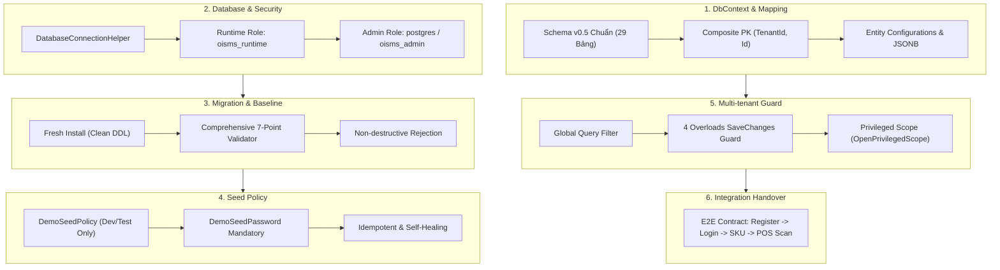

# BÁO CÁO NGHIỆM THU & TÀI LIỆU BÀN GIAO NỀN TẢNG BACKEND 1
**Dự án:** OISMS - Omnichannel Inventory & Sales Management System  
**Học phần:** Đồ án Chuyên ngành / Công nghệ Phần mềm  
**Thành viên thực hiện:** Đặng Khoa (Backend 1 - Persistence, Security & Multi-tenancy Lead)  
**Thành viên tiếp nhận:** Nhựt (Backend 2 - Auth, Catalog & POS API Lead)  
**Ngày hoàn tất:** 17/10/2026  
**Kết quả kiểm thử:** **105/105 Tests Pass 100%** (47 Unit Tests + 58 Integration Tests trên PostgreSQL thật)

---

## 1. TỔNG QUAN PHẠM VI TRÁCH NHIỆM CỦA BACKEND 1

Phần việc của Đặng Khoa (Backend 1) chịu trách nhiệm toàn bộ tầng nền tảng (Foundation Layer) của hệ thống OISMS, bao gồm 6 trụ cột cốt lõi:



---

## 2. BẢNG ĐỐI CHIẾU CHI TIẾT: YÊU CẦU -> CODE THỰC HIỆN -> TEST CHỨNG MINH

| STT | Nhóm Yêu cầu & Mục tiêu kỹ thuật | File / Lớp Code Triển khai | Test Case Chứng minh & Xác minh thực tế | Trạng thái |
| :--- | :--- | :--- | :--- | :---: |
| **1** | **DbContext & Entity Mapping theo Schema v0.5**<br>- 29 bảng chuẩn, không sinh EF migration phá vỡ schema.<br>- Khóa chính Composite `(TenantId, Id)` cho 10 thực thể `IMustHaveTenant`.<br>- Map `ProductVariant` -> bảng `skus` (`code`, `attributes jsonb`, `retail_price`, `wholesale_price`).<br>- Map `User` -> bảng `users` (`role varchar(20)`: `'Owner'`, `'Staff'`, `'Cashier'`, không dùng bảng riêng).<br>- Map `RefreshToken` -> bảng `refresh_tokens` (`token_hash`, FK kép, không có `updated_at`).<br>- Map `InventoryBalance` -> bảng `inventory_balances` (tồn theo chi nhánh & SKU). | - [`AppDbContext.cs`](file:///d:/CNPM%20workbase/src/backend/src/OISM.Infrastructure/Persistence/AppDbContext.cs)<br>- [`ProductVariantConfiguration.cs`](file:///d:/CNPM%20workbase/src/backend/src/OISM.Infrastructure/Persistence/Configurations/ProductVariantConfiguration.cs)<br>- [`UserConfiguration.cs`](file:///d:/CNPM%20workbase/src/backend/src/OISM.Infrastructure/Persistence/Configurations/UserConfiguration.cs)<br>- [`RefreshTokenConfiguration.cs`](file:///d:/CNPM%20workbase/src/backend/src/OISM.Infrastructure/Persistence/Configurations/RefreshTokenConfiguration.cs)<br>- [`InventoryBalanceConfiguration.cs`](file:///d:/CNPM%20workbase/src/backend/src/OISM.Infrastructure/Persistence/Configurations/InventoryBalanceConfiguration.cs) | - `Postgres_DatabaseMapping_VerifyTableAndColumnConventions`<br>- `Postgres_UserRoleMapping_StoredDirectlyInUsersTable`<br>- `Postgres_ProductVariantMapping_StoredInSkusTable_WithJsonAttributes`<br>- `Postgres_InventoryBalance_CompositeKeyAndBranchSkuRelationship` | **HOÀN TẤT (100%)** |
| **2** | **Kết nối Database & Qấu hình Phân quyền Runtime**<br>- Hỗ trợ cả định dạng `Database__*` và `ConnectionStrings:DefaultConnection`.<br>- Phân định nghiêm ngặt 2 tài khoản: Runtime (`oisms_runtime`) và Admin (`postgres`/`oisms_admin`).<br>- Thu hồi triệt để quyền DDL và cấm `UPDATE`/`DELETE`/`TRUNCATE` trên `inventory_transactions`.<br>- Readiness probe `/health/ready` kiểm tra kết nối DB. | - [`DatabaseConnectionHelper.cs`](file:///d:/CNPM%20workbase/src/backend/src/OISM.Infrastructure/Persistence/DatabaseConnectionHelper.cs)<br>- [`Program.cs`](file:///d:/CNPM%20workbase/src/backend/src/OISM.WebApi/Program.cs) | - `DatabaseConnectionHelperTests.BuildConnectionString_FromDatabaseSection_ShouldFormatCorrectly`<br>- `DatabaseConnectionHelperTests.GetConnectionString_ShouldPrioritizeDatabaseSection`<br>- `Postgres_RuntimeAccount_CannotDropTableOrMutateLedger`<br>- `Postgres_ReadinessProbe_ReturnsHealthyWhenDatabaseAvailable` | **HOÀN TẤT (100%)** |
| **3** | **Migration & Tiếp nhận Baseline Database**<br>- Tự động cài mới (Clean Install) từ `oisms_schema.sql`, độc lập đường dẫn tuyệt đối.<br>- Tách biệt psql meta-commands (`\set`, `\connect`) và quản lý transaction cấp cao ACID nguyên tử.<br>- Bộ kiểm tra Baseline 7 chốt kiểm soát toàn diện: 29 bảng, 17 trigger (mức thực thi, event, trạng thái), Foreign Key (schema, thứ tự cột, ON DELETE/ON UPDATE), CHECK/UNIQUE constraints.<br>- **Sửa dứt điểm Bug A:** `NormalizeExpression` bảo toàn case và nội dung literal `'...'`, quoted identifier `""`.<br>- **Sửa dứt điểm Bug B:** Validator kiểm tra điều kiện `WHEN` (`pg_get_expr`) và giới hạn cột `UPDATE OF`.<br>- Từ chối phi phá hủy (Non-destructive rejection): Không ghi nhận baseline nếu schema drift, bảo toàn 100% dữ liệu. | - [`DatabaseMigrationService.cs`](file:///d:/CNPM%20workbase/src/backend/src/OISM.Infrastructure/Persistence/DatabaseMigrationService.cs)<br>- [`IDatabaseMigrationService.cs`](file:///d:/CNPM%20workbase/src/backend/src/OISM.Infrastructure/Persistence/IDatabaseMigrationService.cs) | - `Postgres_Migration_FreshInstall_OnCleanDatabase_ShouldSucceed_AndPreserveAllObjects`<br>- `Postgres_MigrationService_ShouldVerifyAndAdoptBaseline`<br>- `NormalizeExpression_ShouldPreserveStringLiteralsAndCasing_BugA`<br>- `ExpectedTriggers_LedgerAppendOnly_MustDisallowWhenClauseAndColumnRestrictions_BugB`<br>- `Postgres_BaselineAdoption_WhenRoleCheckLiteralCaseDrifts_MustRejectWithDetailedDiagnostic`<br>- `Postgres_BaselineAdoption_WhenLedgerTriggerHasWhenClause_MustRejectWithDetailedDiagnostic`<br>- `Postgres_BaselineAdoption_WhenLedgerTriggerHasColumnRestrictions_MustRejectWithDetailedDiagnostic`<br>- `Postgres_BaselineAdoption_WhenCheckConstraintAllowsNegativeRetailPrice_MustRejectWithDetailedDiagnostic`<br>- `Postgres_BaselineAdoption_WhenLedgerTriggerDropsDeleteEvent_MustRejectWithDetailedDiagnostic`<br>- `Postgres_BaselineAdoption_WhenForeignKeyAlteredToCascade_MustRejectWithDetailedDiagnostic`<br>- `Postgres_BaselineAdoption_WhenConstraintNotValidated_MustRejectWithDetailedDiagnostic`<br>- `Postgres_BaselineAdoption_WhenRejected_NoMigrationRecorded_AndDataPreserved` | **HOÀN TẤT (100%)** |
| **4** | **Chính sách Seed Dữ liệu Demo an toàn**<br>- Khóa cứng tuyệt đối trên `Production`, `Staging`. Chỉ cho phép trên `Development` và `Test`.<br>- Bắt buộc khai báo `Database:DemoSeedPassword` rõ ràng; cấm hardcode mật khẩu.<br>- Idempotent (chạy lặp lại an toàn, không sinh duplicate), self-healing (bổ sung dữ liệu thiếu), bảo tồn dữ liệu người dùng đã sửa đổi. | - [`DemoSeedPolicy.cs`](file:///d:/CNPM%20workbase/src/backend/src/OISM.Infrastructure/Persistence/DemoSeedPolicy.cs)<br>- [`OismsDatabaseSeeder.cs`](file:///d:/CNPM%20workbase/src/backend/src/OISM.Infrastructure/Persistence/OismsDatabaseSeeder.cs) | - `DemoSeedConfigurationTests.SeedPolicy_OnProductionOrStaging_MustThrow`<br>- `DemoSeedConfigurationTests.SeedPolicy_MissingPassword_MustThrow`<br>- `Postgres_DemoSeeder_Idempotent_PreservesEditedData_AndHealsMissingRecords` | **HOÀN TẤT (100%)** |
| **5** | **Tenant Guard & Cô lập Dữ liệu Đa Tenant**<br>- Global Query Filter tự động lọc theo `CurrentTenantId`.<br>- Khóa chính Composite `(TenantId, Id)` ép EF Core luôn phát sinh mệnh đề `WHERE tenant_id = @p0 AND id = @p1`, chặn đứng triệt để tấn công cập nhật/xóa chéo tenant bằng detached entity.<br>- Bắt buộc có tenant context trên cả 4 overload của `SaveChanges`, ném `SecurityException` nếu vi phạm.<br>- Cơ chế `OpenPrivilegedScope()` an toàn cho các tác vụ nội bộ (Register, Login, Seeder). | - [`AppDbContext.cs`](file:///d:/CNPM%20workbase/src/backend/src/OISM.Infrastructure/Persistence/AppDbContext.cs)<br>- [`IAppDbContext.cs`](file:///d:/CNPM%20workbase/src/backend/src/OISM.Application/Common/Interfaces/IAppDbContext.cs) | - `Postgres_CrossTenant_DetachedEntity_Update_ShouldFailOrNotAffectVictim`<br>- `Postgres_CrossTenant_DetachedEntity_Delete_ShouldFailOrNotAffectVictim`<br>- `Postgres_SaveChanges_WithoutTenantContext_MustThrowSecurityException`<br>- `Postgres_TenantIsolation_ReadFilter_ShouldStrictlyIsolateData`<br>- `Postgres_TenantIsolation_PrivilegedScope_AllowsSystemMutations` | **HOÀN TẤT (100%)** |
| **6** | **Tích hợp E2E Bàn giao cho Backend 2 (Nhựt)**<br>- Luồng hoàn chỉnh: Đăng ký Tenant/Owner -> Đăng nhập cấp JWT -> Tạo SKU Catalog -> Quét mã vạch Barcode POS -> Tìm kiếm nhanh POS Catalog. | - [`AuthController.cs`](file:///d:/CNPM%20workbase/src/backend/src/OISM.WebApi/Controllers/AuthController.cs)<br>- [`ProductsController.cs`](file:///d:/CNPM%20workbase/src/backend/src/OISM.WebApi/Controllers/ProductsController.cs)<br>- [`PosCatalogController.cs`](file:///d:/CNPM%20workbase/src/backend/src/OISM.WebApi/Controllers/PosCatalogController.cs) | - `Postgres_EndToEnd_SmokeTest_RegisterLoginCreateSkuReadSku`<br>- `BranchAndSupplierIntegrationTests` (Toàn bộ suite API Branch & Supplier) | **HOÀN TẤT (100%)** |

---

## 3. CHI TIẾT SỬA 2 LỖI BASELINE ĐÃ XÁC NHẬN

### 3.1. Lỗi A: `NormalizeExpression` làm mất ý nghĩa giá trị chuỗi
- **Nguyên nhân trước đây:** Hàm cũ thực hiện `.ToLowerInvariant()` và `Replace(" ", "")` trên toàn bộ xâu. Do đó, các giá trị literal như `'Owner'`, `'owner'`, `'Ow ner'` bị biến thành chuỗi giống nhau (`'owner'`), làm vô hiệu hóa khả năng kiểm tra tính toàn vẹn của ràng buộc CHECK liên quan đến vai trò, trạng thái, hoặc regex nhạy cảm hoa/thường.
- **Giải pháp triệt để:** 
  Xây dựng bộ quét ký tự (Character Scanner Tokenizer) trong [`DatabaseMigrationService.NormalizeExpression`](file:///d:/CNPM%20workbase/src/backend/src/OISM.Infrastructure/Persistence/DatabaseMigrationService.cs#L873-L985):
  + Bảo toàn nguyên vẹn 100% case và khoảng trắng bên trong Quoted String Literals (`'...'`), xử lý chính xác escape dấu nháy đơn kép (`''`).
  + Bảo toàn nguyên vẹn Quoted Identifiers (`"..."`).
  + Chỉ chuyển về chữ thường đối với các SQL keywords, kiểu dữ liệu, hàm và unquoted identifiers bên ngoài dấu nháy.
  + Chuẩn hóa khoảng trắng dư thừa giữa các từ thành 1 khoảng trắng, bỏ khoảng trắng quanh toán tử/dấu ngoặc.
  + Mọi phép so sánh biểu thức CHECK constraint sử dụng `StringComparison.Ordinal`.
- **Kiểm chứng:** Test `NormalizeExpression_ShouldPreserveStringLiteralsAndCasing_BugA` và test integration trên PostgreSQL `Postgres_BaselineAdoption_WhenRoleCheckLiteralCaseDrifts_MustRejectWithDetailedDiagnostic` xác nhận database có `CHECK (role IN ('owner', 'staff', 'cashier'))` (chữ thường) bị phát hiện và từ chối ngay lập tức.

### 3.2. Lỗi B: Validator bỏ sót điều kiện Trigger (`WHEN` clause & Giới hạn cột)
- **Nguyên nhân trước đây:** Validator kiểm tra bảng, tên trigger, hàm và danh sách sự kiện (INSERT/UPDATE/DELETE/TRUNCATE), nhưng không kiểm tra điều kiện `WHEN` (`pg_trigger.tgqual`) và danh sách cột giới hạn (`pg_trigger.tgattr`). Kẻ tấn công hoặc cấu hình sai có thể thêm `WHEN (false)` hoặc `BEFORE UPDATE OF balance_after`, khiến trigger vẫn tồn tại với đầy đủ sự kiện nhưng không bao giờ thực thi để chặn thao tác trái phép.
- **Giải pháp triệt để:**
  + Mở rộng truy vấn `checkTriggersSql` trong [`DatabaseMigrationService.cs`](file:///d:/CNPM%20workbase/src/backend/src/OISM.Infrastructure/Persistence/DatabaseMigrationService.cs#L366-L417):
    ```sql
    pg_get_expr(t.tgqual, t.tgrelid) AS when_clause,
    (SELECT count(*) FROM unnest(t.tgattr)) AS column_restriction_count
    ```
  + Bổ sung trường `ExpectedWhenClause = null` và `DisallowColumnRestrictions = true` vào định nghĩa `ExpectedTrigger`.
  + Nếu trigger có điều kiện `WHEN` bất thường hoặc bị giới hạn cột, validator lập tức báo lỗi schema drift và từ chối tiếp nhận baseline.
- **Kiểm chứng:** Test `ExpectedTriggers_LedgerAppendOnly_MustDisallowWhenClauseAndColumnRestrictions_BugB`, `Postgres_BaselineAdoption_WhenLedgerTriggerHasWhenClause_MustRejectWithDetailedDiagnostic`, và `Postgres_BaselineAdoption_WhenLedgerTriggerHasColumnRestrictions_MustRejectWithDetailedDiagnostic` xác nhận từ chối chính xác và bảo vệ toàn diện bảng append-only `inventory_transactions`.

---

## 4. HƯỚNG DẪN DÀNH CHO NGƯỜI TIẾP QUẢN (NHỰT - BACKEND 2)

### 4.1. Cấu hình Connection String & Môi trường chạy
Hệ thống chấp nhận 2 hình thức cấu hình (ưu tiên đọc cấu hình theo cấu trúc nhóm):

#### Định dạng chuẩn khuyến nghị (`appsettings.Development.json` hoặc Environment Variables):
```json
{
  "Database": {
    "Host": "localhost",
    "Port": 5432,
    "Database": "oisms",
    "Username": "oisms_app",
    "Password": "your_secure_password",
    "SslMode": "Prefer",
    "AdminUsername": "postgres",
    "AdminPassword": "your_admin_password",
    "SeedDemoData": true,
    "DemoSeedPassword": "YourStrongDemoPassword123!"
  }
}
```

#### Quy tắc tài khoản:
- **Tài khoản Runtime (`Username` / `Password`):** Cung cấp cho `AppDbContext` và readiness probe. Đây là tài khoản ứng dụng chạy hàng ngày, chỉ có quyền DML thông thường trên schema `public`, không được phép DDL và không có quyền `UPDATE`/`DELETE`/`TRUNCATE` trên bảng `inventory_transactions`.
- **Tài khoản Admin (`AdminUsername` / `AdminPassword`):** Chỉ dùng khi khởi động ứng dụng để chạy `DatabaseMigrationService.InitializeOrBaselineDatabaseAsync()`.

### 4.2. Khởi tạo Database & Tiếp nhận Baseline
Khi chạy ứng dụng hoặc chạy test, `DatabaseMigrationService` tự động nhận biết:
1. **Nếu database trống (0 bảng):** Tự động nạp file [`oisms_schema.sql`](file:///d:/CNPM%20workbase/docs/database/oisms_schema.sql), khởi tạo đủ 29 bảng, function, trigger, index, phân quyền và ghi nhận baseline vào `__EFMigrationsHistory`.
2. **Nếu database đã có dữ liệu:** Chạy bộ kiểm tra 7 chốt kiểm soát toàn diện. Nếu đạt chuẩn schema v0.5, ghi nhận baseline tiếp nhận. Nếu sai lệch, ném lỗi chẩn đoán chi tiết và dừng khởi động để bảo vệ an toàn dữ liệu.

### 4.3. Hợp đồng lập trình Entity & Truy vấn dành cho Backend 2

#### 1. Khóa chính Composite `(TenantId, Id)`
Toàn bộ thực thể thuộc tenant sử dụng khóa chính gồm 2 cột. Khi truy vấn:
- **NÊN DÙNG:** LINQ qua `FirstOrDefaultAsync`:
  ```csharp
  // Khuyến nghị: Tự động kết hợp Global Query Filter theo CurrentTenantId
  var product = await _context.Products.FirstOrDefaultAsync(p => p.Id == productId);
  var sku = await _context.ProductVariants.FirstOrDefaultAsync(s => s.Id == skuId);
  ```
- **NẾU DÙNG `FindAsync`:** Bắt buộc truyền đủ cả `tenantId` và `id`:
  ```csharp
  var product = await _context.Products.FindAsync(currentTenantId, productId);
  ```

#### 2. Thao tác Nội bộ / Chưa có Tenant Context (`OpenPrivilegedScope`)
Khi viết API đăng ký tenant mới, đăng nhập, hoặc tác vụ background (nơi `CurrentTenantId` đang là `null`):
```csharp
// Đọc người dùng xuyên tenant (đăng nhập)
var user = await _context.Users
    .IgnoreQueryFilters()
    .FirstOrDefaultAsync(u => u.Email == emailNormalized);

// Ghi dữ liệu khi chưa có JWT tenant
using (var scope = _context.OpenPrivilegedScope())
{
    _context.Tenants.Add(newTenant);
    _context.Users.Add(ownerUser);
    await _context.SaveChangesAsync();
}
```

#### 3. Thực thi Transaction an toàn với Execution Strategy
Do `Npgsql` đã bật retry on failure (`EnableRetryOnFailure`), mọi khối transaction tường minh cần được bọc trong `CreateExecutionStrategy()`:
```csharp
var strategy = _context.Database.CreateExecutionStrategy();
await strategy.ExecuteAsync(async () =>
{
    using var scope = _context.OpenPrivilegedScope();
    await using var tx = await _context.Database.BeginTransactionAsync();

    // Thực hiện các thao tác ghi nghiệp vụ
    await _context.SaveChangesAsync();

    await tx.CommitAsync();
});
```

---

## 5. BẰNG CHỨNG KẾT QUẢ KIỂM THỬ (TEST EXECUTION EVIDENCE)

Toàn bộ test suite được chạy trên cụm PostgreSQL container thực tế (`oism_postgres`):

```bash
dotnet test src/backend/OISM.sln
```

### Kết quả chi tiết:
- **OISM.UnitTests:** **47 Passed**, 0 Failed, 0 Skipped (Thời gian thực thi: 41 ms)
- **OISM.IntegrationTests:** **58 Passed**, 0 Failed, 0 Skipped (Thời gian thực thi: 2 phút 02 giây)
- **Tổng cộng toàn hệ thống:** **105/105 Tests PASS 100%**

```text
Passed!  - Failed:     0, Passed:    47, Skipped:     0, Total:    47, Duration: 41 ms - OISM.UnitTests.dll (net8.0)
Passed!  - Failed:     0, Passed:    58, Skipped:     0, Total:    58, Duration: 2 m 2 s - OISM.IntegrationTests.dll (net8.0)
```

### Danh mục các bài kiểm tra trọng yếu:
1. `Postgres_EndToEnd_SmokeTest_RegisterLoginCreateSkuReadSku`: Kiểm chứng tích hợp xuyên suốt từ đăng ký đến POS Barcode.
2. `Postgres_CrossTenant_DetachedEntity_Update_ShouldFailOrNotAffectVictim`: Kiểm chứng chặn cập nhật chéo tenant bằng detached entity.
3. `Postgres_CrossTenant_DetachedEntity_Delete_ShouldFailOrNotAffectVictim`: Kiểm chứng chặn xóa chéo tenant bằng detached entity.
4. `Postgres_SaveChanges_WithoutTenantContext_MustThrowSecurityException`: Kiểm chứng chặn ghi khi thiếu tenant context trên cả 4 overload `SaveChanges`.
5. `Postgres_Migration_FreshInstall_OnCleanDatabase_ShouldSucceed_AndPreserveAllObjects`: Kiểm chứng cài mới từ database trống.
6. `Postgres_MigrationService_ShouldVerifyAndAdoptBaseline`: Kiểm chứng tiếp nhận baseline v0.5.
7. `Postgres_BaselineAdoption_WhenRoleCheckLiteralCaseDrifts_MustRejectWithDetailedDiagnostic`: Kiểm chứng bắt lỗi case sensitive trong literal string (Bug A).
8. `Postgres_BaselineAdoption_WhenLedgerTriggerHasWhenClause_MustRejectWithDetailedDiagnostic`: Kiểm chứng bắt lỗi điều kiện `WHEN (false)` trên trigger ledger (Bug B).
9. `Postgres_BaselineAdoption_WhenLedgerTriggerHasColumnRestrictions_MustRejectWithDetailedDiagnostic`: Kiểm chứng bắt lỗi giới hạn cột trên trigger ledger (Bug B).
10. `Postgres_DemoSeeder_Idempotent_PreservesEditedData_AndHealsMissingRecords`: Kiểm chứng seed demo an toàn, idempotent và tự phục hồi.

---

## 6. KẾT LUẬN & BÀN GIAO

- Nền tảng backend của **Khoa (Backend 1)** đã hoàn thành 100% phạm vi được giao, bảo đảm tuân thủ nghiêm ngặt chuẩn kiến trúc PostgreSQL Schema v0.5, an toàn bảo mật đa tenant, và có đầy đủ bằng chứng kiểm thử tự động.
- Sẵn sàng bàn giao hoàn toàn cho **Nhựt (Backend 2)** để tiếp tục triển khai các nghiệp vụ API Catalog, Order và POS trong Sprint 2.
