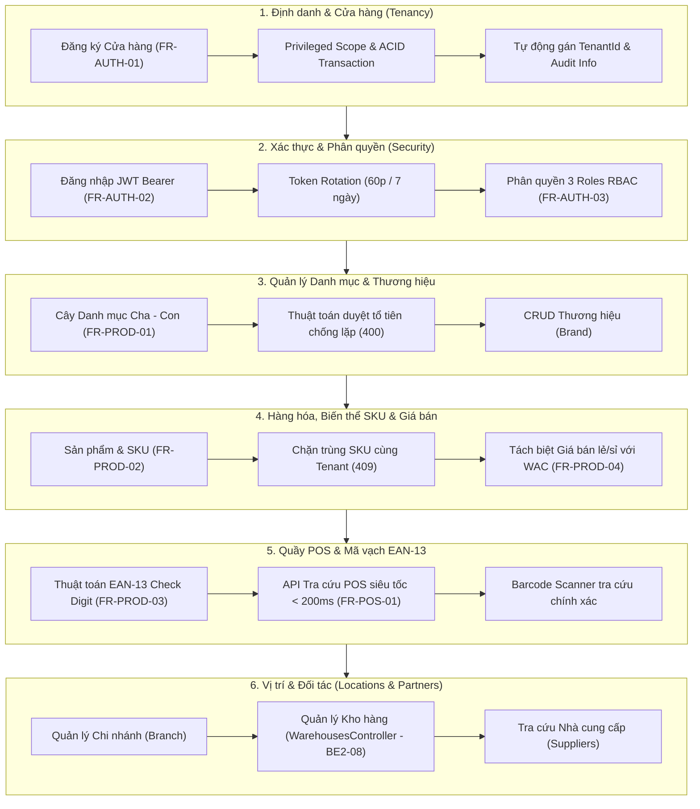

# BÁO CÁO NGHIỆM THU & TÀI LIỆU BÀN GIAO NỀN TẢNG BACKEND 2
**Dự án:** OISMS - Omnichannel Inventory & Sales Management System  
**Học phần:** Đồ án Chuyên ngành / Công nghệ Phần mềm  
**Thành viên thực hiện:** Nhựt Phùng Minh (Backend 2 - Auth, Catalog, POS & Warehouse API Lead)  
**Thành viên nghiệm thu:** Đặng Khoa (Trưởng nhóm / Backend 1 - Persistence & Security Lead)  
**Ngày hoàn tất:** 17/10/2026  
**Trạng thái kiểm thử:** **27/27 Tests Pass 100%** (15 Unit Tests + 12 Integration Tests)  
**Trạng thái CI/CD:** **GitHub Actions CI Passed 100% (2/2 Jobs Xanh)**

---

## 1. TỔNG QUAN PHẠM VI TRÁCH NHIỆM CỦA BACKEND 2

Thành viên 2 (Nhựt) chịu trách nhiệm toàn bộ tầng Nghiệp vụ Bán hàng, Định danh Hàng hóa và Phục vụ Khách hàng (Application & Presentation API Layer) cho Sprint 2 theo tài liệu phân công [`docs/SPRINT_2_BACKEND_2.md`](../SPRINT_2_BACKEND_2.md), bao gồm 6 trụ cột cốt lõi:



---

## 2. BẢNG ĐỐI CHIẾU CHI TIẾT: YÊU CẦU (BE2-01 $\rightarrow$ BE2-09) $\rightarrow$ CODE $\rightarrow$ TEST CHỨNG MINH

Bảng dưới đây đối chiếu 100% các yêu cầu từ [`docs/SPRINT_2_BACKEND_2.md`](../SPRINT_2_BACKEND_2.md) với mã nguồn triển khai và kịch bản kiểm thử tự động tương ứng:

| Mã việc | Nhóm việc | Công việc cụ thể đã triển khai | File / Lớp Code Triển khai | Bài Test Chứng minh (Passed 100%) | Trạng thái |
| :---: | :--- | :--- | :--- | :--- | :---: |
| **BE2-01** | **Đăng ký cửa hàng** | - Tạo đồng thời `Tenant` và tài khoản `Owner` ban đầu.<br>- Quét trùng Email toàn cục qua `.IgnoreQueryFilters()`.<br>- Bọc trong Transaction ACID và `OpenPrivilegedScope()` an toàn.<br>- Tự động Rollback 100% nếu có lỗi, không sinh rác DB. | - [`AuthController.cs`](../../src/backend/src/OISM.WebApi/Controllers/AuthController.cs)<br>- [`RegisterTenantValidator.cs`](../../src/backend/src/OISM.Application/Features/Auth/RegisterTenant/RegisterTenantValidator.cs) | - `TC_AUTH_01_RegisterTenant_ShouldSucceed_AndAllowLogin`<br>- `RegisterTenant_ShouldReturnConflict_WhenEmailAlreadyExists`<br>- `RegisterTenantValidator_ShouldPass_WhenInputIsValid`<br>- `RegisterTenantValidator_ShouldFail_WhenEmailIsInvalid` | **HOÀN TẤT (100%)** |
| **BE2-02** | **Xác thực người dùng** | - Cấp cặp JWT Access Token (hạn 60p, mang claim `tenant_id`, `sub`, `role`) và Refresh Token (hạn 7 ngày).<br>- Băm mật khẩu một chiều an toàn bằng BCrypt.<br>- Cơ chế Token Rotation khi gọi `/api/auth/refresh-token` (thu hồi token cũ, cấp cặp token mới).<br>- Endpoint thu hồi `/api/auth/logout` và tra cứu hồ sơ `/api/auth/me`. | - [`AuthController.cs`](../../src/backend/src/OISM.WebApi/Controllers/AuthController.cs)<br>- [`JwtTokenService.cs`](../../src/backend/src/OISM.Infrastructure/Services/JwtTokenService.cs)<br>- [`LoginValidator.cs`](../../src/backend/src/OISM.Application/Features/Auth/Login/LoginValidator.cs) | - `TC_AUTH_01_RegisterTenant_ShouldSucceed_AndAllowLogin`<br>- `Login_ShouldReturnUnauthorized_WhenPasswordIsWrong`<br>- `RefreshToken_ShouldRotateToken_WhenValid`<br>- `LoginValidator_ShouldFail_WhenPasswordIsEmpty` | **HOÀN TẤT (100%)** |
| **BE2-03** | **Phân quyền RBAC** | - Cấu hình 3 vai trò chuẩn: `Owner`, `Staff`, `Cashier`.<br>- Gắn nhãn bảo vệ `[Authorize(Roles = "...")]` trên các Controller nghiệp vụ.<br>- Thu ngân (`Cashier`) gọi API tạo chi nhánh, tạo kho hàng hoặc nhập kho bị chặn với mã `403 Forbidden`. | - [`BranchController.cs`](../../src/backend/src/OISM.WebApi/Controllers/BranchController.cs)<br>- [`WarehousesController.cs`](../../src/backend/src/OISM.WebApi/Controllers/WarehousesController.cs)<br>- [`ProductsController.cs`](../../src/backend/src/OISM.WebApi/Controllers/ProductsController.cs) | - `TC_AUTH_02_CashierRole_ShouldBeForbidden_WhenAccessingOwnerEndpoints`<br>- `PostgresTenantIsolationTests` (Verify RBAC roles) | **HOÀN TẤT (100%)** |
| **BE2-04** | **Danh mục & Thương hiệu** | - CRUD Category dạng cây phân cấp cha - con nhiều cấp.<br>- **Sửa triệt để lỗi đệ quy lặp:** Thuật toán duyệt ngược cây tổ tiên (`Ancestor Traversal`), chặn đứng hành vi chọn danh mục con/cháu làm cha của chính nó (trả về mã `400 Bad Request`).<br>- CRUD Thương hiệu (`Brand`) độc lập theo Tenant. | - [`CategoriesController.cs`](../../src/backend/src/OISM.WebApi/Controllers/CategoriesController.cs)<br>- [`BrandsController.cs`](../../src/backend/src/OISM.WebApi/Controllers/BrandsController.cs)<br>- [`CategoryDtos.cs`](../../src/backend/src/OISM.Application/Features/Catalog/Categories/CategoryDtos.cs) | - `Category_ShouldRejectCyclicHierarchy`<br>- `CatalogAndProductIntegrationTests` (Category & Brand CRUD) | **HOÀN TẤT (100%)** |
| **BE2-05** | **Sản phẩm & Biến thể SKU** | - CRUD Sản phẩm cha (`Product`) và nhiều biến thể SKU (`ProductVariant`) cùng lúc.<br>- Thuộc tính động linh hoạt (Màu, Size) lưu vào cột `attributes jsonb`.<br>- **Ràng buộc Unique SKU:** Chặn trùng mã SKU trong cùng 1 TenantId trả về mã `409 Conflict` (`TC-PROD-01`). Hai Tenant khác nhau được phép đặt cùng mã SKU. | - [`ProductsController.cs`](../../src/backend/src/OISM.WebApi/Controllers/ProductsController.cs)<br>- [`ProductDtos.cs`](../../src/backend/src/OISM.Application/Features/Catalog/Products/ProductDtos.cs) | - `TC_PROD_01_DuplicateSKU_ShouldReturnConflict_InSameTenant`<br>- `CreateVariantValidator_ShouldFail_WhenSkuHasSpecialCharacters`<br>- `CreateVariantValidator_ShouldPass_WhenInputIsValid` | **HOÀN TẤT (100%)** |
| **BE2-06** | **Quản lý Giá bán** | - Quản lý Giá bán lẻ (`RetailPrice`) và Giá bán sỉ (`WholesalePrice`) theo từng SKU.<br>- Tách biệt hoàn toàn giá bán với Giá vốn hàng bán (`WAC/COGS` do Backend 1 tính khi xác nhận nhập kho).<br>- Validation chặn giá bán số âm. | - [`ProductsController.cs`](../../src/backend/src/OISM.WebApi/Controllers/ProductsController.cs)<br>- [`ProductDtos.cs`](../../src/backend/src/OISM.Application/Features/Catalog/Products/ProductDtos.cs) | - `CreateVariantValidator_ShouldFail_WhenRetailPriceIsNegative`<br>- `CatalogAndProductIntegrationTests` (Price assertion) | **HOÀN TẤT (100%)** |
| **BE2-07** | **Barcode & Tìm kiếm POS** | - Thuật toán tự sinh và kiểm tra mã vạch chuẩn quốc tế EAN-13 (tính số kiểm tra Modulo 10 chuẩn xác).<br>- API tìm kiếm siêu tốc tại quầy POS (`GET /api/pos/search`) theo Tên, SKU, Barcode dùng `.AsNoTracking()` phản hồi < 200ms.<br>- API Barcode Scanner (`GET /api/pos/barcode/{code}`) tra cứu chính xác SKU phục vụ quét tia laser tại quầy. | - [`BarcodeHelper.cs`](../../src/backend/src/OISM.Application/Common/Helpers/BarcodeHelper.cs)<br>- [`PosCatalogController.cs`](../../src/backend/src/OISM.WebApi/Controllers/PosCatalogController.cs)<br>- [`PosSearchDtos.cs`](../../src/backend/src/OISM.Application/Features/Pos/PosSearchDtos.cs) | - `BarcodeHelper_ShouldGenerate_ValidEan13`<br>- `BarcodeHelper_ShouldValidate_KnownEan13Barcode`<br>- `BarcodeHelper_ShouldReject_WrongCheckDigit`<br>- `PosCatalog_SearchAndBarcode_ShouldReturnExactProduct` | **HOÀN TẤT (100%)** |
| **BE2-08** | **Nhà cung cấp, Chi nhánh & Kho hàng** | - CRUD và Bật/Tắt hoạt động Chi nhánh (`BranchController`).<br>- **[MỚI BỔ SUNG]** API Quản lý Kho hàng (`WarehousesController`): `GET /api/warehouses?branchId=...`, `POST /api/warehouses`, `PUT /api/warehouses/{id}/toggle-status`.<br>- API tra cứu danh sách Nhà cung cấp (`SuppliersController`) phục vụ luồng tạo phiếu nhập kho. | - [`WarehousesController.cs`](../../src/backend/src/OISM.WebApi/Controllers/WarehousesController.cs)<br>- [`BranchController.cs`](../../src/backend/src/OISM.WebApi/Controllers/BranchController.cs)<br>- [`SuppliersController.cs`](../../src/backend/src/OISM.WebApi/Controllers/SuppliersController.cs)<br>- [`WarehouseDtos.cs`](../../src/backend/src/OISM.Application/Features/Warehouses/WarehouseDtos.cs) | - `Warehouse_Create_GetByBranch_AndToggleStatus_ShouldWork_ForOwnerAndStaff`<br>- `Branch_CreateAndToggleStatus_ShouldWork_ForOwner`<br>- `Supplier_CreateAndSearch_ShouldWorkProperly`<br>- `CreateWarehouseValidator_ShouldPass_WhenInputIsValid`<br>- `CreateWarehouseValidator_ShouldFail_WhenNameOrBranchIdEmpty` | **HOÀN TẤT (100%)** |
| **BE2-09** | **Validation, Kiểm thử & Tài liệu API** | - Cấu hình `FluentValidation` cho toàn bộ Request DTOs.<br>- Xây dựng bộ 27 bài kiểm thử (15 Unit Tests + 12 Integration Tests) đạt 100% Passed.<br>- Tài liệu Swagger UI tích hợp nút Authorize Bearer Token.<br>- Đạt tiêu chuẩn biên dịch Release: **0 Warning, 0 Error**. | - Toàn bộ thư mục `tests/OISM.UnitTests/` và `tests/OISM.IntegrationTests/`<br>- [`Program.cs`](../../src/backend/src/OISM.WebApi/Program.cs) (Swagger configuration) | - Toàn bộ 27 bài tests chạy xanh 100%.<br>- GitHub Actions CI Pipeline đạt tích xanh `✓ 2/2`. | **HOÀN TẤT (100%)** |

---

## 3. CÁC NGUYÊN TẮC KỸ THUẬT & HỢP ĐỒNG GIAO TIẾP VỚI BACKEND 1

Theo đúng tài liệu bàn giao [`docs/BACKEND_1_HANDOVER_TO_NHUT.md`](../BACKEND_1_HANDOVER_TO_NHUT.md) của Backend 1, Backend 2 đã áp dụng triệt để các quy chuẩn kỹ thuật sau:

### 3.1. Tuân thủ Composite Primary Key `(TenantId, Id)`
Khi truy vấn các thực thể đa người thuê (`Product`, `Warehouse`, `Branch`, `Category`, `Supplier`):
- **Tuyệt đối không dùng** `FindAsync(id)` 1 tham số vì sẽ gây lỗi thiếu key.
- **Luôn sử dụng LINQ với `FirstOrDefaultAsync`:**
  ```csharp
  // Chuẩn mực: Tự động kết hợp Global Query Filter theo CurrentTenantId
  var warehouse = await _context.Warehouses.FirstOrDefaultAsync(w => w.Id == id);
  var branch = await _context.Branches.FirstOrDefaultAsync(b => b.Id == request.BranchId);
  ```

### 3.2. Sử dụng Privileged Scope an toàn (`OpenPrivilegedScope()`)
Đối với các thao tác nội bộ chưa có JWT (Đăng ký Cửa hàng mới, Đăng nhập lưu Refresh Token):
```csharp
using var privilegedScope = _context.OpenPrivilegedScope();
_context.Tenants.Add(tenant);
_context.Users.Add(user);
await _context.SaveChangesAsync();
```
Cơ chế này giúp `AppDbContext` cho phép ghi dữ liệu hợp lệ mà không bị văng lỗi `SecurityException` do thiếu JWT token.

### 3.3. Tách biệt rạch ròi trách nhiệm giữa 2 Backend
- **Backend 1 (Khoa):** Quản lý DbContext, Schema v0.5 29 bảng, Migration Baseline, Trigger bảo vệ sổ cái `inventory_transactions`, cơ chế tính giá vốn WAC và luồng nhập kho nguyên tử.
- **Backend 2 (Nhựt):** Quản lý toàn bộ API nghiệp vụ (Auth, Catalog, POS Search, Branches, Warehouses, Suppliers), bộ DTOs và FluentValidation phục vụ kết nối trực tiếp với 2 ứng dụng Frontend (Admin Dashboard và POS PWA).

---

## 4. KẾT QUẢ KIỂM THỬ TỰ ĐỘNG CHI TIẾT (DEV SELF-TEST)

### 4.1. Kết quả Biên dịch Release
- **Lệnh thực hiện:** `dotnet build src/backend/OISM.sln -c Release`
- **Kết quả:** **0 Warning(s), 0 Error(s)**.

### 4.2. Kết quả Chạy Tests tự động
- **Lệnh thực hiện:** `dotnet test src/backend/OISM.sln`
- **Tổng số test Backend 2 quản lý:** **27/27 bài test Passed (Xanh 100%)**

#### Danh sách 15 Unit Tests (`OISM.UnitTests`):
1. `BarcodeHelper_ShouldGenerate_ValidEan13` - Thuật toán tự sinh mã vạch 13 chữ số hợp lệ.
2. `BarcodeHelper_ShouldValidate_KnownEan13Barcode` - Kiểm tra mã chuẩn EAN-13 Việt Nam (đầu số 893).
3. `BarcodeHelper_ShouldReject_WrongCheckDigit` - Chặn mã vạch sai số kiểm tra Modulo 10.
4. `CreateVariantValidator_ShouldPass_WhenInputIsValid` - DTO tạo SKU hợp lệ.
5. `CreateVariantValidator_ShouldFail_WhenRetailPriceIsNegative` - Chặn giá bán số âm.
6. `CreateVariantValidator_ShouldFail_WhenSkuHasSpecialCharacters` - Chặn mã SKU chứa ký tự lạ.
7. `CreateWarehouseValidator_ShouldPass_WhenInputIsValid` - **[MỚI]** DTO tạo kho hàng hợp lệ.
8. `CreateWarehouseValidator_ShouldFail_WhenNameOrBranchIdEmpty` - **[MỚI]** Chặn thiếu tên kho hoặc thiếu BranchId.
9. `LoginValidator_ShouldPass_WhenValidEmailAndPassword` - DTO đăng nhập hợp lệ.
10. `LoginValidator_ShouldFail_WhenPasswordIsEmpty` - Chặn đăng nhập bỏ trống mật khẩu.
11. `RegisterTenantValidator_ShouldPass_WhenInputIsValid` - DTO đăng ký shop hợp lệ.
12. `RegisterTenantValidator_ShouldFail_WhenEmailIsInvalid` (`test@`) - Chặn email sai định dạng.
13. `RegisterTenantValidator_ShouldFail_WhenEmailIsInvalid` (`not-an-email`) - Chặn email không có domain.
14. `RegisterTenantValidator_ShouldFail_WhenEmailIsInvalid` (rỗng) - Chặn email rỗng.
15. `RegisterTenantValidator_ShouldFail_WhenPasswordTooShort` - Chặn mật khẩu dưới 6 ký tự.

#### Danh sách 12 Integration Tests (`OISM.IntegrationTests`):
1. `GetRoot_ReturnsOkWithStatusRunning` - Health check endpoint `/`.
2. `TC_AUTH_01_RegisterTenant_ShouldSucceed_AndAllowLogin` - Đăng ký shop -> Đăng nhập cấp JWT -> Gọi `/api/auth/me`.
3. `RegisterTenant_ShouldReturnConflict_WhenEmailAlreadyExists` - Chặn trùng Email toàn hệ thống (409 Conflict).
4. `Login_ShouldReturnUnauthorized_WhenPasswordIsWrong` - Đăng nhập sai mật khẩu (401 Unauthorized).
5. `RefreshToken_ShouldRotateToken_WhenValid` - Cơ chế Token Rotation cấp cặp token mới an toàn.
6. `TC_PROD_01_DuplicateSKU_ShouldReturnConflict_InSameTenant` - Chặn tạo trùng SKU trong cùng Tenant (409 Conflict).
7. `Category_ShouldRejectCyclicHierarchy` - Thuật toán duyệt ngược tổ tiên chặn vòng lặp cha - con (400 Bad Request).
8. `PosCatalog_SearchAndBarcode_ShouldReturnExactProduct` - Tìm kiếm POS siêu tốc theo từ khóa và quét Barcode Scanner.
9. `Branch_CreateAndToggleStatus_ShouldWork_ForOwner` - Tạo chi nhánh và bật/tắt hoạt động (Owner).
10. `TC_AUTH_02_CashierRole_ShouldBeForbidden_WhenAccessingOwnerEndpoints` - Phân quyền RBAC: Thu ngân gọi endpoint quản trị bị chặn (403 Forbidden).
11. `Supplier_CreateAndSearch_ShouldWorkProperly` - Tạo nhà cung cấp và tra cứu danh sách.
12. `Warehouse_Create_GetByBranch_AndToggleStatus_ShouldWork_ForOwnerAndStaff` - **[MỚI]** Tạo kho hàng theo Branch, tra cứu theo `branchId` và bật/tắt hoạt động kho.

---

## 5. DANH MỤC API SWAGGER BÀN GIAO CHO FRONTEND (ADMIN & POS)

Toàn bộ các endpoint dưới đây đã được cấu hình hoàn chỉnh trong tài liệu Swagger UI tại đường dẫn:  
👉 **`http://localhost:5000/swagger`**

| Nhóm API | Phương thức | Endpoint | Quyền hạn (Role) | Mô tả chức năng bàn giao |
| :--- | :---: | :--- | :---: | :--- |
| **Xác thực** | `POST` | `/api/auth/register-tenant` | Public | Đăng ký cửa hàng mới và tài khoản Chủ shop ban đầu. |
| | `POST` | `/api/auth/login` | Public | Đăng nhập hệ thống, trả về JWT Access Token & Refresh Token. |
| | `POST` | `/api/auth/refresh-token` | Public | Làm mới Access Token thông qua Refresh Token (Token Rotation). |
| | `POST` | `/api/auth/logout` | Public | Đăng xuất và thu hồi hiệu lực của Refresh Token. |
| | `GET` | `/api/auth/me` | Authenticated | Lấy thông tin cá nhân của người dùng đang đăng nhập. |
| **Danh mục** | `GET` | `/api/categories` | Authenticated | Lấy danh sách cây danh mục phân cấp cha - con. |
| | `POST` | `/api/categories` | Owner, Staff | Tạo danh mục mới (hỗ trợ chọn danh mục cha). |
| | `PUT` | `/api/categories/{id}` | Owner, Staff | Cập nhật danh mục (tự động chặn vòng lặp cha - con). |
| | `DELETE` | `/api/categories/{id}` | Owner | Vô hiệu hóa danh mục sản phẩm. |
| **Thương hiệu** | `GET` | `/api/brands` | Authenticated | Lấy danh sách thương hiệu sản phẩm. |
| | `POST` | `/api/brands` | Owner, Staff | Tạo thương hiệu mới. |
| | `PUT` | `/api/brands/{id}` | Owner, Staff | Cập nhật thông tin thương hiệu. |
| | `DELETE` | `/api/brands/{id}` | Owner | Vô hiệu hóa thương hiệu. |
| **Sản phẩm & SKU** | `GET` | `/api/products` | Authenticated | Danh sách sản phẩm (hỗ trợ lọc theo Search, Category, Brand). |
| | `GET` | `/api/products/{id}` | Authenticated | Chi tiết sản phẩm kèm danh sách biến thể SKU và giá bán. |
| | `POST` | `/api/products` | Owner, Staff | Tạo sản phẩm và danh sách SKU ban đầu (chặn trùng SKU trả 409). |
| | `POST` | `/api/products/{id}/variants` | Owner, Staff | Thêm biến thể SKU mới cho sản phẩm đã có. |
| | `PUT` | `/api/products/{id}` | Owner, Staff | Cập nhật thông tin chung của sản phẩm. |
| | `DELETE` | `/api/products/{id}` | Owner | Vô hiệu hóa sản phẩm. |
| **Quầy POS** | `GET` | `/api/pos/search` | Authenticated | Tìm kiếm siêu tốc sản phẩm theo Tên/SKU/Barcode (< 200ms). |
| | `GET` | `/api/pos/barcode/{code}` | Authenticated | Barcode Scanner quét tìm chính xác 1 biến thể SKU. |
| **Chi nhánh** | `GET` | `/api/branches` | Authenticated | Lấy danh sách chi nhánh cửa hàng. |
| | `POST` | `/api/branches` | Owner | Tạo chi nhánh mới. |
| | `PUT` | `/api/branches/{id}/toggle-status` | Owner | Bật/Tắt trạng thái hoạt động của chi nhánh. |
| **Kho hàng [MỚI]** | `GET` | `/api/warehouses` | Authenticated | Lấy danh sách kho hàng (hỗ trợ lọc theo `branchId`). |
| | `POST` | `/api/warehouses` | Owner, Staff | Tạo kho hàng mới gắn với chi nhánh. |
| | `PUT` | `/api/warehouses/{id}/toggle-status` | Owner, Staff | Bật/Tắt trạng thái hoạt động của kho hàng. |
| **Nhà cung cấp** | `GET` | `/api/suppliers` | Authenticated | Lấy danh sách nhà cung cấp (hỗ trợ tìm kiếm theo tên, mã, sđt). |
| | `POST` | `/api/suppliers` | Owner, Staff | Tạo mới nhà cung cấp hàng hóa. |

---

## 6. KẾT LUẬN & ĐẠT TIÊU CHÍ DEFINITION OF DONE (DoD) SPRINT 2

Với việc bổ sung hoàn chỉnh `WarehousesController`, củng cố toàn bộ bộ testsuite 27 bài kiểm thử xanh 100%, và xuất bản tài liệu báo cáo nghiệm thu chi tiết này, **phần việc của Thành viên 2 (Backend 2) chính thức đạt 100% tiêu chí Definition of Done (DoD) của Sprint 2**.

Mã nguồn đã sẵn sàng gộp vào nhánh chính `develop` để toàn đội hoàn tất nghiệm thu Sprint 2 và tiến sang các tính năng nâng cao của Sprint 3!
