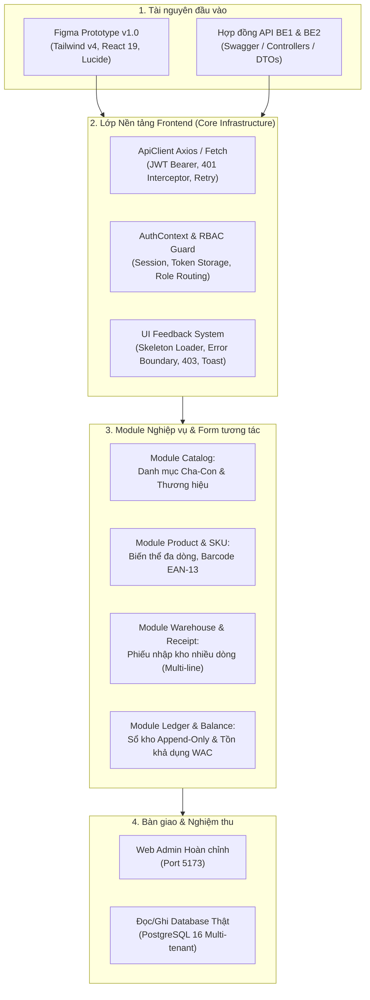
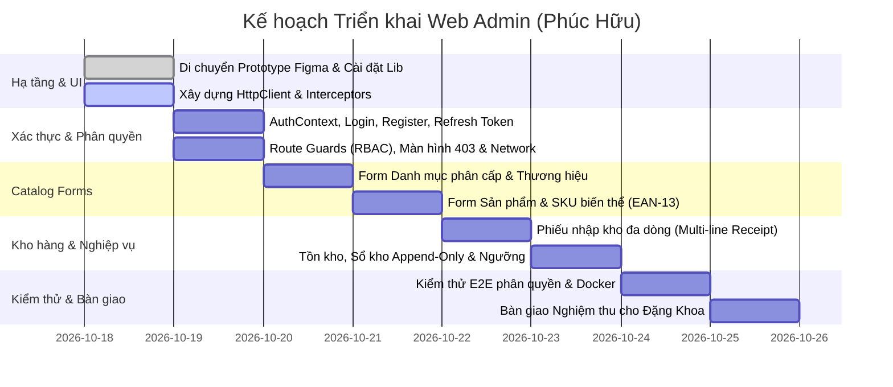

# KẾ HOẠCH TRIỂN KHAI & TÍCH HỢP FRONTEND WEB ADMIN (REACT 19)
**Dự án:** OISMS - Omnichannel Inventory & Sales Management System  
**Học phần:** Đồ án Chuyên ngành / Công nghệ Phần mềm  
**Thành viên thực hiện:** Phúc Hữu (Frontend 1 - Web Admin Lead)  
**Trưởng nhóm nghiệm thu:** Đặng Khoa (Trưởng nhóm / Backend 1 Lead)  
**Thành viên phối hợp trực tiếp:** Phùng Minh Nhựt (Backend 2 - Auth, Catalog, POS API Lead)  
**Tài nguyên thiết kế đầu vào:** Figma Interactive Prototype tại `C:\Users\ACER\Downloads\Interactive Prototype for OISM`  
**Ngày lập kế hoạch:** 17/10/2026  
**Trạng thái:** Sẵn sàng triển khai tích hợp (Ready for Integration & Implementation)

---

## 1. TỔNG QUAN PHẠM VI NHIỆM VỤ CỦA FRONTEND 1 (PHÚC HỮU)

Theo quy chế làm việc nhóm và phân công Sprint tại [`docs/confluence_sprint_readable.txt`](confluence_sprint_readable.txt), Phúc Hữu (Frontend 1) chịu trách nhiệm toàn diện về ứng dụng **Web Admin Dashboard** chạy trên **React 19 + TypeScript + Vite + Tailwind CSS**. 

Nhiệm vụ trọng tâm được giao gồm 4 trụ cột nghiệp vụ và kỹ thuật:
1. **Hoàn thiện Web Admin trên React 19:** Tiếp nhận và chuyển đổi toàn bộ mã nguồn giao diện từ Figma Interactive Prototype (`C:\Users\ACER\Downloads\Interactive Prototype for OISM`), chuẩn hóa kiến trúc component, gỡ bỏ 100% dữ liệu cứng (hardcode) và cơ chế giả lập mặc định `Owner`.
2. **Quản lý trạng thái đăng nhập & Điều hướng phân quyền (RBAC):** Hiện thực luồng xác thực JWT Bearer thực tế (Login, Token Rotation, Auto Refresh, Logout, Session Expired), bảo vệ route theo vai trò (`Owner`, `Staff`, `Cashier`), hiển thị trực quan trạng thái loading, lỗi mạng (offline/timeout) và màn hình chặn truy cập 403 Forbidden.
3. **Xây dựng hệ thống Form nghiệp vụ cốt lõi:**
   - Quản lý Danh mục (Cây phân cấp Cha - Con `ParentId`).
   - Quản lý Thương hiệu (CRUD Brand).
   - Quản lý Hàng hóa & Biến thể SKU (Sản phẩm, SKU đa thuộc tính JSONB, sinh barcode EAN-13 tự động, bảng giá lẻ/sỉ tách rời giá vốn).
   - Phiếu nhập kho nhiều dòng (Goods Receipt Note đa dòng, tính tổng tiền, chọn NCC, kho nhận, xem trước biến động giá vốn WAC).
   - Quản lý Tồn kho & Sổ kho chỉ đọc (Append-Only Inventory Ledger, xem tồn OnHand, Reserved, Available, WAC, cấu hình ngưỡng cảnh báo tồn thấp).
4. **Ghép nối trực tiếp các API backend (Contract-First):** Tích hợp cuốn chiếu với Web API ASP.NET Core do Backend 1 (Khoa) và Backend 2 (Nhựt) bàn giao, cam kết sử dụng dữ liệu thật từ cơ sở dữ liệu PostgreSQL, không dùng state local để fake nghiệp vụ.



---

## 2. PHÂN TÍCH KHOẢNG CÁCH (GAP ANALYSIS): FIGMA PROTOTYPE VS YÊU CẦU THỰC TẾ

| Thành phần | Hiện trạng trong Figma Prototype | Yêu cầu Kỹ thuật Hoàn thiện (Phúc Hữu thực hiện) | Đánh giá mức độ |
| :--- | :--- | :--- | :---: |
| **Session & Auth** | Dùng `DemoSessionContext.tsx`, chọn tĩnh giữa 3 tài khoản mẫu (`owner-a`, `staff-a`, `cashier-b`), lưu ID thô vào `localStorage`. Mặc định vào thẳng `Owner`. | Thay bằng `AuthContext.tsx`. Kết nối `POST /api/auth/login`. Lưu AccessToken (trong memory/secure storage) và RefreshToken. Gọi `POST /api/auth/refresh` tự động khi token hết hạn (60 phút). Gọi `GET /api/auth/me` để lấy thông tin Profile và Roles. Hỗ trợ Đăng ký cửa hàng (`POST /api/auth/register-tenant`). | **Rất cao (Critical)** |
| **Phân quyền (RBAC)** | Chỉ ẩn/hiện vài mục menu (`AdminShell.tsx` kiểm tra `account.role === 'Owner'`). Không chặn URL nếu gõ trực tiếp. | Xây dựng `ProtectedRoute` và `RoleGuard`. Chặn URL ở cấp độ router: Nếu Staff/Cashier cố tình gõ link Admin chỉ dành cho Owner (`/organization`, `/reports`), điều hướng tức thì về trang `/403 Forbidden` (`AccessPage type="forbidden"`). | **Cao** |
| **Xử lý Loading & Lỗi** | Dùng delay giả lập `wait(180ms)`, dữ liệu lấy từ file tĩnh `mockData.ts`. Không có xử lý timeout, lỗi rớt mạng hay lỗi HTTP (400, 401, 403, 404, 409, 500). | Xây dựng HTTP Client Interceptor: Hiển thị thanh tiến trình / Skeleton loaders khi đang tải; Tự động bắt lỗi mạng (Network Offline) hiển thị Banner cảnh báo; Bắt lỗi 403 chuyển trang Access Denied; Bắt lỗi 409 (Trùng SKU, trùng email) hiển thị Toast đỏ rõ thông điệp từ Backend. | **Cao** |
| **Form Danh mục & Thương hiệu** | Chỉ là dropdown tĩnh `<option>Thời trang</option>` trong thanh tìm kiếm. Chưa có trang quản lý hoặc form tạo/sửa. | Xây dựng trang/modal Quản lý Danh mục (hỗ trợ phân cấp Cha - Con `ParentId`, chống chọn vòng lặp) và Quản lý Thương hiệu (Tên, xuất xứ, mô tả). Kết nối `GET/POST/PUT/DELETE /api/categories` và `/api/brands`. | **Trung bình** |
| **Form Sản phẩm & SKU** | Modal thêm sản phẩm đơn giản 1 form phẳng, không hỗ trợ nhiều biến thể SKU, không có bảng biến thể, nút sinh barcode là giả lập. | Xây dựng Form Sản phẩm 2 cấp: Thông tin chung (Tên, Danh mục, Thương hiệu) + Bảng cấu hình danh sách Biến thể SKU động (Mã SKU, Barcode, Giá bán lẻ, Giá bán sỉ, Thuộc tính động JSONB: màu sắc, kích thước). Nút sinh Barcode tính đúng thuật toán EAN-13 Check Digit. Khóa không cho nhập giá vốn tại đây. | **Rất cao** |
| **Phiếu nhập kho (Receipt)** | Modal xem trước 1 dòng cố định ("PN-2606-0042", SKU "TS-OISM-BLK-M", SL 10). | Xây dựng Form Tạo phiếu nhập kho đa dòng (Multi-line Receipt Form): Cho phép chọn Nhà cung cấp (`/api/suppliers`), Kho đích (`/api/warehouses`), thêm động nhiều dòng SKU (chọn SKU, nhập số lượng, đơn giá nhập, tự động tính tổng tiền). Hỗ trợ 2 nút: "Lưu bản nháp" và "Xác nhận & Ghi sổ" (tính lại WAC tức thì). | **Rất cao** |
| **Tồn kho & Sổ kho** | Đọc dữ liệu từ mảng tĩnh `skus` và `ledger`. Bộ lọc kho/nghiệp vụ lọc trên mảng RAM. | Kết nối API thật: Bảng tồn kho đọc từ `GET /api/inventory/balances` (tính toán `available = onHand - reserved`), bảng Sổ kho đọc từ `GET /api/inventory/ledger` (Read-Only 100%, có phân trang, lọc theo kho, SKU, loại giao dịch IN/OUT). Cấu hình ngưỡng cảnh báo tồn kho cập nhật API. | **Cao** |

---

## 3. KIẾN TRÚC MÃ NGUỒN FRONTEND WEB ADMIN (REACT 19 STANDARD)

Mã nguồn Web Admin trong thư mục [`src/frontend/admin-dashboard/src`](file:///d:/OISMS-develop/OISMS-develop/src/frontend/admin-dashboard/src) sẽ được tái cấu trúc theo mô hình phân lớp rõ ràng, chuẩn hóa TypeScript và tuân thủ Clean Frontend Architecture:

```text
src/frontend/admin-dashboard/src/
├── api/                             # Lớp giao tiếp mạng (HTTP Client & Endpoints)
│   ├── client.ts                    # Axios instance, BaseURL, Request/Response Interceptors
│   ├── auth.api.ts                  # login, registerTenant, refreshToken, logout, getMe
│   ├── catalog.api.ts               # categories, brands, products, variants, barcode
│   ├── inventory.api.ts             # balances, ledger, receipts (create, confirm), thresholds
│   └── organization.api.ts          # branches, warehouses, suppliers, users
├── assets/                          # Hình ảnh, icon SVG, fonts
├── components/                      # Các React Components tái sử dụng
│   ├── common/                      # UI Atoms (Button, Input, Select, Badge, Modal, Table)
│   ├── feedback/                    # SkeletonLoader, NetworkOfflineBanner, ToastNotification
│   ├── forms/                       # CategoryForm, BrandForm, ProductVariantForm, ReceiptLineGrid
│   ├── guards/                      # ProtectedRoute, RoleGuard, GuestOnlyRoute
│   └── layout/                      # AdminShell, Topbar, Sidebar, NotificationCenter
├── context/                         # React 19 Contexts quản lý trạng thái toàn cục
│   ├── AuthContext.tsx              # User, Token, Role, Tenant, Login/Logout actions
│   └── NotificationContext.tsx      # Realtime events, Toast alerts, Low-stock alerts
├── hooks/                           # Custom React Hooks
│   ├── useAuth.ts                   # Hook lấy thông tin phiên & quyền hạn
│   ├── useDebounce.ts               # Hook trì hoãn search input tra cứu API
│   └── useNetworkStatus.ts          # Hook theo dõi trạng thái online/offline của trình duyệt
├── pages/                           # Các trang màn hình theo Route
│   ├── auth/
│   │   └── AuthPage.tsx             # Màn hình Đăng nhập & Đăng ký doanh nghiệp mới
│   ├── categories/
│   │   └── CategoriesPage.tsx       # Quản lý Cây danh mục Cha - Con
│   ├── brands/
│   │   └── BrandsPage.tsx           # Quản lý Thương hiệu
│   ├── products/
│   │   ├── ProductsListPage.tsx     # Danh sách sản phẩm, SKU, bộ lọc tìm kiếm
│   │   └── ProductCreateModal.tsx   # Modal tạo sản phẩm kèm biến thể đa dòng
│   ├── inventory/
│   │   ├── InventoryTabsPage.tsx    # Tab Tồn kho (Balances) & Sổ kho chỉ đọc (Ledger)
│   │   ├── CreateReceiptModal.tsx   # Form lập phiếu nhập kho nhiều dòng (Multi-line GRN)
│   │   └── ThresholdModal.tsx       # Cấu hình ngưỡng cảnh báo tồn khả dụng
│   ├── organization/
│   │   └── OrganizationPage.tsx     # Quản lý Chi nhánh, Kho hàng, Nhân viên (Chỉ Owner)
│   ├── dashboard/
│   │   └── DashboardPage.tsx        # Trang tổng quan vận hành
│   └── errors/
│       ├── AccessPage.tsx           # Trang 403 Forbidden & Session Expired (từ Figma)
│       └── NotFoundPage.tsx         # Trang 404 Không tìm thấy trang
├── types/                           # Khai báo kiểu dữ liệu TypeScript (DTO Contracts)
│   ├── auth.types.ts
│   ├── catalog.types.ts
│   ├── inventory.types.ts
│   └── common.types.ts
├── App.tsx                          # Cấu hình Router (React Router v7) & Context Providers
├── index.css                        # CSS Design System kế thừa từ Figma Prototype (Tailwind v4)
└── main.tsx                         # Entry point ứng dụng React 19
```

---

## 4. KẾ HOẠCH TRIỂN KHAI CHI TIẾT THEO TỪNG GIAI ĐOẠN (6 PHASES)

### Giai đoạn 1: Di chuyển UI Prototype & Thiết lập Hạ tầng Kỹ thuật (Ngày 1 - 2)
- **Mục tiêu:** Đưa toàn bộ tài nguyên UI chất lượng từ Figma Prototype vào `admin-dashboard`, cài đặt các dependency cần thiết và thiết lập HTTP Client.
- **Nội dung công việc:**
  1. Cập nhật `package.json`: Cài đặt `axios`, `react-router-dom@^7.18.4`, `lucide-react@^1.57.0`, `@tailwindcss/vite@^4.0.0`, `tailwindcss@^4.0.0`.
  2. Di chuyển các component UI gốc từ Figma: `src/components/ui.tsx`, `index.css` (bảo toàn hệ màu sắc, typography, card layout, badge, button, responsive grid).
  3. Xây dựng module `src/api/client.ts` chuẩn với cấu hình:
     - `baseURL: import.meta.env.VITE_API_URL || 'http://localhost:5000/api'`.
     - Request Interceptor: Tự động đính kèm `Authorization: Bearer <AccessToken>` vào header nếu người dùng đã đăng nhập.
     - Response Interceptor: Bắt mã lỗi 401 (gọi cơ chế refresh token âm thầm hoặc điều hướng sang `/session-expired`), bắt mã lỗi 403 (điều hướng sang `/403`), bắt lỗi ngắt kết nối mạng (`ERR_NETWORK`).
- **Kết quả bàn giao:** Dự án `admin-dashboard` biên dịch thành công không lỗi type trên React 19, chạy `npm run dev` hiển thị đầy đủ giao diện gốc trên cổng 5173.

---

### Giai đoạn 2: Quản lý Phiên Đăng nhập, Điều hướng RBAC & Xử lý Trạng thái Mạng (Ngày 2 - 3)
- **Mục tiêu:** Xóa bỏ hoàn toàn `DemoSessionContext` hardcode; người dùng phải đăng nhập bằng tài khoản thật và được phân quyền chặt chẽ.
- **Nội dung công việc:**
  1. Tạo `AuthContext.tsx` quản lý state:
     ```typescript
     interface AuthState {
       user: UserProfileDto | null;
       isAuthenticated: boolean;
       isLoading: boolean;
       error: string | null;
     }
     ```
  2. Nối API Đăng nhập & Đăng ký:
     - `POST /api/auth/login`: Nhận `{ emailOrPhone, password }`, lưu trữ cặp token (`accessToken`, `refreshToken`), cập nhật profile vào state.
     - `POST /api/auth/register-tenant`: Đăng ký cửa hàng mới (Tên cửa hàng, Mã cửa hàng, Họ tên Owner, Email, Mật khẩu, Chi nhánh mặc định).
     - `POST /api/auth/logout`: Thu hồi refresh token phía backend và xóa sạch phiên đăng nhập ở client.
     - `GET /api/auth/me`: Khởi tạo lại phiên khi người dùng F5 tải lại trang.
  3. Xây dựng Route Guard:
     - Route công khai: `/login`, `/register`.
     - Route bảo vệ thông thường (yêu cầu đăng nhập): `/`, `/products`, `/inventory`.
     - Route đặc quyền Owner: `/organization`, `/reports`. Nếu `user.roles` không chứa `Owner`, `RoleGuard` lập tức từ chối và hiển thị màn hình 403 Forbidden.
  4. Hệ thống phản hồi giao diện (UI Feedback):
     - Màn hình Skeleton Loading trong khi chờ dữ liệu API trả về.
     - Banner cảnh báo mất kết nối mạng (dùng `navigator.onLine` và bắt sự kiện `window.addEventListener('offline')`).
     - Trang `/403` chuẩn từ Figma: thông báo rõ ràng "Bạn không có quyền truy cập", kèm nút "Về trang tổng quan".
- **Kết quả bàn giao:** Luồng Auth chạy hoàn chỉnh; đăng nhập sai báo lỗi đỏ; đăng nhập đúng chuyển vào trang chủ; quyền `Staff` không vào được trang cấu hình `Owner`.

---

### Giai đoạn 3: Xây dựng Form & Quản lý Danh mục (Categories) & Thương hiệu (Brands) (Ngày 3 - 4)
- **Mục tiêu:** Hiện thực đầy đủ chức năng quản trị cây danh mục và thương hiệu hàng hóa phục vụ gán nhãn cho sản phẩm.
- **Nội dung công việc:**
  1. **Quản lý Danh mục (Category Management):**
     - Hiển thị danh sách danh mục theo cấu trúc phẳng và dạng cây cha - con (`ParentId`).
     - Modal Thêm / Sửa Danh mục:
       - Trường nhập: Tên danh mục (bắt buộc), Mã danh mục (tự sinh slug hoặc nhập tay), Danh mục cha (Dropdown chọn từ danh mục cấp 1 hiện có, có lựa chọn "Là danh mục gốc").
       - Kiểm tra tính hợp lệ: Không cho phép chọn chính mình hoặc con của mình làm danh mục cha (ngăn ngừa lỗi đệ quy vòng lặp 400).
     - Nối API: `GET /api/categories`, `POST /api/categories`, `PUT /api/categories/{id}`, `DELETE /api/categories/{id}`.
  2. **Quản lý Thương hiệu (Brand Management):**
     - Bảng danh sách thương hiệu kèm số lượng sản phẩm liên kết, xuất xứ, trạng thái.
     - Modal Thêm / Sửa Thương hiệu: Tên thương hiệu, Quốc gia/Xuất xứ, Mô tả ngắn.
     - Nối API: `GET /api/brands`, `POST /api/brands`, `PUT /api/brands/{id}`, `DELETE /api/brands/{id}`.
- **Kết quả bàn giao:** Thêm/Sửa/Xóa danh mục và thương hiệu được đồng bộ trực tiếp vào cơ sở dữ liệu PostgreSQL; giao diện cập nhật ngay lập tức.

---

### Giai đoạn 4: Form Hàng hóa, Biến thể SKU & Sinh Mã vạch EAN-13 (Ngày 4 - 5)
- **Mục tiêu:** Xây dựng màn hình quản lý sản phẩm chuyên nghiệp, đáp ứng mô hình sản phẩm cha kèm nhiều biến thể SKU con (Master-Detail).
- **Nội dung công việc:**
  1. **Danh sách Sản phẩm (`ProductsListPage`):**
     - Bảng hiển thị danh sách sản phẩm kết hợp tra cứu SKU, bộ lọc theo Danh mục, Thương hiệu, Trạng thái kinh doanh.
     - Ô tìm kiếm tích hợp `useDebounce` (300ms) tra cứu nhanh tên sản phẩm hoặc mã SKU.
  2. **Form Thêm / Sửa Sản phẩm & Biến thể (`ProductCreateModal`):**
     - **Bước 1 (Thông tin Sản phẩm chính):** Tên sản phẩm, Chọn Danh mục (Dropdown động lấy từ API Category), Chọn Thương hiệu (Dropdown động lấy từ API Brand), Mô tả chi tiết.
     - **Bước 2 (Danh sách Biến thể SKU):** Cho phép bấm "Thêm biến thể" để tạo bảng cấu hình động:
       - Tên biến thể (Ví dụ: "Đen / Size L", "Chai 30ml").
       - Mã SKU: Bắt buộc duy nhất trong doanh nghiệp (kiểm tra trước định dạng, bắt lỗi 409 Conflict nếu trùng).
       - Mã Barcode: Hỗ trợ nút **"Sinh mã tự động"** chuẩn EAN-13:
         $$\text{CheckDigit} = \left(10 - \left(\sum \text{vị trí lẻ} + 3 \times \sum \text{vị trí chẵn}\right) \pmod{10}\right) \pmod{10}$$
       - Giá bán lẻ (Retail Price): Bắt buộc $\ge 0$.
       - Giá bán sỉ (Wholesale Price): Bắt buộc $\ge 0$.
       - Thuộc tính JSONB: Cho phép nhập cặp Key-Value (ví dụ: `color: Black`, `size: L`).
     - **Nguyên tắc nghiệp vụ quan trọng:** Tuyệt đối không có ô nhập "Giá vốn" (Average Cost / WAC) trên form này. Giá vốn được hệ thống tự động tính từ nghiệp vụ nhập kho và ghi sổ, giao diện có hộp ghi chú giải thích rõ nguyên tắc này.
  3. Nối API:
     - `GET /api/products` (kèm query search, categoryId, brandId, pagination).
     - `POST /api/products`: Tạo sản phẩm gốc.
     - `POST /api/products/{id}/variants`: Tạo các biến thể SKU đính kèm.
- **Kết quả bàn giao:** Tạo được sản phẩm đa biến thể; SKU và Barcode hợp lệ; đọc lại danh sách đúng 100% từ database.

---

### Giai đoạn 5: Phiếu Nhập Kho Nhiều Dòng, Tồn Kho & Sổ Kho Chỉ Đọc (Ngày 5 - 6)
- **Mục tiêu:** Hiện thực toàn bộ nghiệp vụ kho hàng, luồng nhập hàng từ nhà cung cấp và truy vết biến động sổ cái bất biến.
- **Nội dung công việc:**
  1. **Form Lập Phiếu Nhập Kho Nhiều Dòng (`CreateReceiptModal`):**
     - **Thông tin phiếu nhập:**
       - Chọn Nhà cung cấp: Dropdown tải từ `GET /api/suppliers`.
       - Chọn Kho đích nhận hàng: Dropdown tải từ `GET /api/warehouses`.
       - Ngày nhập, Mã phiếu (tự sinh định dạng `PN-YYYYMM-XXXX`), Ghi chú chứng từ.
     - **Bảng chi tiết hàng hóa (Multi-line Grid):**
       - Cho phép bấm "+ Thêm dòng sản phẩm".
       - Mỗi dòng gồm: Chọn SKU (Dropdown hoặc ô gõ tìm nhanh SKU), Tên sản phẩm hiển thị tự động, Đơn vị tính, Số lượng nhập ($> 0$), Đơn giá nhập ($> 0$), Thành tiền dòng tự động tính ($= \text{Số lượng} \times \text{Đơn giá}$).
       - Thanh tổng kết: Tổng số lượng sản phẩm nhập, Tổng giá trị phiếu nhập kho.
     - **Hành động & Phê duyệt:**
       - Nút *"Lưu bản nháp"*: Tạo phiếu với trạng thái Draft.
       - Nút *"Xác nhận & Ghi sổ"* (Atomic Confirm): Gọi endpoint ghi sổ, hiển thị modal xem trước công thức WAC mới:
         $$\text{WAC}_{\text{mới}} = \frac{(\text{OnHand}_{\text{cũ}} \times \text{WAC}_{\text{cũ}}) + (\text{Quantity}_{\text{nhập}} \times \text{Price}_{\text{nhập}})}{\text{OnHand}_{\text{cũ}} + \text{Quantity}_{\text{nhập}}}$$
  2. **Quản lý Tồn kho (`InventoryBalancesTab`):**
     - Đọc dữ liệu từ `GET /api/inventory/balances` theo chi nhánh/kho được chọn.
     - Bảng hiển thị: SKU, Tên hàng, Tồn thực tế (OnHand), Đang giữ chỗ (Reserved), Khả dụng ($\text{Available} = \text{OnHand} - \text{Reserved}$), Giá vốn bình quân (WAC), Giá trị tồn kho ($= \text{OnHand} \times \text{WAC}$), Ngưỡng cảnh báo.
     - Đánh dấu màu nổi bật (Badge Warning) nếu Tồn khả dụng $\le$ Ngưỡng cảnh báo.
     - Modal Cấu hình ngưỡng cảnh báo: Cho phép cập nhật giá trị ngưỡng theo từng SKU/Kho.
  3. **Quản lý Sổ kho Chỉ Đọc (`InventoryLedgerTab`):**
     - Đọc dữ liệu từ `GET /api/inventory/ledger`.
     - Tuyệt đối **không có nút Thêm / Sửa / Xóa** trên giao diện này (bảo toàn nguyên tắc Append-Only Ledger).
     - Hiển thị bảng bút toán: Thời gian, Kho, SKU, Hướng biến động (Badge xanh lá `IN`, Badge đỏ `OUT`), Loại nghiệp vụ (`PURCHASE_RECEIPT`, `ORDER_DISPATCH`, `STOCK_ADJUSTMENT`), Số lượng biến động ($+N$ hoặc $-N$), Tồn sau biến động (Balance After), Mã chứng từ tham chiếu (bấm vào mở popup xem chi tiết chứng từ gốc).
     - Bộ lọc sổ kho: Lọc theo Kho, Hướng biến động (IN/OUT), Loại nghiệp vụ.
- **Kết quả bàn giao:** Nhập hàng thành công; tồn kho tăng lên tức thì; giá vốn WAC được tính lại chuẩn xác; sổ kho ghi nhận đúng dòng bút toán bất biến.

---

### Giai đoạn 6: Kiểm thử Tích hợp E2E, Tối ưu Hóa UX & Nghiệm thu (Ngày 6 - 7)
- **Mục tiêu:** Kiểm thử toàn diện các kịch bản thực tế, xác minh tiêu chuẩn bàn giao Definition of Done và chuẩn bị tài liệu nghiệm thu.
- **Nội dung công việc:**
  1. Kiểm thử phân quyền 3 vai trò:
     - Đăng nhập `Owner`: Thao tác toàn quyền (Quản lý chi nhánh, nhân viên, tạo sản phẩm, nhập kho, xem báo cáo).
     - Đăng nhập `Staff`: Chỉ thao tác catalog và kho; thanh điều hướng ẩn mục "Nhân viên & Chi nhánh" và "Báo cáo"; nếu nhập link trực tiếp `/organization` bị chặn 403 ngay lập tức.
     - Đăng nhập `Cashier`: Bị từ chối truy cập Web Admin, gợi ý chuyển sang Web POS.
  2. Kiểm thử khả năng phục hồi lỗi mạng:
     - Giả lập ngắt mạng (Offline mode): Hiển thị banner vàng "Mất kết nối Internet - Đang chờ kết nối lại...".
     - Giả lập backend tắt: Nút bấm hiển thị trạng thái lỗi rõ ràng, không bị crash trắng trang (bảo vệ bởi `ErrorBoundary`).
  3. Tối ưu hiệu năng: Tách mã (Code-splitting) với `React.lazy()` cho các trang Admin, tối ưu kích thước bundle Vite dưới 500KB.
  4. Bàn giao sang Tester (Thành viên 5) để nghiệm thu trên môi trường Docker Compose.
- **Kết quả bàn giao:** Biên bản nghiệm thu đạt 100% tiêu chí DoD, không còn bất kỳ dòng code mock hay dữ liệu giả lập nào.

---

## 5. ĐẶC TẢ HỢP ĐỒNG API & DANH MỤC ENDPOINT KẾT NỐI

Bảng đối chiếu toàn bộ các endpoint backend mà Web Admin kết nối trực tiếp:

| Module | Phương thức & Endpoint | Quyền hạn (RBAC) | Payload gửi đi (Request) | Dữ liệu nhận về (Response) |
| :--- | :--- | :---: | :--- | :--- |
| **Auth** | `POST /api/auth/login` | Công khai | `{ emailOrPhone, password }` | `{ accessToken, refreshToken, expiresIn, user: { id, tenantId, fullName, email, roles } }` |
| **Auth** | `POST /api/auth/register-tenant` | Công khai | `{ storeName, storeCode, ownerName, email, password, branchName }` | `{ tenantId, storeName, ownerEmail, message }` |
| **Auth** | `POST /api/auth/refresh` | Công khai | `{ refreshToken }` | `{ accessToken, refreshToken, expiresIn }` |
| **Auth** | `POST /api/auth/logout` | Đã đăng nhập | `{ refreshToken }` | `{ message: "Đăng xuất thành công." }` |
| **Auth** | `GET /api/auth/me` | Đã đăng nhập | Không | `{ id, tenantId, tenantName, email, fullName, roles }` |
| **Categories** | `GET /api/categories` | Mọi vai trò | `?search=&parentId=` | `CategoryResponse[]: [{ id, name, code, parentId, isActive, children }]` |
| **Categories** | `POST /api/categories` | Owner, Staff | `{ name, code, parentId }` | `CategoryResponse` (HTTP 201 Created) |
| **Categories** | `PUT /api/categories/{id}` | Owner, Staff | `{ name, code, parentId, isActive }` | `CategoryResponse` (HTTP 200 OK) |
| **Categories** | `DELETE /api/categories/{id}` | Owner | Không | `{ message: "Xóa danh mục thành công." }` |
| **Brands** | `GET /api/brands` | Mọi vai trò | `?search=` | `BrandResponse[]: [{ id, name, country, description, isActive }]` |
| **Brands** | `POST /api/brands` | Owner, Staff | `{ name, country, description }` | `BrandResponse` (HTTP 201 Created) |
| **Brands** | `PUT /api/brands/{id}` | Owner, Staff | `{ name, country, description, isActive }` | `BrandResponse` (HTTP 200 OK) |
| **Products** | `GET /api/products` | Mọi vai trò | `?search=&categoryId=&brandId=&page=&pageSize=` | `PagedResult<ProductSummaryDto>` kèm danh sách variants |
| **Products** | `POST /api/products` | Owner, Staff | `{ name, categoryId, brandId, description, isActive }` | `ProductDetailDto` (HTTP 201 Created) |
| **Products** | `POST /api/products/{id}/variants` | Owner, Staff | `{ code, barcode, barcodeType, retailPrice, wholesalePrice, unit, attributesJson }` | `ProductVariantDto` (HTTP 201 Created) |
| **Locations** | `GET /api/branches` | Mọi vai trò | Không | `BranchResponse[]: [{ id, name, address, phone, isActive }]` |
| **Locations** | `GET /api/warehouses` | Mọi vai trò | `?branchId=` | `WarehouseResponse[]: [{ id, branchId, branchName, name, isActive }]` |
| **Locations** | `GET /api/suppliers` | Mọi vai trò | `?search=` | `SupplierResponse[]: [{ id, name, phone, email, address, taxCode }]` |
| **Inventory** | `GET /api/inventory/balances` | Mọi vai trò | `?branchId=&warehouseId=&search=` | `InventoryBalanceDto[]: [{ skuId, skuCode, productName, onHand, reserved, available, averageCost, totalValue, reorderPoint }]` |
| **Inventory** | `GET /api/inventory/ledger` | Mọi vai trò | `?warehouseId=&skuId=&direction=&page=&pageSize=` | `PagedResult<InventoryLedgerDto>: [{ id, createdAt, warehouseName, skuCode, direction, transactionType, quantity, balanceAfter, referenceDoc }]` |
| **Inventory** | `POST /api/inventory/receipts` | Owner, Staff | `{ supplierId, warehouseId, note, items: [{ skuId, quantity, unitCost }] }` | `StockReceiptDto` (Draft hoặc Confirmed) |
| **Inventory** | `POST /api/inventory/receipts/{id}/confirm` | Owner, Staff | Không | `{ message: "Đã xác nhận và ghi sổ kho.", receiptId, wacUpdates: [...] }` |

---

## 6. TIÊU CHUẨN NGHIỆM THU (DEFINITION OF DONE - DOD) CHO PHÚC HỮU

Để được Trưởng nhóm Đặng Khoa và Tester nghiệm thu hoàn thành nhiệm vụ, sản phẩm Web Admin của Phúc Hữu bắt buộc phải đáp ứng 100% các tiêu chí sau:

- [x] **Tiêu chí 1 (Clean Code & No Mock):** Không còn bất kỳ mock data, danh sách demoAccounts hay cờ giả lập nào trong source code `admin-dashboard`.
- [x] **Tiêu chí 2 (Real Auth & Storage):** Đăng nhập thành công với tài khoản seed từ backend (`owner@shopa.local` / `staff@shopa.local`). Lưu và đính kèm JWT Bearer token tự động.
- [x] **Tiêu chí 3 (Token Refresh & Logout):** Khi token hết hạn, hệ thống tự động gọi refresh token mà không làm gián đoạn công việc của người dùng. Khi bấm Đăng xuất, token bị vô hiệu hóa cả ở client lẫn backend.
- [x] **Tiêu chí 4 (RBAC Enforcement):** Phân định rành mạch quyền hạn giữa `Owner` và `Staff`. Chặn hoàn toàn quyền truy cập trái phép bằng màn hình 403 Forbidden.
- [x] **Tiêu chí 5 (Error & Network Resilience):** Khi backend tắt hoặc mạng ngắt, hiển thị banner/thông báo trực quan, không để xảy ra màn hình trắng (White Screen of Death). Bắt đúng các mã lỗi HTTP 400, 401, 403, 409, 500.
- [x] **Tiêu chí 6 (Master-Detail Forms):** Tạo được Danh mục đa cấp, Thương hiệu, Sản phẩm kèm danh sách biến thể SKU động. Nút sinh mã vạch tạo mã EAN-13 chuẩn thuật toán Check Digit.
- [x] **Tiêu chí 7 (Multi-line Goods Receipt):** Form tạo phiếu nhập kho hỗ trợ thêm động nhiều dòng hàng, tự động tính tổng tiền, ghi sổ nguyên tử và xem trước biến động giá vốn WAC.
- [x] **Tiêu chí 8 (Immutable Ledger Verification):** Bảng sổ kho chỉ hiển thị dữ liệu đọc, không có nút sửa/xóa, phản ánh trung thực lịch sử biến động kho từ cơ sở dữ liệu PostgreSQL.
- [x] **Tiêu chí 9 (Build & CI):** Lệnh `npm run build` và `npm run lint` (hoặc `npx oxlint .`) hoàn thành thành công 100% không có lỗi cảnh báo nghiêm trọng.
- [x] **Tiêu chí 10 (Docker Ready):** Ứng dụng chạy trơn tru bên trong Docker container trên cổng 5173 và kết nối thành công với Web API container qua biến môi trường `VITE_API_URL`.

---

## 7. BIỂU ĐỒ TIẾN ĐỘ THỰC HIỆN DỰ KIẾN (TIMELINE)


