# OISMS — Cẩm Nang Toàn Diện Sprint 2 (Sprint 2 Comprehensive Guide)

> **Dự án:** Omnichannel Inventory and Sales Management System (OISMS)  
> **Thời gian thực hiện:** 13/10/2026 – 17/10/2026 (D1 – D6: 6 ngày phát triển)  
> **Trọng tâm Sprint 2:** Xây dựng nền tảng cơ sở dữ liệu, cô lập đa người thuê (Multi-tenant), phân quyền tài khoản (RBAC/JWT), danh mục sản phẩm/SKU, luồng nhập kho nguyên tử (Atomic), sổ cái kho bất biến (Append-Only Ledger), tính giá vốn bình quân (WAC) và đặt nền móng cho Đơn hàng / Bán hàng POS.

---

## I. Mục Tiêu Cốt Lõi & Luồng Dữ Liệu Hoàn Thiện Sprint 2

Mục tiêu tối thượng của Sprint 2 là **kết nối thành công luồng dữ liệu thật 100% từ Database lên Giao diện**:

$$\text{Đăng nhập (JWT)} \longrightarrow \text{Tạo SKU mới} \longrightarrow \text{Lập \& Xác nhận Nhập kho} \longrightarrow \text{Ghi Sổ cái \& Cập nhật WAC} \longrightarrow \text{Xem Tồn kho \& Tra cứu POS}$$

### Các tiêu chí nghiệm thu bắt buộc (Definition of Done - DoD):
1. **Cơ sở dữ liệu tái tạo được:** Chạy migration và seed script trên PostgreSQL sạch là khởi tạo được toàn bộ hệ thống.
2. **Cô lập Đa người thuê (Multi-tenant Isolation):** Mọi bảng dữ liệu nghiệp vụ đều có `TenantId`, Global Query Filter của EF Core chặn triệt để việc đọc/ghi chéo dữ liệu giữa các cửa hàng.
3. **Sổ cái kho bất biến (Append-Only):** Mọi biến động nhập kho phải tạo bản ghi `InventoryTransaction` có số dư sau giao dịch `BalanceAfter`. Tuyệt đối cấm lệnh `UPDATE` hoặc `DELETE` trên bảng sổ cái; cấm cập nhật tùy tiện cột tồn kho `on_hand`.
4. **Tính giá vốn bình quân (WAC) tự động:** Khi xác nhận phiếu nhập, hệ thống tự động tính lại giá vốn đơn vị theo công thức đề bài:
   $$\text{NewCost} = \frac{\text{OldStock} \times \text{OldCost} + \text{ImportQty} \times \text{ImportPrice}}{\text{OldStock} + \text{ImportQty}}$$
5. **Nói không với dữ liệu giả (No Fake/Mock Data):** Web Admin và Web POS phải gọi API thật, lấy dữ liệu từ PostgreSQL, hiển thị đúng mã trạng thái 200, 400, 403, 409.

---

## II. Phân Công Chi Tiết & Trách Nhiệm 5 Thành Viên

| Thành viên | Vai trò | Nhiệm vụ chính trong Sprint 2 | Sản phẩm bàn giao bắt buộc |
|---|---|---|---|
| **Khoa** *(Trưởng nhóm)* | **Backend chính** (75% effort BE) | • Thiết kế Schema PostgreSQL, Entity, Mapping, DbContext, Migrations & Seed data.<br>• Thiết lập cô lập Multi-tenant (TenantContext, Global Query Filter).<br>• Lõi Sổ cái kho bất biến (Append-Only Ledger) & Xác nhận nhập kho nguyên tử (Atomic Transaction).<br>• Thuật toán tính giá vốn bình quân (WAC) tự động.<br>• Đặt nền móng dịch vụ Order / Reservation & Thử nghiệm khóa database chống bán vượt sớm.<br>• Chuẩn hóa mẫu Controller, Xử lý lỗi, Transaction Management và Docker Compose/CI. | • DB PostgreSQL chạy thông suốt qua Docker/Local.<br>• API Nhập kho, Sổ cái, Tồn kho chạy thật trên Swagger.<br>• Unit/Integration tests phần lõi Sổ cái & WAC đạt độ phủ (Coverage) $\ge 80\%$.<br>• Hợp đồng API (Contract DTO) rõ ràng cho nhóm. |
| **Thành viên 2** | **Backend phụ** (25% effort BE) | • Module xác thực: Băm mật khẩu (BCrypt), cấp & refresh JWT token (login/logout/refresh/me) theo template của Khoa.<br>• API Đăng ký cửa hàng (Tenant registration) dưới sự rà soát của Khoa.<br>• API CRUD & Tra cứu: Cây danh mục (Category Hierarchy), Thương hiệu (Brand), Sản phẩm (Product), Biến thể SKU, Bảng giá sỉ/lẻ, Mã vạch (Barcode EAN-13/Code128).<br>• Tra cứu Nhà cung cấp (Supplier), Chi nhánh/Kho.<br>• Viết FluentValidation kiểm tra tính hợp lệ dữ liệu. | • Toàn bộ API Auth và Catalog nộp theo từng lát cắt nhỏ (PR nhỏ).<br>• Ràng buộc duy nhất mã SKU theo tenant và validation mã vạch được kiểm thử đơn vị đạt 100%. |
| **Thành viên 3** | **Frontend Admin** (Web React 19) | • Tiếp nhận mã nguồn giao diện từ bản Prototype (`Downloads`), đưa vào `src/frontend/admin-dashboard`.<br>• Gỡ bỏ 100% dữ liệu cứng (mock data), gỡ bỏ tài khoản mặc định Owner.<br>• Xây dựng luồng đăng nhập, lưu token JWT, điều hướng phân quyền (Owner/Staff), trang báo lỗi 403.<br>• Dựng và nối API các màn hình: Danh mục, Thương hiệu, Sản phẩm/SKU, Form tạo phiếu nhập kho nhiều dòng, Sổ kho và Báo cáo tồn kho.<br>• Xử lý giao diện: Khung xương đang tải (Skeleton loading), thông báo lỗi đỏ (Toast error). | • Web Admin chạy trên cổng `5173`.<br>• Thao tác thêm/sửa/nhập kho và đọc lại dữ liệu thật từ cơ sở dữ liệu thành công.<br>• Giao diện không bị văng màn hình trắng khi mất mạng. |
| **Thành viên 4** | **Frontend POS** (Web PWA React 19) | • Tiếp nhận màn hình `PosPage` từ bản Prototype (`Downloads`), đưa vào `src/frontend/pos-app`.<br>• Gỡ bỏ giỏ hàng mẫu hardcode `skus[0]`.<br>• Hoàn thiện tính năng: Tìm kiếm/quét mã vạch từ API thật, giỏ hàng nhiều dòng (thêm/bớt/xóa dòng tự tính tổng tiền), nhập tiền khách đưa tính tiền thừa, phương thức thanh toán.<br>• Chuẩn bị cấu trúc gọi API Checkout nguyên tử theo hợp đồng DTO.<br>• Tối ưu bản in hóa đơn nhiệt qua CSS `@media print` khổ 80mm/58mm.<br>• Cấu hình PWA (manifest, icon). | • Web POS chạy trên cổng `5174`.<br>• Tra cứu và hiển thị đúng tồn khả dụng (`available`) của SKU.<br>• Nút in hóa đơn mở đúng hộp thoại in chuẩn kích thước hóa đơn bán lẻ. |
| **Thành viên 5** | **Kiểm thử (Tester)** | • **Ngày D1 (Static Testing):** Đọc Hợp đồng DTO, review bắt lỗi thiết kế trên giấy; thiết kế bộ Testcases chi tiết (Positive, Negative, RBAC, Data formats); tạo sẵn Postman Collection và dữ liệu test mẫu.<br>• **Ngày D2–D3:** Nhận API từ Backend ➔ Kiểm thử độc lập ngay trên Swagger/Postman (không đợi Frontend).<br>• **Ngày D4–D5:** Kiểm thử toàn luồng giao diện Web Admin & POS (End-to-End).<br>• **Ngày D5–D6:** Chạy kịch bản thử tải tranh mua Flash Sale (50 reqs/1 SKU); Quản lý bug trên Jira (retest bug); Lập Test Report và đối chiếu ma trận RTM. | • Bảng kịch bản Testcase có kết quả Passed/Failed.<br>• Báo cáo Bug trên Jira (cam kết 0 lỗi Blocker/Critical còn mở trước khi đóng Sprint).<br>• Ma trận RTM đối chiếu 100% yêu cầu đề bài của Sprint 2.<br>• Biên bản ký duyệt chất lượng (Sign-off Summary). |

---

## III. Tiến Độ Thực Hiện Từng Ngày (Timeline D1 – D6)

```mermaid
gantt
    title Tiến độ Triển khai Sprint 2 (D1 - D6)
    dateFormat  X
    axisFormat D%x
    
    section Khoa (Backend Lead)
    Chốt Contract, Schema DB, Migration, Seed        :active, 1, 2
    Sổ cái Ledger, Nhập kho Atomic, Công thức WAC    :2, 4
    Lõi Order/Reserve, Khóa DB, Docker/CI            :4, 5
    Tổng hợp, Hỗ trợ fix lỗi, Báo cáo kỹ thuật       :5, 6

    section TV2 (Backend Sub)
    JWT Auth (Login, Logout, Refresh, Me)            :1, 3
    Catalog CRUD (Danh mục, Brand, Product, SKU)     :2, 4
    FluentValidation, Unique SKU Tenant Guard        :4, 5
    Hoàn thiện DTO & API Docs Swagger               :5, 6

    section TV3 (Frontend Admin)
    Port Prototype sang admin-dashboard, Auth state   :1, 3
    Nối API Danh mục, Thương hiệu, Sản phẩm/SKU       :3, 4
    Form Phiếu nhập kho nhiều dòng & Trang Sổ kho    :4, 5
    Xử lý Loading/Error states & Retest              :5, 6

    section TV4 (Frontend POS)
    Port PosPage sang pos-app, Xóa giỏ mẫu           :1, 3
    Tìm/quét SKU từ API, Giỏ hàng nhiều món          :3, 4
    Bản in hóa đơn CSS print, Chuẩn bị Checkout      :4, 5
    Tối ưu phím tắt F-keys & Cảm ứng                 :5, 6

    section TV5 (Tester)
    Test Design, Chuẩn bị Data & Postman Collec      :1, 2
    Test Swagger độc lập API Auth & Catalog          :2, 4
    Test E2E toàn luồng Admin & POS                  :4, 5
    Test tải 50 reqs Flash Sale, Đóng Bug & RTM      :5, 6
```



---

## IV. Ma Trận Đối Chiếu Yêu Cầu Đề Bài Trong Sprint 2 (RTM)

| Mã yêu cầu | Tên yêu cầu nghiệp vụ | Người làm | Tiêu chuẩn nghiệm thu kỹ thuật |
|---|---|---|---|
| **FR-AUTH-01** | Đăng ký cửa hàng (Tenant) | TV2 & Khoa | Tạo cửa hàng cấp `TenantId` riêng biệt, sinh tài khoản quản trị mặc định ban đầu. |
| **FR-AUTH-02** | Đăng nhập bảo mật | TV2 | Đăng nhập email/SĐT + mật khẩu; băm mật khẩu bằng BCrypt/Argon2; cấp JWT chứa TenantId, UserId, Role. |
| **FR-AUTH-03** | Phân quyền RBAC | TV2 & Khoa | Owner toàn quyền; Staff quản lý kho/đơn; Cashier chỉ dùng POS. API trả về `403 Forbidden` nếu sai quyền. |
| **FR-AUTH-04** | Quản lý Chi nhánh & Kho | TV2 | Owner có quyền tạo, cập nhật, bật/tắt hiển thị chi nhánh và kho trực thuộc cửa hàng mình. |
| **FR-PROD-01** | Cây danh mục & Thương hiệu | TV2 & TV3 | Quản lý danh mục cha-con phân cấp đa tầng và thương hiệu sản phẩm. |
| **FR-PROD-02** | Sản phẩm & Biến thể SKU | TV2 & TV3 | Sản phẩm có biến thể (Màu sắc, Kích thước); mã SKU duy nhất trong cùng một tenant (ràng buộc DB Unique Index). |
| **FR-PROD-03** | Quản lý Mã vạch | TV2 & TV4 | Tự sinh hoặc nhập mã vạch chuẩn EAN-13 / Code128 cho từng SKU; quét tìm kiếm trên POS tức thì. |
| **FR-PROD-04** | Quản lý Bảng giá | TV2 | Quản lý giá bán lẻ và giá bán sỉ theo từng SKU; tách biệt hoàn toàn với giá vốn. |
| **FR-INV-01** | Sổ cái kho bất biến (Append-Only) | Khoa | Ghi log mọi biến động nhập, xuất, bán, trả vào `InventoryTransaction` có `BalanceAfter`. Tuyệt đối cấm Update/Delete. |
| **FR-INV-02** | Nhập kho nhà cung cấp | Khoa & TV3 | Phiếu nhập nhiều dòng; xác nhận nhập kho ghi nhận tăng tồn thực tế và cập nhật giá vốn WAC nguyên tử (Atomic). |
| **FR-COST-01** | Tính giá vốn bình quân (WAC) | Khoa | Tự động tính toán lại giá vốn đơn vị khi xác nhận nhập kho; có Unit Test chứng minh công thức số học đúng 100%. |
| **FR-RSE (Nền)** | Nền tảng Giữ chỗ & Khóa DB | Khoa | Công thức tồn khả dụng: `available = on_hand - reserved`. Thử nghiệm khóa database (`SELECT ... FOR UPDATE` hoặc Version Token). |
| **FR-POS (Nền)** | Nền tảng Giao diện POS | TV4 | Giao diện cảm ứng, phím tắt F2 tìm kiếm, giỏ hàng nhiều dòng, tính tiền thừa, mở hộp thoại in hóa đơn trình duyệt. |
| **NFR-SEC-01** | Bảo mật token & mật khẩu | TV2 | Access token thời hạn 60 phút, refresh token lưu an toàn; mã hóa mật khẩu một chiều BCrypt. |
| **NFR-SEC-03** | Bất biến dữ liệu sổ cái | Khoa | Ràng buộc cơ sở dữ liệu và cấu trúc tầng Application ngăn chặn can thiệp trực tiếp sửa đổi số dư sổ cái. |
| **NFR-MAINT-02** | Độ phủ kiểm thử phần lõi | Khoa | Viết Unit & Integration test tự động cho Inventory Ledger, WAC và Reservation đạt tối thiểu **80% Coverage**. |

---

## V. Quy Tắc Phối Hợp Git, Commit & Đồng Bộ Jira

### 1. Quy ước đặt tên nhánh (Branch Naming):
```text
<loại-nhánh>/<mã-jira>-<mô-tả-tiếng-việt-không-dấu>

Ví dụ:
  feature/OISMS-12-xac-thuc-jwt-dang-nhap
  feature/OISMS-14-tao-bien-the-va-sku
  feature/OISMS-25-xac-nhan-phieu-nhap-wac
  fix/OISMS-30-sua-loi-loc-du-lieu-tenant
```

### 2. Quy chuẩn thông điệp Commit (100% Tiếng Việt có gắn mã Jira):
```text
<loại>(<phạm-vi>): <mô tả tóm tắt bằng Tiếng Việt> [OISMS-xxx]

- <Chi tiết công việc đã thực hiện 1>
- <Chi tiết công việc đã thực hiện 2>
- <Chi tiết công việc đã thực hiện 3>

Bàn giao: <Nêu rõ API endpoint, thành phần giao diện hoặc tài liệu bàn giao>
Mã task: OISMS-xxx | Người thực hiện: <Tên> | Hạn chót: <Ngày/Tháng>
```

### 3. Quy trình đồng bộ trạng thái Jira:
1. Nhận task & Tạo nhánh Git ➔ Chuyển Jira sang **In Progress**.
2. Hoàn thành code & Mở Pull Request ➔ Chuyển Jira sang **In Review** (dán link PR vào comment).
3. Reviewer duyệt (Approved) & Merge ➔ Chuyển Jira sang **Done**.
4. Phát hiện lỗi khi kiểm thử ➔ Tạo ticket **Bug** liên kết với commit gây lỗi.

---

## VI. Hướng Dẫn Tự Kiểm Thử (Self-Test) Trước Khi Bàn Giao

### 1. Dành cho Backend (Khoa & TV2):
* **Kiểm tra Build & Unit Tests:**
  ```bash
  dotnet build src/backend/OISM.sln -c Release
  dotnet test src/backend/OISM.sln
  ```
  *(Yêu cầu: 0 Error, 0 Warning, 100% Test Passed).*
* **Kiểm tra Swagger UI (`http://localhost:5000/swagger`):**
  * Đăng nhập lấy Bearer Token qua `POST /api/auth/login` ➔ Bấm nút **Authorize** dán token.
  * Test ca thành công (200/201), test ca lỗi nghiệp vụ (400, 409 khi trùng SKU), test phân quyền (403 khi dùng token Cashier gọi API nhập kho).
* **Kiểm tra PostgreSQL:** Chạy query xác nhận bảng `InventoryTransactions` có bản ghi mới, đúng `BalanceAfter`, giá vốn `CostPrice` được cập nhật đúng.
* **Bằng chứng đính kèm PR:** Ảnh chụp màn hình test pass + ảnh Swagger 200/201.

### 2. Dành cho Frontend (TV3 Admin & TV4 POS):
* **Kiểm tra Build & Lint:**
  ```bash
  cd src/frontend/admin-dashboard && npm run lint && npm run build
  cd src/frontend/pos-app && npm run lint && npm run build
  ```
* **Kiểm tra Web DevTools (F12):**
  * **Console:** Không có chữ đỏ báo lỗi JavaScript.
  * **Network (Fetch/XHR):** Request có header `Authorization: Bearer <token>`, response trả về mã 200/201, dữ liệu trên màn hình khớp hoàn toàn với JSON trả về (không dùng mock).
* **Kiểm tra 4 trạng thái giao diện bắt buộc:**
  * **Loading:** Bật mạng chậm Slow 3G ➔ Hiện skeleton loader.
  * **Empty:** Vào danh mục chưa có hàng ➔ Hiện hình vẽ minh họa thân thiện.
  * **Error:** Backend lỗi hoặc cố tình nhập sai ➔ Bật Toast thông báo màu đỏ, không văng màn hình trắng.
  * **In hóa đơn (POS):** Bấm In ➔ Hộp thoại in trình duyệt mở ra ngay, khổ giấy 80mm/58mm sắc nét.

---

## VII. Kịch Bản Kiểm Thử Mẫu Sprint 2 (Dành Cho Tester TV5)

| Mã Testcase | Chức năng kiểm tra | Dữ liệu đầu vào & Thao tác | Kết quả mong đợi (Expected Output) |
|---|---|---|---|
| `TC-AUTH-01` | Đăng nhập thành công | Email: `owner@tenant1.com`, Pass: `Abc@123` | Trả về mã 200 OK kèm JWT Token chứa TenantId, UserId, Role = Owner. |
| `TC-AUTH-02` | Chặn quyền Thu ngân (RBAC) | Đăng nhập tài khoản Cashier ➔ Gọi `POST /api/inventory/receipts` | Trả về mã 403 Forbidden, chặn không cho tạo phiếu nhập. |
| `TC-PROD-01` | Kiểm tra tính độc quyền SKU | Tạo SKU `AO-THUN-DEN-L` đã tồn tại trong cùng Tenant | Trả về mã 409 Conflict, thông báo "Mã SKU đã tồn tại trong cửa hàng". |
| `TC-COST-01` | Tính giá vốn bình quân WAC | Tồn cũ: 10 cái giá 100.000đ.<br>Nhập mới: 20 cái giá 130.000đ.<br>Bấm Xác nhận phiếu nhập. | Giá vốn mới cập nhật đúng 120.000đ theo công thức:<br>$$\frac{10 \times 100.000 + 20 \times 130.000}{30} = 120.000\text{ đ}$$ |
| `TC-INV-01` | Sổ cái kho bất biến | Truy vấn bảng `InventoryTransactions` sau khi xác nhận nhập hàng | Có dòng mới `Type = IN`, `Quantity = 20`, `BalanceAfter = 30`. Không có lệnh Update/Delete nào trên bản ghi cũ. |
| `TC-RSE-01` | Khóa DB chống bán vượt Flash Sale | Thiết lập tồn khả dụng `available = 1`.<br>Gửi đồng thời 50 requests đặt hàng trong 1 giây. | Đúng 1 request thành công chuyển sang Reserved, 49 requests bị từ chối hợp lệ, tồn khả dụng = 0 (tuyệt đối không âm). |

---

## VIII. Kế Hoạch Tận Dụng Mã Nguồn Prototype Figma

Nhóm đã có sẵn bộ mã nguồn Prototype chất lượng cao tại:  
📁 `C:\Users\Jacki Khoa\Downloads\Interactive Prototype for OISM`

### Hướng dẫn hành động cụ thể cho Frontend (Thực hiện ngay từ D1–D3):
1. **TV3 (Frontend Admin):**
   * Sao chép các trang `DashboardPage.tsx`, `InventoryPage.tsx`, `ProductsPage.tsx`, `OrdersPage.tsx`, `ReportsPage.tsx` từ Prototype sang `src/frontend/admin-dashboard/src/pages/`.
   * Gỡ bỏ import `mockData.ts`, thay thế bằng các hàm gọi API thật qua `apiClient.ts`.
   * Thêm logic Form Validation cho form tạo sản phẩm và phiếu nhập kho nhiều dòng.
2. **TV4 (Frontend POS):**
   * Sao chép `PosPage.tsx` sang `src/frontend/pos-app/src/pages/`.
   * Xóa bỏ giỏ hàng mẫu `skus[0]`, viết hàm thanh toán toàn bộ giỏ hàng nhiều dòng.
   * Thêm CSS `@media print` để hóa đơn in ra chuẩn khổ giấy nhiệt 80mm/58mm.
3. **Kết nối API cuốn chiếu:**
   * Ngay khi Khoa hoặc TV2 bàn giao xong endpoint nào (Auth ➔ Catalog ➔ Nhập kho), TV3 và TV4 chỉ việc cắm URL thật vào là màn hình sáng đèn chạy thật ngay lập tức!
