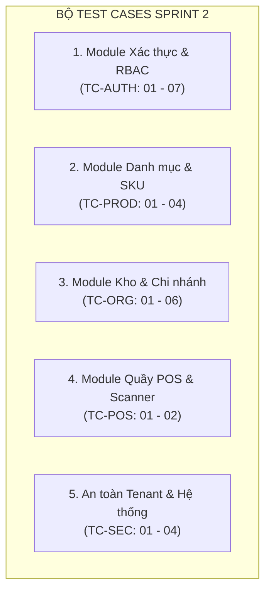

# Kế Hoạch Kiểm Thử Toàn Diện (Master Test Plan) — OISMS
**Dành cho: Thành viên 5 (Tester / Đảm bảo chất lượng - QA)**
**Dự án:** Omnichannel Inventory & Sales Management System (OISMS)  
**Mục tiêu:** Kiểm thử nghiệm thu Backend Sprint 2 và thiết lập ma trận kiểm thử lõi Sprint 3

---

## I. MỤC TIÊU & PHẠM VI KIỂM THỬ (TEST OBJECTIVES & SCOPE)

### 1. Mục tiêu cốt lõi của Tester (TV5)
1. **Kiểm thử nghiệm thu Sprint 2:** Xác minh tính đúng đắn của toàn bộ 33 endpoints API Backend đã được bàn giao tại `http://localhost:5000/swagger`.
2. **Bảo vệ tính toàn vẹn đa người thuê (Multi-tenant):** Kiểm chứng không có lỗ hổng rò rỉ dữ liệu chéo giữa các cửa hàng (Tenant A tuyệt đối không xem/sửa được dữ liệu của Tenant B).
3. **Kiểm tra phân quyền RBAC:** Đảm bảo vai trò `Cashier` (Thu ngân) bị chặn `403 Forbidden` khi cố tình gọi các API quản trị của `Owner` và `Staff`.
4. **Cập nhật ma trận RTM (Requirements Traceability Matrix):** Ghi nhận bằng chứng thực nghiệm (Evidence), lập Bug Log và xác nhận sửa lỗi với đội Backend.
5. **Chuẩn bị kịch bản Sprint 3:** Lập sẵn kịch bản kiểm thử máy trạng thái đơn hàng (Order State Machine), kiểm thử tranh chấp tồn kho (Concurrency 50 reqs) và chuyển kho 2 bước.

### 2. Môi trường & Công cụ Kiểm thử
- **Địa chỉ Swagger UI:** `http://localhost:5000/swagger`
- **Công cụ khuyến nghị:** Postman (hoặc Thunder Client trong VS Code), trình duyệt Chrome/Edge (F12 Network), Swagger UI.
- **Tài khoản Demo có sẵn trên hệ thống (DB PostgreSQL Docker cổng 5432):**
  - **Shop A (Tenant A - `11111111-1111-1111-1111-111111111111`):**
    - Owner: `owner@shopa.local` / Mật khẩu: `YourStrongDemoPassword123!`
    - Staff: `staff@shopa.local` / Mật khẩu: `YourStrongDemoPassword123!`
    - Cashier: `cashier@shopa.local` / Mật khẩu: `YourStrongDemoPassword123!`
  - **Shop B (Tenant B - `22222222-2222-2222-2222-222222222222`):**
    - Owner: `owner@shopb.local` / Mật khẩu: `YourStrongDemoPassword123!`

---

## II. MA TRẬN TEST CASES CHI TIẾT (SPRINT 2 ACCEPTANCE)

---

### Khối 1: Module Xác thực, Phân quyền RBAC & Đa Người Thuê (FR-AUTH)

| Test Case ID | Tên ca kiểm thử | Phương thức & Endpoint | Dữ liệu đầu vào (Payload / Header) | Kết quả kỳ vọng (Expected) | Trọng số |
| :--- | :--- | :--- | :--- | :--- | :---: |
| **TC-AUTH-01** | Đăng ký cửa hàng mới thành công | `POST /api/auth/register-tenant` | `{ tenantName: "Shop Test", tenantCode: "SHOP_TEST_01", fullName: "Chủ Shop", email: "newowner@shop.vn", password: "Password@123" }` | HTTP **201 Created**, trả về `tenantId`, `userId`, `accessToken` | **Blocker** |
| **TC-AUTH-02** | Chặn đăng ký trùng Email toàn hệ thống | `POST /api/auth/register-tenant` | Dùng lại email đã tồn tại (`owner@shopa.local`) | HTTP **409 Conflict**, thông báo "Email đã tồn tại trong hệ thống" | **Critical** |
| **TC-AUTH-03** | Đăng nhập hợp lệ nhận JWT | `POST /api/auth/login` | `{ email: "owner@shopa.local", password: "YourStrongDemoPassword123!" }` | HTTP **200 OK**, trả về `accessToken` (JWT), `refreshToken`, thông tin User & Role `Owner` | **Blocker** |
| **TC-AUTH-04** | Đăng nhập sai mật khẩu | `POST /api/auth/login` | `{ email: "owner@shopa.local", password: "WrongPassword" }` | HTTP **401 Unauthorized**, không cấp token | **Major** |
| **TC-AUTH-05** | Token Rotation (Làm mới token) | `POST /api/auth/refresh-token` | `{ refreshToken: "<token_nhận_từ_login>" }` | HTTP **200 OK**, trả về cặp Access Token mới và Refresh Token mới | **Major** |
| **TC-AUTH-06** | Đăng xuất & Thu hồi token | `POST /api/auth/logout` | `{ refreshToken: "<token_vừa_dùng>" }` | HTTP **200 OK**. Sau đó dùng lại Refresh token này phải bị từ chối **401** | **Major** |
| **TC-AUTH-07** | Phân quyền: Cashier gọi API quản trị | `POST /api/branches` | Header: `Authorization: Bearer <token_cashier>` | HTTP **403 Forbidden** (Chặn thu ngân tạo chi nhánh/sản phẩm) | **Critical** |

---

### Khối 2: Module Danh mục, Thương hiệu, Sản phẩm & Mã vạch (FR-PROD)

| Test Case ID | Tên ca kiểm thử | Phương thức & Endpoint | Dữ liệu đầu vào (Payload / Header) | Kết quả kỳ vọng (Expected) | Trọng số |
| :--- | :--- | :--- | :--- | :--- | :---: |
| **TC-CAT-01** | Lấy cây danh mục phân cấp | `GET /api/categories` | Bearer Token Owner/Staff | HTTP **200 OK**, trả về danh sách danh mục có cấu trúc quan hệ `parentId` | **Major** |
| **TC-CAT-02** | Chống vòng lặp đệ quy cha - con | `PUT /api/categories/{id}` | Cập nhật `parentId` của danh mục cha trỏ vào chính con cháu của nó | HTTP **400 Bad Request**, chặn đứng vòng lặp vô tận | **Critical** |
| **TC-PROD-01** | Tạo sản phẩm kèm danh sách SKU | `POST /api/products` | `{ name: "Áo Thun Nam", categoryId: "...", brandId: "...", variants: [{ sku: "AT-TRANG-L", barcode: "8936012349999", retailPrice: 150000 }] }` | HTTP **201 Created**, tạo đầy đủ sản phẩm và SKU vào database | **Blocker** |
| **TC-PROD-02** | Chặn trùng mã SKU trong cùng Shop | `POST /api/products/{id}/variants` | Gửi mã SKU đã tồn tại (`POLO-NAM-DEN-M`) | HTTP **409 Conflict**, thông báo "Mã SKU đã tồn tại trong cửa hàng" | **Critical** |
| **TC-PROD-03** | Khác Shop được phép trùng SKU | `POST /api/products` (Shop B) | Đăng nhập Shop B, tạo SKU trùng mã với Shop A (`POLO-NAM-DEN-M`) | HTTP **201 Created** (Chứng minh tính độc lập giữa các Tenant) | **Critical** |
| **TC-BARCODE-01**| Quét mã vạch chuẩn EAN-13 | `GET /api/pos/barcode/{code}` | Mã `POLONAMDENM` hoặc mã 13 số hợp lệ | HTTP **200 OK**, phản hồi < 50ms, trả đúng SKU, Tên SP, Giá niêm yết | **Blocker** |
| **TC-BARCODE-02**| Quét mã không tồn tại | `GET /api/pos/barcode/UNKNOWN999` | Mã ngẫu nhiên không có trong database | HTTP **404 Not Found**, thông báo không tìm thấy sản phẩm | **Minor** |

---

### Khối 3: Module Chi nhánh, Kho hàng & Nhà cung cấp (FR-ORG)

| Test Case ID | Tên ca kiểm thử | Phương thức & Endpoint | Dữ liệu đầu vào (Payload / Header) | Kết quả kỳ vọng (Expected) | Trọng số |
| :--- | :--- | :--- | :--- | :--- | :---: |
| **TC-ORG-01** | Lấy danh sách Chi nhánh | `GET /api/branches` | Bearer Token Owner | HTTP **200 OK**, danh sách các chi nhánh của cửa hàng | **Major** |
| **TC-ORG-02** | Tạo kho hàng mới thuộc Chi nhánh | `POST /api/warehouses` | `{ branchId: "<id_chi_nhánh_hợp_lệ>", name: "Kho Trung Tâm Q1" }` | HTTP **201 Created**, kho có trạng thái `isActive = true`, gắn đúng `branchName` | **Blocker** |
| **TC-ORG-03** | Chặn tạo kho với chi nhánh giả | `POST /api/warehouses` | `{ branchId: "00000000-0000-0000-0000-000000000000", name: "Kho Lỗi" }` | HTTP **400 Bad Request**, "Chi nhánh không tồn tại hoặc không thuộc quyền sở hữu" | **Major** |
| **TC-ORG-04** | Bật/Tắt hoạt động kho hàng | `PUT /api/warehouses/{id}/toggle-status` | ID kho hàng hợp lệ | HTTP **200 OK**, trạng thái `isActive` chuyển từ `true` sang `false` và ngược lại | **Major** |
| **TC-ORG-05** | Lọc danh sách kho theo Branch | `GET /api/warehouses?branchId={id}` | Tham số `branchId` trên Query URL | HTTP **200 OK**, chỉ trả về các kho thuộc đúng chi nhánh được truyền vào | **Major** |
| **TC-ORG-06** | Tạo và tìm kiếm Nhà cung cấp | `POST /api/suppliers` & `GET /api/suppliers` | Thông tin nhà cung cấp hàng hóa | HTTP **201** khi tạo và **200** khi tìm kiếm | **Minor** |

---

### Khối 4: An toàn CSDL & Kiểm tra Sức khỏe Hệ thống (NFR-SEC & NFR-TENANT)

| Test Case ID | Tên ca kiểm thử | Phương thức & Endpoint | Dữ liệu đầu vào | Kết quả kỳ vọng (Expected) | Trọng số |
| :--- | :--- | :--- | :--- | :--- | :---: |
| **TC-SEC-01** | Kiểm tra Health Ready Probe | `GET /health/ready` | Không cần token (Public probe) | HTTP **200 OK**, `status: "Healthy"`, `tablesCount: 29`, `triggerVerified: true` | **Blocker** |
| **TC-SEC-02** | Bảo mật không rò rỉ Connection String | `GET /health/ready` (khi DB tắt) | Giả lập DB không khả dụng | HTTP **503 Service Unavailable**, phản hồi KHÔNG chứa password hay connection string | **Critical** |
| **TC-TENANT-01**| Cô lập dữ liệu chéo (Cross-tenant Leak) | `GET /api/warehouses` | Đăng nhập Shop B, thử gọi xem kho bằng `id` của Shop A | Trả về rỗng hoặc HTTP **404 Not Found**, không bao giờ thấy kho của Shop A | **Blocker** |
| **TC-TENANT-02**| Chống cập nhật chéo (Detached Entity) | `PUT /api/warehouses/{id_shop_A}/toggle-status` | Dùng Token của Shop B để sửa kho của Shop A | HTTP **404 Not Found**, không thể thay đổi dữ liệu của shop khác | **Blocker** |

---

## III. MẪU BÁO CÁO KẾT QUẢ & BUG LOG DÀNH CHO TESTER

Khi phát hiện lỗi hoặc lập báo cáo nghiệm thu, TV5 điền theo bảng chuẩn dưới đây để đưa vào tài liệu nghiệm thu Sprint:

### 1. Bảng Tổng Hợp Kết Quả Thực Thi (Execution Summary)
- **Tổng số Test Cases:** 20 ca
- **Passed:** ... / 20
- **Failed:** ... / 20
- **Blocked:** ... / 20
- **Tỉ lệ đạt:** ...%

### 2. Mẫu Nhật Ký Lỗi (Defect / Bug Log Template)

| Bug ID | Test Case | Tiêu đề lỗi | Mức độ | Endpoint / URL | Các bước tái hiện (Steps to Reproduce) | Kết quả thực tế | Người gán sửa | Trạng thái |
| :---: | :---: | :--- | :---: | :--- | :--- | :--- | :---: | :---: |
| **BUG-01** | TC-AUTH-07 | Cashier vẫn tạo được chi nhánh | Critical | `POST /api/branches` | 1. Login cashier 2. Gửi request tạo branch | Trả về 201 thay vì 403 Forbidden | Khoa / Nhựt | Open |
| **BUG-02** | TC-PROD-02 | Trùng SKU không báo lỗi | Major | `POST /api/products` | 1. Tạo SKU `ABC` 2. Tạo lại SKU `ABC` | Trả về 500 thay vì 409 Conflict | Nhựt | Fixed |

*Phân loại mức độ lỗi:*
- **Blocker:** Hệ thống sập, API không phản hồi, không thể tiếp tục test.
- **Critical:** Lỗi bảo mật, rò rỉ dữ liệu đa tenant, sai phân quyền, tính sai giá vốn.
- **Major:** Nghiệp vụ sai mã HTTP (ví dụ: trả 500 thay vì 400/409), logic xử lý không đúng mong đợi.
- **Minor:** Lỗi chính tả thông báo, định dạng ngày tháng chưa chuẩn.

---

## IV. LỘ TRÌNH CHUẨN BỊ CHO SPRINT 3 (DÀNH CHO TESTER)

Trong Sprint 3 (18/10 – 22/10), trọng tâm của Tester sẽ chuyển sang các luồng **giao dịch tài chính, kho vận và tải đồng thời**:

1. **Kiểm thử Máy trạng thái đơn hàng (Order State Machine):**
   - Luồng hợp lệ: `Draft` ➔ `Reserved` ➔ `Confirmed` ➔ `Completed`.
   - Luồng hủy: `Reserved` ➔ `Cancelled` (Tự động hoàn trả tồn khả dụng `Available`).
   - Luồng chặn: Đơn đã `Completed` thì không được phép chuyển ngược về `Draft` hay `Cancelled`.
2. **Kiểm thử Tranh chấp tồn kho (Concurrency Stress Test):**
   - Kịch bản Flash Sale: 1 biến thể SKU chỉ còn 1 sản phẩm tồn kho, 50 request POS & Sàn cùng đặt đồng thời.
   - Kỳ vọng: Chỉ đúng 1 đơn thành công (HTTP 200), 49 đơn còn lại bị từ chối sạch sẽ với mã lỗi `409 / INSUFFICIENT_STOCK`, tồn kho không bị âm.
3. **Kiểm thử Chuyển kho 2 bước (Two-step Stock Transfer):**
   - Bước 1 (Xuất kho đi): Trừ tồn kho xuất, ghi nhận hàng đang trên đường chuyển (`In-Transit`).
   - Bước 2 (Nhập kho đến): Cộng tồn kho đích, kết thúc trạng thái `In-Transit`.
4. **Kiểm thử Kiểm kê kho (Stock Count & Variance):**
   - So sánh tồn thực tế đếm được và tồn hệ thống, tự động sinh phiếu điều chỉnh cân bằng kho.
5. **Kiểm thử Sự kiện Realtime (SignalR):**
   - Bật quầy POS hoặc Admin, khi có đơn hàng mới từ kênh khác -> kiểm tra xem có nhận được thông báo nhảy popup và chuông hay không.
