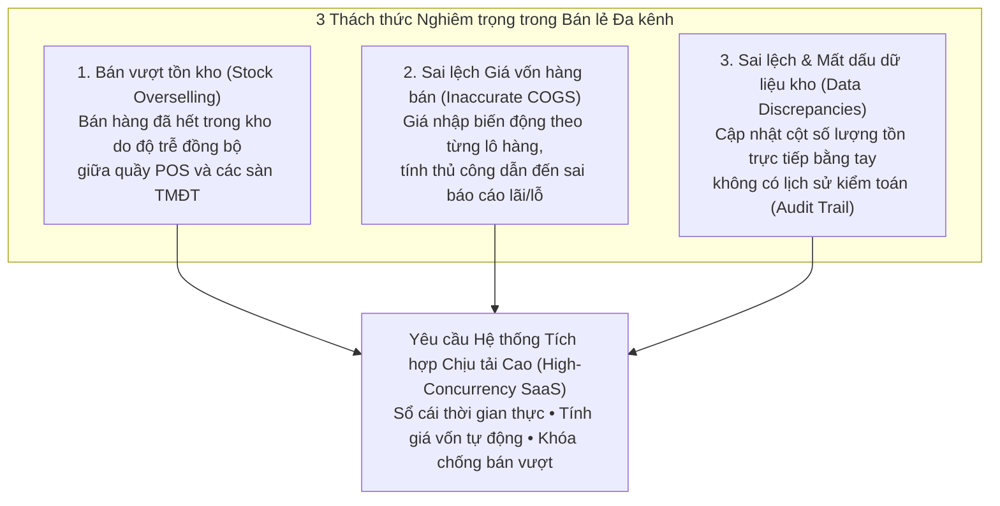
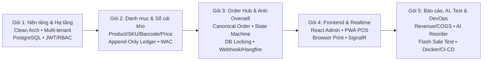

# 01. Tầm Nhìn & Tổng Quan Dự Án (Project Vision & Scope)

| Thông tin kiểm soát tài liệu | Chi tiết |
| :--- | :--- |
| **Mã tài liệu (Document ID)** | `DOC-OVW-01` |
| **Phiên bản (Version)** | `v1.0.0` |
| **Ngày hiệu lực (Effective Date)** | `2026-10-22` |
| **Nguồn truy vết (Source Traceability)** | `De bai CNPM.pdf` — Mục 3.1, 3.2.a, 3.2.b, 3.2.e, 3.2.f, 3.2.g (Trang 1, 4, 5, 6) |
| **Phạm vi áp dụng** | Toàn bộ hệ thống OISMS (Backend, Web Admin, Web POS PWA, DevOps) |

---

## Lịch sử Phiên bản (Version History)

| Phiên bản | Ngày cập nhật | Tác giả / Vai trò | Mô tả thay đổi | Mã tham chiếu |
| :---: | :---: | :--- | :--- | :--- |
| `v1.0.0` | `2026-10-22` | Nhóm dự án OISMS | Khởi tạo tài liệu tầm nhìn, bối cảnh bài toán, giải pháp kiến trúc và lộ trình 5 gói công việc từ đề bài gốc. | `INIT-OVW-01` |

---

## 1. Định danh Dự án (Project Identification)

- **Tên tiếng Anh:** Omnichannel Inventory and Sales Management System (**OISMS** / **OISM**)
- **Tên tiếng Việt:** Hệ thống quản lý bán hàng và tồn kho đa kênh
- **Mô hình vận hành:** Nền tảng phần mềm dạng dịch vụ đa người thuê (**Multi-tenant SaaS**)
- **Kiến trúc cốt lõi:** Clean Architecture (.NET 8 Web API, PostgreSQL, EF Core, React Admin Dashboard, React PWA POS, SignalR, Hangfire)

---

## 2. Bối cảnh Thực tiễn & Bài toán Kinh doanh (Business Context & Problem Statement)

> *Truy vết nguồn: Mục 3.2.a - Context (Trang 1, `De bai CNPM.pdf`)*

Trong bối cảnh bán lẻ hiện đại, các doanh nghiệp ngày càng mở rộng hoạt động kinh doanh trên nhiều kênh bán hàng đồng thời, bao gồm:
1. **Cửa hàng vật lý tại quầy (Physical Point-of-Sale - POS).**
2. **Các sàn thương mại điện tử (E-commerce Marketplaces):** Shopee, TikTok Shop, Lazada.

Tuy nhiên, việc quản lý tồn kho và đơn hàng rời rạc trên các kênh phân mảnh gây ra **3 thách thức nghiêm trọng**:

---

## 3. Giải pháp Đề xuất (Proposed Solution Architecture)

> *Truy vết nguồn: Mục 3.2.b - Proposed Solutions (Trang 1, `De bai CNPM.pdf`)*

Để giải quyết triệt để các vấn đề trên, dự án xây dựng hệ thống **OISMS** dựa trên nguyên lý **Clean Architecture** và **Multi-tenant SaaS** với 5 trụ cột kỹ thuật cốt lõi:

| STT | Trụ cột giải pháp | Cơ chế giải quyết bài toán | Mã yêu cầu liên kết |
| :---: | :--- | :--- | :--- |
| **1** | **Sổ cái kho chỉ ghi thêm (Append-Only Inventory Ledger)** | Thay thế hoàn toàn thao tác sửa trực tiếp cột tồn kho (`on_hand`) bằng bảng giao dịch sổ cái bất biến (`InventoryTransaction`), đảm bảo khả năng kiểm toán tuyệt đối 100%. | `FR-INV-01`, `NFR-SEC-03` |
| **2** | **Trung tâm tiếp nhận đơn hàng đa kênh (Order Ingestion Hub)** | Chuẩn hóa đơn hàng từ POS, Web Admin và Webhook sàn TMĐT về một mô hình đơn hợp nhất (**Canonical Order Model**) vận hành theo máy trạng thái (**State Machine**) nghiêm ngặt. | `FR-ORD-01`, `FR-ORD-02` |
| **3** | **Bộ tính Giá vốn bình quân tự động (Automated WAC Engine)** | Tự động tính lại giá vốn đơn vị theo công thức bình quân gia quyền ngay khi xác nhận nhập kho và chụp (snapshot) giá vốn vào từng dòng đơn hàng khi xuất bán. | `FR-COST-01`, `FR-COST-02` |
| **4** | **Module chống bán vượt dựa trên khóa CSDL (Lock-based Anti-Oversell)** | Duy trì tồn khả dụng động (`available = on_hand - reserved`) và áp dụng khóa mức cơ sở dữ liệu (Pessimistic/Optimistic Locking) để chặn đứng tình trạng bán âm trong các đợt Flash Sale. | `FR-RSE-01..03`, `NFR-PERF-02` |
| **5** | **Giao diện bán hàng PWA POS & Realtime** | Ứng dụng Web POS dạng Progressive Web App tối ưu cho màn hình cảm ứng, máy quét mã vạch, in hóa đơn nhiệt và thông báo đơn mới tức thời qua SignalR. | `FR-POS-01..04`, `FR-SIM-02` |

---

## 4. Sản phẩm Bàn giao Kỳ vọng (Expected Deliverables)

> *Truy vết nguồn: Mục 3.2.e & 3.2.f - Theory, Practical & Products (Trang 4, 5, `De bai CNPM.pdf`)*

### 4.1. Sản phẩm Phần mềm Hoàn chỉnh (Complete Software)
1. **Backend System (`.NET 8 Web API`):** Xử lý xác thực đa người thuê (Multi-tenant JWT/RBAC), sổ cái tồn kho bất biến, động cơ chống bán vượt và xử lý đơn hàng thời gian thực.
2. **Admin Dashboard (`React Web Application`):** Ứng dụng quản trị dành cho Chủ cửa hàng (Owner) và Nhân viên kho (Staff) để quản lý danh mục sản phẩm/SKU, xem sổ cái kho, điều phối đơn hàng đa kênh và phân tích báo cáo lợi nhuận gộp.
3. **POS Application (`React PWA`):** Ứng dụng bán hàng tại quầy tốc độ cao dành cho Thu ngân (Cashier), hỗ trợ quét mã vạch (EAN-13/Code128), thanh toán nguyên tử dưới 3 thao tác và in hóa đơn trình duyệt.
4. **Gói cài đặt Demo (`Docker Compose Package`):** Đóng gói trọn bộ Backend, Web Admin, POS App, PostgreSQL Database và kịch bản khởi tạo dữ liệu mẫu (`seed data scripts`) để triển khai tức thì.

### 4.2. Bộ Hồ sơ Tài liệu Kỹ thuật (Software Engineering Documentation)
Áp dụng quy trình **Agile** và ngôn ngữ mô hình hóa **UML 2.0**:
- Đặc tả yêu cầu người dùng (**URS**) & Ma trận truy vết yêu cầu (**RTM**).
- Tài liệu thiết kế kiến trúc (**Architecture Design Document**: Clean Architecture, SaaS Multi-tenancy).
- Tài liệu thiết kế chi tiết (**Detailed Design**: UML Class Diagrams, ERD, Sequence Diagrams cho Giữ chỗ tồn kho & Thanh toán nhanh POS).
- Kế hoạch hiện thực hóa và triển khai hệ thống (**System Implementation & Deployment Plan**).
- Tài liệu kiểm thử phần mềm (**Software Testing Document**: Unit Test, Integration Test, Concurrency Test cases).
- Đặc tả API (**Swagger/Postman**) và Tài liệu hướng dẫn cài đặt & sử dụng (**Installation & User Guide**).

---

## 5. Phân rã 5 Gói Công việc Trọng tâm (Proposed Task Packages)

> *Truy vết nguồn: Mục 3.2.g - Proposed Tasks (Trang 5, 6, `De bai CNPM.pdf`)*

| Gói công việc | Tên gói (Theo đề bài) | Nội dung triển khai cốt lõi | Mã FR/NFR liên quan |
| :---: | :--- | :--- | :--- |
| **Task Package 1** | **Core Platform & Infrastructure Setup** | Thiết lập cấu trúc giải pháp Clean Architecture (.NET 8); xây dựng nền tảng Multi-tenant, thiết kế schema PostgreSQL, EF Core Global Query Filters và module xác thực JWT/RBAC. | `FR-AUTH-01..04`, `NFR-TENANT-01`, `NFR-MAINT-01` |
| **Task Package 2** | **Product Catalog & Append-Only Inventory Ledger** | Phát triển API quản lý Danh mục, Thương hiệu, Sản phẩm, Biến thể SKU, Mã vạch, Bảng giá; hiện thực cơ chế Sổ cái kho chỉ ghi thêm, quy trình Nhập kho/Chuyển kho/Kiểm kê và máy tính giá vốn bình quân (WAC). | `FR-PROD-01..04`, `FR-INV-01..04`, `FR-COST-01..02`, `NFR-SEC-03` |
| **Task Package 3** | **Centralized Order Hub & Anti-Oversell Engine** | Hiện thực Mô hình đơn hàng hợp nhất (Canonical Order Model) và luật chuyển trạng thái (State Machine); xây dựng động cơ giữ chỗ/trừ tồn (Reserve/Deduct) với Database Locking; phát triển Webhook Simulator và tác vụ nền Hangfire. | `FR-ORD-01..03`, `FR-RSE-01..03`, `FR-SIM-01`, `FR-SIM-03`, `NFR-PERF-02` |
| **Task Package 4** | **POS Front-end & Real-time Integration** | Xây dựng Web Admin Dashboard quản lý kho/danh mục/đơn hàng; xây dựng ứng dụng PWA POS hỗ trợ quét barcode nhanh, in hóa đơn trình duyệt và thanh toán 1 giao dịch nguyên tử; tích hợp SignalR báo đơn mới thời gian thực. | `FR-POS-01..04`, `FR-SIM-02`, `NFR-USA-02` |
| **Task Package 5** | **Reporting, AI Integration, Testing & Deployment** | Xây dựng báo cáo phân tích Doanh thu, Giá vốn (COGS) và Lợi nhuận gộp; tích hợp dự báo AI gợi ý nhập lại hàng; viết Unit/Integration Test ($\ge 80\%$), chạy test chịu tải Flash Sale, thiết lập CI/CD GitHub Actions và đóng gói Docker. | `FR-REP-01..03`, `FR-AI`, `NFR-PERF-01`, `NFR-MAINT-02` |
