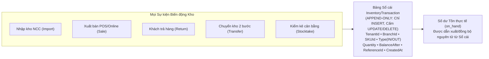
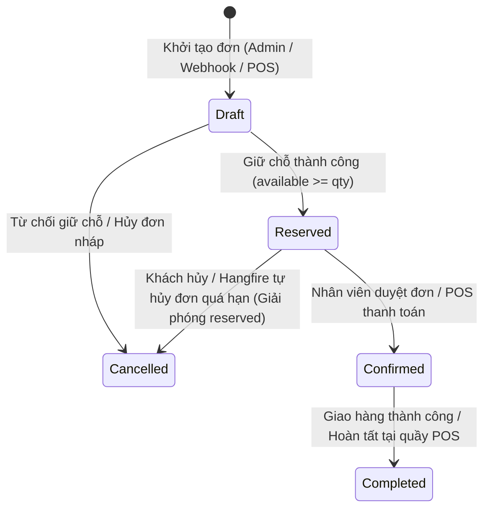

# 02. Các Khái Niệm & Cơ Chế Nghiệp Vụ Cốt Lõi (Core Domain Concepts)

| Thông tin kiểm soát tài liệu | Chi tiết |
| :--- | :--- |
| **Mã tài liệu (Document ID)** | `DOC-OVW-02` |
| **Phiên bản (Version)** | `v1.0.0` |
| **Ngày hiệu lực (Effective Date)** | `2026-10-22` |
| **Nguồn truy vết (Source Traceability)** | `De bai CNPM.pdf` — Mục 3.2.b, 3.2.c, 3.2.d (Trang 1, 2, 3, 4) |
| **Phạm vi áp dụng** | Domain Layer, Application Use Cases, Database Schema & UI Workflows |

---

## Lịch sử Phiên bản (Version History)

| Phiên bản | Ngày cập nhật | Tác giả / Vai trò | Mô tả thay đổi | Mã tham chiếu |
| :---: | :---: | :--- | :--- | :--- |
| `v1.0.0` | `2026-10-22` | Nhóm dự án OISMS | Định nghĩa chuẩn hóa các khái niệm miền nghiệp vụ (Ubiquitous Language) và quy tắc bất biến của hệ thống OISMS. | `INIT-OVW-02` |

---

## 1. Kiến trúc Đa Người Thuê & Cô lập Dữ liệu (Multi-Tenancy & Data Isolation)

> *Truy vết nguồn: `FR-AUTH-01`, `NFR-TENANT-01`, `NFR-TENANT-02` (Trang 1, 4, `De bai CNPM.pdf`)*

- **Tenant (Khách thuê / Doanh nghiệp bán lẻ):** Mỗi cửa hàng hoặc chuỗi cửa hàng đăng ký sử dụng hệ thống được cấp một định danh duy nhất `TenantId` và hoạt động trong một không gian dữ liệu cô lập hoàn toàn.
- **Chiến lược lưu trữ:** Sử dụng mô hình **Shared Database với cột `TenantId` bắt buộc** trên toàn bộ các bảng dữ liệu vận hành, kết hợp **EF Core Global Query Filters** để tự động lọc dữ liệu theo `TenantId` trong JWT của người dùng đang đăng nhập, cam kết **0% rò rỉ dữ liệu chéo** giữa các cửa hàng.
- **Branch & Warehouse (Chi nhánh & Kho hàng):** Một Tenant có thể sở hữu nhiều chi nhánh (`Branch`) và kho hàng (`Warehouse`). Số dư tồn kho và khả năng cung ứng hàng hóa được quản lý chi tiết theo từng chi nhánh/kho.

---

## 2. Cấu trúc Sản phẩm, Biến thể SKU, Mã vạch & Giá niêm yết (Catalog & SKU Hierarchy)

> *Truy vết nguồn: `FR-PROD-01` đến `FR-PROD-04` (Trang 1, 2, `De bai CNPM.pdf`)*

- **Category & Brand (Danh mục phân cấp & Thương hiệu):** Danh mục hỗ trợ phân cấp cha - con nhiều tầng (`ParentId`) và gắn kết với Thương hiệu (`Brand`).
- **Product vs. Variant/SKU (Sản phẩm gốc & Đơn vị lưu kho):**
  - Hệ thống hỗ trợ cả sản phẩm đơn giản và sản phẩm đa biến thể (theo Màu sắc, Kích thước, Chất liệu...).
  - Mỗi biến thể cụ thể là một **SKU (Stock Keeping Unit)** có mã `SkuCode` **duy nhất trong phạm vi cùng một Tenant**.
- **Barcode (Mã vạch EAN-13 / Code128):** Mỗi SKU được gắn mã vạch (nhập thủ công hoặc tự động sinh) phục vụ quét tia laser/camera tại quầy POS và khi kiểm kê kho.
- **Listed Price vs. COGS (Giá bán niêm yết vs. Giá vốn):**
  - Mỗi SKU có **Giá bán lẻ (Retail Price)** và **Giá bán sỉ (Wholesale Price)** do chủ cửa hàng thiết lập.
  - Giá bán niêm yết hoàn toàn **tách biệt độc lập** với Giá vốn hàng bán (**COGS / Unit Cost**).

---

## 3. Sổ Cái Tồn Kho Bất Biến Chỉ Ghi Thêm (Append-Only Inventory Ledger)

> *Truy vết nguồn: `FR-INV-01`, `NFR-SEC-03` (Trang 2, 4, `De bai CNPM.pdf`)*

- **Quy tắc bất biến (Immutability Rule):** Bảng `InventoryTransaction` hoạt động như sổ cái ngân hàng — **tuyệt đối cấm lệnh `UPDATE` hoặc `DELETE`**.
- **Cấm sửa trực tiếp `on_hand`:** Nghiêm cấm mọi hành vi cập nhật trực tiếp cột số lượng tồn kho mà không thông qua giao dịch ghi sổ cái. Nếu phát sinh sai sót, hệ thống bắt buộc phải tạo **bút toán điều chỉnh bù/đảo (Compensating Ledger Transaction)**.
- **Cấu trúc bản ghi chuẩn:** Mỗi dòng giao dịch bắt buộc lưu đầy đủ: `TenantId`, `BranchId`, `SKUId`, `Type` (`IN` / `OUT`), `Quantity`, `BalanceAfter` (số dư tồn ngay sau giao dịch), `ReferenceId` (mã chứng từ gốc) và `CreatedAt`.

---

## 4. Giá Vốn Bình Quân Gia Quyền & Chụp Giá Vốn Lịch Sử (Weighted Average Cost - WAC)

> *Truy vết nguồn: `FR-COST-01`, `FR-COST-02` (Trang 2, `De bai CNPM.pdf`)*

### 4.1. Công thức tính lại giá vốn khi Nhập kho (`FR-COST-01`)
Ngay tại thời điểm xác nhận Phiếu nhập hàng từ Nhà cung cấp (`Purchase Receipt Confirmation`), hệ thống tự động tính lại giá vốn đơn vị của SKU theo công thức bình quân gia quyền:

$$\text{NewCost} = \frac{(\text{OldStock} \times \text{OldCost}) + (\text{ImportQty} \times \text{ImportPrice})}{\text{OldStock} + \text{ImportQty}}$$

### 4.2. Chụp giá vốn tại thời điểm xuất bán (`FR-COST-02`)
- Khi một đơn hàng chuyển sang trạng thái **Confirmed** hoặc được **thanh toán tại quầy POS**, hệ thống chụp (snapshot) chính xác giá vốn bình quân hiện hành của SKU vào trường `OrderItem.CostPrice`.
- **Bảo toàn lịch sử lợi nhuận:** Các lần nhập hàng sau làm thay đổi giá vốn hiện tại sẽ **không bao giờ** làm sai lệch giá vốn và lợi nhuận gộp của các đơn hàng đã bán trong quá khứ.

---

## 5. Công Thức Tồn Khả Dụng & Cơ Chế Chống Bán Vượt (Anti-Oversell & Stock Reservation)

> *Truy vết nguồn: `FR-RSE-01` đến `FR-RSE-03`, `NFR-PERF-02` (Trang 2, 3, 4, `De bai CNPM.pdf`)*

Hệ thống phân biệt rõ 3 chỉ số tồn kho cho mỗi SKU tại từng Chi nhánh:

$$\text{Available (Tồn khả dụng)} = \text{OnHand (Tồn vật lý trong kho)} - \text{Reserved (Tồn đang giữ chỗ cho đơn chờ)}$$

| Sự kiện nghiệp vụ | Tác động lên `OnHand` | Tác động lên `Reserved` | Tác động lên `Available` | Ghi Sổ cái (`InventoryTransaction`) |
| :--- | :---: | :---: | :---: | :---: |
| **1. Đơn Online mới vào trạng thái `Reserved`** | Giữ nguyên | $+\text{Qty}$ | $-\text{Qty}$ | Chưa ghi (chỉ giữ chỗ) |
| **2. Đơn hàng được duyệt `Confirmed`** | $-\text{Qty}$ | $-\text{Qty}$ | Giữ nguyên (đã trừ lúc Reserve) | **Ghi `OUT`** + Chụp `CostPrice` |
| **3. Đơn `Reserved` bị hủy `Cancelled` / Hết hạn** | Giữ nguyên | $-\text{Qty}$ | $+\text{Qty}$ (Hoàn trả kho khả dụng) | Không ghi |
| **4. Thanh toán nhanh tại quầy POS (`Fast Checkout`)** | $-\text{Qty}$ | $+ \text{Qty} \rightarrow -\text{Qty}$ (Nguyên tử) | $-\text{Qty}$ | **Ghi `OUT`** + Chụp `CostPrice` |

- **Khóa mức Cơ sở dữ liệu (Database-level Locking):** Trong kịch bản tranh chấp cao (ví dụ: 50 khách cùng đặt mua 1 sản phẩm cuối cùng trong Flash Sale), hệ thống bắt buộc sử dụng **Pessimistic Locking (`SELECT ... FOR UPDATE`)** hoặc **Optimistic Concurrency (`RowVersion`)** trong Transaction ACID để đảm bảo chỉ đúng 1 đơn thành công và `Available` không bao giờ âm (`< 0`).

---

## 6. Mô Hình Đơn Hàng Hợp Nhất & Máy Trạng Thái (Canonical Order & State Machine)

> *Truy vết nguồn: `FR-ORD-01` đến `FR-ORD-03`, `FR-POS-04` (Trang 2, 3, `De bai CNPM.pdf`)*

- **Canonical Order Model:** Mọi đơn hàng phát sinh từ Quầy POS, tạo thủ công trên Web Admin, hay đẩy về từ trình giả lập Webhook (Shopee, TikTok Shop, Lazada) đều được chuẩn hóa về chung một cấu trúc thực thể `Order` & `OrderItem` duy nhất.
- **Order State Machine (Vòng đời đơn hàng):**

