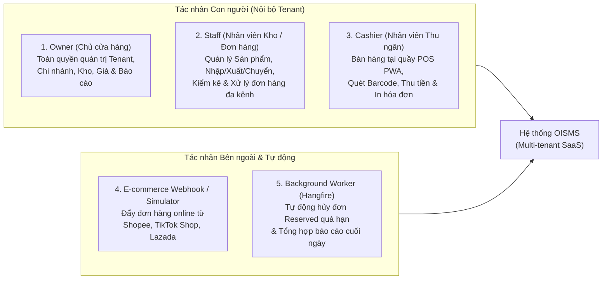

# 01. Đặc Tả Tác Nhân & Chân Dung Người Dùng (Actors & Personas)

| Thông tin kiểm soát tài liệu | Chi tiết |
| :--- | :--- |
| **Mã tài liệu (Document ID)** | `DOC-USR-01` |
| **Phiên bản (Version)** | `v1.0.0` |
| **Ngày hiệu lực (Effective Date)** | `2026-10-22` |
| **Nguồn truy vết (Source Traceability)** | `De bai CNPM.pdf` — Mục `FR-AUTH-01..04`, `FR-ORD-03`, `FR-POS-01..04`, `FR-SIM-01..03` (Trang 1, 2, 3) |
| **Phạm vi áp dụng** | Phân hệ Xác thực, Phân quyền RBAC, Giao diện Web Admin & Web POS PWA |

---

## Lịch sử Phiên bản (Version History)

| Phiên bản | Ngày cập nhật | Tác giả / Vai trò | Mô tả thay đổi | Mã tham chiếu |
| :---: | :---: | :--- | :--- | :--- |
| `v1.0.0` | `2026-10-22` | Nhóm dự án OISMS | Đặc tả chi tiết 5 nhóm tác nhân (Actors) tương tác với hệ thống OISMS theo đề bài. | `INIT-USR-01` |

---

## 1. Sơ Đồ Tổng Quan Tác Nhân Hệ Thống (System Actors Overview)

---

## 2. Chi Tiết Từng Tác Nhân (Detailed Actor Specifications)

### 2.1. Chủ Cửa Hàng — `Owner` (Store Tenant Owner)
- **Nguồn đề bài:** `FR-AUTH-01`, `FR-AUTH-03`, `FR-AUTH-04`, `FR-REP-01..03` (Trang 1, 3, 5).
- **Mô tả vai trò:** Người sáng lập hoặc chủ sở hữu hợp pháp của một doanh nghiệp bán lẻ (`Tenant`) đăng ký trên nền tảng OISMS.
- **Trách nhiệm & Quyền hạn chính:**
  - Khởi tạo tài khoản cửa hàng (`Tenant Registration`) và nhận `TenantId` riêng biệt.
  - Tạo mới, cập nhật thông tin hoặc bật/tắt trạng thái hoạt động (`IsActive`) của các Chi nhánh (`Branch`), Kho hàng (`Warehouse`) và Tài khoản nhân viên thuộc Tenant của mình.
  - Quản lý toàn diện danh mục, thương hiệu, sản phẩm, biến thể SKU, mã vạch và thiết lập bảng giá bán lẻ/bán sỉ (`FR-PROD-01..04`).
  - Thực hiện hoặc phê duyệt mọi nghiệp vụ kho (Nhập hàng NCC, Chuyển kho, Kiểm kê cân bằng kho) và đơn hàng đa kênh.
  - Truy cập độc quyền các báo cáo tài chính nhạy cảm: Doanh thu thuần, Tổng giá vốn (`Total COGS`) và Lợi nhuận gộp (`Gross Profit = Revenue - COGS`).

### 2.2. Nhân Viên Kho & Điều Phối Đơn Hàng — `Staff` (Warehouse / Order Manager)
- **Nguồn đề bài:** `FR-AUTH-03`, `FR-INV-01..04`, `FR-ORD-03` (Trang 1, 2).
- **Mô tả vai trò:** Nhân sự phụ trách vận hành kho bãi, danh mục hàng hóa và xử lý đơn hàng hằng ngày tại cửa hàng/chi nhánh.
- **Trách nhiệm & Quyền hạn chính:**
  - Quản lý danh mục sản phẩm, biến thể SKU và mã vạch phục vụ in tem/quét kiểm kê.
  - Lập và xác nhận Phiếu nhập hàng từ Nhà cung cấp (`FR-INV-02`), kích hoạt tính lại giá vốn bình quân (`WAC`).
  - Thực hiện quy trình chuyển kho 2 bước giữa các chi nhánh (`Out-bound transit -> In-bound confirmation`, `FR-INV-03`).
  - Tạo phiên kiểm kê vật lý, nhập số lượng kiểm đếm thực tế và sinh bút toán điều chỉnh sổ cái (`FR-INV-04`).
  - Theo dõi danh sách đơn hàng chờ (`Pending/Reserved`), duyệt đơn (`Confirmed`), in phiếu giao hàng (`Shipping Slips`) hoặc hủy đơn (`FR-ORD-03`).
- **Giới hạn quyền hạn:** Không được phép tạo/xóa Chi nhánh hoặc quản lý tài khoản nhân sự cấp Tenant (`FR-AUTH-04`).

### 2.3. Nhân Viên Thu Ngân — `Cashier` (Counter POS Cashier)
- **Nguồn đề bài:** `FR-AUTH-03`, `FR-POS-01..04`, `NFR-USA-02` (Trang 1, 3, 4).
- **Mô tả vai trò:** Nhân viên đứng quầy trực tiếp phục vụ khách mua lẻ tại cửa hàng vật lý thông qua ứng dụng **PWA POS**.
- **Trách nhiệm & Quyền hạn chính:**
  - Tìm kiếm nhanh hàng hóa theo Tên, mã SKU hoặc quét mã vạch `EAN-13`/`Code128` (`p95 < 200ms`).
  - Kiểm tra tồn khả dụng (`available`) tức thì tại chi nhánh đang đứng quầy, lập giỏ hàng đa dòng.
  - Thực hiện thu tiền (Tiền mặt / Chuyển khoản QR), kích hoạt luồng thanh toán nguyên tử `Reserve -> Confirm -> Deduct` và in hóa đơn nhiệt cho khách hàng.
- **Giới hạn quyền hạn nghiêm ngặt (`Strict RBAC`):**
  - **Chỉ được phép sử dụng phân hệ POS (`POS only`).**
  - Bị chặn hoàn toàn (`HTTP 403 Forbidden` trên API và chặn điều hướng trên UI) đối với các chức năng quản trị Web Admin: thêm/sửa sản phẩm, nhập kho, điều chỉnh tồn kho, cấu hình chi nhánh và báo cáo lợi nhuận gộp.

### 2.4. Hệ Thống Sàn TMĐT / Trình Giả Lập Webhook — `E-commerce Webhook Simulator`
- **Nguồn đề bài:** `FR-ORD-01`, `FR-RSE-02`, `FR-SIM-01`, `NFR-PERF-02` (Trang 2, 3).
- **Mô tả vai trò:** Tác nhân tích hợp bên ngoài đại diện cho các kênh bán hàng trực tuyến (Shopee, TikTok Shop, Lazada) gửi đơn hàng về trung tâm đơn hàng (`Order Ingestion Hub`).
- **Hành vi tương tác:**
  - Đẩy payload đơn hàng thương mại điện tử vào endpoint tiếp nhận đơn.
  - Kích hoạt kiểm tra và giữ chỗ tồn kho (`Reserved`) đồng thời ở cường độ cao (kịch bản Flash Sale 50 đơn tranh 1 SKU cuối cùng).

### 2.5. Tác Vụ Nền Tự Động — `Background Worker (Hangfire)`
- **Nguồn đề bài:** `FR-SIM-03`, `FR-RSE-03` (Trang 3).
- **Mô tả vai trò:** Tác nhân hệ thống chạy ngầm định kỳ không cần sự can thiệp của con người.
- **Hành vi tương tác:**
  - Quét định kỳ các đơn hàng ở trạng thái `Reserved` đã quá thời gian chờ thanh toán/xác nhận để tự động chuyển sang `Cancelled` và giải phóng số lượng `reserved` về lại quỹ `available`.
  - Thực hiện tổng hợp dữ liệu báo cáo doanh thu - giá vốn hằng ngày (`Daily report aggregations`).
