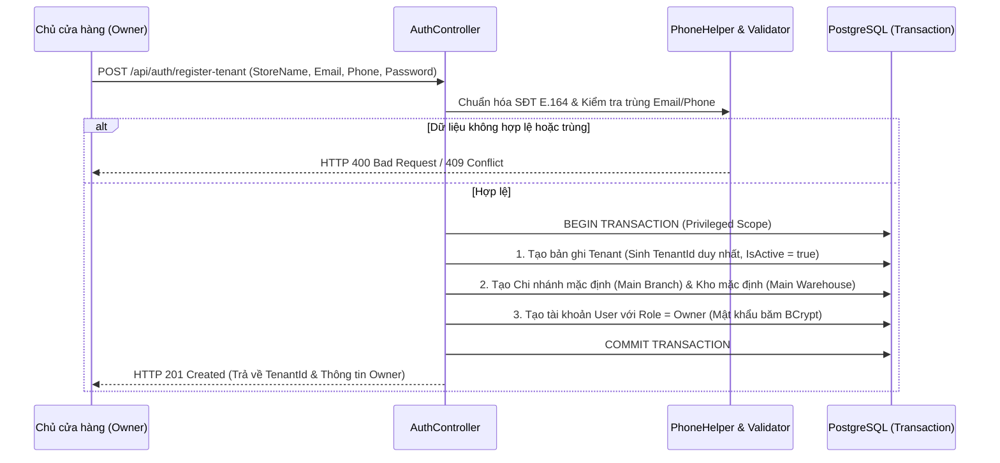

# 03. Vòng Đời Khách Thuê & Quản Lý Tổ Chức (Tenant & Branch Lifecycle)

| Thông tin kiểm soát tài liệu | Chi tiết |
| :--- | :--- |
| **Mã tài liệu (Document ID)** | `DOC-USR-03` |
| **Phiên bản (Version)** | `v1.0.0` |
| **Ngày hiệu lực (Effective Date)** | `2026-10-22` |
| **Nguồn truy vết (Source Traceability)** | `De bai CNPM.pdf` — Mục `FR-AUTH-01`, `FR-AUTH-04`, `NFR-TENANT-01` (Trang 1, 4) |
| **Phạm vi áp dụng** | Khởi tạo Tenant, Quản lý Chi nhánh/Kho và Bảo vệ Trạng thái Hoạt động (`IsActive`) |

---

## Lịch sử Phiên bản (Version History)

| Phiên bản | Ngày cập nhật | Tác giả / Vai trò | Mô tả thay đổi | Mã tham chiếu |
| :---: | :---: | :--- | :--- | :--- |
| `v1.0.0` | `2026-10-22` | Nhóm dự án OISMS | Đặc tả chu trình sống của Tenant, cấu trúc phân cấp Chi nhánh - Kho và quy tắc kiểm tra trạng thái hoạt động. | `INIT-USR-03` |

---

## 1. Quy Trình Khởi Tạo Khách Thuê Nguyên Tử (`FR-AUTH-01`)

Khi một doanh nghiệp mới đăng ký cửa hàng qua API `POST /api/auth/register-tenant`, hệ thống thực thi một giao dịch cơ sở dữ liệu nguyên tử (**Atomic Transaction**) để thiết lập không gian dữ liệu cô lập:



---

## 2. Cấu Trúc Phân Cấp Tổ Chức Trong Một Tenant (`FR-AUTH-04`)

Mỗi `Tenant` quản lý hệ thống điểm bán và lưu trữ hàng hóa theo cấu trúc phân cấp:

```
Tenant (Doanh nghiệp / Cửa hàng - TenantId)
 ├── Users (Tài khoản nhân sự: Owner, Staff, Cashier)
 ├── Catalog (Danh mục, Thương hiệu, Sản phẩm, Biến thể SKU - Dùng chung toàn Tenant)
 └── Branches (Chi nhánh bán hàng - BranchId)
      ├── Warehouses (Kho lưu trữ thuộc chi nhánh - WarehouseId)
      ├── Inventory Balances (Số dư OnHand, Reserved, Available, WAC theo Chi nhánh/Kho)
      └── Orders & Ledger Transactions (Đơn hàng & Sổ cái phát sinh tại Chi nhánh)
```

---

## 3. Quy Tắc Kiểm Soát Trạng Thái Hoạt Động (`IsActive` Lifecycle Rules)

Để đảm bảo tính toàn vẹn dữ liệu trong suốt vòng đời vận hành của cửa hàng, hệ thống áp dụng các quy tắc kiểm soát trạng thái nghiêm ngặt:

| Cấp độ tài nguyên | Khi `IsActive = true` (Đang hoạt động) | Khi `IsActive = false` (Tạm khóa / Ngừng hiển thị) |
| :--- | :--- | :--- |
| **1. Tenant (`tenants.is_active`)** | Mọi người dùng thuộc Tenant đăng nhập và giao dịch bình thường. | Chặn hoàn toàn cả `POST /api/auth/login` lẫn `POST /api/auth/refresh-token` (trả về `401 Unauthorized`). |
| **2. User (`users.is_active`)** | Được cấp phát và làm mới JWT bình thường. | Thu hồi quyền truy cập ngay lập tức khi đăng nhập hoặc làm mới token (`401 Unauthorized`). |
| **3. Branch & Warehouse (`is_active`)** | Cho phép lập phiếu nhập kho, giữ chỗ tồn kho (`Reserve`) và bán hàng POS. | Chặn tạo mới giao dịch giữ chỗ hoặc nhập kho vào chi nhánh/kho đã ngừng hoạt động (`409 Conflict`). Không cho phép đổi chi nhánh của kho đã phát sinh lịch sử sổ cái. |
