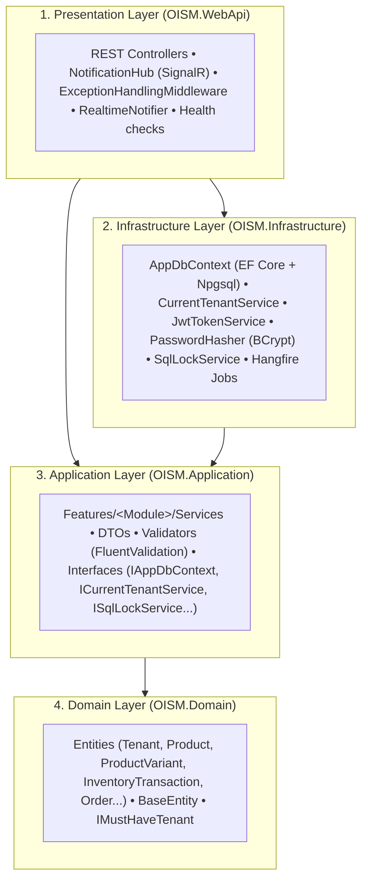

# 01. Thiết Kế Kiến Trúc Sạch 4 Tầng (Clean Architecture Design)

| Thông tin kiểm soát tài liệu | Chi tiết |
| :--- | :--- |
| **Mã tài liệu (Document ID)** | `DOC-ARC-01` |
| **Phiên bản (Version)** | `v1.1.0` |
| **Ngày hiệu lực (Effective Date)** | `2026-11-06` |
| **Nguồn truy vết (Source Traceability)** | `De bai CNPM.pdf` — Mục `3.2.b`, `NFR-MAINT-01`, `3.2.e` (Trang 1, 4, 5) |
| **Phạm vi áp dụng** | Solution Backend `src/backend/OISM.sln` |

---

## Lịch sử Phiên bản (Version History)

| Phiên bản | Ngày cập nhật | Tác giả / Vai trò | Mô tả thay đổi | Mã tham chiếu |
| :---: | :---: | :--- | :--- | :--- |
| `v1.0.0` | `2026-10-22` | Nhóm dự án OISMS | Đặc tả kiến trúc Clean Architecture 4 tầng của hệ thống Backend `.NET 8`. | `INIT-ARC-01` |
| `v1.1.0` | `2026-11-06` | Nhóm dự án OISMS | Đồng bộ tên project, interface và service theo mã nguồn hiện tại; ghi rõ nợ kỹ thuật đã biết. | `OISMS-46` |

---

## 1. Sơ Đồ Phân Tầng & Chiều Phụ Thuộc (Dependency Rule)

---

## 2. Trách Nhiệm Từng Tầng Trong `src/backend/src/`

| Tầng (Project) | Đường dẫn mã nguồn | Trách nhiệm kỹ thuật (`NFR-MAINT-01`) |
| :--- | :--- | :--- |
| **`OISM.Domain`** | `src/backend/src/OISM.Domain` | 41 entity trong `Entities/` (`Tenant`, `User`, `Branch`, `Warehouse`, `Product`, `ProductVariant` ánh xạ bảng `skus`, `Unit`, `SkuUnit`, `InventoryBalance`, `WarehouseInventoryBalance`, `InventoryTransaction`, `GoodsReceipt`, `PurchaseOrder`, `Order`, `Reservation`, `SalesInvoice`, `PriceList`, `StockCount`, `StockCountSchedule`...), `Common/BaseEntity` và `Common/IMustHaveTenant`. Trạng thái nghiệp vụ lưu dạng chuỗi và được ràng buộc bằng `CHECK` trong PostgreSQL. |
| **`OISM.Application`** | `src/backend/src/OISM.Application` | `Features/<Module>/` gồm 20 module: `Ai`, `Auth`, `Branches`, `Catalog`, `Inventory`, `Orders`, `Pos`, `Pricing`, `PurchaseOrders`, `Realtime`, `Reports`, `SalesInvoices`, `Search`, `Simulator`, `StockCounts`, `StockTransfers`, `Suppliers`, `Users`, `Warehouses`, `Webhooks`. Mỗi module có service (`OrderService`, `GoodsReceiptService`, `ReservationService`, `PriceChangeService`, `StockCountService`...), DTO và validator. `Common/Interfaces` định nghĩa `IAppDbContext`, `ICurrentTenantService`, `IJwtTokenService`, `IPasswordHasher`, `ISqlLockService`, `IReservationExpiryJob`, `IStockCountPeriodJob`. |
| **`OISM.Infrastructure`** | `src/backend/src/OISM.Infrastructure` | `Persistence/AppDbContext` (38 global query filter theo tenant, tenant guard khi `SaveChanges`, `OpenPrivilegedScope`), `Configurations/` (Fluent API), `DatabaseMigrationService`, `OismsDatabaseSeeder` + `DemoSeedPolicy`; `Services/` gồm `CurrentTenantService`, `JwtTokenService`, `PasswordHasher`, `SqlLockService`; `Jobs/` gồm `ReservationExpiryJob`, `StockCountPeriodJob` và cấu hình Hangfire. |
| **`OISM.WebApi`** | `src/backend/src/OISM.WebApi` | 25 controller dưới `/api/...`, hub `/hubs/notifications`, `ExceptionHandlingMiddleware` trả `application/problem+json`, Swagger (chỉ Development), health check `/health/live`, `/health/ready`, `/health`. |

---

## 3. Quy Tắc Khi Thêm Mã Mới

1. Controller chỉ điều phối HTTP (đọc request, gọi service, trả kết quả). Nghiệp vụ, transaction, khóa và ghi sổ nằm trong service của `OISM.Application`.
2. Không có middleware tenant riêng. `TenantId` được `CurrentTenantService` đọc từ claim `tenantId` của JWT đã xác thực; không đọc từ header hay body.
3. Bảng nghiệp vụ mới: entity triển khai `IMustHaveTenant`, có cột `tenant_id` và query filter trong `AppDbContext`.
4. Sự kiện realtime gửi qua `IRealtimeNotifier` sau khi transaction đã commit.

## 4. Nợ Kỹ Thuật Đã Biết

- `OISM.Application` vẫn tham chiếu `Microsoft.EntityFrameworkCore` và một số service cũ còn SQL PostgreSQL thuần (`FOR UPDATE`, `pg_advisory_xact_lock`). Đây là đánh đổi có chủ đích để giữ khóa đúng thứ tự; không refactor tiện tay.
- Gói `MediatR` có trong `OISM.Application.csproj` nhưng chưa dùng; các use case gọi trực tiếp service.
- Rà soát lại ngày 06/11/2026 ghi 8 chỗ lệch còn lại (BF-028..035) và kế hoạch sửa 4 đợt: [CHECKLIST mục E](../bug-fixaffter/CHECKLIST.md#e-kế-hoạch-hoàn-thiện-clean-architecture-bf-028035).
- Chi tiết rà soát: [Upgrade 06 — Rà soát Clean Architecture](../Upgrade-recommended/06-ra-soat-clean-architecture.md) và [báo cáo sau nâng cấp](../report-after-upgrade/clean-architecture.md).
