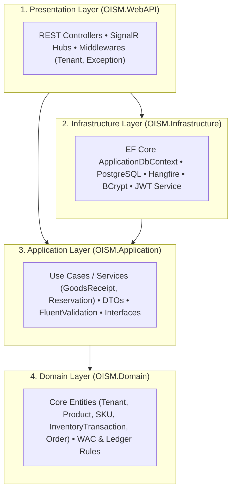

# 01. Thiết Kế Kiến Trúc Sạch 4 Tầng (Clean Architecture Design)

| Thông tin kiểm soát tài liệu | Chi tiết |
| :--- | :--- |
| **Mã tài liệu (Document ID)** | `DOC-ARC-01` |
| **Phiên bản (Version)** | `v1.0.0` |
| **Ngày hiệu lực (Effective Date)** | `2026-10-22` |
| **Nguồn truy vết (Source Traceability)** | `De bai CNPM.pdf` — Mục `3.2.b`, `NFR-MAINT-01`, `3.2.e` (Trang 1, 4, 5) |
| **Phạm vi áp dụng** | Solution Backend `src/backend/OISM.sln` |

---

## Lịch sử Phiên bản (Version History)

| Phiên bản | Ngày cập nhật | Tác giả / Vai trò | Mô tả thay đổi | Mã tham chiếu |
| :---: | :---: | :--- | :--- | :--- |
| `v1.0.0` | `2026-10-22` | Nhóm dự án OISMS | Đặc tả kiến trúc Clean Architecture 4 tầng của hệ thống Backend `.NET 8`. | `INIT-ARC-01` |

---

## 1. Sơ Đồ Phân Tầng & Chiều Phụ Thuộc (Dependency Rule)

---

## 2. Trách Nhiệm Từng Tầng Trong `src/backend/src/`

| Tầng (Project) | Đường dẫn mã nguồn | Trách nhiệm kỹ thuật theo đề bài (`NFR-MAINT-01`) |
| :--- | :--- | :--- |
| **`OISM.Domain`** | `src/backend/src/OISM.Domain` | Chứa các thực thể cốt lõi (`Tenant`, `User`, `Branch`, `Warehouse`, `Category`, `Brand`, `Product`, `Sku`, `InventoryBalance`, `InventoryTransaction`, `GoodsReceipt`, `Reservation`, `Order`), các Enums và quy tắc bất biến cấp miền (COGS/WAC, Sổ cái Append-Only). |
| **`OISM.Application`** | `src/backend/src/OISM.Application` | Chứa các Interfaces (`IApplicationDbContext`, `ITenantContext`), các dịch vụ nghiệp vụ trọng yếu (`GoodsReceiptService`, `ReservationService`, `InventoryLedgerService`), DTOs Request/Response và bộ kiểm tra hợp lệ `FluentValidation`. |
| **`OISM.Infrastructure`** | `src/backend/src/OISM.Infrastructure` | Hiện thực hóa `ApplicationDbContext` trên **PostgreSQL**, cấu hình **EF Core Global Query Filters**, cấu hình Entity Fluent API (`IEntityTypeConfiguration`), dịch vụ JWT/BCrypt, SignalR và Hangfire. |
| **`OISM.WebAPI`** | `src/backend/src/OISM.WebAPI` | Cung cấp các RESTful Endpoints (`/api/auth`, `/api/products`, `/api/inventory`, `/api/pos`,...), cấu hình Swagger OpenAPI, Middleware phân giải `TenantContext` từ JWT và xử lý ngoại lệ tập trung. |
