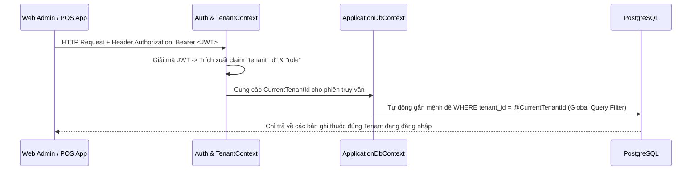

# 02. Kiến Trúc Đa Người Thuê & Cô Lập Dữ Liệu (SaaS Multi-tenancy Architecture)

| Thông tin kiểm soát tài liệu | Chi tiết |
| :--- | :--- |
| **Mã tài liệu (Document ID)** | `DOC-ARC-02` |
| **Phiên bản (Version)** | `v1.0.0` |
| **Ngày hiệu lực (Effective Date)** | `2026-10-22` |
| **Nguồn truy vết (Source Traceability)** | `De bai CNPM.pdf` — Mục `FR-AUTH-01`, `NFR-TENANT-01`, `NFR-TENANT-02` (Trang 1, 4, 5) |
| **Phạm vi áp dụng** | `TenantContext`, `ApplicationDbContext` & Toàn bộ Bảng Nghiệp vụ |

---

## Lịch sử Phiên bản (Version History)

| Phiên bản | Ngày cập nhật | Tác giả / Vai trò | Mô tả thay đổi | Mã tham chiếu |
| :---: | :---: | :--- | :--- | :--- |
| `v1.0.0` | `2026-10-22` | Nhóm dự án OISMS | Đặc tả cơ chế phân giải Tenant tự động và cô lập dữ liệu bằng EF Core Global Query Filter. | `INIT-ARC-02` |

---

## 1. Luồng Phân Giải & Cô Lập Tenant Từ JWT (`NFR-TENANT-01`)

---

## 2. Cơ Chế Bảo Vệ Đa Tầng Chống Rò Rỉ Dữ Liệu Chéo

1. **Tầng Đọc (`Read Isolation`):** Mọi thực thể kế thừa `ITenantEntity` đều được cấu hình `HasQueryFilter(e => e.TenantId == CurrentTenantId)` trong `ApplicationDbContext`.
2. **Tầng Ghi (`Write Protection`):** Khi thêm mới bản ghi (`EntityState.Added`), `SaveChangesAsync` tự động gán `TenantId = CurrentTenantId` và chặn mọi nỗ lực ghi đè `TenantId` của cửa hàng khác.
3. **Tầng Ràng buộc Khóa ngoại Kép (`Composite Foreign Keys`):** Các bảng con như `goods_receipts`, `inventory_balances`, `reservations`, `inventory_transactions` sử dụng khóa ngoại tổ hợp kèm `tenant_id` ở tầng PostgreSQL để ngăn chặn tuyệt đối việc tham chiếu chéo chi nhánh/kho/SKU giữa hai Tenant khác nhau.
4. **Cơ chế `OpenPrivilegedScope()`:** Chỉ được sử dụng có kiểm soát trong luồng đăng ký Tenant mới (`RegisterTenant`) hoặc xác thực đăng nhập ban đầu trước khi có JWT.
