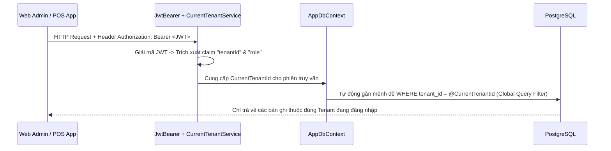

# 02. Kiến Trúc Đa Người Thuê & Cô Lập Dữ Liệu (SaaS Multi-tenancy Architecture)

| Thông tin kiểm soát tài liệu | Chi tiết |
| :--- | :--- |
| **Mã tài liệu (Document ID)** | `DOC-ARC-02` |
| **Phiên bản (Version)** | `v1.1.0` |
| **Ngày hiệu lực (Effective Date)** | `2026-11-06` |
| **Nguồn truy vết (Source Traceability)** | `De bai CNPM.pdf` — Mục `FR-AUTH-01`, `NFR-TENANT-01`, `NFR-TENANT-02` (Trang 1, 4, 5) |
| **Phạm vi áp dụng** | `CurrentTenantService`, `AppDbContext` & toàn bộ bảng nghiệp vụ |

---

## Lịch sử Phiên bản (Version History)

| Phiên bản | Ngày cập nhật | Tác giả / Vai trò | Mô tả thay đổi | Mã tham chiếu |
| :---: | :---: | :--- | :--- | :--- |
| `v1.0.0` | `2026-10-22` | Nhóm dự án OISMS | Đặc tả cơ chế phân giải Tenant tự động và cô lập dữ liệu bằng EF Core Global Query Filter. | `INIT-ARC-02` |
| `v1.1.0` | `2026-11-06` | Nhóm dự án OISMS | Đồng bộ tên lớp (`AppDbContext`, `CurrentTenantService`, `IMustHaveTenant`), claim `tenantId` và tenant guard khi ghi. | `OISMS-46` |

---

## 1. Luồng Phân Giải & Cô Lập Tenant Từ JWT (`NFR-TENANT-01`)

---

## 2. Cơ Chế Bảo Vệ Đa Tầng Chống Rò Rỉ Dữ Liệu Chéo

1. **Nguồn TenantId duy nhất:** `CurrentTenantService` chỉ đọc claim `tenantId` (hoặc `TenantId`) khi `User.Identity.IsAuthenticated`. Không đọc header kiểu `X-Tenant-Id` hay trường trong body.
2. **Tầng Đọc (`Read Isolation`):** Mọi entity triển khai `IMustHaveTenant` có `HasQueryFilter(e => e.TenantId == CurrentTenantId)` trong `AppDbContext` (38 bộ lọc).
3. **Tầng Ghi (`Write Protection`):** `SaveChanges`/`SaveChangesAsync` gọi `EnforceTenantGuardsAndAudit()`: tự gán `TenantId` cho bản ghi mới, chặn đổi `TenantId`, chặn ghi chéo tenant và chặn mọi thao tác ghi `IMustHaveTenant` khi không có tenant context (ném `SecurityException`).
4. **Tầng Ràng buộc Khóa ngoại Kép (`Composite Foreign Keys`):** Các bảng con dùng khóa ngoại tổ hợp `(tenant_id, id)` ở PostgreSQL (`uq_<bảng>_1`) nên không thể tham chiếu chéo chi nhánh/kho/SKU giữa hai tenant.
5. **`OpenPrivilegedScope()` và `IgnoreQueryFilters()`:** Chỉ dùng cho luồng chưa có JWT: đăng ký tenant (`register-tenant`), đăng nhập, làm mới token và webhook giả lập sàn (xác thực bằng chữ ký của `shop_integrations`). Job Hangfire xử lý nhiều tenant cũng chạy trong scope này. Ngoài ra code hiện có vài chỗ `IgnoreQueryFilters()` có kiểm soát nhưng vẫn lọc tường minh hoặc chỉ kiểm tra tồn tại: kiểm tra trùng email/số điện thoại toàn hệ thống (`UserService`, vì `uq_users_2` là unique toàn cục), sinh số phiếu chuyển kho (`StockTransferService`, có điều kiện `TenantId == tenantId`) và đọc tenant trong `SimulatorService`.
6. **Tài khoản database ít quyền:** Backend kết nối bằng `oisms_app` (thuộc nhóm `oisms_runtime`), không sở hữu schema hay bảng; `/health/ready` trả 503 nếu tài khoản runtime có quyền quản trị.
