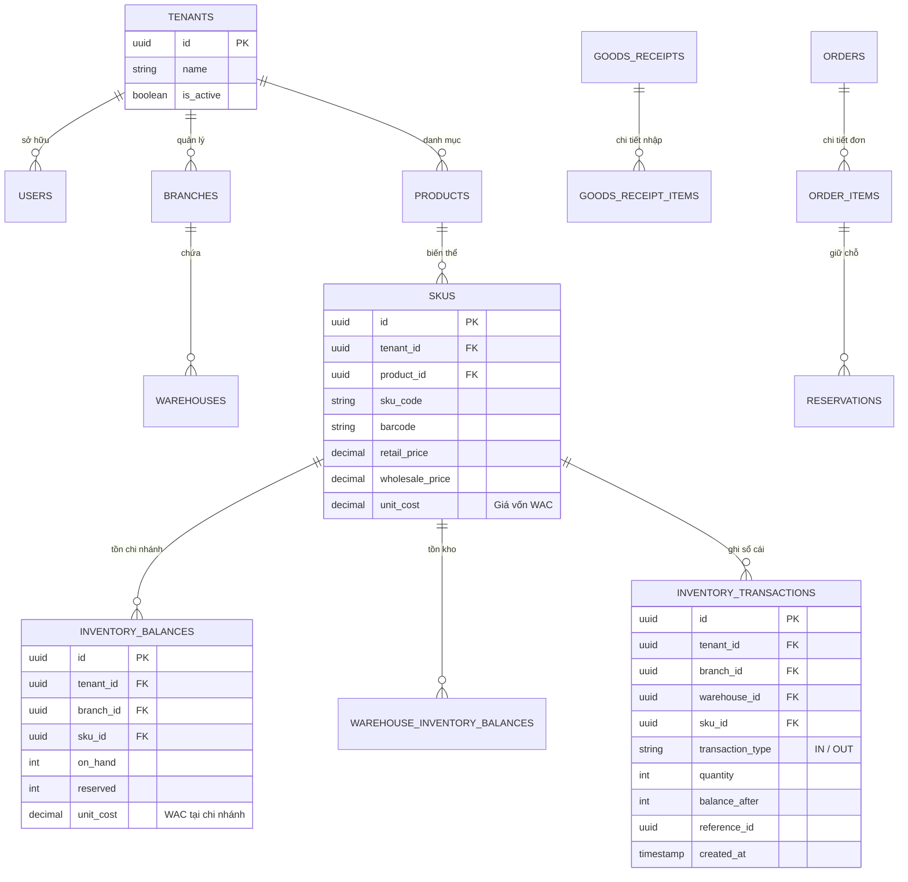

# 03. Thiết Kế Cơ Sở Dữ Liệu & Sơ Đồ Thực Thể Liên Kết (Database & ERD Design)

| Thông tin kiểm soát tài liệu | Chi tiết |
| :--- | :--- |
| **Mã tài liệu (Document ID)** | `DOC-ARC-03` |
| **Phiên bản (Version)** | `v1.0.0` |
| **Ngày hiệu lực (Effective Date)** | `2026-10-22` |
| **Nguồn truy vết (Source Traceability)** | `De bai CNPM.pdf` — Mục `FR-INV-01`, `NFR-TENANT-02`, `NFR-SEC-03`, `3.2.e` (Trang 2, 4, 5) |
| **Phạm vi áp dụng** | PostgreSQL 16+ Schema (`docs/database/oisms_schema.sql` — 29 bảng) |

---

## Lịch sử Phiên bản (Version History)

| Phiên bản | Ngày cập nhật | Tác giả / Vai trò | Mô tả thay đổi | Mã tham chiếu |
| :---: | :---: | :--- | :--- | :--- |
| `v1.0.0` | `2026-10-22` | Nhóm dự án OISMS | Đặc tả sơ đồ ERD cốt lõi, quy tắc Sổ cái Append-Only và chiến lược đánh chỉ mục hiệu năng cao. | `INIT-ARC-03` |

---

## 1. Sơ Đồ Thực Thể Liên Kết Cốt Lõi (Core Entity Relationship Diagram)

---

## 2. Chiến Lược Đánh Chỉ Mục Quy Mô Lớn (`NFR-TENANT-02`)

| Bảng dữ liệu | Tên Index / Ràng buộc | Các cột cấu thành | Mục đích tối ưu hóa |
| :--- | :--- | :--- | :--- |
| `skus` | `uq_skus_tenant_sku` | `(tenant_id, sku_code)` | Đảm bảo mã SKU duy nhất trong cùng Tenant & tìm kiếm tức thì. |
| `skus` | `uq_skus_3` | `(tenant_id, barcode)` | Quét Barcode tại quầy POS đạt độ trễ `p95 < 200ms` (`NFR-PERF-01`). |
| `inventory_transactions` | `ix_ledger_tenant_created` | `(tenant_id, created_at DESC)` | Truy vấn phân trang lịch sử Sổ cái hàng triệu dòng (`NFR-TENANT-02`). |
| `inventory_transactions` | `ix_ledger_tenant_sku` | `(tenant_id, sku_id, created_at DESC)` | Tra cứu thẻ kho theo từng SKU tức thì (`NFR-TENANT-02`). |
| `reservations` | `uq_reservations_2` | `(tenant_id, order_item_id, warehouse_id)` | Bảo vệ tính Idempotent, chống giữ chỗ lặp cho cùng 1 dòng đơn hàng. |

> **Tham chiếu chi tiết DDL:** Xem toàn bộ 29 bảng và trigger bảo vệ Sổ cái tại [`docs/database/oisms_schema.sql`](../database/oisms_schema.sql) và [`docs/database/README.md`](../database/README.md).
