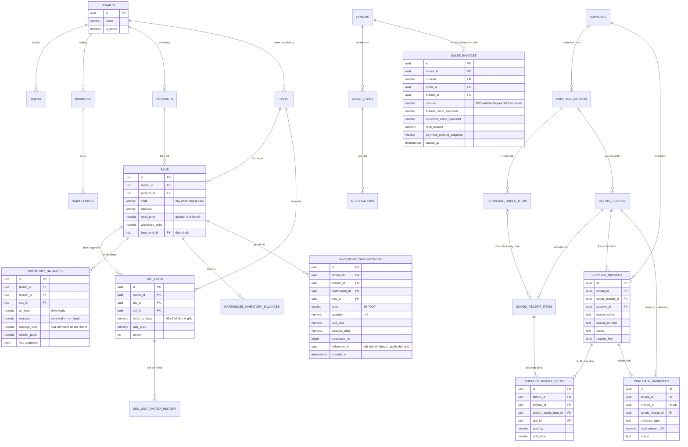

# 03. Thiết Kế Cơ Sở Dữ Liệu & Sơ Đồ Thực Thể Liên Kết (Database & ERD Design)

| Thông tin kiểm soát tài liệu | Chi tiết |
| :--- | :--- |
| **Mã tài liệu (Document ID)** | `DOC-ARC-03` |
| **Phiên bản (Version)** | `v1.1.1` |
| **Ngày hiệu lực (Effective Date)** | `2026-11-08` |
| **Nguồn truy vết (Source Traceability)** | `De bai CNPM.pdf` — Mục `FR-INV-01`, `NFR-TENANT-02`, `NFR-SEC-03`, `3.2.e` (Trang 2, 4, 5) |
| **Phạm vi áp dụng** | PostgreSQL 16+ Schema (`docs/database/oisms_schema.sql` — 47 bảng) |

---

## Lịch sử Phiên bản (Version History)

| Phiên bản | Ngày cập nhật | Tác giả / Vai trò | Mô tả thay đổi | Mã tham chiếu |
| :---: | :---: | :--- | :--- | :--- |
| `v1.0.0` | `2026-10-22` | Nhóm dự án OISMS | Đặc tả sơ đồ ERD cốt lõi, quy tắc Sổ cái Append-Only và chiến lược đánh chỉ mục hiệu năng cao. | `INIT-ARC-03` |
| `v1.1.0` | `2026-11-06` | Nhóm dự án OISMS | Đồng bộ ERD và chỉ mục với `oisms_schema.sql` hiện hành (43 bảng): tên cột thật, kiểu `numeric(18,3)` cho số lượng, giá vốn nằm ở `inventory_balances.average_cost`. | `OISMS-46` |
| `v1.1.1` | `2026-11-08` | Nhóm dự án OISMS | Cập nhật số bảng hiện hành lên 44 sau khi bổ sung `payment_accounts`; giữ mốc 43 bảng trong lịch sử v1.1.0. | `CS-05` |

---

## 1. Sơ Đồ Thực Thể Liên Kết Cốt Lõi (Core Entity Relationship Diagram)

---

Mỗi phiếu nhập có thể lưu nhiều hóa đơn lịch sử và tối đa một hóa đơn còn hiệu lực. Chỉ mục unique `uq_supplier_invoices_active_receipt` loại `Cancelled` và `Rejected`. Dòng hóa đơn đối chiếu với dòng phiếu nhập rồi tới dòng phiếu mua. Các khóa ngoại nghiệp vụ ghép `tenant_id`.

## 2. Chiến Lược Đánh Chỉ Mục Quy Mô Lớn (`NFR-TENANT-02`)

| Bảng dữ liệu | Tên Index / Ràng buộc | Các cột cấu thành | Mục đích tối ưu hóa |
| :--- | :--- | :--- | :--- |
| `skus` | `uq_skus_2` | `(tenant_id, code)` | Mã SKU duy nhất trong cùng tenant. |
| `skus` | `uq_skus_3` | `(tenant_id, barcode)` | Quét barcode tại quầy POS (`NFR-PERF-01`). |
| `sku_units` | `uq_sku_units_2` | `(tenant_id, sku_id, unit_id)` | Mỗi SKU chỉ khai báo một lần cho mỗi đơn vị tính. |
| `inventory_balances` | `uq_inventory_balances_2` | `(tenant_id, branch_id, sku_id)` | Một dòng tồn cho mỗi SKU tại chi nhánh, là điểm khóa `FOR UPDATE`. |
| `inventory_transactions` | `uq_inventory_transactions_2` | `(tenant_id, branch_id, sku_id, sequence_no)` | Thứ tự bút toán liên tục theo SKU tại chi nhánh. |
| `inventory_transactions` | `ix_inventory_transactions_tenant_history` | `(tenant_id, created_at, id)` | Phân trang lịch sử sổ cái toàn tenant (`NFR-TENANT-02`). |
| `inventory_transactions` | `ix_inventory_transactions_sku_history` | `(tenant_id, branch_id, sku_id, created_at, id)` | Thẻ kho theo SKU tại chi nhánh. |
| `inventory_transactions` | `uq_inventory_transactions_3..8` | `(tenant_id, <nguồn chứng từ>)` | Mỗi dòng chứng từ chỉ ghi sổ một lần (chống ghi trùng khi retry). |
| `reservations` | `uq_reservations_2` | `(tenant_id, order_item_id, warehouse_id)` | Chống giữ chỗ lặp cho cùng một dòng đơn tại một kho. |
| `reservations` | `ix_reservations_expiry` | `(status, expires_at, tenant_id)` | Job quét giữ chỗ hết hạn. |
| `sales_invoices` | `uq_sales_invoices_2` | `(tenant_id, number)` | Số hóa đơn duy nhất trong tenant. |
| `sales_invoices` | `uq_sales_invoices_3` | `(tenant_id, order_id)` | Mỗi đơn có tối đa một hóa đơn bán. |
| `sales_invoices` | `ix_sales_invoices_time` | `(tenant_id, issued_at, id)` | Phân trang hóa đơn theo thời gian xuất. |

> **Tham chiếu chi tiết DDL:** Xem toàn bộ 47 bảng và trigger bảo vệ Sổ cái tại [`docs/database/oisms_schema.sql`](../database/oisms_schema.sql) và [`docs/database/README.md`](../database/README.md).

## 3. Quy Tắc Thay Đổi Schema

- Không dùng EF Core migrations. Mỗi thay đổi gồm: một file mới trong `docker/postgres/migrations/` (không sửa file cũ), cập nhật `docs/database/oisms_schema.sql`, thêm bảng vào `RequiredTables` trong `Program.cs` và sửa số bảng kiểm tra trong `docker/postgres/init-oisms.sh`.
- `inventory_transactions` chỉ được `INSERT`; trigger `ledger_append_only` chặn `UPDATE`/`DELETE`. Sửa sai bằng bút toán bù.
- `sales_returns`, `sales_return_items` đã có entity và API (trả hàng CS-01, PR #41). Hai bảng `daily_sales_summaries`, `replenishment_suggestions` có trong schema nhưng backend chưa dùng: báo cáo và gợi ý nhập hàng tính trực tiếp từ `inventory_transactions`, `orders` và `inventory_balances`. Trợ lý OISMS (FR-AI-02) không thêm bảng.
