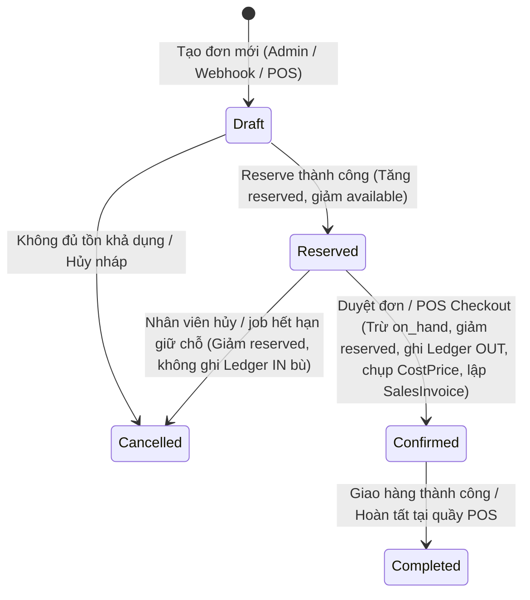
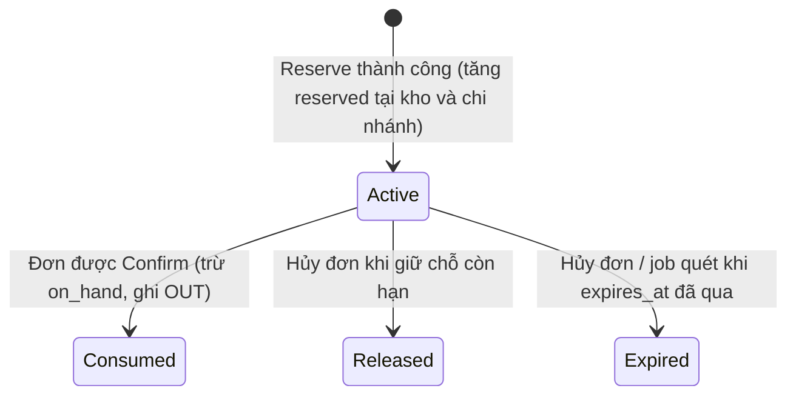
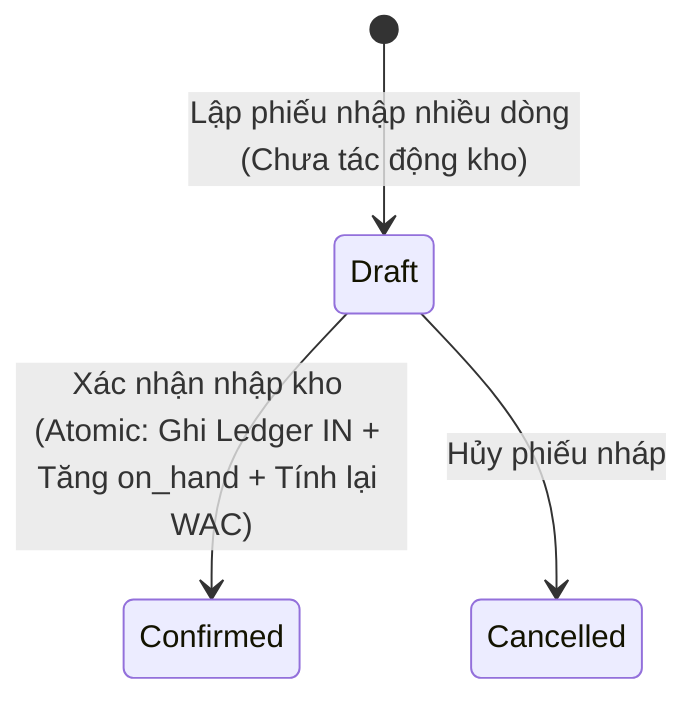
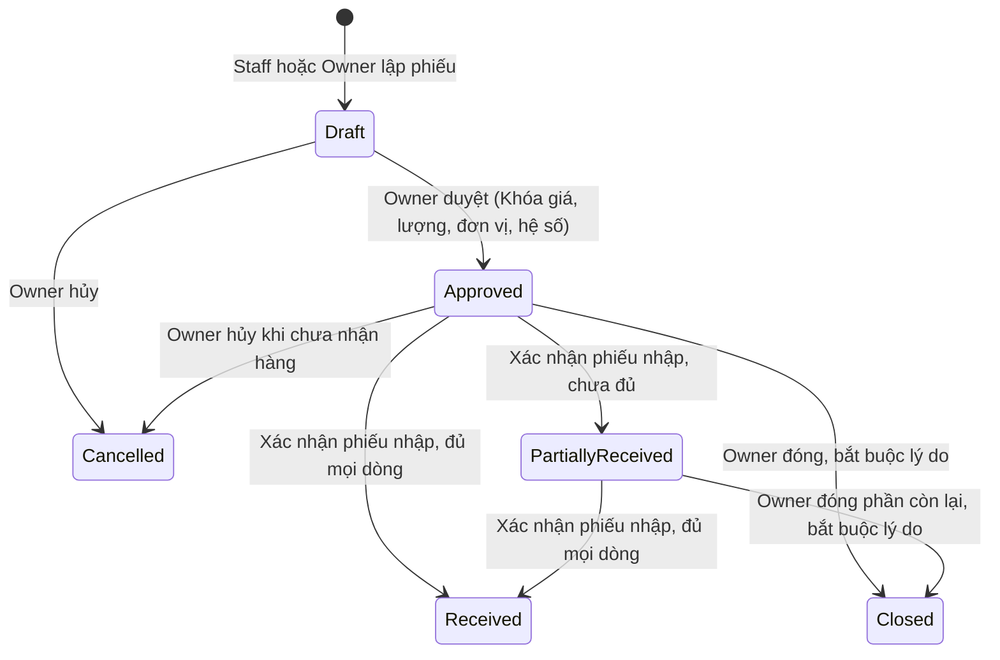
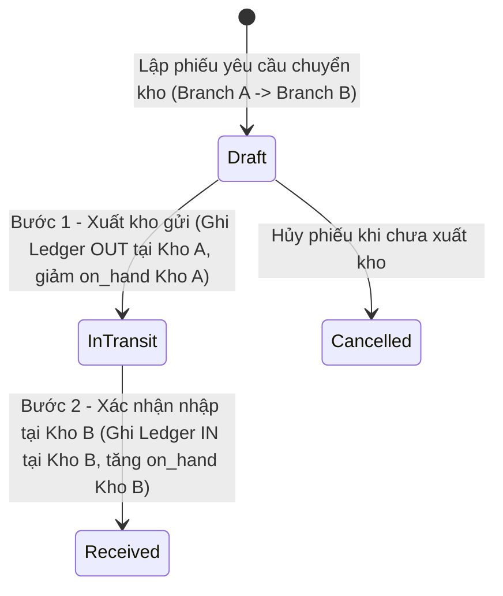
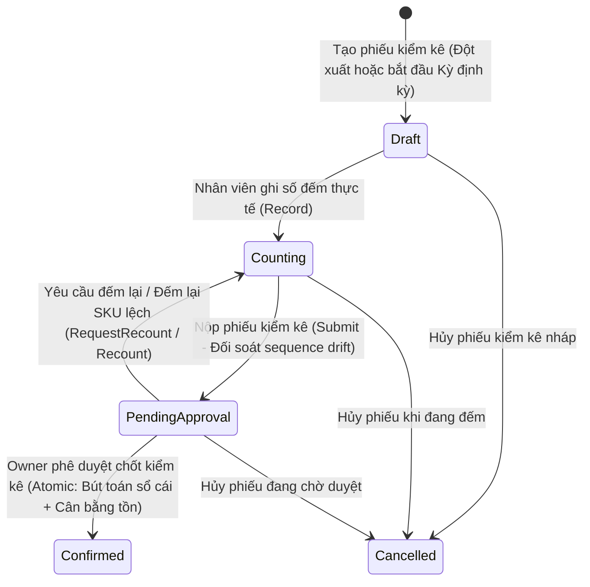
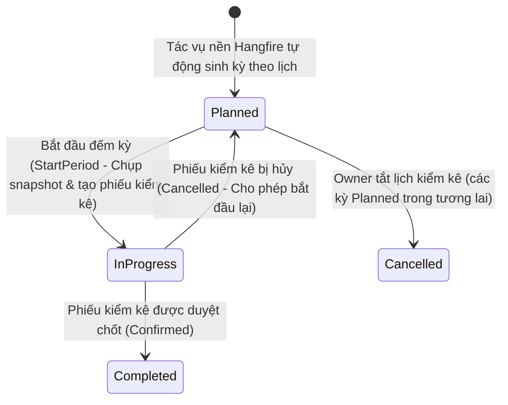
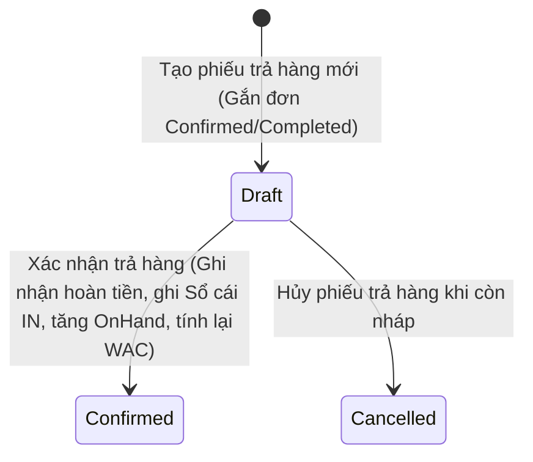

# 04. Thiết Kế Máy Trạng Thái Nghiệp Vụ (Business State Machines)

| Thông tin kiểm soát tài liệu | Chi tiết |
| :--- | :--- |
| **Mã tài liệu (Document ID)** | `DOC-ARC-04` |
| **Phiên bản (Version)** | `v1.3.0` |
| **Ngày hiệu lực (Effective Date)** | `2026-11-06` |
| **Nguồn truy vết (Source Traceability)** | `De bai CNPM.pdf` — Mục `FR-ORD-02`, `FR-INV-02..03`, `FR-RSE-02..03` (Trang 2, 3) |
| **Phạm vi áp dụng** | Đơn hàng (`Order`), Giữ chỗ (`Reservation`), Phiếu nhập (`GoodsReceipt`) & Chuyển kho (`StockTransfer`) |

---

## Lịch sử Phiên bản (Version History)

| Phiên bản | Ngày cập nhật | Tác giả / Vai trò | Mô tả thay đổi | Mã tham chiếu |
| :---: | :---: | :--- | :--- | :--- |
| `v1.0.0` | `2026-10-22` | Nhóm dự án OISMS | Đặc tả máy trạng thái chuẩn UML 2.0 cho Đơn hàng, Giữ chỗ, Phiếu nhập và Phiếu chuyển kho 2 bước. | `INIT-ARC-04` |
| `v1.1.0` | `2026-11-02` | Nhóm dự án OISMS | Thêm máy trạng thái Phiếu mua hàng. | `OISMS-47-U01A` |
| `v1.2.0` | `2026-11-03` | Nhóm dự án OISMS | Bổ sung máy trạng thái Đợt kiểm kê (StockCount) và Kỳ kiểm kê (StockCountPeriod). | `OISMS-47-U03` |
| `v1.3.0` | `2026-11-06` | Nhóm dự án OISMS | Đối chiếu với service: thêm máy trạng thái Giữ chỗ, `PendingApproval → Cancelled` của kiểm kê, kỳ kiểm kê bị hủy khi tắt lịch; ghi chú Hangfire mặc định tắt. | `OISMS-46` |
| `v1.4.0` | `2026-11-09` | Nhóm dự án OISMS | Bổ sung máy trạng thái Phiếu trả hàng từ khách (`SalesReturn`, CS-01). | `OISMS-58-CS01-P2` |

---

## 1. Máy Trạng Thái Đơn Hàng Đa Kênh (`FR-ORD-02`, `FR-RSE-03`)

Các entity kiểm tra chuyển trạng thái tại Domain. Hằng số trong `OISM.Domain/Common/DocumentStatuses.cs` giữ nguyên giá trị đang lưu trong DB và trả qua API. Application kiểm tra các điều kiện cần dữ liệu từ cơ sở dữ liệu, như tồn kho khả dụng, quyền duyệt và các khóa giao dịch.

- POS checkout (`POST /api/pos/checkout`, `POST /api/orders/checkout`) đi thẳng từ giỏ hàng tới `Completed` trong một transaction: trừ `on_hand`, ghi `OUT`, chụp `OrderItem.CostPrice`, lập `SalesInvoice`.
- `POST /api/orders/{id}/process` (xử lý đóng gói) gọi lại luồng Confirm cho đơn `Reserved`; đơn đã `Confirmed` thì trả nguyên kết quả. Không có trạng thái `Processing` trong DB (CHECK của `orders.status` chỉ có 5 giá trị trên).
- Hủy đơn `Draft` chỉ áp dụng cho nháp chưa thanh toán; đơn đã `Confirmed`/`Completed` không hủy được, phải xử lý bằng phiếu trả hàng (CS-01, `/api/sales-returns`, PR #41): phiếu trả gắn đơn gốc, không đổi trạng thái đơn.
- Job hết hạn giữ chỗ (`ReservationExpiryJob`, mỗi phút) chỉ chạy khi `Hangfire:Enabled=true`; cấu hình mặc định và Docker Compose đang tắt.

### 1.1. Máy Trạng Thái Phiếu Giữ Chỗ (`Reservation`)

---

## 2. Máy Trạng Thái Phiếu Nhập Kho Nhà Cung Cấp (`FR-INV-02`, `FR-COST-01`)

Xác nhận phiếu nhập yêu cầu phiếu mua còn nhận được và không vượt lượng còn lại. Từ U01-B, hóa đơn còn hiệu lực ở `Draft` hoặc `PendingApproval` làm xác nhận trả `409 GOODS_RECEIPT_INVOICE_PENDING`. Với `Approved`, mỗi dòng có trên hóa đơn dùng giá trước thuế của hóa đơn. Khi hóa đơn khớp, vắng mặt hoặc thiếu một dòng, dòng nhập tương ứng dùng giá phiếu mua. Tồn và lượng đã nhận luôn theo thực nhận. Từ chối chênh lệch `AtReceipt` hủy phiếu nhập nếu phiếu vẫn `Draft`, trong cùng transaction.

### 2.1. Máy Trạng Thái Phiếu Mua Hàng (`OISMS-47-U01A`)

---

### 2.2. Máy trạng thái hóa đơn nhà cung cấp và chênh lệch (U01-B)

| Chứng từ | Từ | Đến | Điều kiện |
| :--- | :--- | :--- | :--- |
| `SupplierInvoice` | `Draft` | `Matched` | Gửi và mọi chênh lệch giá/lượng đều bằng 0. |
| `SupplierInvoice` | `Draft` | `PendingApproval` | Gửi và có chênh lệch. Tạo một `PurchaseVariance` ở `Pending`. |
| `SupplierInvoice` | `PendingApproval` | `Approved` / `Rejected` | Owner quyết định riêng. Từ chối bắt buộc có ghi chú. |
| `SupplierInvoice` | `Draft`, `Matched`, `Approved` | `Cancelled` | Owner hoặc Staff hủy và ghi lý do. |
| `PurchaseVariance` | `Pending` | `Approved` / `Rejected` | Cùng transaction với chuyển trạng thái hóa đơn. |

`Rejected` và `Cancelled` là trạng thái kết thúc của hóa đơn. `Approved` và `Rejected` là trạng thái kết thúc của chênh lệch. Hủy hóa đơn đã duyệt giữ quyết định của chênh lệch để truy vết. Khi gửi, loại là `AtReceipt` nếu phiếu nhập còn `Draft`, hoặc `AfterReceipt` nếu đã `Confirmed`. Với `AfterReceipt`, các thao tác hóa đơn chỉ lưu chứng từ.

Trong transaction xác nhận nhập, khóa theo thứ tự phiếu nhập → hóa đơn còn hiệu lực (đọc lại sau khóa) → phiếu mua → SKU. Mọi thao tác ghi hóa đơn khóa phiếu nhập trước hóa đơn.

## 3. Máy Trạng Thái Chuyển Kho 2 Bước (`FR-INV-03`)

---

## 4. Máy Trạng Thái Đợt Kiểm Kê & Kỳ Kiểm Kê (`FR-INV-04`, `OISMS-47-U03`)

### 4.1. Máy Trạng Thái Đợt Kiểm Kê (`StockCount`)

### 4.2. Máy Trạng Thái Kỳ Kiểm Kê Định Kỳ (`StockCountPeriod`)

Kỳ kiểm kê được sinh bởi `StockCountPeriodJob` (phút thứ 5 mỗi giờ) khi `Hangfire:Enabled=true`. Khi Hangfire tắt, lịch vẫn lưu được nhưng kỳ mới không tự sinh.

---

## 5. Máy Trạng Thái Phiếu Trả Hàng Từ Khách (`SalesReturn`, `CS-01`)

Áp dụng cho quy trình nhận lại hàng trả từ khách gắn với đơn gốc đã xuất kho (`Confirmed` hoặc `Completed`).

- Phiếu chỉ được tạo ở trạng thái `Draft`, kiểm tra số lượng trả không vượt số lượng đã mua trừ đi các phiếu đã `Confirmed` trước đó.
- Khi chuyển sang `Confirmed`: kiểm tra lại số lượng dưới khóa giao dịch; ghi tăng `OnHand` chi nhánh và kho; ghi dòng sổ cái `IN` với `unit_cost = OrderItem.CostPrice`; tính lại WAC chi nhánh bằng `WacCalculator`; ghi nhận phương thức và thời điểm hoàn tiền.
- Phiếu đã `Confirmed` không được phép hủy hay chỉnh sửa (Terminal State). Nếu có sai sót nghiệp vụ, xử lý qua phiếu điều chỉnh kho (`InventoryAdjustment`).
- Phiếu `Cancelled` cũng là trạng thái kết thúc (Terminal State).
