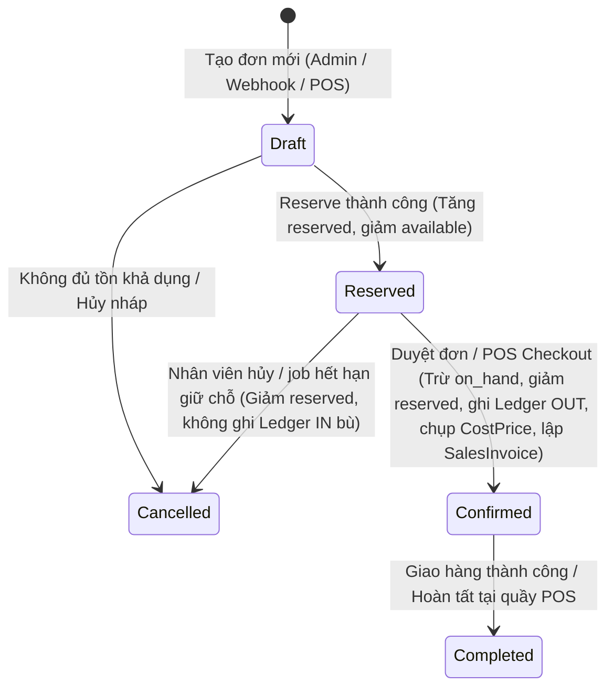
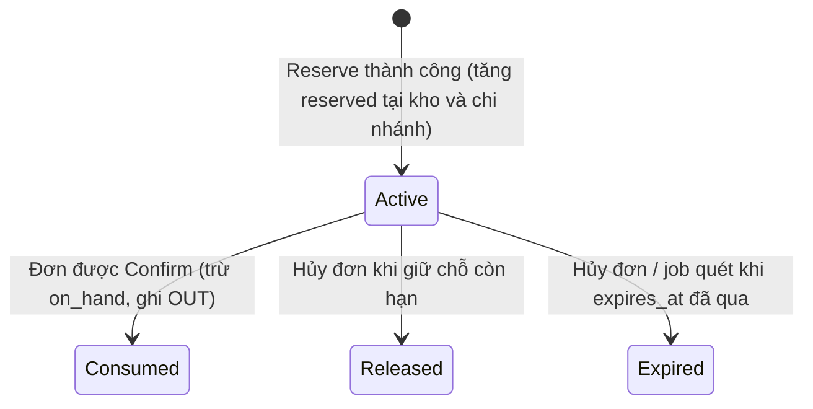
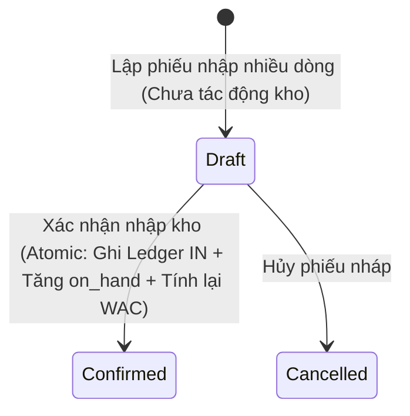
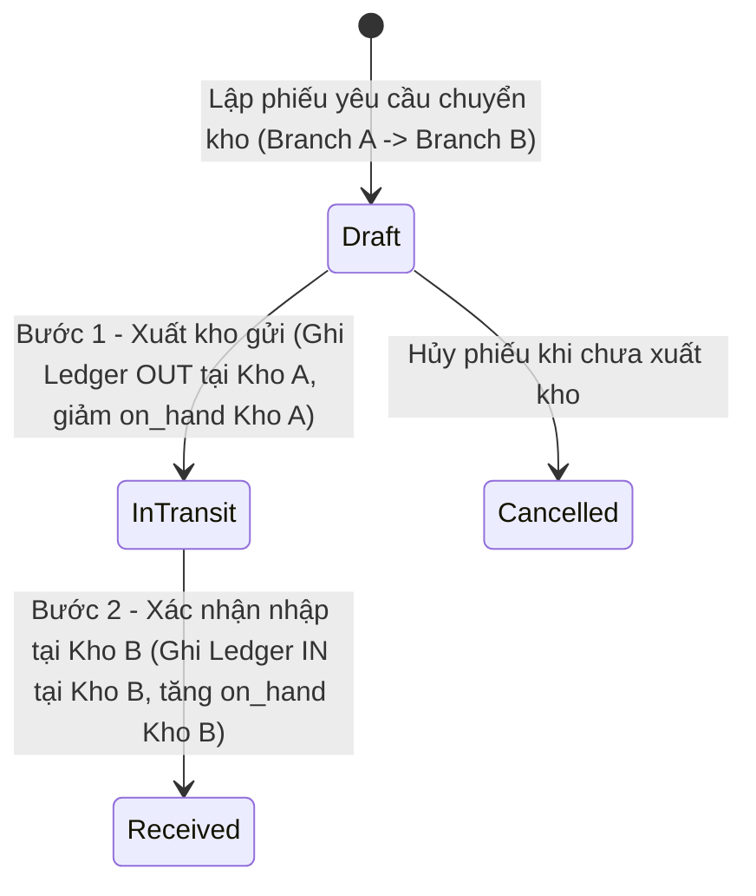
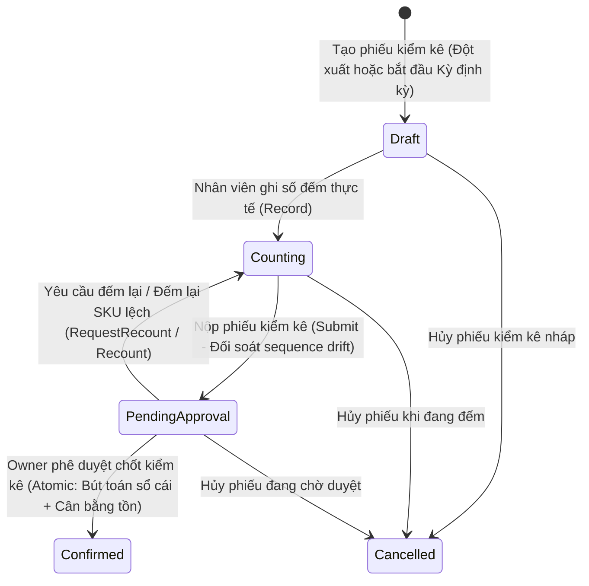
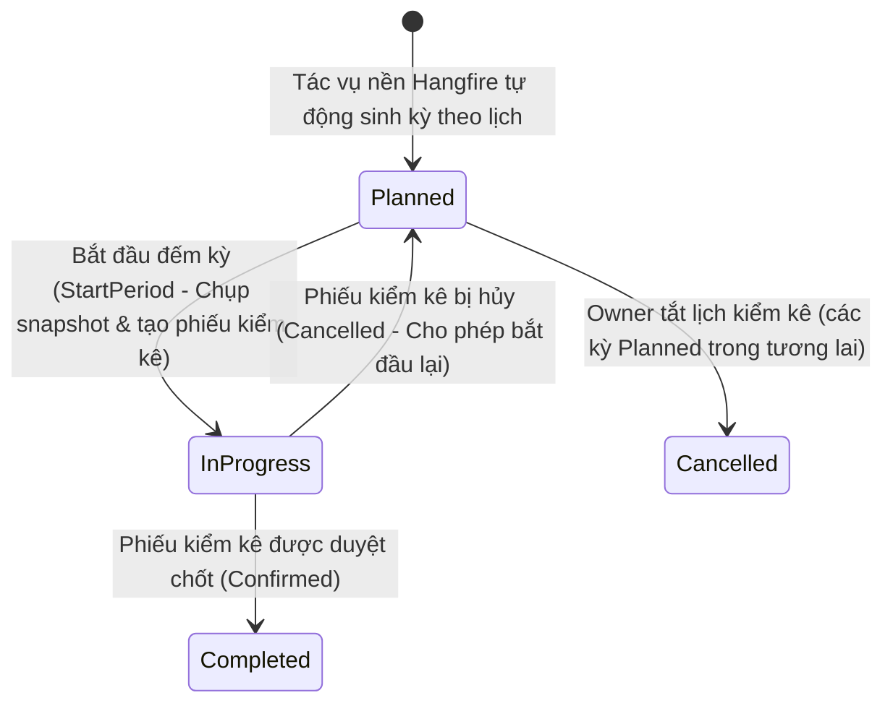
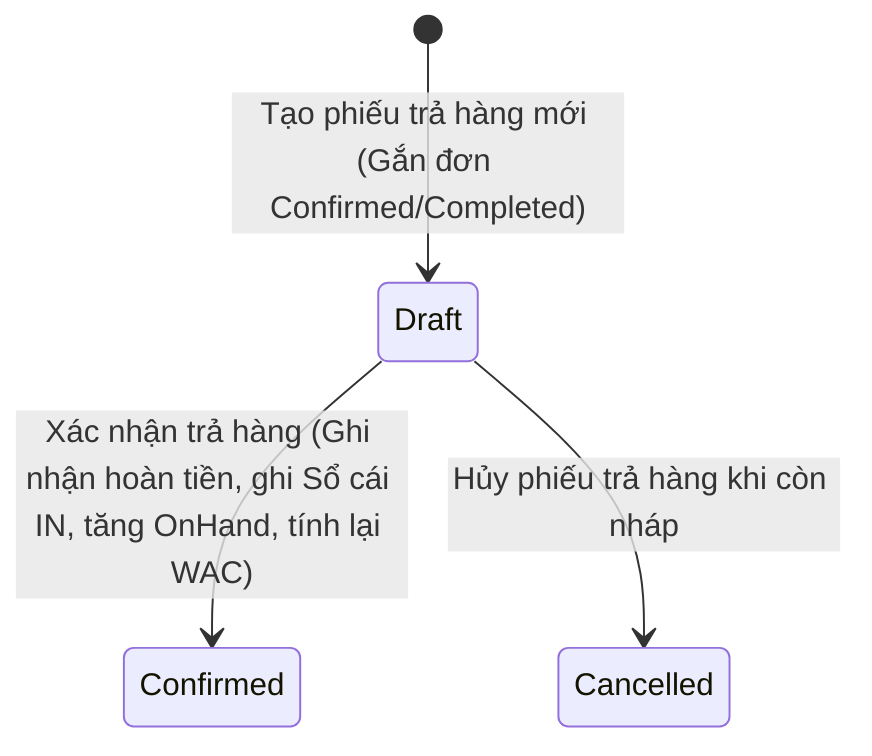

# 04. Thiết Kế Máy Trạng Thái Nghiệp Vụ (Business State Machines)

| Thông tin kiểm soát tài liệu | Chi tiết |
| :--- | :--- |
| **Mã tài liệu (Document ID)** | `DOC-ARC-04` |
| **Phiên bản (Version)** | `v1.6.0` |
| **Ngày hiệu lực (Effective Date)** | `2026-11-15` |
| **Nguồn truy vết (Source Traceability)** | `De bai CNPM.pdf` — Mục `FR-ORD-02`, `FR-INV-02..03`, `FR-RSE-02..03` (Trang 2, 3) |
| **Phạm vi áp dụng** | Đơn hàng (`Order`), Giữ chỗ (`Reservation`), Phiếu nhập (`GoodsReceipt`) & Chuyển kho (`StockTransfer`) |

---

## Lịch sử Phiên bản (Version History)

| Phiên bản | Ngày cập nhật | Tác giả / Vai trò | Mô tả thay đổi | Mã tham chiếu |
| :---: | :---: | :--- | :--- | :--- |
| `v1.0.0` | `2026-10-22` | Nhóm dự án OISMS | Đặc tả máy trạng thái chuẩn UML 2.0 cho Đơn hàng, Giữ chỗ, Phiếu nhập và Phiếu chuyển kho 2 bước. | `INIT-ARC-04` |
| `v1.1.0` | `2026-11-02` | Nhóm dự án OISMS | Thêm máy trạng thái Phiếu mua hàng. | `OISMS-47-U01A` |
| `v1.2.0` | `2026-11-03` | Nhóm dự án OISMS | Bổ sung máy trạng thái Đợt kiểm kê (StockCount) và Kỳ kiểm kê (StockCountPeriod). | `OISMS-47-U03` |
| `v1.3.0` | `2026-11-06` | Nhóm dự án OISMS | Đối chiếu với service: thêm máy trạng thái Giữ chỗ, `PendingApproval → Cancelled` của kiểm kê, kỳ kiểm kê bị hủy khi tắt lịch; ghi chú Hangfire mặc định tắt. | `OISMS-46` |
| `v1.4.0` | `2026-11-09` | Nhóm dự án OISMS | Bổ sung máy trạng thái Phiếu trả hàng từ khách (`SalesReturn`, CS-01). | `OISMS-58-CS01-P2` |
| `v1.5.0` | `2026-11-15` | Nhóm dự án OISMS | Bổ sung bảng ranh giới giao dịch theo kênh và ghi chú luồng giữ chỗ kỹ thuật POS (`Draft`). | `OISMS-59-G3A` |
| `v1.6.0` | `2026-11-19` | Nhóm dự án OISMS | Nâng cấp máy trạng thái Đơn mua hàng (`PendingApproval`, `Submit`, `Return`, phân bổ phí theo VAS 02) và gỡ luồng Hóa đơn nhà cung cấp (`U01-B`). | `OISMS-66-L2-G1` |

---

## 1. Máy Trạng Thái Đơn Hàng Đa Kênh (`FR-ORD-02`, `FR-RSE-03`)

Các entity kiểm tra chuyển trạng thái tại Domain. Hằng số trong `OISM.Domain/Common/DocumentStatuses.cs` giữ nguyên giá trị đang lưu trong DB và trả qua API. Application kiểm tra các điều kiện cần dữ liệu từ cơ sở dữ liệu, như tồn kho khả dụng, quyền duyệt và các khóa giao dịch.

- POS checkout (`POST /api/pos/checkout`, `POST /api/orders/checkout`) đi thẳng từ giỏ hàng tới `Completed` trong một transaction: trừ `on_hand`, ghi `OUT`, chụp `OrderItem.CostPrice`, lập `SalesInvoice`.
- `POST /api/orders/{id}/process` (xử lý đóng gói) gọi lại luồng Confirm cho đơn `Reserved`; đơn đã `Confirmed` thì trả nguyên kết quả. Không có trạng thái `Processing` trong DB (CHECK của `orders.status` chỉ có 5 giá trị trên).
- Hủy đơn `Draft` chỉ áp dụng cho nháp chưa thanh toán (luồng giữ chỗ kỹ thuật của `POST /api/inventory/reserve` sinh đơn `POS` ở `Draft` kèm `Reservation` `Active` để thỏa `Order.CanCancel` và `ReservationExpiryJob`); đơn đã `Confirmed`/`Completed` không hủy được, phải xử lý bằng phiếu trả hàng (CS-01, `/api/sales-returns`, PR #41): phiếu trả gắn đơn gốc, không đổi trạng thái đơn.
- Job hết hạn giữ chỗ (`ReservationExpiryJob`, mỗi phút) chỉ chạy khi `Hangfire:Enabled=true`; cấu hình mặc định và Docker Compose đang tắt.

### 1.1. Máy Trạng Thái Phiếu Giữ Chỗ (`Reservation`)

### 1.2. Ranh Giới Giao Dịch Theo Kênh

| Kênh / Thao tác | Giao dịch 1 | Giao dịch 2 |
| :--- | :--- | :--- |
| **POS** (`POST /api/pos/checkout`, `POST /api/orders/checkout`) | Tạo đơn + giữ chỗ + trừ tồn `on_hand` + ghi sổ `OUT` + chụp `CostPrice` + lập `SalesInvoice` + `Completed` | — |
| **Admin, sàn** (`Admin`, `Shopee`, `TikTok`, `Lazada`) | Tạo đơn (đi qua `Draft -> Reserved` trong cùng giao dịch, không lưu `Draft`) + giữ chỗ (`Active`) | Xác nhận (`Confirm`): trừ `OnHand`, giảm `Reserved`, ghi sổ `OUT`, chụp `CostPrice`, lập `SalesInvoice` -> `Confirmed` |
| **Hủy / hết hạn** (`Cancel`, `ReservationExpiryJob`) | Chỉ giảm `Reserved`, chuyển giữ chỗ sang `Released`/`Expired` và đơn sang `Cancelled`, không ghi bút toán `IN` bù | — |

Đơn online không thể gộp xác nhận vào giao dịch tạo đơn vì `FR-ORD-03` yêu cầu nhân viên duyệt. Mỗi giao dịch tự rollback 100% khi có lỗi.

---

## 2. Máy Trạng Thái Phiếu Nhập Kho Nhà Cung Cấp (`FR-INV-02`, `FR-COST-01`)

Xác nhận phiếu nhập yêu cầu phiếu mua còn nhận được (`Approved` hoặc `PartiallyReceived`) và không vượt lượng còn lại. Từ Upgrade 12 (`OISMS-66-L2-G1`), hệ thống bỏ hoàn toàn bước đối chiếu và ghi đè giá từ hóa đơn nhà cung cấp (`U01-B`): giá nhập đưa vào tính `WAC` và dòng sổ cái `IN` luôn lấy từ `allocated_unit_cost / FactorSnapshot` đã chốt cố định trên dòng đơn mua lúc duyệt.

### 2.1. Máy Trạng Thái Phiếu Mua Hàng (`OISMS-47-U01A`, `OISMS-66-L2-G1`)

```mermaid
stateDiagram-v2
    [*] --> Draft : Staff lập đề nghị mua (chỉ SKU, đơn vị, số lượng; không NCC, không giá)
    [*] --> PendingApproval : Owner tự tạo đơn mua (vào thẳng chờ duyệt)
    Draft --> PendingApproval : Staff gửi duyệt (Submit)
    Draft --> Cancelled : Staff (người tạo) hoặc Owner hủy đề nghị nháp
    PendingApproval --> Draft : Owner trả về (Return, bắt buộc lý do)
    PendingApproval --> Approved : Owner duyệt (Approve: khóa phiên bản, chốt NCC, giá & phân bổ phí/chiết khấu)
    PendingApproval --> Cancelled : Owner hủy đơn chờ duyệt
    Approved --> Cancelled : Owner hủy khi chưa nhận hàng
    Approved --> PartiallyReceived : Xác nhận phiếu nhập, chưa đủ
    Approved --> Received : Xác nhận phiếu nhập, đủ mọi dòng
    PartiallyReceived --> Received : Xác nhận phiếu nhập, đủ mọi dòng
    Approved --> Closed : Owner đóng, bắt buộc lý do
    PartiallyReceived --> Closed : Owner đóng phần còn lại, bắt buộc lý do
```

- **Tách vai trò đề nghị và chốt giá:**
  - `Staff` tạo đơn mua ở trạng thái `Draft` (mọi trường `supplierId`, `unitPrice`, phí gửi lên đều bị bỏ qua); chỉ được sửa, hủy hoặc bấm `Submit` (`Draft -> PendingApproval`) đối với đơn nháp do chính mình tạo. Khi đơn đã sang `PendingApproval`, `Staff` không thể sửa hay hủy (`409 INVALID_STATE_TRANSITION`).
  - `Owner` tạo đơn mua thì vào thẳng `PendingApproval`. Ở `PendingApproval`, `Owner` chọn Nhà cung cấp, ngày đặt hàng (`order_date <= hôm nay`), nhập đơn giá từng dòng, phí vận chuyển (`shipping_fee`), chiết khấu thương mại (`discount_amount`), thuế VAT (`vat_amount`), sửa số lượng hoặc bỏ dòng và lưu nhiều lần.
  - Khi `Owner` bấm `Approve` (`PendingApproval -> Approved`): bắt buộc gửi `version` (thiếu trả `400 VALIDATION_ERROR`) và kiểm tra khớp (`409 PURCHASE_ORDER_VERSION_MISMATCH`), bắt buộc có `supplier_id` và đủ `unit_price` trên mọi dòng (`422 PURCHASE_ORDER_INCOMPLETE_FOR_APPROVAL`), kiểm tra `discount_amount <= subtotal` (`422 PURCHASE_ORDER_DISCOUNT_EXCEEDS_SUBTOTAL`), xác nhận nếu có dòng giá `0`, và tính cố định `allocated_unit_cost` cho từng dòng. Từ `Approved` trở đi, giá mua và giá vốn phân bổ không bao giờ thay đổi.

---

### 2.2. Ghi chú ngừng sử dụng Máy trạng thái Hóa đơn nhà cung cấp (`U01-B` -> Thay bởi `Upgrade 12`)

Từ `Upgrade 12` (`OISMS-66-L2-G1`, ngày 19/11/2026), luồng hóa đơn nhà cung cấp và đối chiếu ba bên (`SupplierInvoice`, `PurchaseVariance`) đã được gỡ bỏ khỏi tầng API, giao diện và luồng xác nhận phiếu nhập vì trùng lặp với đơn mua hàng. Ba bảng `supplier_invoices`, `supplier_invoice_items`, `purchase_variances` vẫn được giữ trong schema (đủ 48 bảng) và thu hồi quyền `INSERT, UPDATE, DELETE` của `oisms_app` / `oisms_runtime` để lưu trữ lịch sử chỉ đọc. Trong transaction xác nhận phiếu nhập, thứ tự khóa chuẩn là: **phiếu nhập → phiếu mua → tồn SKU (sắp theo `SkuId`)**.

## 3. Máy Trạng Thái Chuyển Kho 2 Bước (`FR-INV-03`)

---

## 4. Máy Trạng Thái Đợt Kiểm Kê & Kỳ Kiểm Kê (`FR-INV-04`, `OISMS-47-U03`)

### 4.1. Máy Trạng Thái Đợt Kiểm Kê (`StockCount`)

### 4.2. Máy Trạng Thái Kỳ Kiểm Kê Định Kỳ (`StockCountPeriod`)

Kỳ kiểm kê được sinh bởi `StockCountPeriodJob` (phút thứ 5 mỗi giờ) khi `Hangfire:Enabled=true`. Khi Hangfire tắt, lịch vẫn lưu được nhưng kỳ mới không tự sinh.

---

## 5. Máy Trạng Thái Phiếu Trả Hàng Từ Khách (`SalesReturn`, `CS-01`)

Áp dụng cho quy trình nhận lại hàng trả từ khách gắn với đơn gốc đã xuất kho (`Confirmed` hoặc `Completed`).

- Phiếu chỉ được tạo ở trạng thái `Draft`, kiểm tra số lượng trả không vượt số lượng đã mua trừ đi các phiếu đã `Confirmed` trước đó.
- Khi chuyển sang `Confirmed`: kiểm tra lại số lượng dưới khóa giao dịch; ghi tăng `OnHand` chi nhánh và kho; ghi dòng sổ cái `IN` với `unit_cost = OrderItem.CostPrice`; tính lại WAC chi nhánh bằng `WacCalculator`; ghi nhận phương thức và thời điểm hoàn tiền.
- Phiếu đã `Confirmed` không được phép hủy hay chỉnh sửa (Terminal State). Nếu có sai sót nghiệp vụ, xử lý qua phiếu điều chỉnh kho (`InventoryAdjustment`).
- Phiếu `Cancelled` cũng là trạng thái kết thúc (Terminal State).
