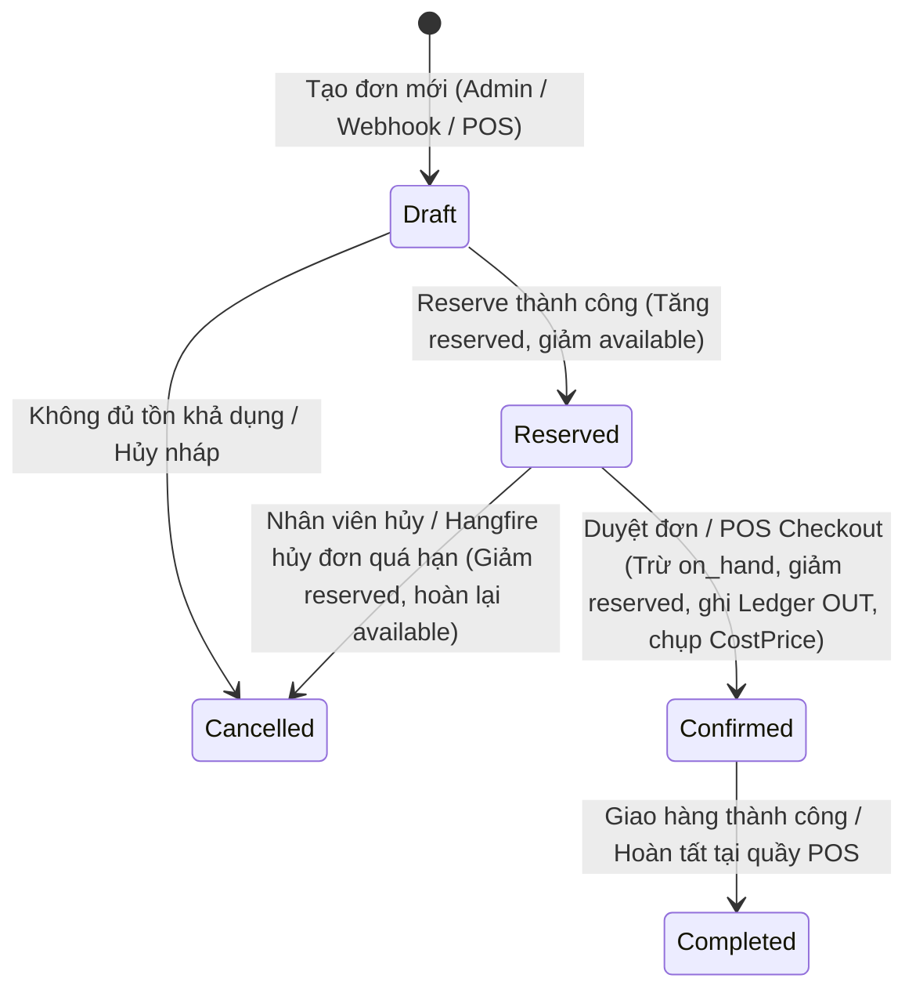
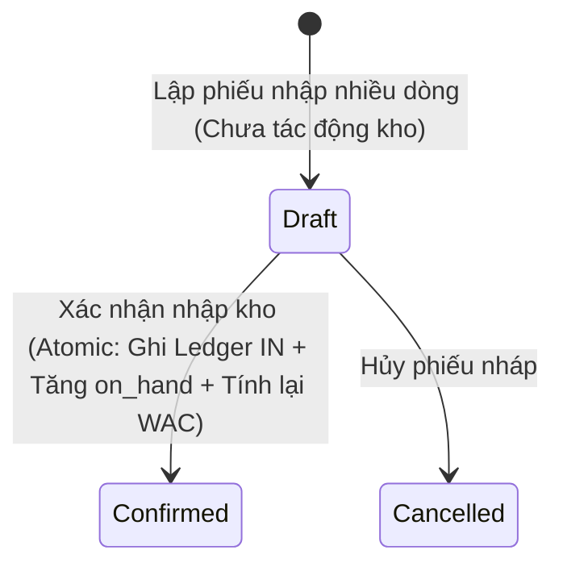
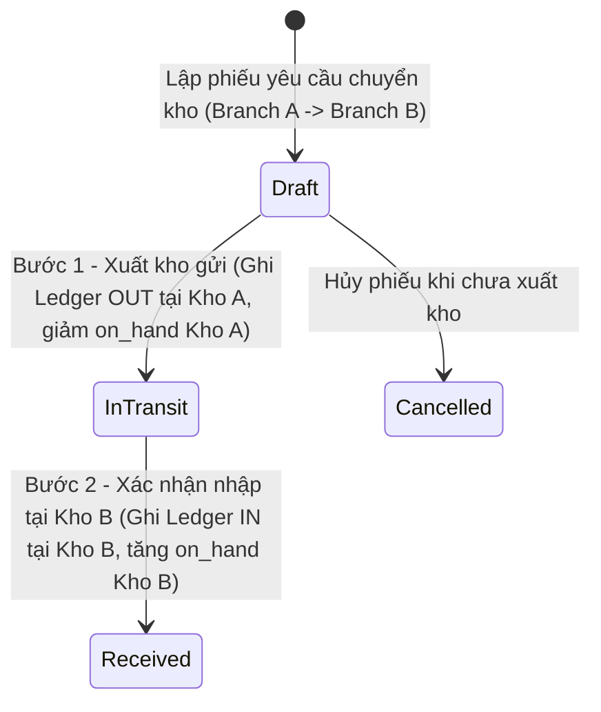

# 04. Thiết Kế Máy Trạng Thái Nghiệp Vụ (Business State Machines)

| Thông tin kiểm soát tài liệu | Chi tiết |
| :--- | :--- |
| **Mã tài liệu (Document ID)** | `DOC-ARC-04` |
| **Phiên bản (Version)** | `v1.0.0` |
| **Ngày hiệu lực (Effective Date)** | `2026-10-22` |
| **Nguồn truy vết (Source Traceability)** | `De bai CNPM.pdf` — Mục `FR-ORD-02`, `FR-INV-02..03`, `FR-RSE-02..03` (Trang 2, 3) |
| **Phạm vi áp dụng** | Đơn hàng (`Order`), Giữ chỗ (`Reservation`), Phiếu nhập (`GoodsReceipt`) & Chuyển kho (`StockTransfer`) |

---

## Lịch sử Phiên bản (Version History)

| Phiên bản | Ngày cập nhật | Tác giả / Vai trò | Mô tả thay đổi | Mã tham chiếu |
| :---: | :---: | :--- | :--- | :--- |
| `v1.0.0` | `2026-10-22` | Nhóm dự án OISMS | Đặc tả máy trạng thái chuẩn UML 2.0 cho Đơn hàng, Giữ chỗ, Phiếu nhập và Phiếu chuyển kho 2 bước. | `INIT-ARC-04` |

---

## 1. Máy Trạng Thái Đơn Hàng Đa Kênh (`FR-ORD-02`, `FR-RSE-03`)

---

## 2. Máy Trạng Thái Phiếu Nhập Kho Nhà Cung Cấp (`FR-INV-02`, `FR-COST-01`)

---

## 3. Máy Trạng Thái Chuyển Kho 2 Bước (`FR-INV-03`)

