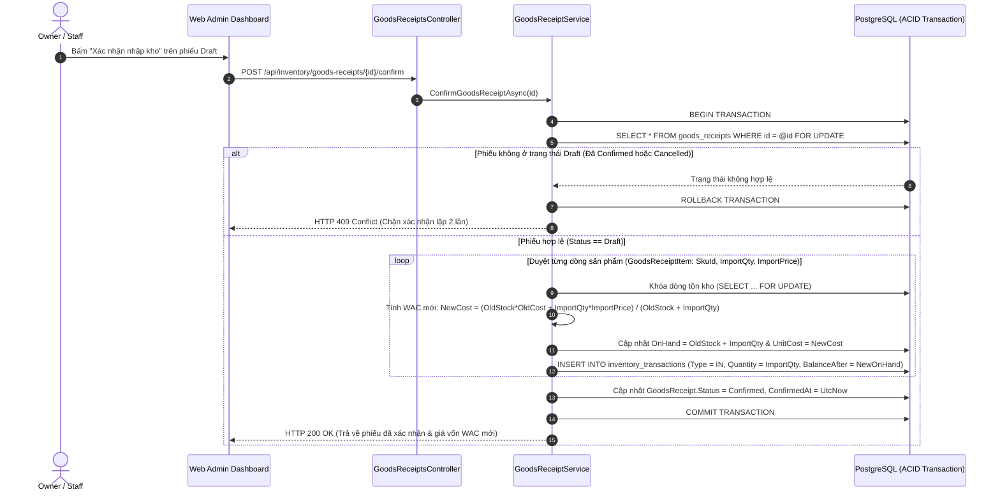

# Sơ Đồ Trình Tự 04: Xác Nhận Nhập Kho & Tính Tự Động Giá Vốn Bình Quân WAC (Purchase Receipt & WAC Sequence)

| Thông tin kiểm soát tài liệu | Chi tiết |
| :--- | :--- |
| **Mã tài liệu (Document ID)** | `DOC-SEQ-04` |
| **Phiên bản (Version)** | `v1.0.0` |
| **Ngày hiệu lực (Effective Date)** | `2026-10-22` |
| **Nguồn truy vết (Source Traceability)** | `De bai CNPM.pdf` — Mục `FR-INV-01`, `FR-INV-02`, `FR-COST-01`, `NFR-SEC-02..03` (Trang 2, 4) |
| **Phạm vi áp dụng** | `GoodsReceiptService.cs`, `InventoryLedgerService.cs` & `POST /api/inventory/goods-receipts/{id}/confirm` |

---

## Lịch sử Phiên bản (Version History)

| Phiên bản | Ngày cập nhật | Tác giả / Vai trò | Mô tả thay đổi | Mã tham chiếu |
| :---: | :---: | :--- | :--- | :--- |
| `v1.0.0` | `2026-10-22` | Nhóm dự án OISMS | Thiết kế Sequence Diagram cho luồng xác nhận phiếu nhập kho nguyên tử, ghi sổ cái Append-Only và tính lại giá vốn WAC. | `INIT-SEQ-04` |

---

## Sơ Đồ Trình Tự Xác Nhận Nhập Kho & Cập Nhật WAC (`FR-INV-02`, `FR-COST-01`)

