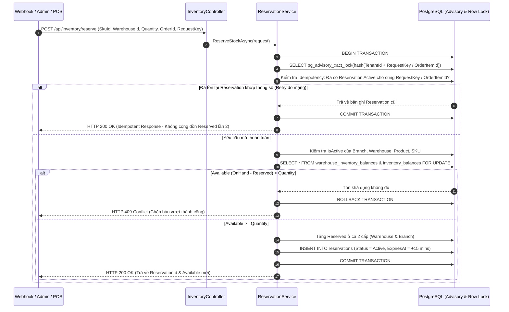

# Sơ Đồ Trình Tự 02: Giữ Chỗ Tồn Kho & Chống Bán Vượt Đơn Online (Stock Reservation & Anti-Oversell Sequence)

| Thông tin kiểm soát tài liệu | Chi tiết |
| :--- | :--- |
| **Mã tài liệu (Document ID)** | `DOC-SEQ-02` |
| **Phiên bản (Version)** | `v1.0.0` |
| **Ngày hiệu lực (Effective Date)** | `2026-10-22` |
| **Nguồn truy vết (Source Traceability)** | `De bai CNPM.pdf` — Mục `FR-RSE-01..03`, `NFR-PERF-02`, `3.2.e` (Trang 2, 3, 4, 5) |
| **Phạm vi áp dụng** | `ReservationService.cs`, `POST /api/inventory/reserve` & Webhook Ingestion |

---

## Lịch sử Phiên bản (Version History)

| Phiên bản | Ngày cập nhật | Tác giả / Vai trò | Mô tả thay đổi | Mã tham chiếu |
| :---: | :---: | :--- | :--- | :--- |
| `v1.0.0` | `2026-10-22` | Nhóm dự án OISMS | Thiết kế Sequence Diagram cho cơ chế khóa CSDL chống bán vượt và bảo vệ Idempotency khi giữ chỗ. | `INIT-SEQ-02` |

---

## Sơ Đồ Trình Tự Giữ Chỗ Chịu Tải Cao (Flash Sale 50 Concurrent Requests)

