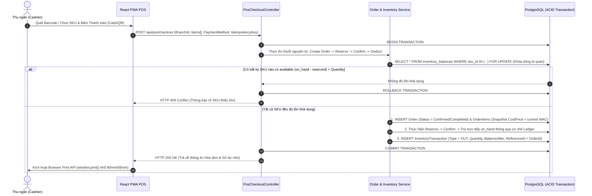

# Sơ Đồ Trình Tự 01: Thanh Toán Nhanh Nguyên Tử Tại Quầy POS (Fast POS Checkout Sequence)

| Thông tin kiểm soát tài liệu | Chi tiết |
| :--- | :--- |
| **Mã tài liệu (Document ID)** | `DOC-SEQ-01` |
| **Phiên bản (Version)** | `v1.0.0` |
| **Ngày hiệu lực (Effective Date)** | `2026-10-22` |
| **Nguồn truy vết (Source Traceability)** | `De bai CNPM.pdf` — Mục `FR-POS-04`, `FR-COST-02`, `NFR-SEC-02`, `3.2.e` (Trang 2, 3, 4, 5) |
| **Phạm vi áp dụng** | Luồng thanh toán đơn hàng tại quầy POS (`Reserve -> Confirm -> Deduct`) |

---

## Lịch sử Phiên bản (Version History)

| Phiên bản | Ngày cập nhật | Tác giả / Vai trò | Mô tả thay đổi | Mã tham chiếu |
| :---: | :---: | :--- | :--- | :--- |
| `v1.0.0` | `2026-10-22` | Nhóm dự án OISMS | Thiết kế Sequence Diagram chuẩn UML 2.0 cho luồng thanh toán nhanh nguyên tử tại quầy POS. | `INIT-SEQ-01` |

---

## Sơ Đồ Trình Tự (`Reserve -> Confirm -> Deduct` in Single Atomic Transaction)

