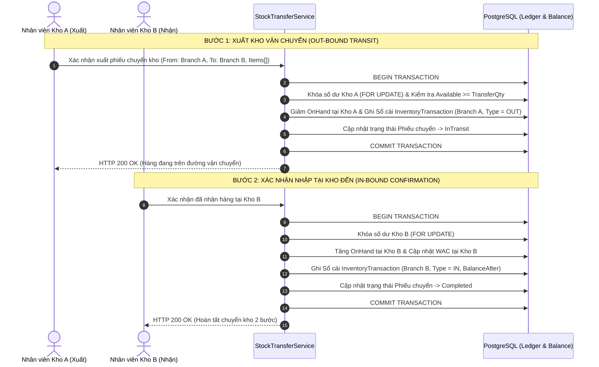

# Sơ Đồ Trình Tự 03: Quy Trình Chuyển Kho 2 Bước Giữa Các Chi Nhánh (Two-Step Stock Transfer Sequence)

| Thông tin kiểm soát tài liệu | Chi tiết |
| :--- | :--- |
| **Mã tài liệu (Document ID)** | `DOC-SEQ-03` |
| **Phiên bản (Version)** | `v1.0.0` |
| **Ngày hiệu lực (Effective Date)** | `2026-10-22` |
| **Nguồn truy vết (Source Traceability)** | `De bai CNPM.pdf` — Mục `FR-INV-01`, `FR-INV-03` (Trang 2) |
| **Phạm vi áp dụng** | Điều chuyển hàng hóa nội bộ giữa Chi nhánh A (Kho xuất) và Chi nhánh B (Kho nhận) |

---

## Lịch sử Phiên bản (Version History)

| Phiên bản | Ngày cập nhật | Tác giả / Vai trò | Mô tả thay đổi | Mã tham chiếu |
| :---: | :---: | :--- | :--- | :--- |
| `v1.0.0` | `2026-10-22` | Nhóm dự án OISMS | Thiết kế Sequence Diagram cho quy trình chuyển kho 2 bước (`Out-bound transit -> In-bound confirmation`). | `INIT-SEQ-03` |

---

## Sơ Đồ Trình Tự Chuyển Kho 2 Bước (`FR-INV-03`)

