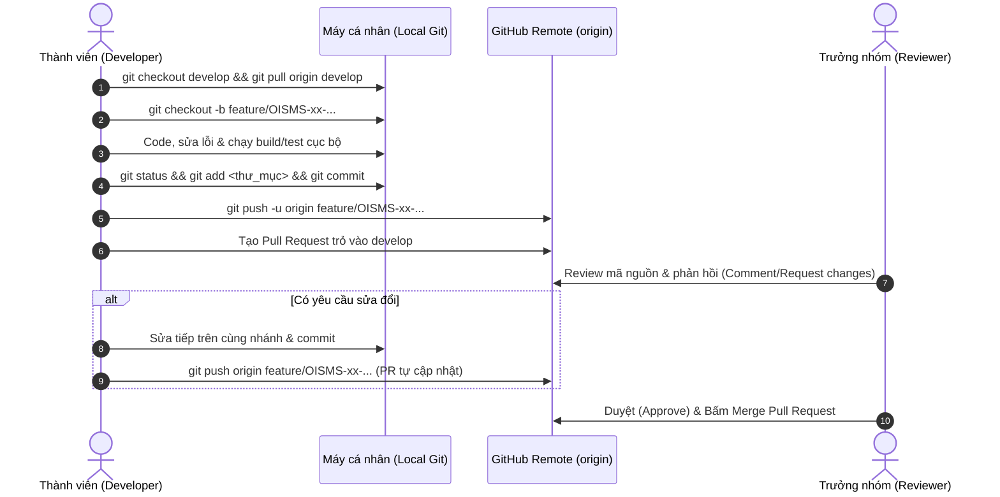

# QUY TẮC CHUẨN MỰC LÀM VIỆC VỚI GITHUB (GIT WORKFLOW GUIDELINES)

> **Dự án:** OISMS — Omnichannel Inventory & Sales Management System  
> **Áp dụng cho:** Toàn bộ thành viên đội ngũ phát triển (Khoa, Thành viên 2, TV3, TV4, TV5)  
> **Nền tảng quản lý:** Confluence / GitHub Repository (`khoalvd839764-netizen/OISMS`)  
> **Cập nhật:** 19/10/2026 (Chuẩn hóa từ Sprint 2 trở đi)  

---

## 1. MÔ HÌNH NHÁNH (BRANCHING STRATEGY)

Dự án áp dụng mô hình **Git Feature Branch Workflow**. Nhánh `main` và `develop` là hai nhánh xương sống được bảo vệ (Protected Branches):

```mermaid
flowchart TD
    Main["main (Bản phát hành ổn định)"]
    Develop["develop (Nhánh tích hợp chính của Sprint)"]
    Feature1["feature/OISMS-xx-ten-tinh-nang"]
    Feature2["feature/OISMS-yy-ten-tinh-nang"]
    Bugfix["bugfix/OISMS-zz-ten-loi"]
    Hotfix["hotfix/loi-khan-cap"]

    Main -->|Khởi tạo Sprint| Develop
    Develop -->|Tách nhánh làm việc| Feature1
    Develop -->|Tách nhánh làm việc| Feature2
    Develop -->|Tách nhánh sửa lỗi| Bugfix

    Feature1 -->|Pull Request (Đã review & test pass)| Develop
    Feature2 -->|Pull Request (Đã review & test pass)| Develop
    Bugfix -->|Pull Request (Đã review & test pass)| Develop

    Develop -->|Cuối Sprint đóng gói Release| Main
    Main -->|Lỗi khẩn cấp production| Hotfix
    Hotfix -->|PR khẩn cấp| Main
    Hotfix -->|Merge ngược lại| Develop
```

### Quy ước phân định nhánh:
| Tên nhánh | Mục đích sử dụng | Quy tắc bắt buộc |
| :--- | :--- | :--- |
| **`main`** | Chứa mã nguồn chính thức đã nghiệm thu, sẵn sàng bàn giao cho Hội đồng chấm thi. | ⛔ **TUYỆT ĐỐI CẤM** push trực tiếp. Chỉ được merge từ `develop` sau khi kết thúc Sprint và pass 100% test suite. |
| **`develop`** | Nhánh làm việc trung tâm của Sprint. Nơi tích hợp toàn bộ API, Frontend Admin và POS. | ⛔ **TUYỆT ĐỐI CẤM** commit code trực tiếp. Mọi thay đổi đều phải thông qua **Pull Request (PR)** được Trưởng nhóm review và duyệt. |
| **`feature/...`** | Phát triển một tính năng hoặc phân hệ mới theo bảng phân công Confluence. | Bắt buộc tách từ `develop` mới nhất. Định dạng: `feature/OISMS-<mã_task>-<ten-chuc-nang>`. |
| **`bugfix/...`** | Sửa các lỗi tích hợp, lỗi kiểm thử (từ báo cáo của Tester hoặc Reviewer). | Định dạng: `bugfix/OISMS-<mã_task>-<ten-loi>`. |
| **`hotfix/...`** | Sửa lỗi nghiêm trọng phát sinh trực tiếp trên `main`. | Tách từ `main` và merge ngược vào cả `main` lẫn `develop`. |

---

## 2. QUY ƯỚC ĐẶT TÊN NHÁNH & THÔNG ĐIỆP COMMIT (CONVENTIONAL COMMITS)

### 2.1. Định dạng tên nhánh:
- `feature/OISMS-28-xay-dung-giao-dien-admin`
- `feature/OISMS-26-so-cai-kho-va-wac`
- `bugfix/OISMS-27-fix-reservation-isactive-a10`
- `bugfix/OISMS-29-fix-admin-token-race-a06`

### 2.2. Định dạng thông điệp Commit:
```text
[Mã-Task] loại(phạm-vi): Mô tả ngắn gọn, súc tích việc đã làm

- Chi tiết các thay đổi chính (gạch đầu dòng)
- Kết quả tự kiểm thử hoặc mã lỗi đã khắc phục
```

*Các loại (types) được phép sử dụng:*
- `feat`: Tính năng hoặc API mới.
- `fix`: Sửa lỗi logic, sửa bug tích hợp.
- `docs`: Thêm hoặc cập nhật tài liệu báo cáo, kế hoạch, Confluence.
- `refactor`: Tái cấu trúc code (không đổi hành vi nghiệp vụ).
- `test`: Bổ sung Unit Test, Integration Test.
- `chore`: Cấu hình build, docker, dependencies.

*Ví dụ chuẩn mẫu:*
```bash
[OISMS-27] fix(backend): Bo sung validation IsActive A10 cho ReservationService

- Kiem tra IsActive cho Chi nhanh, Kho hang, San pham va SKU khi tao reservation moi
- Tra ma HTTP 409 Conflict ro rang khi tai nguyen ngung hoat dong, rollback toan ven
- Dat 193/193 tests pass 100% tren PostgreSQL
```

---

## 3. CHU TRÌNH 6 BƯỚC CỦA MỘT PHIÊN LÀM VIỆC CHUẨN MỰC



### Bước 1: Khởi động phiên làm việc & Đồng bộ `develop` mới nhất
Luôn đảm bảo bạn bắt đầu từ code mới nhất mà các thành viên khác đã merge:
```bash
# Chuyển về develop và kéo cập nhật mới nhất
git checkout develop
git pull origin develop

# Tạo nhánh làm việc mới từ develop
git checkout -b feature/OISMS-31-quan-ly-khuyen-mai
```

### Bước 2: Trong phiên làm việc (Code & Tự kiểm tra)
Thường xuyên kiểm tra trạng thái các file đã thay đổi:
```bash
# Xem danh sách file đã chỉnh sửa
git status

# Xem chi tiết dòng code thay đổi
git diff
```

### Bước 3: Kiểm tra Build & Test trước khi đóng gói
Tuyệt đối không commit khi code chưa biên dịch được:
- **Frontend Admin / POS:** `npm run build` *(Phải pass 0 lỗi TypeScript, 0 lỗi Vite)*.
- **Backend .NET:** `dotnet build` và `dotnet test` *(Phải pass 100% test suite)*.

### Bước 4: Đóng gói Commit
Chỉ đưa vào commit đúng thư mục và file thuộc trách nhiệm của mình:
```bash
# Chỉ định rõ thư mục thay vì 'git add .' bừa bãi
git add src/frontend/admin-dashboard/

# Tạo commit theo đúng cú pháp quy ước
git commit -m "[OISMS-31] feat(admin): Hoan thien giao dien chuong trinh khuyen mai"
```

### Bước 5: Đẩy nhánh lên GitHub & Mở Pull Request
```bash
# Đẩy nhánh của bạn lên GitHub (lần đầu dùng cờ -u)
git push -u origin feature/OISMS-31-quan-ly-khuyen-mai
```
1. Truy cập vào GitHub repo: `https://github.com/khoalvd839764-netizen/OISMS`.
2. Bấm nút xanh **Compare & pull request**.
3. **Cực kỳ quan trọng:** Đảm bảo chọn **Base: `develop`** (KHÔNG CHỌN `main`).
4. Điền mô tả chi tiết: Các mục đã làm, các lỗi đã test, bằng chứng hình ảnh (nếu có).

### Bước 6: Phản hồi Review & Cập nhật code trên cùng một PR
Nếu Trưởng nhóm review và yêu cầu chỉnh sửa, **TUYỆT ĐỐI KHÔNG ĐÓNG PR CŨ ĐỂ TẠO PR MỚI**. Bạn chỉ cần tiếp tục sửa trên máy và push lên chính nhánh đó:
```bash
# Đang đứng ở đúng nhánh đó, chỉnh sửa code theo feedback
# Kiểm tra lại trạng thái
git status

# Add file và commit tiếp
git add src/frontend/admin-dashboard/
git commit -m "[OISMS-31] fix(admin): Cap nhat bo loc theo gop y review"

# Đẩy tiếp lên GitHub (PR trên GitHub sẽ TỰ ĐỘNG cập nhật)
git push origin feature/OISMS-31-quan-ly-khuyen-mai
```

---

## 4. QUY TRÌNH TIẾP NHẬN BÀN GIAO & MERGE PULL REQUEST (DÀNH CHO REVIEWER)

1. **Kiểm tra sơ bộ trên GitHub:**
   - Tab **Files changed**: Xem số lượng file có khớp với phạm vi công việc hay không. Nếu thấy số file nhảy vọt bất thường (như 200+ file) hoặc xuất hiện thư mục lạ lồng vào repo ➔ Yêu cầu sửa ngay trước khi review chi tiết.
   - Kiểm tra xem có xóa nhầm file của phân hệ khác (Backend/POS) không.
2. **Kéo về máy kiểm thử thực tế (Local Verification):**
   ```bash
   git fetch origin
   git checkout -b review-pr-xx origin/<tên-nhánh-pr>
   # Chạy test suite hoặc npm run build để nghiệm thu
   ```
3. **Duyệt & Merge:**
   - Khi tất cả tiêu chí đạt: Bấm **Review changes** ➔ Chọn **Approve** ➔ Bấm **Merge pull request** (chọn *Squash and merge* hoặc *Rebase and merge* tùy chiến lược Sprint).
   - Sau khi merge, xóa nhánh trên GitHub để giữ repo gọn gàng.

---

## 5. 5 ĐIỀU CẤM KỴ KHI LÀM VIỆC VỚI GITHUB TRONG NHÓM

| # | Điều cấm kỵ | Lý do kỹ thuật | Hậu quả nếu vi phạm |
| :-: | :--- | :--- | :--- |
| **1** | **Cấm code trực tiếp trên `main` hoặc `develop`** | Vi phạm nguyên tắc cô lập tính năng. | Làm hỏng nhánh chung, các thành viên khác kéo về bị xung đột (conflict) hàng loạt. |
| **2** | **Cấm đứng ở thư mục cha ngoài repo rồi gõ `git add .`** | Khi mở terminal ở ngoài thư mục gốc, Git sẽ hiểu bạn muốn tạo thêm thư mục con lồng vào dự án. | Làm sinh ra thư mục lồng trùng tên (như lỗi `OISMS/src/...`), làm gãy đường dẫn build Docker và CI. |
| **3** | **Cấm dùng `git push --force` bừa bãi** | Ghi đè lịch sử commit của remote server. | Xóa mất commit của người khác trên nhánh chung, gây mất code không khôi phục được. |
| **4** | **Cấm commit file rác, file nhị phân** | Thư mục `node_modules/`, `bin/`, `obj/`, file `.env` chứa mật khẩu bí mật. | Làm phình dung lượng repository, lộ lọt thông tin bảo mật kết nối cơ sở dữ liệu. |
| **5** | **Cấm tự ý xóa các file không thuộc phân hệ của mình** | Mỗi thành viên phụ trách một khu vực (`src/backend`, `src/frontend/admin-dashboard`, `src/frontend/pos-app`, `docs`). | Làm sập ứng dụng của thành viên khác và gãy luồng tích hợp của cả đồ án. |
