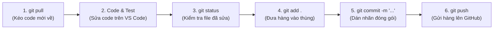

# SỔ TAY TOÀN TẬP: LỆNH GITHUB • DOCKER • OVERVIEW SPRINT 2 • CÚ PHÁP MARKDOWN
## DÀNH CHO KỸ SƯ PHẦN MỀM OISMS (PHÙNG MINH NHỰT - BACKEND 2 LEAD)

---

# PHẦN 1: TỔNG HỢP TOÀN BỘ LỆNH GIT & GITHUB CẦN BIẾT

### 1. Luồng làm việc chuẩn hằng ngày (Daily Workflow)


---

### 2. Bảng tra cứu các lệnh Git thông dụng nhất

| Lệnh Git | Ý nghĩa đời thường | Khi nào dùng? |
| :--- | :--- | :--- |
| **`git status`** | Kiểm tra xem trên máy bạn đang có file nào sửa dở, file nào mới tạo (màu đỏ) hay đã đóng gói (màu xanh). | Gõ bất cứ lúc nào bạn thấy phân vân không biết máy mình đang ở trạng thái nào. |
| **`git pull origin <tên-nhánh>`** | Tải code mới nhất từ trên GitHub của đồng đội về máy mình. | Luôn gõ trước khi bắt đầu code một tính năng mới để không bị lệch code. |
| **`git add .`** | Gom toàn bộ các file vừa sửa hoặc vừa tạo mới chuẩn bị đóng gói. | Sau khi code và test xong. |
| **`git commit -m "mô tả"`** | Đóng gói thùng hàng và dán nhãn ghi chú nội dung đã làm. | Sau khi gõ `git add .`. Luôn ghi rõ mã task, ví dụ: `git commit -m "[OISMS-41] feat: Bo sung endpoint complete"`. |
| **`git push origin <tên-nhánh>`** | Đẩy thùng hàng từ máy cá nhân lên máy chủ GitHub. | Sau khi commit xong, muốn đồng đội trên GitHub thấy code của mình. |
| **`git branch`** | Xem danh sách tất cả các nhánh trên máy và xem mình đang đứng ở nhánh nào. | Khi muốn kiểm tra tên nhánh. |
| **`git checkout -b <tên-nhánh-mới>`** | Tạo một nhánh mới toanh và nhảy sang nhánh đó luôn. | Khi bắt đầu làm một tính năng mới (ví dụ: `git checkout -b feature/OISMS-xx`). |
| **`git checkout <tên-nhánh>`** | Chuyển qua lại giữa các nhánh làm việc. | Khi muốn chuyển từ nhánh của mình về nhánh chung `develop`. |
| **`git log --oneline -n 5`** | Xem lại lịch sử 5 lần commit gần nhất (ngắn gọn trên 1 dòng). | Khi muốn kiểm tra xem commit của mình đã được ghi nhận chưa. |
| **`git diff`** | Xem chi tiết từng dòng code mình vừa sửa khác gì so với code cũ. | Trước khi gõ `git add`. |

---

### 3. Các lệnh "Cứu nguy" khi lỡ tay làm sai trong Git

| Tình huống sự cố | Lệnh xử lý | Giải thích |
| :--- | :--- | :--- |
| Lỡ sửa bậy vài dòng trong code, muốn quay lại nguyên trạng lúc đầu: | `git restore .` | Xóa sạch mọi sửa đổi chưa commit, khôi phục code về ban đầu. |
| Lỡ gõ `git add .` rồi nhưng muốn bỏ ra lại: | `git restore --staged .` | Chuyển file từ màu xanh (đã add) về lại màu đỏ (chưa add). |
| Muốn kéo code mới về mà máy báo lỗi do có file sửa dở: | `git stash`<br>`git pull`<br>`git stash pop` | Tạm cất code đang sửa vào túi áo (`stash`), kéo code mới về (`pull`), rồi lôi code trong túi áo ra lại (`pop`). |

---

# PHẦN 2: TỔNG HỢP TOÀN BỘ LỆNH DOCKER & DOCKER COMPOSE

### 1. Bảng tra cứu các lệnh Docker cốt lõi trong dự án OISMS

| Lệnh Docker | Ý nghĩa kỹ thuật | Khi nào sử dụng? |
| :--- | :--- | :--- |
| **`docker compose up -d`** | Bật toàn bộ 6 container chạy ngầm (chỉ mất 1 - 2 giây). | Dùng khi **chỉ muốn mở web lên xem/demo/vấn đáp**, không sửa code. |
| **`docker compose up -d --build`** | Bắt Docker biên dịch lại code mới (`.NET` & `React`) rồi mới bật container. | Dùng khi **vừa sửa code trong VS Code** hoặc **vừa gõ `git pull` kéo code mới về**. |
| **`docker compose ps`** | Kiểm tra danh sách và trạng thái của toàn bộ container. | Sau khi bật Docker, gõ để xem 6 dịch vụ có chữ `Up` màu xanh lá không. |
| **`docker compose down`** | Dừng và hạ toàn bộ container một cách an toàn. | Khi học xong, muốn tắt hết để máy Mac mát và tiết kiệm pin. |
| **`docker compose logs -f <service>`** | Xem trực tiếp dòng chữ thông báo lỗi của 1 dịch vụ. | Khi web bị lỗi, ví dụ: `docker compose logs -f backend`. |
| **`docker compose restart <service>`** | Khởi động lại riêng 1 dịch vụ duy nhất. | Ví dụ: `docker compose restart backend`. |

---

### 2. Danh bạ các cổng (Port) của dự án OISMS trên trình duyệt

| Dịch vụ | Địa chỉ truy cập (URL) | Dành cho ai? |
| :--- | :--- | :--- |
| 💻 **Web Admin Dashboard** | `http://localhost:5173` | Chủ shop & Quản lý (Sản phẩm, Kho, Báo cáo, Giả lập sàn). |
| 🛒 **Web POS (PWA Touch)** | `http://localhost:5174` | Thu ngân bán lẻ tại quầy (Quét mã vạch, In hóa đơn nhiệt). |
| 📑 **Swagger API Documentation** | `http://localhost:5000/swagger` | Lập trình viên kiểm tra và gọi thử API trực tiếp. |
| 🐘 **PostgreSQL Database** | Cổng `5433:5432` | Cơ sở dữ liệu quan hệ lưu trữ 29 bảng. |
| ⚡ **Redis Cache** | Cổng `6379` | Bộ nhớ đệm tốc độ cao. |
| ⚙️ **pgAdmin** | `http://localhost:5050` | Giao diện quản lý Database trực quan. |

---

# PHẦN 3: OVERVIEW SPRINT 2 (BẢN TÓM TẮT DỄ THUỘC ĐỂ BÁO CÁO)

### 1. Phân định rõ ràng vai trò:
- **Lê Võ Đăng Khoa (Backend 1):** Làm "móng nhà" — Thiết kế CSDL 29 bảng, Sổ cái kho Append-Only, Phiếu nhập kho, Công thức Giá vốn WAC, Khóa giữ chỗ Flash Sale.
- **Phùng Minh Nhựt (Backend 2 - BẠN):** Xây "tầng 1" — Toàn bộ Cổng bảo mật, Xác thực JWT, Cây danh mục, Sản phẩm biến thể SKU, Mã vạch EAN-13 và API quầy POS.

---

### 2. Ba Cụm việc cốt lõi của Nhựt trong Sprint 2:

#### Cụm 1: Cổng bảo mật & Xác thực (BE2-01 $\rightarrow$ BE2-03)
- **Đăng ký cửa hàng (`Tenant`):** Tạo cửa hàng mới cấp `TenantId` riêng, tài khoản `Owner` ban đầu; chuẩn hóa SĐT quốc tế E.164 (`PhoneHelper`) tránh lỗi 500.
- **Đăng nhập & Xoay vòng vé (JWT Token Rotation):** Cấp Access Token (60p) + Refresh Token (7 ngày); băm mật khẩu bằng BCrypt; áp dụng khóa dòng `FOR UPDATE` trong PostgreSQL để xoay vòng token nguyên tử, chống tấn công dùng lại vé cũ (Replay Attack).
- **Phân quyền RBAC 3 vai trò:** `Owner` (Chủ shop), `Staff` (Thủ kho), `Cashier` (Thu ngân). Gắn `[Authorize]` chặn thu ngân xem tiền lãi hoặc sửa kho bằng mã lỗi **`403 Forbidden`**.

#### Cụm 2: Hàng hóa, Mã vạch & Bán lẻ POS (BE2-04 $\rightarrow$ BE2-07)
- **Cây danh mục đa tầng:** Cho phép tạo danh mục cha - con; áp dụng **PostgreSQL Advisory Lock theo Tenant** để triệt tiêu hoàn toàn lỗi tạo vòng lặp vô tận $A \rightarrow B \rightarrow A$ (trả lỗi `400 Bad Request`).
- **Sản phẩm & Biến thể SKU:** Hỗ trợ lưu thuộc tính tùy ý trong `attributes jsonb` (Size, Màu sắc); viết hàm `SkuAttributeHelper` tính chữ ký Canonical để nhận diện và chặn trùng thuộc tính bằng mã **`409 Conflict`**.
- **Sinh mã vạch EAN-13 quốc tế:** Viết thuật toán tính số kiểm tra Checksum theo quy tắc **Modulo 10** (đầu số Việt Nam `893`), tích hợp API tìm kiếm và quét barcode quầy POS với độ trễ siêu tốc $< 200\text{ms}$.
- **Bảng giá sỉ / lẻ:** Quản lý giá bán độc lập, chặn giá âm, tách biệt hoàn toàn với Giá vốn WAC của Khoa.

#### Cụm 3: Tổ chức kho bãi & Kiểm thử chứng minh chất lượng (BE2-08 $\rightarrow$ BE2-09)
- **Quản lý Chi nhánh & Kho:** Chặn tuyệt đối không cho phép đổi chi nhánh của một kho đã có lịch sử nhập hàng hoặc sổ cái (`409 Conflict`).
- **Bằng chứng nghiệm thu:** Đạt **188/188 bài test PASS 100%** (99 Unit Tests + 89 Integration Tests trên PostgreSQL 16 thật). Đã merge qua **PR #1 và PR #4** trên GitHub, đối chiếu đồng bộ với Jira **`OISMS-27`** và Confluence 3.1.3.

---

# PHẦN 4: TOÀN BỘ KIẾN THỨC VỀ TÀI LIỆU MARKDOWN (.MD)

### 1. Markdown là gì? Tại sao dân IT dùng Markdown thay vì Word?
- **Định nghĩa:** Markdown (tệp có đuôi `.md`) là ngôn ngữ định dạng văn bản siêu nhẹ bằng các ký tự thuần túy bàn phím.
- **Tại sao dân IT mê mẩn Markdown?**
  - Mở được bằng bất kỳ phần mềm nào (VS Code, Notepad, GitHub).
  - Không bị lỗi font, không bị nhảy dòng lung tung như Microsoft Word.
  - Quản lý được bằng Git: Git có thể so sánh từng chữ thay đổi giữa 2 phiên bản (Word không làm được).
  - Hiển thị trực tiếp và cực đẹp trên GitHub, Confluence, Notion.

---

### 2. Bảng cú pháp Markdown thông dụng nhất (Học 3 phút là biết dùng)

| Muốn hiển thị | Bạn gõ ký tự gì | Kết quả hiển thị |
| :--- | :--- | :--- |
| **Tiêu đề lớn cấp 1** | `# Tiêu đề 1` | Chữ to nhất đầu trang |
| **Tiêu đề cấp 2** | `## Tiêu đề 2` | Chữ to vừa |
| **Tiêu đề cấp 3** | `### Tiêu đề 3` | Tiêu đề mục nhỏ |
| **Chữ in đậm** | `**chữ in đậm**` | **chữ in đậm** |
| **Chữ in nghiêng** | `*chữ in nghiêng*` | *chữ in nghiêng* |
| **Gạch ngang chữ** | `~~chữ gạch ngang~~` | ~~chữ gạch ngang~~ |
| **Gạch đầu dòng** | `- Dòng 1`<br>`- Dòng 2` | • Dòng 1<br>• Dòng 2 |
| **Danh sách số** | `1. Bước một`<br>`2. Bước hai` | 1. Bước một<br>2. Bước hai |
| **Ô tích chọn (Checklist)** | `- [x] Đã làm`<br>`- [ ] Chưa làm` |  Đã làm<br> Chưa làm |
| **Đoạn code trong dòng** | \`docker ps\` | `docker ps` *(Chữ có khung xám)* |
| **Khối code nhiều dòng** | \`\`\`bash<br>docker compose up -d<br>\`\`\` | Hộp mã code có màu sắc lập trình |
| **Đường link bấm được** | `[Tên hiển thị](https://...)` | [Tên hiển thị](https://...) |
| **Trích dẫn / Lời thoại** | `> Đoạn trích dẫn` | Khung thụt lề có thanh màu bên trái |
| **Đường kẻ ngang phân cách**| `---` | Một đường kẻ ngang trang nhã |

---

### 3. Cú pháp tạo Bảng (Table) trong Markdown:
Bạn gõ:
```markdown
| Tên sản phẩm | Số lượng | Đơn giá |
| :--- | :---: | ---: |
| Áo Polo Nam | 10 | 299.000 đ |
| iPhone 13 | 5 | 150.000 đ |
```
*(Dấu `:` ở hàng thứ 2 dùng để căn lề: `:---` căn trái, `:---:` căn giữa, `---:` căn phải).*

---

### 4. Hộp ghi chú cảnh báo (GitHub Alerts):
```markdown
> [!NOTE]
> Đây là ghi chú thông tin nền tảng.

> [!TIP]
> Đây là mẹo hay giúp làm bài nhanh.

> [!WARNING]
> Cảnh báo quan trọng cần lưu ý!
```

---

### 5. Cách xem trước (Preview) Markdown trong VS Code trên Mac:
- **Cách 1 (Mở tab xem toàn màn hình):** Bấm tổ hợp phím **`Cmd + Shift + V`**.
- **Cách 2 (Chia đôi màn hình — Bên trái gõ code, bên phải xem kết quả):** Bấm tổ hợp phím **`Cmd + K` rồi buông tay bấm tiếp phím `V`**.
