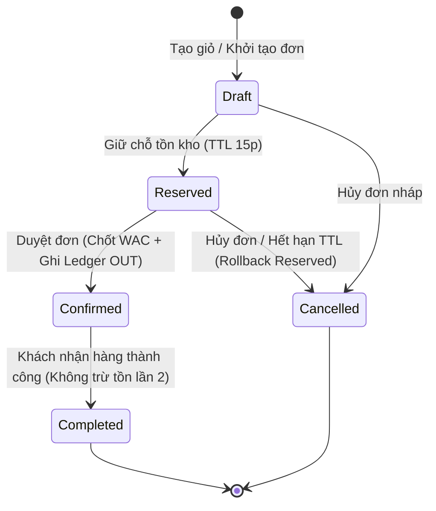
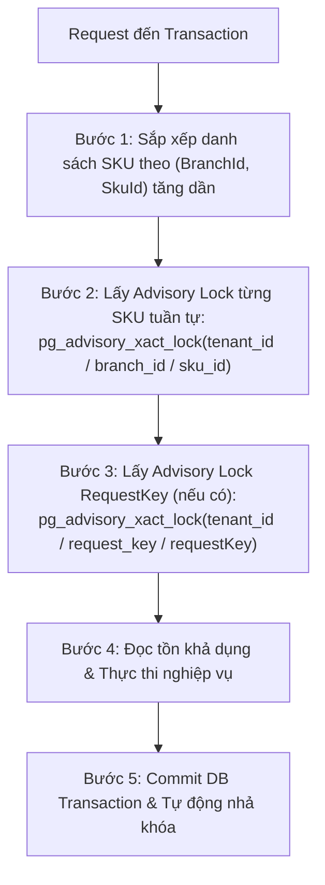

# HỢP ĐỒNG API & THIẾT KẾ PERSISTENCE CHÍNH THỨC SPRINT 3 (OISMS)

| Thông tin kiểm soát tài liệu | Chi tiết |
| :--- | :--- |
| **Mã tài liệu (Document ID)** | `DOC-CTR-S3-01` |
| **Phiên bản (Version)** | `v1.2.0` |
| **Ngày ban hành** | `2026-10-26` |
| **Tác giả / Vai trò** | **Lê Võ Đăng Khoa** — Lead Developer / Backend 1 |
| **Nguồn truy vết gốc** | `De bai CNPM.pdf`, Confluence Page ID `5275650` (Version 11), Confluence Page ID `983053` (Version 69) |
| **Tài liệu liên kết** | [`../../05-api-contracts/04-order-endpoints.md`](../../05-api-contracts/04-order-endpoints.md), [`../../05-api-contracts/05-pos-endpoints.md`](../../05-api-contracts/05-pos-endpoints.md), [`README.md`](README.md) |

---

## I. TỔNG QUAN & BỐI CẢNH ĐỒNG BỘ CONTRACT

Tài liệu này xác lập hợp đồng kỹ thuật chuẩn mực (API Contracts) và mô hình lưu trữ (Persistence Model) cho toàn bộ các phân hệ lõi vận hành trong **Sprint 3 (18/10/2026 – 22/10/2026)**.

### 1. Mục tiêu cốt lõi
* **Đối với Backend 1 (Đăng Khoa):** Định vị ranh giới transaction, cơ chế locking chống bán vượt, máy trạng thái đơn hàng (Order State Machine), hoàn tất đơn online (`complete`), chuyển kho 2 bước, kiểm kê kho, Webhook Simulator đa kênh và SignalR realtime.
* **Đối với Backend 2 (Nhựt):** Cung cấp cấu trúc DTO, phân trang, truy vấn `list/detail/filter` và chỉ số tài chính (Net Revenue, COGS, Gross Profit, Inventory Value, Velocity) để viết API đọc và bộ Automated Core Tests.
* **Đối với Frontend Admin (Phúc Hữu):** Cung cấp contract chuẩn cho duyệt đơn online, quản lý chuyển kho, kiểm kê và nhận thông báo chuông/popup SignalR.
* **Đối với Frontend POS (Phương):** Cung cấp contract thanh toán nhanh nguyên tử toàn giỏ (Atomic Checkout), in hóa đơn chuẩn qua `PosReceiptDto`, giải quyết dứt điểm tình trạng lệch endpoint và bảo mật dữ liệu giá vốn.
* **Đối với QA / Tester (Nam Nguyễn):** Cung cấp ma trận endpoint, payload mẫu, mã lỗi HTTP và kịch bản kiểm thử tải đồng thời (Concurrency 50 reqs).

---

## II. GIẢI QUYẾT XUNG ĐỘT ENDPOINT CHECKOUT POS

### 1. Hiện trạng xung đột
* **Tài liệu thiết kế ban đầu (`DOC-API-05`):** Ghi nhận `POST /api/pos/checkout`.
* **Mã nguồn thực tế Frontend POS (`src/frontend/pos-app/src/services/api.ts`):** Gọi `POST /api/orders/checkout`.
* **Mã nguồn thực tế Frontend Admin (`src/frontend/admin-dashboard/src/services/posApi.ts`):** Gọi `POST /api/orders/checkout`.

### 2. Quyết định kỹ thuật chuẩn hóa (Dual-Route Unified Contract)
Hệ thống Backend OISMS áp dụng kiến trúc **Dual-Route Mapping** trên cùng một lõi xử lý nghiệp vụ `IOrderService.CheckoutPosAsync`:
1. **Endpoint Canonical (Chuẩn RESTful):** `POST /api/pos/checkout`
   * Phù hợp theo đúng phân hệ quầy thu ngân POS, quyền `Owner, Staff, Cashier`.
2. **Endpoint Alias (Tương thích ngược 100%):** `POST /api/orders/checkout`
   * Ánh xạ cùng controller action và DTO `PosCheckoutRequestDto`, bảo đảm mã nguồn cả 2 frontend (`pos-app` và `admin-dashboard`) chạy mượt mà ngay lập tức mà không cần sửa code giao diện.
3. **Quy tắc xử lý:** Cả hai endpoint đều dùng chung một bộ validator, cùng cơ chế `Idempotency Key` (`RequestKey`), cùng chạy trong một Transaction CSDL nguyên tử duy nhất.

---

## III. MÁY TRẠNG THÁI ĐƠN HÀNG & QUY TẮC PERSISTENCE

### 1. Sơ đồ chuyển đổi trạng thái (Order State Machine)



### 2. Ma trận tác động dữ liệu theo từng trạng thái

| Thao tác | Trạng thái chuyển đổi | Tác động Tồn kho (`InventoryBalance`) | Tác động Giữ chỗ (`Reservation`) | Tác động Sổ cái (`InventoryTransaction`) | Tác động Giá vốn (`OrderItem.CostPrice`) |
| :--- | :---: | :--- | :--- | :--- | :--- |
| **POS Fast Checkout** | `Draft` ➔ `Completed` | Trừ thẳng `on_hand -= Qty`. Không tăng `reserved`. | Tạo `Reservation` với trạng thái `Consumed`. | Ghi bút toán `type = 'OUT'`, tham chiếu `order_item_id`. | Chốt snapshot giá vốn WAC tại thời điểm thanh toán. |
| **Tạo đơn Admin / Webhook** | `Draft` ➔ `Reserved` | Không đổi `on_hand`. Tăng `reserved += Qty`. | Tạo `Reservation` với trạng thái `Active`, hạn dùng `expires_at = now() + 15m`. | Chưa ghi Sổ cái (chưa xuất hàng vật lý). | Chưa chốt giá vốn. |
| **Duyệt đơn online (`confirm`)** | `Reserved` ➔ `Confirmed` | Trừ `on_hand -= Qty`, giảm `reserved -= Qty`. | Chuyển trạng thái `Reservation` sang `Consumed`. | Ghi bút toán `type = 'OUT'`, tham chiếu `order_item_id`. | Chốt snapshot giá vốn WAC tại thời điểm xác nhận. |
| **Hoàn tất đơn online (`complete`)** | `Confirmed` ➔ `Completed` | **Không thay đổi tồn kho.** | Giữ nguyên trạng thái `Consumed`. | **Tuyệt đối KHÔNG ghi Sổ cái lần 2** (đã ghi khi Confirm). | Giữ nguyên giá vốn đã chốt. Gán `completed_at = now()`. |
| **Hủy đơn / Hết hạn (`cancel / expire`)** | `Reserved` ➔ `Cancelled` | Không đổi `on_hand`. Giảm `reserved -= Qty` (hoàn trả `available`). | Chuyển trạng thái `Reservation`: Phiếu quá hạn (`ExpiresAt <= cutoffUtc`) sang `Expired`, phiếu còn hạn cùng giỏ sang `Released`. | Không ghi Sổ cái (vì chưa từng xuất kho). | Không phát sinh giá vốn. |

---

## IV. CƠ CHẾ KHÓA ĐỒNG THỜI, IDEMPOTENCY & THỨ TỰ KHÓA THỐNG NHẤT

### 1. Thống nhất Thứ tự Khóa với nền tảng Sprint 2 (Lock Hierarchy Rule)
Để ngăn ngừa triệt để tình trạng Deadlock giữa các luồng đồng thời (POS Checkout, Duyệt đơn online, Giữ chỗ Reservation, Kiểm kê kho), hệ thống quy định một **thứ tự khóa xác định duy nhất (Deterministic Lock Ordering)** xuyên suốt toàn bộ ứng dụng:



1. **Khóa tài nguyên trước (SKU Locks First):**
   - Danh sách mặt hàng giỏ hàng/đơn hàng được gom nhóm và **sắp xếp tăng dần theo `(BranchId, SkuId)`**.
   - Vòng lặp khóa tuần tự từng SKU:
     ```sql
     SELECT pg_advisory_xact_lock(hashtextextended(tenant_id || '/' || branch_id || '/' || sku_id, 0));
     ```
   - Việc sắp xếp cố định triệt tiêu chu trình chờ khóa chéo giữa hai đơn hàng chứa cùng tập SKU.
2. **Khóa RequestKey sau (RequestKey Lock Second):**
   - Sau khi đã giữ khóa SKU, nếu client truyền `RequestKey`:
     ```sql
     SELECT pg_advisory_xact_lock(hashtextextended(tenant_id || '/request_key/' || request_key, 0));
     ```
   - Khóa này đồng bộ 100% với `ReservationService` của Sprint 2 (vốn đã thực thi SKU lock trước, RequestKey lock sau).
3. **Ranh giới Transaction:**
   - Toàn bộ chuỗi thao tác `Validate -> Deduct Stock -> Create Order -> Create Payment -> Write Ledger OUT` nằm trọn trong **1 Database Transaction duy nhất**.
   - Tái sử dụng trực tiếp công thức số học và bảng `inventory_balances` / `inventory_transactions` của lõi Inventory, **không tạo engine trừ kho thứ hai**.

### 2. Quy tắc Idempotency & Validation
* Client **bắt buộc** phải cung cấp `RequestKey` ổn định (kiểu UUID RFC 4122). Backend **không sinh sẵn `Guid.NewGuid()` mặc định** trong DTO.
* Ràng buộc kiểm tra `[NotEmptyGuid]` từ chối `Guid.Empty` (`00000000-0000-0000-0000-000000000000`) và trả `400 Bad Request`.
* **Cùng RequestKey + Cùng Payload:** Trả về kết quả đơn hàng cũ kèm mã `HTTP 200 OK`, không trừ kho lần 2, không tạo Payment mới.
* **Cùng RequestKey + Khác Payload:** Từ chối với mã lỗi `HTTP 409 Conflict` (`IDEMPOTENCY_PAYLOAD_MISMATCH`).
* **Request Đồng Thời (Concurrent Retries):** Nhờ khóa Advisory Lock, request thứ hai phải chờ transaction thứ nhất commit; sau đó đọc lại kết quả đã hoàn thành và trả về 200 OK.
* **Kết quả chưa xác định (Network Timeout):** Client retry với cùng `RequestKey`, hệ thống phát hiện đơn đã tạo và trả về kết quả an toàn.
* **Hai Alias Checkout (`/api/pos/checkout` & `/api/orders/checkout`):** Cùng bảo vệ bởi unique constraint `uq_orders_3 (tenant_id, request_key)`.

---

## V. CHI TIẾT HỢP ĐỒNG API SPRINT 3

### 1. Nhóm Bán hàng POS (`/api/pos` & `/api/orders`)

#### `POST /api/pos/checkout` & `POST /api/orders/checkout`
* **Quyền hạn (RBAC):** `Owner, Staff, Cashier`
* **Mô tả:** Thanh toán nguyên tử toàn bộ giỏ hàng tại quầy POS, in hóa đơn tức thì.
* **Request Body (`PosCheckoutRequestDto`):**
  ```json
  {
    "branchId": "11111111-1111-1111-1111-111111111111",
    "channel": "POS",
    "customerName": "Nguyễn Văn A",
    "customerPhone": "0901234567",
    "paymentMethod": "Cash",
    "amountGiven": 500000,
    "changeDue": 50000,
    "requestKey": "a1b2c3d4-e5f6-7890-abcd-ef1234567890",
    "items": [
      {
        "skuId": "22222222-2222-2222-2222-222222222222",
        "skuCode": "POLO-NAM-DEN-M",
        "productName": "Áo Polo Nam",
        "variantName": "Đen / M",
        "quantity": 2,
        "unitPrice": 225000
      }
    ],
    "totalAmount": 450000
  }
  ```
* **Response Body (`HTTP 200 OK` - `PosCheckoutResponseDto`):**
  > **Bảo mật RBAC:** Trả về `PosReceiptDto` chuẩn hóa đơn bán lẻ, **tuyệt đối KHÔNG chứa `costPrice`, `totalCost`, `totalCogs`**.
  ```json
  {
    "success": true,
    "message": "Thanh toán đơn hàng thành công.",
    "orderId": "33333333-3333-3333-3333-333333333333",
    "orderNumber": "ORD-20261024-0001",
    "totalAmount": 450000,
    "amountGiven": 500000,
    "changeDue": 50000,
    "paymentMethod": "Cash",
    "checkoutAt": "2026-10-24T10:30:00Z",
    "receipt": {
      "orderId": "33333333-3333-3333-3333-333333333333",
      "receiptNumber": "HD-20261024-0001",
      "orderNumber": "ORD-20261024-0001",
      "branchId": "11111111-1111-1111-1111-111111111111",
      "branchName": "Chi nhánh Quận 1",
      "cashierName": "Thu ngân Nguyễn Văn B",
      "customerName": "Nguyễn Văn A",
      "customerPhone": "0901234567",
      "totalAmount": 450000,
      "paymentMethod": "Cash",
      "amountGiven": 500000,
      "changeDue": 50000,
      "createdAt": "2026-10-24T10:30:00Z",
      "items": [
        {
          "skuId": "22222222-2222-2222-2222-222222222222",
          "skuCode": "POLO-NAM-DEN-M",
          "productName": "Áo Polo Nam",
          "variantName": "Đen / M",
          "quantity": 2,
          "unitPrice": 225000,
          "subtotal": 450000
        }
      ]
    }
  }
  ```

---

### 2. Nhóm Đơn hàng Đa kênh (`/api/orders`)

| Method | Endpoint | Quyền (RBAC) | Mô tả & Quy tắc xử lý |
| :---: | :--- | :---: | :--- |
| `GET` | `/api/orders` | `Owner, Staff` | Tra cứu danh sách đơn hàng có phân trang (`pageNumber`, `pageSize`), hỗ trợ lọc theo `branchId`, `status`, `channel`, `fromDate`, `toDate`. |
| `GET` | `/api/orders/{id}` | `Owner, Staff` | Lấy chi tiết đơn hàng kèm danh sách dòng sản phẩm, WAC snapshot và thông tin thanh toán (có giá vốn cho quản trị viên). |
| `POST` | `/api/orders` | `Owner, Staff` | Tạo đơn hàng thủ công trên Admin Portal. Bắt buộc `RequestKey` hợp lệ. Trạng thái khởi tạo `Reserved`. |
| `POST` | `/api/orders/{id}/confirm` | `Owner, Staff` | Duyệt đơn online (`Reserved -> Confirmed`), chốt giá vốn WAC snapshot và trừ kho thật. |
| `POST` | `/api/orders/{id}/complete` | `Owner, Staff` | **Hoàn tất đơn online (`Confirmed -> Completed`):** Ghi nhận khách đã nhận hàng thành công. Gán `completed_at = now()`. **Không trừ tồn kho và không ghi ledger OUT lần thứ hai.** Gọi lại trên đơn đã Completed trả 200 OK. Đơn chưa Confirmed trả `409 Conflict` (`INVALID_STATE_TRANSITION`). |
| `POST` | `/api/orders/{id}/cancel` | `Owner, Staff` | Hủy đơn (`Reserved -> Cancelled`), giải phóng tồn giữ chỗ về lại quỹ khả dụng. |

---

### 3. Nhóm Chuyển kho Nội bộ 2 bước (`/api/stock-transfers`)

Phân hệ chuyển kho thực hiện chuyển hàng giữa hai kho (`fromWarehouseId != toWarehouseId`) trong cùng một chi nhánh hoặc giữa hai chi nhánh khác nhau. Nghiệp vụ tuân thủ máy trạng thái 2 bước nghiêm ngặt: `Draft -> InTransit -> Received`, chỉ được phép hủy (`cancel`) khi phiếu còn ở trạng thái `Draft`.

#### 3.1. Bảng ma trận Endpoint

| Method | Endpoint | Quyền (RBAC) | Mô tả & Quy tắc xử lý |
| :---: | :--- | :---: | :--- |
| `POST` | `/api/stock-transfers` | `Owner, Staff` | Tạo phiếu chuyển kho trạng thái nháp (`Draft`). Yêu cầu `fromWarehouseId != toWarehouseId`. Hỗ trợ Idempotency qua `RequestKey`. Sinh mã `TRF-yyyyMMdd-XXXXX` an toàn dưới Advisory Lock. |
| `POST` | `/api/stock-transfers/{id}/dispatch` | `Owner, Staff` | **Bước 1 (Xuất chuyển):** Chuyển trạng thái `Draft -> InTransit`. Trừ `on_hand` kho xuất, chụp snapshot giá vốn WAC kho xuất vào `StockTransferItem.UnitCost` (6 số thập phân), ghi Ledger OUT với tham chiếu `transfer_item_id`. |
| `POST` | `/api/stock-transfers/{id}/receive` | `Owner, Staff` | **Bước 2 (Nhập nhận):** Chuyển trạng thái `InTransit -> Received`. Kiểm tra snapshot `UnitCost` (từ chối 409 nếu NULL). Cộng `on_hand` kho đích, tính lại WAC đích qua `IWacCalculator.CalculateWac`, cập nhật `InventoryBalance.AverageCost`, ghi Ledger IN với tham chiếu `transfer_item_id`. |
| `POST` | `/api/stock-transfers/{id}/cancel` | `Owner, Staff` | Hủy phiếu chuyển kho khi còn ở trạng thái `Draft` (`Draft -> Cancelled`). Phiếu đã InTransit hoặc Received không được phép hủy (trả về 409). |
| `GET` | `/api/stock-transfers` | `Owner, Staff` | (BE2 Scope) Lấy danh sách phiếu chuyển kho có phân trang và bộ lọc chi nhánh/kho. |
| `GET` | `/api/stock-transfers/{id}` | `Owner, Staff` | (BE2 Scope) Lấy chi tiết phiếu chuyển kho kèm danh sách SKU và giá vốn chuyển giao. |

#### 3.2. Quy tắc Idempotency & Băm Chữ ký Payload (`payload_signature`)
* **Khóa Idempotency (`RequestKey`):** Client cung cấp `RequestKey` kiểu UUID. Khóa được bảo vệ bởi Unique Constraint `uq_stock_transfers_3 (tenant_id, request_key)`.
* **Chuẩn hóa chữ ký Payload (SHA-256):** Chuỗi canonical hiện hành là `"{FromBranchId:D}|{ToBranchId:D}|{FromWarehouseId:D}|{ToWarehouseId:D}|{(Note ?? string.Empty).Trim()}|{sortedItems(skuId:qty)}"`. Payload đầu vào không có giá vốn; server snapshot WAC tại Dispatch. `Items` được sắp xếp theo `SkuId`; mỗi dòng dùng `SkuId:D` và định dạng quantity `0.###` trong implementation hiện hành, rồi tính SHA-256 hex chữ thường. Đảo thứ tự Items hoặc thêm khoảng trắng ở đầu/cuối Note không làm thay đổi chữ ký; khoảng trắng bên trong Note vẫn có ý nghĩa. Không mô tả formatter hiện tại là `G29` hay bảo đảm invariant culture khi code chưa thực hiện điều đó.
* **Giới hạn số lượng:** Số lượng chuyển kho phải là số dương, tối đa 3 chữ số thập phân (`scale <= 3`) và không vượt quá giới hạn biểu diễn của kiểu `numeric(18,3)` (`MaxQuantityAmount = 999,999,999,999,999.999m`). Mọi giá trị vi phạm đều bị chặn ở tầng validation và trả về `400 VALIDATION_ERROR` trước khi ghi CSDL.
* **Quy trình xử lý Replay & Validation dưới khóa:**
  1. Lấy khóa SKU theo thứ tự `(FromBranchId, SkuId)`.
  2. Lấy khóa RequestKey `pg_advisory_xact_lock(tenantId || '/request_key/' || requestKey)`.
  3. **Kiểm tra Replay trước khi kiểm tra tài nguyên:** Truy vấn `StockTransfer` theo `(TenantId, RequestKey)`.
     - Nếu đã tồn tại: So sánh chữ ký `payload_signature`.
       - **Cùng chữ ký (Match):** Trả về phiếu cũ kèm `HTTP 200 OK` ngay lập tức mà không cần kiểm tra lại tài nguyên catalog (kể cả khi SKU/kho sau đó bị vô hiệu hóa `IsActive = false`, hoặc phiếu đã chuyển trạng thái `InTransit`/`Received`/`Cancelled`).
       - **Khác chữ ký (Mismatch):** Trả về `HTTP 409 Conflict` (`IDEMPOTENCY_PAYLOAD_MISMATCH`).
  4. Nếu chưa tồn tại: Tiến hành kiểm tra tài nguyên hệ thống (Branch, Warehouse, SKU). Nếu không tìm thấy trong tenant trả về `404 NOT_FOUND`; nếu tài nguyên bị inactive hoặc sai quan hệ trả về `400 VALIDATION_ERROR`.
* **Hỗ trợ Legacy:** Phiếu chuyển kho cũ được tạo trước khi có cột `request_key` (có giá trị `request_key IS NULL`) vẫn được hỗ trợ đầy đủ các thao tác Dispatch, Receive, Cancel bình thường.

#### 3.3. Sinh Mã Phiếu An Toàn Đồng Thời (`TransferNumber`)
* Định dạng mã: `TRF-yyyyMMdd-XXXXX` (hậu tố 5 chữ số định dạng D5, ví dụ: `TRF-20261024-00001`).
* Để loại trừ race condition gây lỗi 500 vi phạm ràng buộc `uq_stock_transfers_2`, việc đếm và sinh mã được bảo vệ bên trong Database Transaction bởi Transaction Advisory Lock:
  ```sql
  SELECT pg_advisory_xact_lock(hashtextextended(tenant_id || '/stock_transfer_number', 0));
  ```
* Nhờ khóa này, các luồng tạo phiếu đồng thời trong cùng tenant sẽ được xếp hàng tuần tự hóa việc cấp phát số thứ tự `XXXXX`, đảm bảo 100% mã sinh ra là duy nhất và liên tục. Khóa tự động giải phóng khi Transaction kết thúc.

#### 3.4. Thứ Tự Khóa Tài Nguyên Tuyệt Đối (Strict Lock Hierarchy)
Để ngăn ngừa bế tắc khóa (Deadlock) giữa các luồng chuyển kho chéo chiều (A -> B và B -> A) hoặc giữa Chuyển kho và POS/Online Order, hệ thống áp dụng triệt để thứ tự khóa:
$$\text{SKU } (BranchId, SkuId) \longrightarrow \text{RequestKey (nếu có)} \longrightarrow \text{Document } (TransferId)$$

1. **Gợi ý khóa (Hint Lookup):** Khi nhận yêu cầu Dispatch / Receive / Cancel, service thực hiện một truy vấn un-tracked đọc nhẹ `(BranchId, RequestKey, List<SkuId>)`.
2. **Khóa SKU:** Gom nhóm và sắp xếp tăng dần theo `(BranchId, SkuId)`:
   ```sql
   SELECT pg_advisory_xact_lock(hashtextextended(tenant_id || '/' || branch_id || '/' || sku_id, 0));
   ```
3. **Khóa RequestKey (nếu phiếu có RequestKey):**
   ```sql
   SELECT pg_advisory_xact_lock(hashtextextended(tenant_id || '/request_key/' || request_key, 0));
   ```
4. **Khóa chứng từ (Document Lock):**
   ```sql
   SELECT pg_advisory_xact_lock(hashtextextended(tenant_id || '/stock_transfer/' || transfer_id, 0));
   ```
5. **Đọc lại dữ liệu (Fresh Reload):** Sau khi đã giữ đầy đủ khóa theo đúng thứ tự phân cấp, service nạp lại toàn bộ thực thể `StockTransfer`, `InventoryBalance`, `Warehouse` từ Database để kiểm tra điều kiện nghiệp vụ và thực thi biến động.
6. **Bất biến:** Tuyệt đối không lấy thêm bất kỳ khóa SKU nào sau khi đã giữ khóa chứng từ.

#### 3.5. Quy Tắc Giá Vốn WAC, Sổ Cái Ledger & Snapshot Chuyển Kho
* **Bước Xuất chuyển (Dispatch):**
  - Trừ tồn kho xuất: `on_hand -= Qty`, tồn khả dụng `available -= Qty`.
  - Chụp snapshot giá vốn bình quân gia quyền tại thời điểm xuất:
    `item.UnitCost = Math.Round(balance.AverageCost > 0 ? balance.AverageCost : sku.PurchasePrice, 6)`.
  - Ghi bút toán sổ cái `inventory_transactions`:
    - `type = 'OUT'`
    - `warehouse_id = transfer.FromWarehouseId`
    - `quantity = -item.Quantity`
    - `unit_cost = item.UnitCost`
    - `transfer_item_id = item.Id` (tham chiếu dòng chuyển kho)
* **Bước Nhập nhận (Receive):**
  - **Kiểm tra Snapshot Giá vốn (T4A-F03):** Nếu `!item.UnitCost.HasValue` (NULL), hệ thống từ chối ngay lập tức với mã lỗi `HTTP 409 Conflict` (`INVALID_STATE_TRANSITION`), bảo vệ toàn vẹn sổ cái và không tự động gán giá vốn về 0. Trường hợp snapshot thực sự bằng `0.000000m` vẫn là giá trị hợp lệ theo thiết kế.
  - Cộng tồn kho đích: `on_hand += Qty`, tồn khả dụng `available += Qty`.
  - Tính lại giá vốn bình quân gia quyền tại kho đích bằng dịch vụ `IWacCalculator.CalculateWac`:
    $$\text{NewWac} = \frac{(\text{CurrentOnHand} \times \text{CurrentAverageCost}) + (\text{ReceivedQty} \times \text{SnapshotUnitCost})}{\text{CurrentOnHand} + \text{ReceivedQty}}$$
  - Cập nhật trường `InventoryBalance.AverageCost` tại kho đích.
  - Ghi bút toán sổ cái `inventory_transactions`:
    - `type = 'IN'`
    - `warehouse_id = transfer.ToWarehouseId`
    - `quantity = item.Quantity`
    - `unit_cost = item.UnitCost.Value`
    - `transfer_item_id = item.Id` (tham chiếu dòng chuyển kho)

#### 3.6. Cấu trúc Payload DTOs

**Tạo phiếu chuyển kho (`CreateStockTransferRequestDto`):**
```json
{
  "requestKey": "e1f2a3b4-c5d6-7e8f-9012-3456789abcde",
  "fromBranchId": "11111111-1111-1111-1111-111111111111",
  "fromWarehouseId": "22222222-2222-2222-2222-222222222222",
  "toBranchId": "33333333-3333-3333-3333-333333333333",
  "toWarehouseId": "44444444-4444-4444-4444-444444444444",
  "notes": "Chuyển hàng bổ sung tồn chi nhánh 2",
  "items": [
    {
      "skuId": "55555555-5555-5555-5555-555555555555",
      "quantity": 10.000
    }
  ]
}
```

**Phản hồi thông tin phiếu (`StockTransferResponseDto`):**
```json
{
  "id": "66666666-6666-6666-6666-666666666666",
  "transferNumber": "TRF-20261024-0001",
  "requestKey": "e1f2a3b4-c5d6-7e8f-9012-3456789abcde",
  "status": "InTransit",
  "fromBranchId": "11111111-1111-1111-1111-111111111111",
  "fromWarehouseId": "22222222-2222-2222-2222-222222222222",
  "toBranchId": "33333333-3333-3333-3333-333333333333",
  "toWarehouseId": "44444444-4444-4444-4444-444444444444",
  "dispatchedAt": "2026-10-24T14:30:00Z",
  "dispatchedBy": "77777777-7777-7777-7777-777777777777",
  "receivedAt": null,
  "receivedBy": null,
  "notes": "Chuyển hàng bổ sung tồn chi nhánh 2",
  "createdAt": "2026-10-24T14:00:00Z",
  "items": [
    {
      "id": "88888888-8888-8888-8888-888888888888",
      "skuId": "55555555-5555-5555-5555-555555555555",
      "skuCode": "POLO-NAM-DEN-M",
      "productName": "Áo Polo Nam",
      "variantName": "Đen / M",
      "quantity": 10.000,
      "unitCost": 150000.000000
    }
  ]
}
```

---

### 4. Nhóm Kiểm kê Kho & Cân bằng Tồn (`/api/stock-counts`)

| Method | Endpoint | Quyền (RBAC) | Mô tả & Quy tắc xử lý |
| :---: | :--- | :---: | :--- |
| `POST` | `/api/stock-counts` | `Owner, Staff` | **Khởi tạo đợt kiểm kê & Snapshot số dư:**<br/>- **Payload (`CreateStockCountRequestDto`):** `RequestKey` (UUID bắt buộc), `BranchId` (UUID), `WarehouseId` (UUID), `SkuIds` (List&lt;Guid&gt;?, null/rỗng = Toàn kho), `Note` (string?).<br/>- **Chế độ kiểm kê:** Lựa chọn danh sách SKU cụ thể hoặc Toàn kho (ALL). Kho rỗng khi chọn Toàn kho trả `400 EMPTY_WAREHOUSE_STOCK_COUNT`.<br/>- **Snapshot:** Chụp chính xác `expected_quantity` (OnHand kho) và `balance_sequence_at_snapshot` (`last_sequence` kho). SKU chưa có số dư snapshot 0. Tạo phiếu Draft không làm biến động tồn kho/ledger (`Zero stock mutation`).<br/>- **Mã đợt kiểm kê:** Tự động sinh số hiệu định dạng `CNT-yyyyMMdd-XXXXX` dưới advisory lock `stock_count_number`.<br/>- **Idempotency tuyệt đối:** Khóa idempotent SHA-256 theo canonical payload. Cùng key + payload trả `200 OK` (`isReplay = true`); cùng key + khác payload trả `409 IDEMPOTENCY_PAYLOAD_MISMATCH`. Replay trả về trạng thái thực tế hiện tại (`Draft`, `Counting`, `Confirmed`, `Cancelled`). |
| `POST` | `/api/stock-counts/{id}/record` | `Owner, Staff` | **Ghi nhận số lượng đếm thực tế:**<br/>- **Payload (`RecordStockCountBatchRequestDto`):** `Items` (danh sách dòng kiểm đếm). Mỗi dòng gồm `SkuId` (UUID), `CountedQuantity` (decimal?, 0 .. 999,999,999,999,999.999, scale &le; 3), `AdjustmentUnitCost` (decimal?, scale &le; 6, max 999,999,999,999.999999).<br/>- **Phân biệt số 0:** `CountedQuantity = 0` là giá trị kiểm đếm hợp lệ (mất toàn bộ hàng), phân biệt với chưa đếm (`null` / omitted).<br/>- **Chuyển trạng thái:** Tự động chuyển từ `Draft` sang `Counting` sau lần ghi nhận hợp lệ đầu tiên.<br/>- **Atomic Batch & SKU Guards:** Gửi SKU không thuộc đợt kiểm kê trả `400 INVALID_COUNT_ITEM`. Bất kỳ dòng nào lỗi sẽ từ chối toàn bộ batch, không lưu dở dang. |
| `POST` | `/api/stock-counts/{id}/confirm` | `Owner, Staff` | **Chốt kiểm kê & Cân bằng kho nguyên tử:**<br/>1. **Điều kiện tiên quyết:** Toàn bộ mặt hàng trong đợt phải được nhập số đếm thực tế (nếu thiếu trả `409 INVALID_STATE_TRANSITION`). Phiếu phải ở trạng thái `Counting` (nếu ở `Draft`, `Confirmed` hoặc `Cancelled` trả `409 INVALID_STATE_TRANSITION`). Phiếu đã chốt `Confirmed` trước đó bị từ chối `409 INVALID_STATE_TRANSITION` (không replay 200).<br/>2. **Thứ tự khóa Advisory Lock:** Khóa SKU `(BranchId, SkuId)` theo thứ tự tăng dần &rarr; Khóa Document `/stock_count/{id}` &rarr; Khóa Sequence `/inventory_adjustment_number`. Loại trừ deadlock tuyệt đối.<br/>3. **Phát hiện Sequence Drift:** Đối chiếu `warehouse_inventory_balances.last_sequence` từng SKU với snapshot. Nếu phát hiện giao dịch xen giữa làm tăng sequence kho, trả `409 STOCK_COUNT_SEQUENCE_DRIFT` và rollback sạch 100%. Giao dịch ở kho khác cùng chi nhánh hoặc SKU khác trong kho không gây false drift.<br/>4. **Bảo vệ hàng giữ chỗ (Active Reservations):** Nếu `CountedQuantity < whReserved` hoặc `newBranchOnHand < branchReserved`, trả `409 INSUFFICIENT_STOCK` để bảo vệ đơn hàng đang chờ giao.<br/>5. **Chính sách WAC hàng thừa (Quyết định B):**<br/>&bull; Khi chi nhánh đã có `WAC > 0`: Dùng WAC hiện có của chi nhánh để tính giá trị điều chỉnh, client gửi giá khác không được ghi đè WAC.<br/>&bull; Khi chi nhánh chưa có tồn / `WAC == 0 || null`: Bắt buộc client cung cấp `AdjustmentUnitCost > 0`. Nếu thiếu/nhỏ hơn bằng 0 trả `422 ADJUSTMENT_COST_REQUIRED`.<br/>&bull; Khi lệch thiếu (deficit): Giữ nguyên WAC chi nhánh.<br/>6. **Sinh chứng từ điều chỉnh & Kiểm soát tràn số:** Tạo duy nhất 1 `InventoryAdjustment` (`ADJ-yyyyMMdd-XXXXX`), liên kết bền vững qua `generated_adjustment_id`. Chặn chủ động các phép tính tổng tồn hoặc tràn số số học CLR vượt giới hạn trước khi lưu CSDL (trả `400 VALIDATION_ERROR`). Chỉ sinh `InventoryAdjustmentItem` và bút toán sổ cái `InventoryTransaction` cho các dòng có `Delta != 0` (Thừa `IN`, Thiếu `OUT`). Toàn bộ khớp: sinh adjustment 0 items, 0 ledger entries. Cập nhật số dư 2 cấp (Kho và Chi nhánh) nguyên tử trong transaction. |
| `POST` | `/api/stock-counts/{id}/cancel` | `Owner, Staff` | **Hủy đợt kiểm kê an toàn:**<br/>- Cho phép hủy khi phiếu ở `Draft` hoặc `Counting`. Chuyển sang `Cancelled`, ghi nhận lý do hủy.<br/>- Tuyệt đối không làm biến động tồn kho, sổ cái hay sequence (`Zero stock mutation`).<br/>- Chặn hủy khi đã `Confirmed` hoặc `Cancelled` (trả `409 INVALID_STATE_TRANSITION`). |
| `GET` | `/api/stock-counts` | `Owner, Staff` | *(Phân công Backend 2)* Danh sách các đợt kiểm kê theo chi nhánh/kho. |
| `GET` | `/api/stock-counts/{id}` | `Owner, Staff` | *(Phân công Backend 2)* Chi tiết đợt kiểm kê kèm bảng so sánh thừa/thiếu giữa số đếm thực tế và sổ sách. |

---

### 5. Nhóm Webhook Đa kênh Canonical (`/api/webhooks/simulator`)

#### `POST /api/webhooks/simulator/{channel}`
* **Tham số Path:** `channel` nhận giá trị `'Shopee'`, `'TikTok'`, `'Lazada'`.
* **Xác thực & Bảo mật Tenant:**
  * Xác thực qua Header bí mật `X-Webhook-Secret` hoặc Bearer JWT Token (`Authorization: Bearer <token>`).
  * **Chế độ Secret:** Tìm kiếm tích hợp dựa trên `SecretHash` duy nhất (`uq_shop_integrations_secret_hash`). Phát hiện xung đột nếu nhiều cấu hình trùng hash (`401 Unauthorized` / `CREDENTIAL_CONFLICT`). Xác thực doanh nghiệp `Tenant.IsActive == true` (`401 Unauthorized` / `Doanh nghiệp đã ngừng hoạt động`).
  * **Tuyệt đối không tin cậy `tenant_id` từ Request Body.** `TenantId` luôn được trích xuất từ thông tin kênh tích hợp đã xác thực.
* **Ánh xạ Chi nhánh Fulfillment (Branch Resolution):**
  * Sàn TMĐT không quản lý `branchId` nội bộ. Hệ thống ánh xạ `(tenant_id, channel, external_shop_id)` sang Chi nhánh mặc định được cấu hình trong bảng tích hợp.
  * Kiểm tra chi nhánh này phải `IsActive = true` khi tạo đơn mới (`404 Not Found` / `BRANCH_INACTIVE_OR_INVALID`).
* **Khóa chống trùng nhận đơn (Deduplication Key) & Fast Replay:**
  * Khóa xác định: `(tenant_id, channel, external_shop_id, external_order_id)`. RequestKey nội bộ phân tách bằng null-byte `\0` triệt tiêu va chạm delimiter MD5.
  * **Fast Replay:** Cơ chế kiểm tra đơn đã tồn tại được thực hiện trước các kiểm tra tài nguyên động (như chi nhánh ngừng hoạt động hay thay đổi giá catalog).
  * **Cùng khóa & cùng payload:** Trả về kết quả đơn hàng đã tạo trước đó `HTTP 200 OK` (Idempotent Replay).
  * **Cùng khóa & khác payload:** Trả về `HTTP 409 Conflict` (`WEBHOOK_PAYLOAD_MISMATCH`).
* **Quy chuẩn Validation DTO (`CanonicalWebhookPayloadDto`):**
  * `Channel`: Bắt buộc (`[Required]`), không được để trống hoặc omit trong JSON payload (trả về `400 VALIDATION_ERROR`).
  * `OrderTimestamp`: Bắt buộc (`[Required]`), định dạng ISO-8601 UTC. Giữ trọn 7 chữ số phần thập phân (`.fffffff`) để tính chữ ký Canonical SHA-256 chính xác tới 100ns (1 tick).
  * `TotalAmount`: Bắt buộc (`[Required]`), số dương $\ge 0$, scale tối đa 2 chữ số thập phân (từ chối `10.001` trả `400 Bad Request`), giá trị tối đa 999 tỷ.
  * `Items[i].Quantity` & `Items[i].UnitPrice`: Bắt buộc (`[Required] decimal?`). Omit trong JSON trả về `400 VALIDATION_ERROR`. Trường hợp `unitPrice: 0` khi `totalAmount: 0` (quà tặng/hàng khuyến mãi 0 đồng) vẫn hoàn toàn hợp lệ.
  * Giới hạn độ dài chuỗi: `CustomerName` tối đa 200 ký tự, `CustomerPhone` tối đa 32 ký tự, `ShippingAddress` tối đa 500 ký tự. Vượt quá trả về `400 Bad Request` chuẩn RFC 7807, ngăn chặn lỗi 22001 / 500 Internal Server Error.
* **Xử lý sai lệch & tài nguyên:**
  * Path channel khác Body channel (vd: URL là `Shopee` nhưng body là `TikTok`): Trả `400 Bad Request` (`CHANNEL_MISMATCH`).
  * SKU không tồn tại trong danh mục cửa hàng: Trả `422 Unprocessable Entity` (`SKU_NOT_FOUND`).
  * SKU hoặc sản phẩm bị khóa (`IsActive = false`): Trả `422 Unprocessable Entity` (`SKU_INACTIVE`).
* **Payload đầu vào (`CanonicalWebhookPayloadDto`):**
  ```json
  {
    "channel": "Shopee",
    "externalShopId": "SHOP_VN_001",
    "externalOrderId": "SP-20261024-9988",
    "customerName": "Lê Thị B",
    "customerPhone": "0987654321",
    "shippingAddress": "Quận 1, TP. Hồ Chí Minh",
    "totalAmount": 300000,
    "items": [
      {
        "skuCode": "POLO-NAM-DEN-M",
        "quantity": 1,
        "unitPrice": 300000
      }
    ],
    "orderTimestamp": "2026-10-24T10:30:00Z"
  }
  ```

---

### 6. Sự kiện Realtime SignalR Hub (`/hubs/notifications`)

* **Xác thực Hub:** Yêu cầu Bearer JWT Token qua Query string (`?access_token=...`) dành riêng cho đường dẫn `/hubs/notifications` (tuyệt đối không áp dụng cho REST API). Hỗ trợ các vai trò: `Owner`, `Staff`, `Cashier`.
* **Phân nhóm nhận (Group Segregation):**
  * `tenant_{tenantId}`: Tự động gia nhập khi kết nối thành công. Nhận thông báo đơn hàng mới toàn cửa hàng và cảnh báo hết hàng.
  * `tenant_{tenantId}_branch_{branchId}`: Thu ngân và nhân viên chi nhánh đăng ký nhận qua Hub method `JoinBranchGroup(Guid branchId)` và hủy đăng ký qua `LeaveBranchGroup(Guid branchId)`. Server xác thực chi nhánh thuộc đúng quyền quản lý của Tenant trước khi thêm vào Group; Client tuyệt đối không được tự đặt tên group.
* **Thời điểm phát sự kiện:** **Chỉ được phát sau khi Database Transaction đã commit thành công** (ngăn chặn thông báo ảo khi giao dịch bị rollback). Nếu Notifier gặp sự cố sau commit, hệ thống ghi log và tuyệt đối không làm gián đoạn phản hồi HTTP hay rollback dữ liệu CSDL.
* **Payload tối thiểu, bảo mật giá vốn (Zero Cost Leakage):**

| Tên sự kiện (Event Name) | Payload DTO | Nội dung & Mục đích |
| :--- | :--- | :--- |
| `OrderCreated` | `OrderSummaryRealtimeDto` | Báo đơn hàng mới phát sinh (OrderId, OrderNumber, Channel, Status, TotalAmount, TotalItems). **Tuyệt đối không chứa CostPrice/COGS/SecretHash.** Phát chuông và popup. Áp dụng cho các đơn Reserved (Admin, Shopee, TikTok, Lazada). Không phát cho POS hoặc replay cũ. |
| `StockLevelChanged` | `StockChangedRealtimeDto` | Báo tồn kho khả dụng vừa thay đổi `{ branchId, skuId, newAvailableStock }` (Available = OnHand - Reserved) để POS tự động cập nhật giỏ hàng theo thời gian thực. |
| `LowStockWarning` | `LowStockAlertRealtimeDto` | Cảnh báo mặt hàng sắp hết tồn kho `{ branchId, skuId, skuCode, currentAvailable, threshold }` khi tồn khả dụng giảm xuống dưới hoặc bằng `reorder_point`. |

---

## VI. CẤU TRÚC MÃ LỖI CHUẨN HOÁ (RFC 7807)

```json
{
  "type": "https://oisms.local/errors/INSUFFICIENT_STOCK",
  "title": "Tồn kho không đủ",
  "status": 409,
  "detail": "SKU 'POLO-NAM-DEN-M' chỉ còn 1 sản phẩm khả dụng, không đủ đáp ứng số lượng yêu cầu 2.",
  "instance": "/api/pos/checkout",
  "errorCode": "INSUFFICIENT_STOCK",
  "timestamp": "2026-10-24T10:30:00Z"
}
```

| Mã HTTP | Mã lỗi (`errorCode`) | Ý nghĩa & Tình huống kích hoạt |
| :---: | :--- | :--- |
| `400` | `VALIDATION_ERROR` | Thiếu trường bắt buộc, RequestKey là Guid.Empty, số lượng âm, format không hợp lệ, hoặc tràn số số học CLR. |
| `400` | `CHANNEL_MISMATCH` | Path parameter channel không khớp với trường channel trong Webhook payload. |
| `400` | `TOTAL_AMOUNT_MISMATCH` | Tổng tiền gửi lên từ Webhook sàn không khớp với tổng tính toán lại từ các dòng mặt hàng (làm tròn AwayFromZero). |
| `401` | `UNAUTHORIZED` | Thiếu Bearer Token, Token hết hạn, hoặc Webhook secret không hợp lệ / không khớp cấu hình tích hợp. |
| `403` | `FORBIDDEN` | Cashier cố tình gọi API duyệt đơn Admin, Chuyển kho, Kiểm kê hoặc Webhook Simulator. |
| `404` | `NOT_FOUND` | Không tìm thấy Order, SKU, Warehouse hoặc Branch trong phạm vi Tenant. |
| `404` | `INTEGRATION_NOT_FOUND` | Gian hàng sàn TMĐT chưa được cấu hình tích hợp trong bảng `shop_integrations`. |
| `404` | `BRANCH_INACTIVE_OR_INVALID` | Chi nhánh liên kết với cấu hình tích hợp gian hàng không tồn tại hoặc đã ngừng hoạt động. |
| `409` | `INSUFFICIENT_STOCK` | Hết tồn kho khả dụng hoặc tồn kho bị chiếm trong phiên đồng thời (kể cả kiểm kê chốt làm OnHand thấp hơn Reserved). |
| `409` | `IDEMPOTENCY_PAYLOAD_MISMATCH` | Gửi cùng RequestKey nhưng khác payload so với yêu cầu trước đó. |
| `409` | `WEBHOOK_PAYLOAD_MISMATCH` | Gửi cùng bộ khóa sàn (channel, external_shop_id, external_order_id) nhưng khác chữ ký nội dung Canonical SHA-256. |
| `409` | `INVALID_STATE_TRANSITION` | Cố tình duyệt đơn đã Cancelled, hoàn tất đơn chưa Confirmed, hủy đơn đã Completed, hoặc chốt lại phiếu kiểm kê đã Confirmed. |
| `409` | `STOCK_COUNT_SEQUENCE_DRIFT` | Tồn kho bị giao dịch khác làm thay đổi sequence kho trong thời gian đếm thực tế của phiên kiểm kê. |
| `422` | `ADJUSTMENT_COST_REQUIRED` | Hàng kiểm kê thừa của SKU mới chưa từng có WAC nhưng không cung cấp đơn giá điều chỉnh dương. |
| `422` | `SKU_NOT_FOUND` | Mặt hàng biến thể SKU không tồn tại trong hệ thống khi tiếp nhận đơn hàng Webhook TMĐT. |
| `422` | `SKU_INACTIVE` | SKU hoặc sản phẩm bị khóa ngưng hoạt động. |

---

## VII. DANH MỤC FILE IMPLEMENTATION ĐÃ HOÀN THIỆN (TASK 1)

1. **Domain Entities (`src/backend/src/OISM.Domain/Entities/`):**
   - [`Payment.cs`](../../../../src/backend/src/OISM.Domain/Entities/Payment.cs) (Thanh toán đơn hàng, ràng buộc tiền mặt)
   - [`StockTransfer.cs`](../../../../src/backend/src/OISM.Domain/Entities/StockTransfer.cs) & [`StockTransferItem.cs`](../../../../src/backend/src/OISM.Domain/Entities/StockTransferItem.cs) (Chuyển kho 2 bước)
   - [`StockCount.cs`](../../../../src/backend/src/OISM.Domain/Entities/StockCount.cs) & [`StockCountItem.cs`](../../../../src/backend/src/OISM.Domain/Entities/StockCountItem.cs) (Kiểm kê kho & sequence snapshot)
   - [`InventoryAdjustment.cs`](../../../../src/backend/src/OISM.Domain/Entities/InventoryAdjustment.cs) & [`InventoryAdjustmentItem.cs`](../../../../src/backend/src/OISM.Domain/Entities/InventoryAdjustmentItem.cs) (Bút toán cân bằng tồn)
   - Cập nhật [`Order.cs`](../../../../src/backend/src/OISM.Domain/Entities/Order.cs) (Thêm navigation `Payment`)
2. **Infrastructure Persistence Configurations & Context (`src/backend/src/OISM.Infrastructure/Persistence/`):**
   - [`PaymentConfiguration.cs`](../../../../src/backend/src/OISM.Infrastructure/Persistence/Configurations/PaymentConfiguration.cs)
   - [`StockTransferConfiguration.cs`](../../../../src/backend/src/OISM.Infrastructure/Persistence/Configurations/StockTransferConfiguration.cs) & [`StockTransferItemConfiguration.cs`](../../../../src/backend/src/OISM.Infrastructure/Persistence/Configurations/StockTransferItemConfiguration.cs) (Composite FK 3 thành phần)
   - [`StockCountConfiguration.cs`](../../../../src/backend/src/OISM.Infrastructure/Persistence/Configurations/StockCountConfiguration.cs) & [`StockCountItemConfiguration.cs`](../../../../src/backend/src/OISM.Infrastructure/Persistence/Configurations/StockCountItemConfiguration.cs) (Composite FK kho-chi nhánh)
   - [`InventoryAdjustmentConfiguration.cs`](../../../../src/backend/src/OISM.Infrastructure/Persistence/Configurations/InventoryAdjustmentConfiguration.cs) & [`InventoryAdjustmentItemConfiguration.cs`](../../../../src/backend/src/OISM.Infrastructure/Persistence/Configurations/InventoryAdjustmentItemConfiguration.cs)
   - [`IAppDbContext.cs`](../../../../src/backend/src/OISM.Application/Common/Interfaces/IAppDbContext.cs) (Bổ sung 7 DbSets mới)
   - [`AppDbContext.cs`](../../../../src/backend/src/OISM.Infrastructure/Persistence/AppDbContext.cs) (Bổ sung DbSets và 7 Global Query Filters bảo vệ Multi-tenant)
3. **Application DTOs, Attributes & Service Interfaces (`src/backend/src/OISM.Application/`):**
   - [`NotEmptyGuidAttribute.cs`](../../../../src/backend/src/OISM.Application/Common/Attributes/NotEmptyGuidAttribute.cs) (Chống rò lọt `Guid.Empty`)
   - [`OrderDtos.cs`](../../../../src/backend/src/OISM.Application/Features/Orders/Dtos/OrderDtos.cs) & [`IOrderService.cs`](../../../../src/backend/src/OISM.Application/Features/Orders/Services/IOrderService.cs) (Bổ sung CompleteOrder, tách biệt `PosReceiptDto`)
   - [`StockTransferDtos.cs`](../../../../src/backend/src/OISM.Application/Features/StockTransfers/Dtos/StockTransferDtos.cs) & [`IStockTransferService.cs`](../../../../src/backend/src/OISM.Application/Features/StockTransfers/Services/IStockTransferService.cs)
   - [`StockCountDtos.cs`](../../../../src/backend/src/OISM.Application/Features/StockCounts/Dtos/StockCountDtos.cs) & [`IStockCountService.cs`](../../../../src/backend/src/OISM.Application/Features/StockCounts/Services/IStockCountService.cs) (Bổ sung quy tắc AdjustmentUnitCost)
   - [`WebhookDtos.cs`](../../../../src/backend/src/OISM.Application/Features/Webhooks/Dtos/WebhookDtos.cs) (Quy tắc HMAC, tenant resolution, channel validation)
   - [`RealtimeDtos.cs`](../../../../src/backend/src/OISM.Application/Features/Realtime/Dtos/RealtimeDtos.cs) & [`IRealtimeNotifier.cs`](../../../../src/backend/src/OISM.Application/Features/Realtime/IRealtimeNotifier.cs) (OrderSummaryRealtimeDto không lộ giá vốn)
4. **Automated Verification Test Suites (`src/backend/tests/`):**
   - [`OrderDtoValidationTests.cs`](../../../../src/backend/tests/OISM.UnitTests/OrderDtoValidationTests.cs) (10 unit tests mới về validation, serialization security)
   - [`Sprint3PersistenceIntegrationTests.cs`](../../../../src/backend/tests/OISM.IntegrationTests/Sprint3PersistenceIntegrationTests.cs) (5 integration tests trên PostgreSQL 16+ thật kiểm chứng 7 thực thể, check constraints và multi-tenant isolation)
