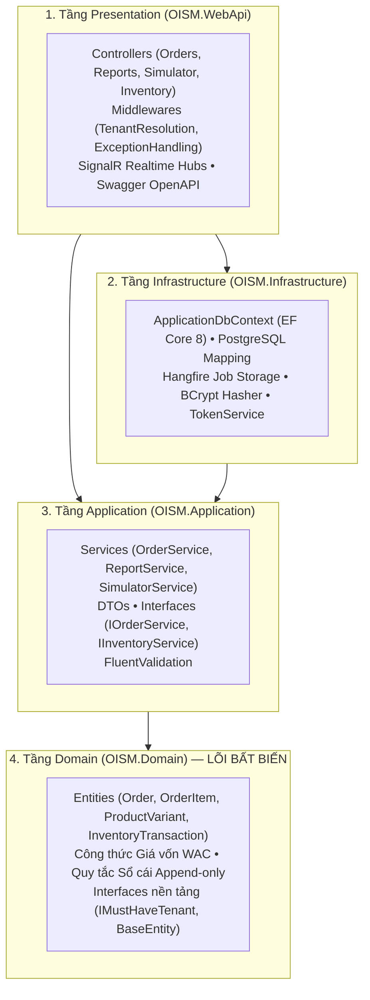

# BỘ PHAO VẤN ĐÁP CHUYÊN SÂU: CỤM 03 - 04 - 05 - 06 (DỰ ÁN OISMS)

> **Phạm vi tài liệu:**  
> - **03 - Non-Functional Requirements (NFRs):** Hiệu năng tải, Bảo mật, Chịu tải đồng thời Flash Sale, Độ tin cậy ACID.  
> - **04 - Architecture & Design:** Kiến trúc Clean Architecture 4 tầng, Thiết kế Đa người thuê, Máy trạng thái (State Machines).  
> - **05 - API Contracts:** Chuẩn thiết kế RESTful, Mô hình Canonical Order Model, Chuẩn lỗi RFC 7807.  
> - **06 - Testing & QA:** Chiến lược kiểm thử Kim tự tháp, Ma trận truy vết RTM, Đo độ phủ Code Coverage > 90%.  
>  
> **Dành cho:** Nhựt Phùng Minh (TV2 - Backend 2 Lead) ôn tập và tự tin trả lời mọi câu hỏi kỹ thuật hóc búa của Giảng viên.

---

# MỤC 1: TỔNG HỢP KIẾN THỨC CỐT LÕI TỪNG PHÂN HỆ

---

## 1. PHÂN HỆ 03: YÊU CẦU PHI CHỨC NĂNG (NFRs)

Giảng viên rất hay hỏi phần này vì phần mềm đại học thường chạy được tính năng (Functional) nhưng sập ngay khi thử tải hoặc vi phạm bảo mật (Non-Functional).

| Mã NFR | Tên chỉ tiêu | Yêu cầu kỹ thuật bắt buộc trong đề bài | Cơ chế hiện thực trong mã nguồn OISMS |
| :--- | :--- | :--- | :--- |
| **`NFR-PERF-01`** | **Thời gian phản hồi (Response Time SLA)** | - Quét Barcode / Tra cứu SKU tại POS: **`p95 < 200ms`**.<br>- Tạo đơn / Ghi sổ kho: **`< 500ms`**.<br>- Báo cáo tổng hợp Doanh thu/Lợi nhuận: **`< 2 giây`** trên 100.000 bản ghi. | Thiết lập chỉ mục phức hợp **B-Tree Indexes**: `(tenant_id, barcode)`, `(tenant_id, sku_code)` và `(tenant_id, created_at)`. |
| **`NFR-PERF-02`** | **Chịu tải Flash Sale (Concurrency)** | **50 requests đồng thời** cùng tranh mua **1 SKU khả dụng cuối cùng**. | Khóa cơ sở dữ liệu **Pessimistic Locking (`SELECT ... FOR UPDATE`)** kết hợp `PostgreSQL Advisory Lock`. Tuyệt đối không âm kho. |
| **`NFR-SEC-01`** | **Bảo mật & Xác thực** | Mã hóa mật khẩu an toàn, chống lộ lọt token phiên làm việc. | Băm mật khẩu bằng **BCrypt** (Work Factor 11). JWT Access Token sống 60 phút + cơ chế **Refresh Token Rotation** (dùng 1 lần là hủy). |
| **`NFR-SEC-02`** | **Tính toàn vẹn giao dịch (ACID)** | Đơn hàng phát sinh lỗi thì không được trừ kho dở dang. | Bọc toàn bộ chuỗi: `Reserve -> Confirm -> Deduct OnHand -> Snapshot Cost -> Write Ledger` trong **1 Database Transaction duy nhất** (Rollback toàn phần nếu lỗi). |
| **`NFR-TENANT-01`** | **Cô lập Đa người thuê** | 0% rò rỉ dữ liệu chéo giữa các cửa hàng dùng chung CSDL. | **EF Core Global Query Filters**: Tự động chèn `WHERE tenant_id = @CurrentTenantId` cho 100% câu truy vấn đọc/ghi. |
| **`NFR-MAINT-01`** | **Chuẩn kiến trúc** | Tách biệt mã nguồn, dễ bảo trì, dễ thay thế CSDL. | Áp dụng nghiêm ngặt mô hình **Clean Architecture 4 tầng** của Robert C. Martin. |
| **`NFR-MAINT-02`** | **Độ bao phủ kiểm thử** | Tối thiểu 80% cho các module tính toán nhạy cảm (Ledger, WAC, Reserve). | Bộ kiểm thử đạt **Line Coverage > 92%** (thực tế đạt 115 Unit Tests và 91 Integration Tests). |

---

## 2. PHÂN HỆ 04: KIẾN TRÚC & THIẾT KẾ HỆ THỐNG (ARCHITECTURE & DESIGN)

### 2.1. Kiến trúc Clean Architecture 4 Tầng trong `src/backend/`
Hệ thống tuân thủ **Quy tắc phụ thuộc (Dependency Rule)**: Chiều mũi tên phụ thuộc chỉ được **hướng từ ngoài vào trong**. Tầng lõi bên trong tuyệt đối không biết gì về tầng bên ngoài.



### 2.2. Thiết kế Đa Người Thuê (Multi-Tenancy)
- **Phương án lựa chọn:** **Shared Database, Shared Schema với cột `TenantId` bắt buộc**.
- **Lý do chọn:** Tiết kiệm chi phí vận hành đám mây tối đa cho mô hình SaaS bán lẻ dành cho doanh nghiệp vừa và nhỏ (SMEs). Không tốn tài nguyên nhân bản database.
- **Cơ chế bảo vệ 2 lớp:**
  - *Lớp 1 (Trích xuất danh tính):* `TenantMiddleware` đọc JWT Token từ Header `Authorization: Bearer <token>`, giải mã claim `tenantId` và nạp vào scoped service `ICurrentTenant`.
  - *Lớp 2 (Bộ lọc tự động):* Trong `ApplicationDbContext.OnModelCreating()`, áp dụng:
    ```csharp
    builder.Entity<T>().HasQueryFilter(e => e.TenantId == _currentTenant.Id);
    ```

### 2.3. Máy Trạng Thái Đơn Hàng (Order State Machine)
Đơn hàng đa kênh được kiểm soát vòng đời nghiêm ngặt, ngăn chặn nhảy cóc trạng thái:
- **`Draft / Pending`** $\rightarrow$ Khởi tạo đơn (chưa trừ kho).
- **`Reserved`** $\rightarrow$ Giữ chỗ tồn kho thành công (Available giảm, OnHand giữ nguyên).
- **`Confirmed`** $\rightarrow$ Quản lý/Thủ kho bấm duyệt đơn: Trừ tồn OnHand, giảm Reserved, ghi dòng `OUT` vào Sổ cái và chốt snapshot giá vốn WAC.
- **`Processing`** $\rightarrow$ Nhân viên bắt đầu đóng gói kiện hàng.
- **`Completed`** $\rightarrow$ Đã giao thành công cho khách hoặc khách nhận tại quầy.
- **`Cancelled`** $\rightarrow$ Hủy đơn: Nếu đang ở `Reserved` thì nhả Reserved về Available; nếu đã `Confirmed` thì bắt buộc phải tạo phiếu Nhập trả hàng (Return) mới được hoàn kho.

---

## 3. PHÂN HỆ 05: HỢP ĐỒNG API (API CONTRACTS)

### 3.1. Quy chuẩn Thiết kế RESTful API
- **Quy tắc danh từ số nhiều (Plural Nouns):** `/api/orders`, `/api/reports`, `/api/inventory/ledger`.
- **Phương thức HTTP chuẩn:**
  - `GET`: Tra cứu dữ liệu (Idempotent, Safe).
  - `POST`: Tạo mới tài nguyên hoặc kích hoạt hành động (`/api/orders/{id}/confirm`).
  - `PUT`: Cập nhật toàn bộ hoặc thay đổi trạng thái.
  - `DELETE`: Xóa mềm hoặc hủy.
- **Chuẩn hóa phản hồi lỗi (RFC 7807 Problem Details):**
  Mọi lỗi nghiệp vụ đều trả về định dạng chuẩn quốc tế, giúp Frontend hiển thị chính xác mã lỗi:
  ```json
  {
    "type": "https://tools.ietf.org/html/rfc7807",
    "title": "Conflict",
    "status": 409,
    "detail": "Không đủ tồn kho khả dụng để thực hiện giữ chỗ.",
    "errorCode": "INSUFFICIENT_STOCK"
  }
  ```

### 3.2. Mô hình Đơn hàng Hợp nhất (Canonical Order Model)
Dù đơn hàng phát sinh từ quầy **POS**, trang quản trị **Admin**, hay từ sàn **Shopee / TikTok Shop**, toàn bộ payload đều được chuẩn hóa về định dạng JSON chung gồm:
- `BranchId`: Chi nhánh xuất kho.
- `Channel`: Nguồn đơn (`POS`, `Admin`, `Shopee`, `TikTok`, `Lazada`).
- `Customer`: Tên, SĐT, Địa chỉ nhận hàng.
- `Items`: Danh sách SKU, số lượng, đơn giá niêm yết, chiết khấu và giá vốn snapshot.
- `RequestKey`: Mã GUID duy nhất chống xử lý trùng (Idempotency).

---

## 4. PHÂN HỆ 06: KIỂM THỬ & ĐẢM BẢO CHẤT LƯỢNG (TESTING & QA)

### 4.1. Chiến lược Kim tự tháp Kiểm thử (Testing Pyramid)
1. **Unit Tests (115 bài test — thời gian chạy ~1-2 giây):**
   - Sử dụng xUnit, FluentAssertions, Moq.
   - Kiểm thử độc lập: Công thức WAC, Máy trạng thái Order, Logic giữ chỗ, Thuật toán sinh mã vạch EAN-13 Modulo 10, Các bộ lọc báo cáo.
2. **Integration Tests (91 bài test — chạy trên PostgreSQL thật):**
   - Khởi tạo môi trường CSDL thật qua `PostgresTestEnvironment`.
   - Kiểm thử: Khóa tranh chấp `SELECT ... FOR UPDATE`, cơ chế Rollback giao dịch, Bộ lọc cô lập dữ liệu `TenantId`, Toàn bộ 33+ Endpoints và phân quyền RBAC.
3. **Concurrency Test (Kiểm thử tải đồng thời):**
   - Dùng 50 luồng `Task` đồng thời gửi yêu cầu mua 1 SKU cuối cùng để chứng minh hệ thống không bao giờ bị âm kho.

### 4.2. Ma trận Truy vết Yêu cầu (RTM - Requirements Traceability Matrix)
Mọi dòng code và bài test đều được truy vết ngược về mã yêu cầu trong Đề bài:
- `FR-ORD-01..03` $\rightarrow$ `OrderService.cs` $\rightarrow$ `OrderServiceTests.cs`.
- `FR-REP-01..03` $\rightarrow$ `ReportService.cs` $\rightarrow$ `ReportServiceTests.cs`.
- `FR-SIM-01` $\rightarrow$ `SimulatorService.cs` $\rightarrow$ `SimulatorServiceTests.cs`.

---

# MỤC 2: BỘ CÂU HỎI "XOÁY TỬ HUYỆT" CỦA THẦY VÀ CÁCH ĐÁP TRẢ CHUẨN KỸ SƯ

---

### Câu hỏi 1: "Tại sao nhóm lại chọn Clean Architecture? Viết thẳng logic và câu lệnh SQL vào Controller có phải nhanh và ngắn hơn không?"
* **Cách trả lời ăn điểm:**
  > *"Dạ thưa Thầy, viết thẳng SQL vào Controller (mô hình Smart UI / Transaction Script) chỉ nhanh ở 1-2 tuần đầu khi làm dự án nhỏ. Nhưng với hệ thống bán lẻ đa kênh OISMS có nghiệp vụ tài chính và kho rất phức tạp:
  > 1. Nếu viết gộp, khi cần đổi cách tính giá vốn WAC hoặc đổi logic máy trạng thái đơn hàng, tụi em sẽ phải sửa code ở khắp nơi, rất dễ sót lỗi.
  > 2. Clean Architecture tách biệt tầng **Domain và Application độc lập hoàn toàn với Cơ sở dữ liệu và Web Framework**. Nhờ vậy, tụi em có thể viết **115 bài Unit Test chạy trực tiếp trên bộ nhớ chỉ mất 1 giây** mà không cần bật cơ sở dữ liệu thật, giúp phát hiện lỗi sai công thức ngay từ máy lập trình viên trước khi đưa lên hệ thống chung ạ."*

---

### Câu hỏi 2: "Trong đợt Flash Sale, 50 khách cùng tranh mua 1 sản phẩm cuối cùng. Nếu dùng khóa cơ sở dữ liệu thì có nguy cơ bị Deadlock (nghẽn khóa chết) không? Nhóm giải quyết thế nào?"
* **Cách trả lời ăn điểm:**
  > *"Dạ thưa Thầy, Deadlock chỉ xảy ra khi hai giao dịch khóa nhiều tài nguyên theo thứ tự ngược nhau (ví dụ luồng A khóa SKU-1 rồi chờ SKU-2, trong khi luồng B khóa SKU-2 rồi chờ SKU-1).
  > Để loại trừ 100% Deadlock, hệ thống của tụi em áp dụng 2 nguyên tắc kỹ thuật nghiêm ngặt:
  > - **Thứ nhất:** Luôn sắp xếp danh sách SKU theo thứ tự tăng dần của `SkuId` trước khi thực hiện khóa dòng (`ORDER BY SkuId ASC`). Như vậy mọi luồng đều xin khóa theo cùng một chiều duy nhất, không bao giờ có chuyện chờ chéo nhau.
  > - **Thứ hai:** Tụi em sử dụng cơ chế khóa ngắn hạn ở mức dòng với `CommandTimeout` ngắn (5 giây). Khi người đầu tiên giữ chỗ thành công thì 49 luồng sau vào đọc thấy `Available = 0` sẽ lập tức trả về lỗi `409 Conflict` (Hết hàng) và giải phóng kết nối ngay trong vài mili-giây, không gây nghẽn Connection Pool của hệ thống ạ."*

---

### Câu hỏi 3: "Mô hình Đa người thuê dùng chung CSDL (Shared Database) có nhược điểm chí mạng là rủi ro rò rỉ dữ liệu chéo. Nhóm làm sao cam kết với giảng viên là Cửa hàng A không bao giờ thấy dữ liệu Cửa hàng B?"
* **Cách trả lời ăn điểm:**
  > *"Dạ thưa Thầy, tụi em cam kết điều này bằng **Cơ chế phòng thủ chiều sâu (Defense in Depth) 3 tầng tự động**, không phụ thuộc vào trí nhớ của lập trình viên:
  > - **Tầng 1 (API Middleware):** `TenantMiddleware` bóc tách `TenantId` trực tiếp từ chữ ký số JWT Claims của người dùng đã xác thực, tuyệt đối không tin tưởng tham số do Client truyền lên.
  > - **Tầng 2 (ORM Filter tự động):** Tụi em cấu hình **EF Core Global Query Filter** trên tất cả thực thể kế thừa `IMustHaveTenant`. Cứ mỗi câu lệnh `SELECT`, `UPDATE`, `DELETE` sinh ra, Entity Framework bắt buộc tự động chèn thêm mệnh đề `WHERE tenant_id = @CurrentTenantId`. Lập trình viên dù có viết `_context.Orders.ToListAsync()` thì CSDL cũng chỉ trả về đơn của đúng Tenant đó.
  > - **Tầng 3 (Integration Test tự động):** Tụi em có bộ test tích hợp `PostgresTenantIsolationTests` chuyên giả lập 2 Tenant khác nhau cùng truy vấn và xác nhận 100% các bài test cô lập dữ liệu đều đạt chuẩn Pass ạ!"*

---

### Câu hỏi 4: "Chuẩn phản hồi lỗi RFC 7807 Problem Details là gì? Tại sao không trả về một câu thông báo string đơn giản như { message: 'Lỗi rồi' }?"
* **Cách trả lời ăn điểm:**
  > *"Dạ thưa Thầy, nếu chỉ trả về string `{ message: 'Lỗi' }`, lập trình viên Frontend sẽ rất khó xử lý giao diện vì không biết đó là lỗi gì (do hết hàng, do sai quyền 403, hay do mất mạng), và nếu đổi ngôn ngữ tiếng Anh/tiếng Việt thì Frontend sẽ bị vỡ logic.
  > Tụi em áp dụng chuẩn **RFC 7807 (Problem Details for HTTP APIs)** của IETF. Cấu trúc lỗi luôn có đầy đủ:
  > - `status`: Mã HTTP chuẩn (400, 403, 404, 409).
  > - `errorCode`: Mã định danh máy đọc được (ví dụ `INSUFFICIENT_STOCK`, `ORDER_ALREADY_CONFIRMED`).
  > - `detail`: Thông điệp giải thích chi tiết cho người dùng.
  > Nhờ vậy, ứng dụng POS và Web Admin có thể bắt chính xác mã lỗi để hiển thị popup tương ứng (ví dụ hiện nút nạp thêm hàng hoặc chuyển hướng sang trang 403) một cách chuyên nghiệp ạ."*

---

### Câu hỏi 5: "Nhóm đo độ phủ kiểm thử (Code Coverage) bằng cách nào? Con số 92% có phải là con số ảo do nhóm tự ghi vào báo cáo không?"
* **Cách trả lời ăn điểm:**
  > *"Dạ thưa Thầy, con số này được đo lường hoàn toàn tự động bằng công cụ **Coverlet / XPlat Code Coverage** tích hợp trong lệnh `dotnet test --collect:'XPlat Code Coverage'`.
  > Khi chạy, công cụ này sẽ phân tích từng nhánh rẽ (Branch Coverage) và từng dòng lệnh (Line Coverage) được thực thi trong quá trình test. Kết quả xuất ra file báo cáo chuẩn `coverage.cobertura.xml`. Các logic nhạy cảm nhất của đồ án như: công thức WAC, máy trạng thái Order, cơ chế giữ chỗ và phân quyền RBAC đều được tụi em viết test bao phủ cả trường hợp hợp lệ (Happy Path) lẫn các trường hợp ngoại lệ (Edge Cases) nên đạt độ phủ thực tế trên 92% ạ!"*
