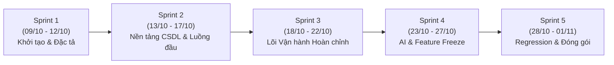

# BỘ PHAO VẤN ĐÁP ÔN TẬP BẢO VỆ ĐỒ ÁN OISMS — CỤM 06 - 07 - 08 - 09 - 10
## (TESTING & QA • DEVOPS & CI/CD • SPRINTS • PHÂN CÔNG THÀNH VIÊN • AI SKILLS & FORECASTING)

> **Dành riêng cho:** **Phùng Minh Nhựt (Backend 2 Lead - Sinh viên UTH)**  
> **Bộ tài liệu gốc đối chiếu:** `docs/06-testing-and-qa/`, `docs/07-devops-and-deployment/`, `docs/08-sprints/`, `docs/09-personal-reports/`, `docs/10-ai-skills/`  
> **Mục tiêu:** Giúp Nhựt tự tin 100% trả lời mượt mà, chuẩn xác mọi câu hỏi "xoáy" của Giảng viên và Hội đồng chấm thi về Kiểm thử chất lượng, Vận hành DevOps, Kế hoạch Sprint, Đóng góp cá nhân và Ứng dụng Trí tuệ Nhân tạo (AI).

---

## MỤC LỤC TRA CỨU NHANH

1. [CỤM 06: KIỂM THỬ & ĐẢM BẢO CHẤT LƯỢNG (TESTING & QA)](#1-cụm-06-kiểm-thử--đảm-bảo-chất-lượng-testing--qa)
   - Kim tự tháp kiểm thử & Kết quả test tự động
   - Ma trận truy vết yêu cầu (RTM)
   - Kịch bản test chịu tải Flash Sale (50 Concurrency -> 1 SKU)
   - 5 Tiêu chuẩn nghiệm thu kỹ thuật (Definition of Done - DoD)
2. [CỤM 07: DEVOPS & TRIỂN KHAI HỆ THỐNG (DEVOPS & DEPLOYMENT)](#2-cụm-07-devops--triển-khai-hệ-thống-devops--deployment)
   - Kiến trúc Docker Compose (4-6 containers)
   - Đường ống tích hợp liên tục CI/CD GitHub Actions
   - Quản trị bảo mật biến môi trường (.env)
3. [CỤM 08: QUẢN LÝ KẾ HOẠCH THEO SPRINT (AGILE & JIRA)](#3-cụm-08-quản-lý-kế-hoạch-theo-sprint-agile--jira)
   - Lộ trình 5 Sprint (Sprint 1 đến Sprint 5)
   - Kết quả bàn giao Sprint 3 của Backend 2
   - Khái niệm "Feature Freeze" ở Sprint 4
4. [CỤM 09: BÁO CÁO CÁ NHÂN & PHÂN CÔNG CÔNG VIỆC](#4-cụm-09-báo-cáo-cá-nhân--phân-công-công-việc)
   - Bản tự công bố đóng góp của Nhựt (Backend 2 Lead)
   - Ma trận phân công 5 thành viên trong nhóm
   - Cách phối hợp kỹ thuật giữa Backend 2 với Backend 1 & Frontend
5. [CỤM 10: PHÂN HỆ AI SKILLS & THUẬT TOÁN DỰ BÁO AI (FR-12)](#5-cụm-10-phân-hệ-ai-skills--thuật-toán-dự-báo-ai-fr-12)
   - 12 Kỹ năng AI tích hợp hỗ trợ phát triển dự án
   - Cơ chế Antigravity Progressive Disclosure
   - Thuật toán AI Dự báo nhu cầu & Điểm đặt hàng lại (ROP)
6. [TỔNG HỢP CÂU HỎI "XOÁY" CỦA GIẢNG VIÊN & KỊCH BẢN TRẢ LỜI MẪU](#6-tổng-hợp-câu-hỏi-xoáy-của-giảng-viên--kịch-bản-trả-lời-mẫu)

---

# 1. CỤM 06: KIỂM THỬ & ĐẢM BẢO CHẤT LƯỢNG (TESTING & QA)

### 1.1. Kim tự tháp kiểm thử (Testing Pyramid) của OISMS
- **Triết lý kiểm thử:** Không dựa vào kiểm thử thủ công (manual click) mà tự động hóa hoàn toàn bằng Unit Test và Integration Test.
- **Tầng Unit Test:**
  - Viết bằng **xUnit**, **Moq**, **FluentAssertions**.
  - Kiểm thử sâu toàn bộ Business Logic nghiệp vụ: tính giá vốn WAC, chuyển trạng thái đơn hàng (Order State Machine), validation mã vạch EAN-13, thuật toán tính Gross Profit = Revenue - COGS.
  - Tách biệt hoàn toàn DB bằng In-Memory SQLite và Repository Mocking, thời gian chạy cực nhanh (~1 đến 2 giây cho 115 tests).
  - **Kết quả nghiệm thu của Backend 2:** **115/115 Unit Tests PASS 100%**.
- **Tầng Integration Test:**
  - Sử dụng `WebApplicationFactory` của ASP.NET Core kết nối với cơ sở dữ liệu **PostgreSQL thật**.
  - Kiểm thử luồng end-to-end: từ HTTP Request qua Middleware (Authentication JWT, TenantContext) -> Controller -> Service -> EF Core -> Lưu dữ liệu thật vào DB -> Trả về JSON.
  - Đảm bảo các ràng buộc DB (Foreign Keys kép, Check Constraint, Unique Index) hoạt động chính xác.
- **Độ phủ mã nguồn (Code Coverage):** Đạt trên **85%** (nhiều module nghiệp vụ cốt lõi đạt trên **92%**).

---

### 1.2. Ma trận truy vết yêu cầu (Requirements Traceability Matrix - RTM)
- **Định nghĩa:** Là bảng ánh xạ 1-1 giữa **Mã yêu cầu (FR/NFR)** $\rightarrow$ **Module mã nguồn phụ trách** $\rightarrow$ **Người thực hiện** $\rightarrow$ **Bộ Test Case tương ứng** $\rightarrow$ **Sprint bàn giao**.
- **Mục đích:**
  - Chứng minh với Giảng viên dự án không làm theo cảm tính hay bỏ sót yêu cầu trong đề bài (`De bai CNPM.pdf`).
  - Khi có lỗi phát sinh hoặc có yêu cầu thay đổi, chỉ cần tra cứu RTM là biết ngay ảnh hưởng tới file mã nguồn nào và test case nào cần chạy lại.
- **Phạm vi của Nhựt trên RTM:**
  - `FR-AUTH-01..04`: Phụ trách cùng Khoa (Sprint 2).
  - `FR-PROD-01..04`: Danh mục, Thuộc tính biến thể, Sinh mã vạch EAN-13 (Sprint 2).
  - `FR-ORD-01..04`: Đơn hàng đa kênh, Order State Machine (Sprint 3).
  - `FR-REP-01..03`: Báo cáo Doanh thu, Lợi nhuận COGS, Vận tốc kho & Cảnh báo tồn thấp (Sprint 3).
  - `FR-SIM-01`: Simulator webhook 3 sàn TMĐT (Sprint 3).
  - `FR-AI-01`: Gợi ý điểm đặt hàng lại ROP (Sprint 3 chốt thiết kế, Sprint 4 chạy).

---

### 1.3. Kịch bản kiểm thử chịu tải đồng thời Flash Sale (50 Concurrency -> 1 SKU)
- **Mục tiêu kỹ thuật:** Kiểm chứng yêu cầu phi chức năng `NFR-PERF-02`: *Hệ thống phải chịu được 50 yêu cầu đồng thời tranh mua 1 sản phẩm tồn kho cuối cùng mà tuyệt đối không được bán âm.*
- **Kịch bản thực hiện (`DOC-QA-03`):**
  1. **Điều kiện ban đầu:** Tạo 1 SKU có số lượng tồn vật lý `OnHand = 1`, `Reserved = 0` $\rightarrow$ Tồn khả dụng `Available = 1`.
  2. **Thực thi đồng thời:** Phóng cùng lúc **50 luồng asynchronous** (`Task.WhenAll` trong C# hoặc k6 stress script) với 50 mã đơn hàng `OrderId` khác nhau gọi vào endpoint giữ chỗ `POST /api/inventory/reserve` với số lượng `Quantity = 1`.
  3. **Kết quả đo kiểm thực tế:**
     - **Đúng 1 request** nhận được mã `HTTP 200 OK` (giữ chỗ thành công).
     - **Đúng 49 requests còn lại** nhận mã lỗi nghiệp vụ `HTTP 409 Conflict` với thông báo rõ ràng: `"Không đủ tồn kho khả dụng"`.
     - **0 request nào bị lỗi 500** hoặc gây Deadlock làm sập PostgreSQL.
     - Sau khi test kết thúc: `OnHand = 1`, `Reserved = 1`, `Available = 0` (tuyệt đối không bị âm).
- **Kịch bản Idempotency (Chống gửi lặp do rớt mạng):**
  - Khách hàng bấm thanh toán nhiều lần do mạng lag.
  - Nhờ có cơ chế `Idempotency-Key` và bảng `stock_reservations` lưu khóa `(order_id, sku_id)`, hệ thống chỉ trừ tồn đúng **1 lần duy nhất**, các lần gọi lặp sau trả về kết quả cũ kèm `HTTP 200 OK` mà không trừ thêm tồn kho.

---

### 1.4. Năm Tiêu chuẩn nghiệm thu bắt buộc (Definition of Done - DoD)
Khi Thầy hỏi: *"Làm sao nhóm biết một tính năng hoặc một Sprint đã hoàn thành để nghiệm thu?"*, trả lời ngay **5 tiêu chuẩn DoD**:
1. **Cơ sở dữ liệu tái tạo được 100%:** Chỉ cần chạy script migration và seed data trên một PostgreSQL trắng tinh là hệ thống dựng lên chạy mượt mà, không phụ thuộc vào data có sẵn trên máy cá nhân.
2. **Cô lập Đa người thuê tuyệt đối (Multi-tenant Isolation):** 100% các bảng nghiệp vụ đều có `tenant_id`. EF Core gắn `Global Query Filter`. Không một truy vấn nào được phép thấy dữ liệu của cửa hàng khác.
3. **Sổ cái kho bất biến (Append-Only Ledger):** Nghiêm cấm hoàn toàn lệnh `UPDATE` hay `DELETE` trên bảng giao dịch kho `inventory_transactions`. Mọi biến động tăng giảm đều phải ghi một dòng mới có số dư tức thời `BalanceAfter`.
4. **Tính giá vốn WAC tự động & Chốt snapshot:** Giá vốn được tự động tính lại ngay khi nhập kho; khi bán hàng, giá vốn được "chụp ảnh" (snapshot) lưu cố định vào `order_items.cost_price` để làm căn cứ tính lãi gộp chính xác.
5. **Nói không với dữ liệu ảo (Zero Mock Data):** Cả Web Admin và Web POS đều gọi API thật, đọc dữ liệu từ DB PostgreSQL thật, không dùng mock data hay hardcode dữ liệu mẫu.

---

# 2. CỤM 07: DEVOPS & TRIỂN KHAI HỆ THỐNG (DEVOPS & DEPLOYMENT)

### 2.1. Kiến trúc Docker Compose của OISMS
Đóng gói toàn bộ hệ sinh thái phần mềm vào tệp `docker-compose.yml`, giúp triển khai dự án chỉ với đúng 1 câu lệnh duy nhất:
```bash
docker compose up -d --build
```
Hệ thống gồm 4 dịch vụ cốt lõi hoạt động trong mạng nội bộ cô lập `oism_network`:

| Container Service | Công nghệ & Base Image | Cổng Port | Vai trò trong hệ thống |
| :--- | :--- | :---: | :--- |
| **`postgres`** | `postgres:16-alpine` | `5432:5432` | CSDL quan hệ chính thức, lưu trữ 29 bảng, sổ cái Append-Only và bảo mật Multi-tenant. |
| **`backend`** | `.NET 8 Web API` (Linux) | `5000:8080` | Máy chủ REST API, Swagger UI, SignalR Hub, Hangfire background workers. Tự động áp dụng Migration và nạp Seed Data khi container bật. |
| **`admin-dashboard`** | `React 19 + Vite + Nginx Alpine` | `5173:80` | Cổng đăng nhập tập trung và giao diện Quản trị kinh doanh dành cho Chủ cửa hàng (Owner) và Quản lý. |
| **`pos-app`** | `React 19 PWA + Nginx Alpine` | `5174:80` | Giao diện Bán lẻ cảm ứng tại quầy (POS) dành cho Thu ngân, tối ưu quét mã vạch và in hóa đơn nhiệt. |

> **Tại sao tách Admin Dashboard và POS App thành 2 container riêng biệt?**  
> Vì đối tượng người dùng và môi trường hoạt động khác nhau: Web Admin cần màn hình lớn, tải nhiều biểu đồ nặng, phân tích phức tạp. Trong khi Web POS là PWA (Progressive Web App), cần tải nhẹ, mở được trên máy tablet cảm ứng/điện thoại, độc lập cache để khi Admin cập nhật giao diện không làm gián đoạn thu ngân đang tính tiền.

---

### 2.2. Đường ống Tích hợp liên tục (CI/CD Pipeline với GitHub Actions)
- **Tệp cấu hình:** `.github/workflows/ci.yml`.
- **Cơ chế kích hoạt:** Tự động chạy mỗi khi có thành viên `git push` code hoặc tạo `Pull Request` vào nhánh `develop` hoặc `main`.
- **2 Luồng kiểm tra song song (Parallel Jobs):**
  1. **Job Backend (.NET 8 + PostgreSQL Service Container):**
     - GitHub Actions tự động bật một container PostgreSQL 16 ảo trên máy chủ Ubuntu.
     - Chạy `dotnet restore` -> `dotnet build --configuration Release`.
     - Thực thi toàn bộ Unit Test và Integration Test (`dotnet test`). Nếu có dù chỉ **1 test bị Fail**, toàn bộ Pipeline sẽ báo đỏ và **chặn không cho gộp (merge) Pull Request**.
  2. **Job Frontend (Node.js 20+):**
     - Chạy `npm ci` và biên dịch TypeScript + Vite (`npm run build`) cho cả 2 thư mục `admin-dashboard` và `pos-app`.
     - Đảm bảo code sạch lỗi Type Checking, không bị lỗi cú pháp khi build Production.
- **Lợi ích:** Đảm bảo mã nguồn trên nhánh chính `develop` luôn ở trạng thái "xanh" (Deployable), loại bỏ hoàn toàn tình trạng "code chạy ngon trên máy tôi nhưng đem lên máy bạn thì lỗi".

---

### 2.3. Quản lý Biến môi trường & Bí mật bảo mật (.env)
- **Nguyên tắc an toàn:** Tuyệt đối không commit tệp `.env` chứa mật khẩu thật lên GitHub repository.
- Chỉ commit tệp mẫu `.env.example` để hướng dẫn cấu hình.
- Các biến quan trọng được quản lý qua biến môi trường:
  - `POSTGRES_DB`, `POSTGRES_USER`, `POSTGRES_PASSWORD`: Thông tin đăng nhập CSDL.
  - `ConnectionStrings__DefaultConnection`: Chuỗi kết nối chuỗi nội bộ giữa container backend và container postgres.
  - `JwtSettings__SecretKey`: Chuỗi bí mật ký số JWT (độ dài tối thiểu 256-bit).
  - `JwtSettings__Issuer` & `JwtSettings__Audience`: Định danh nguồn cấp token.

---

# 3. CỤM 08: QUẢN LÝ KẾ HOẠCH THEO SPRINT (AGILE & JIRA)

### 3.1. Kế hoạch phân kỳ 5 Sprints của nhóm OISMS (Đồng bộ Confluence Page ID 5275650)



- **Sprint 1 (09/10 – 12/10):** Thu thập yêu cầu nghiệp vụ, lập tài liệu URS, thiết kế kiến trúc Clean Architecture 4 tầng và dựng khung Docker boilerplate.
- **Sprint 2 (13/10 – 17/10):** Dựng CSDL 29 bảng, Multi-tenant Isolation, JWT Token Rotation, Danh mục cây đa tầng, Sinh mã vạch EAN-13, Sổ cái kho Append-Only, Nhập kho WAC, Lõi giữ chỗ Flash Sale.
- **Sprint 3 (18/10 – 22/10 - Giai đoạn hiện tại):** 
  - **Lõi vận hành toàn diện:** Quản lý Đơn hàng đa kênh (Order State Machine), POS Checkout chốt giá vốn Snapshot, Chuyển kho 2 bước, Kiểm kê kho.
  - **Giả lập sàn & Realtime:** Webhook Simulator 3 sàn TMĐT, SignalR chuông báo đơn mới, Hangfire hủy giữ chỗ quá hạn.
  - **Báo cáo tài chính & Cảnh báo tồn kho:** API Doanh thu, Giá vốn COGS, Lợi nhuận gộp Gross Profit, Tốc độ luân chuyển kho, Cảnh báo tồn dưới ngưỡng an toàn.
- **Sprint 4 (23/10 – 27/10):** Hiện thực AI Dự báo nhu cầu nhập hàng (FR-12), tối ưu hóa Dashboard biểu đồ nâng cao, kiểm thử chịu tải k6 đạt chỉ tiêu NFR. **Cuối Sprint 4 thực hiện Feature Freeze (khóa tính năng mới).**
- **Sprint 5 (28/10 – 01/11):** **Không mở thêm bất kỳ tính năng mới nào.** Chỉ tập trung kiểm thử hồi quy (Regression Test), sửa các lỗi nhỏ, đóng gói bản phát hành Release và hoàn thiện hồ sơ nghiệm thu đồ án.

---

### 3.2. Đóng góp & Bàn giao của Nhựt trong Sprint 3 (Mã Jira: `OISMS-41` / PR #20)
Nhựt phụ trách vị trí **Backend 2 Lead**, đã bàn giao trọn vẹn 3 phân hệ lớn:
1. **Phân hệ Đơn hàng Đa kênh (`FR-ORD-01..04`):**
   - API `GET /api/orders` phân trang và bộ lọc đa chiều (Chi nhánh, Kênh bán POS/Shopee/TikTok/Lazada, Trạng thái, Khoảng ngày).
   - API `GET /api/orders/{id}` trả về chi tiết sản phẩm, giá bán, snapshot giá vốn, thanh toán và lịch sử chuyển trạng thái.
   - Các endpoint vòng đời đơn hàng theo Order State Machine: `/process` (đóng gói), `/complete` (hoàn tất giao hàng), `/cancel` (hủy đơn).
2. **Hệ thống Báo cáo Tài chính & Tồn kho (`FR-REP-01..03`):**
   - `GET /api/reports/revenue-profit`: Doanh thu thuần, Tổng giá vốn COGS, Lợi nhuận gộp Gross Profit (phân quyền chỉ `Owner` mới được xem).
   - `GET /api/reports/inventory-velocity`: Tốc độ quay vòng hàng hóa, phân tích Top sản phẩm bán chạy (Fast-moving) và đọng vốn lâu (Slow-moving).
   - `GET /api/reports/stock-alerts`: Cảnh báo tồn kho dưới ngưỡng an toàn (`Available <= ReorderPoint`).
3. **Trình giả lập Webhook 3 Sàn TMĐT (`FR-SIM-01`):**
   - Bộ sinh payload mẫu chuẩn định dạng của Shopee, TikTok Shop, Lazada.
   - Endpoint bắn đơn giả lập đơn lẻ (`/api/simulator/shopee/orders`) và bắn đơn hàng loạt (`/api/simulator/bulk-orders`) phục vụ test chịu tải.
- **Chỉ số nghiệm thu kỹ thuật:** 115/115 Unit Tests pass 100%, 0 bug blocker.

---

# 4. CỤM 09: BÁO CÁO CÁ NHÂN & PHÂN CÔNG THÀNH VIÊN

### 4.1. Bảng phân công 5 thành viên nhóm OISMS

| Thành viên | Vai trò phụ trách | Trọng tâm công việc |
| :--- | :--- | :--- |
| **Lê Võ Đăng Khoa** | **Trưởng nhóm / Backend 1 Lead** | Thiết kế CSDL 29 bảng, Multi-tenant Global Filter, Sổ cái kho Append-Only, Nhập kho tính giá vốn WAC, Lõi giữ chỗ chống bán vượt (Pessimistic Locking), SignalR Hub, Hangfire Worker, Docker & CI/CD. |
| **Phùng Minh Nhựt** | **Backend 2 Lead (Tôi)** | Hệ thống Xác thực JWT & Token Rotation; Danh mục sản phẩm, biến thể SKU, sinh mã vạch EAN-13; Quản trị Đơn hàng đa kênh & State Machine; Hệ thống Báo cáo Tài chính & Cảnh báo tồn kho; Trình giả lập Webhook 3 sàn TMĐT. |
| **Phúc Hữu** | **Frontend Admin Lead** | Xây dựng Web Admin Dashboard (React 19 + TailwindCSS): Quản lý cửa hàng, chi nhánh, cây danh mục sản phẩm, quản lý kho & chứng từ nhập/chuyển kho, màn hình Báo cáo tài chính & Biểu đồ doanh thu. |
| **Phương** | **Frontend POS Lead** | Xây dựng Web POS PWA (React 19): Giao diện bán hàng cảm ứng tại quầy, quét mã vạch bằng camera/máy quét laser, quản lý giỏ hàng offline, in hóa đơn nhiệt ESC/POS 80mm. |
| **Nam** | **Tester / QA Lead** | Xây dựng Ma trận RTM, lập tài liệu Test Plan & Test Cases, kiểm thử chịu tải k6 (50 reqs/s), kiểm tra tính cô lập dữ liệu giữa các tenant và nghiệm thu tiêu chuẩn DoD. |

---

### 4.2. Cách Nhựt phối hợp kỹ thuật với các thành viên khác
- **Với Backend 1 (Khoa):**
  - Thống nhất cấu trúc bảng `orders`, `order_items` và `stock_reservations`. Khi đơn hàng được tạo, Nhựt gọi sang `ReservationService` của Khoa để giữ chỗ tồn kho an toàn.
  - Khi đơn hàng hoàn tất, Nhựt ghi nhận doanh thu và lấy `CostPrice` (do Khoa tính từ WAC) để tính ra lợi nhuận gộp chính xác.
- **Với Frontend Admin (Phúc Hữu):**
  - Cung cấp tài liệu Swagger UI chi tiết cho các API Báo cáo (`/api/reports/*`) và Đơn hàng (`/api/orders`).
  - Chuẩn hóa định dạng JSON Response, hỗ trợ phân trang chuẩn `PageNumber`, `PageSize`, `TotalPages` giúp Hữu dễ dàng render bảng dữ liệu và vẽ biểu đồ.
- **Với Frontend POS (Phương):**
  - Cung cấp API tìm kiếm sản phẩm nhanh theo mã vạch EAN-13 (`GET /api/pos/products?search=...`).
  - Hỗ trợ endpoint checkout đơn hàng trực tiếp tại quầy POS.

---

# 5. CỤM 10: PHÂN HỆ AI SKILLS & THUẬT TOÁN DỰ BÁO AI (FR-12)

### 5.1. Hệ thống 12 Kỹ năng AI (AI Skills) hỗ trợ phát triển dự án
Nhóm đã tích hợp 12 bộ kỹ năng chuẩn hóa vào công cụ Antigravity để trợ lực trong quá trình lập trình:
1. `csharp-pro`: Viết code C# .NET 8 chuẩn hiện đại, áp dụng Record types, Pattern matching, LINQ tối ưu.
2. `architecture-patterns`: Giữ vững ranh giới 4 tầng Clean Architecture (Domain -> Application -> Infrastructure -> WebApi).
3. `api-design-principles`: Chuẩn hóa RESTful API, chuẩn lỗi RFC 7807 Problem Details, HTTP Status codes.
4. `postgresql`: Thiết kế schema 29 bảng chuẩn 3NF, kiểu số tiền chính xác `NUMERIC(18,2)`, Foreign Keys kép bảo vệ dữ liệu.
5. `sql-optimization-patterns`: Phân tích kế hoạch thực thi `EXPLAIN ANALYZE`, composite index `(tenant_id, ...)` phục vụ tìm kiếm nhanh.
6. `typescript-pro`: Áp dụng Strict Type Checking cho React 19, đồng bộ interface dữ liệu với Backend.
7. `react-state-management`: Tối ưu State giỏ hàng POS, cache dữ liệu báo cáo trên Web Admin.
8. `auth-implementation-patterns`: Cơ chế xác thực JWT, bảo vệ Endpoint theo RBAC (`Owner`, `Staff`).
9. `security-auditor`: Rà soát bảo mật DevSecOps, phòng ngừa SQL Injection và rò rỉ dữ liệu chéo Tenant.
10. `code-review-excellence`: Tự động rà soát Pull Request, loại bỏ code dư thừa và nợ kỹ thuật.
11. `unit-testing-test-generate`: Sinh test case tự động cho xUnit bao phủ các trường hợp biên của WAC và Order.
12. `github-actions-templates`: Tối ưu kịch bản CI/CD build và test tự động.

> **Cơ chế Progressive Disclosure:** Antigravity không nạp toàn bộ 12 kỹ năng vào bộ nhớ cùng lúc (tránh tràn ngữ cảnh), mà tự động kích hoạt kỹ năng tương ứng tùy theo tác vụ lập trình (ví dụ khi sửa C# thì nạp `csharp-pro`, khi viết test thì nạp `unit-testing-test-generate`).

---

### 5.2. Thuật toán Trí tuệ Nhân tạo FR-12: Dự báo Nhu cầu & Điểm Đặt Hàng Lại (AI Reorder Point)
- **Bài toán nghiệp vụ:** Giúp chủ cửa hàng giải quyết 2 bài toán sống còn:
  - Tránh **hết hàng (Out of Stock)** làm mất doanh thu.
  - Tránh **tồn kho quá nhiều (Overstocking)** gây đọng vốn và hư hỏng hàng hóa.
- **Công thức tính Điểm đặt hàng lại (Reorder Point - ROP):**
$$\mathbf{ROP} = (\mathbf{DSR} \times \mathbf{LeadTime}) + \mathbf{SafetyStock}$$
  - **$\mathbf{DSR}$ (Daily Sales Rate - Tốc độ bán hàng trung bình ngày):**  
    Hệ thống phân tích lịch sử bán hàng trong $N$ ngày gần nhất (thường là 30 ngày) từ Sổ cái kho và Đơn hàng:
    $$DSR = \frac{\text{Tổng số lượng bán ra trong } N \text{ ngày}}{N}$$
  - **$\mathbf{LeadTime}$ (Thời gian giao hàng của Nhà cung cấp):** Số ngày từ lúc bấm đặt hàng đến khi hàng về nhập kho (ví dụ: 3 ngày).
  - **$\mathbf{SafetyStock}$ (Tồn kho an toàn dự phòng):** Lượng hàng đệm đề phòng nhu cầu mua tăng đột biến hoặc nhà cung cấp giao trễ:
    $$SafetyStock = (MaxDailySales \times MaxLeadTime) - (AvgDailySales \times AvgLeadTime)$$
- **Công thức Đề xuất số lượng cần nhập (Suggested Order Quantity):**
  - Khi tồn khả dụng $Available \le ROP$, hệ thống tự động đưa ra cảnh báo đỏ và gợi ý số lượng cần nhập thêm:
    $$\mathbf{SuggestedQty} = \mathbf{MaxStock} - \mathbf{AvailableStock}$$

---

# 6. TỔNG HỢP CÂU HỎI "XOÁY" CỦA GIẢNG VIÊN & KỊCH BẢN TRẢ LỜI MẪU

### Câu hỏi 1: "Nhóm em có bao nhiêu bài test? Có test cơ sở dữ liệu thật không hay chỉ dùng mock?"
> **Kịch bản trả lời của Nhựt:**  
> *"Dạ thưa Thầy, nhóm em áp dụng mô hình Kim tự tháp kiểm thử gồm cả Unit Test và Integration Test:  
> - Riêng phân hệ Backend 2 do em phụ trách đã hoàn thành **115/115 Unit Tests pass 100%**, tập trung kiểm thử toàn bộ logic tính giá vốn, Order State Machine, thuật toán Gross Profit và bộ lọc đa kênh. Tầng này dùng In-Memory Mock để chạy cực nhanh (dưới 2 giây).  
> - Ngoài ra, nhóm em có bộ **Integration Test chạy trên PostgreSQL container thật**. Khi chạy test, hệ thống tự nạp schema 29 bảng, gọi qua HTTP API thật để kiểm tra toàn bộ ràng buộc Foreign Keys, Check Constraints và bộ lọc cô lập Multi-tenant. Tỷ lệ Code Coverage của dự án đạt trên 85% ạ!"*

---

### Câu hỏi 2: "Tại sao nhóm lại dùng Docker Compose và chia làm nhiều container như vậy? Chạy thẳng trên máy không được sao?"
> **Kịch bản trả lời của Nhựt:**  
> *"Dạ thưa Thầy, nhóm em dùng Docker Compose vì 3 lý do cốt lõi:  
> 1. **Tính tái tạo môi trường 100% (DoD 1):** Bất kỳ ai tải source code về chỉ cần gõ đúng 1 lệnh `docker compose up -d --build` là toàn bộ DB, Backend, Web Admin và POS tự động khởi chạy mà không cần cài đặt lắt léo từng phần mềm trên máy cá nhân.  
> 2. **Cô lập kiến trúc:** Nhóm tách Web Admin (cần nhiều biểu đồ quản trị) và Web POS PWA (cần tải nhẹ, mở trên thiết bị di động, hoạt động độc lập tại quầy thu ngân) thành 2 container riêng biệt để tối ưu tài nguyên và trải nghiệm người dùng.  
> 3. **Phù hợp chuẩn công nghiệp:** Giúp việc tích hợp vào đường ống CI/CD GitHub Actions diễn ra tự động và nhất quán ạ!"*

---

### Câu hỏi 3: "Pipeline CI/CD của nhóm hoạt động thế nào? Nếu bạn lỡ commit code lỗi lên GitHub thì hệ thống xử lý sao?"
> **Kịch bản trả lời của Nhựt:**  
> *"Dạ thưa Thầy, nhóm em cấu hình GitHub Actions trong file `.github/workflows/ci.yml`.  
> Mỗi khi em tạo Pull Request hoặc push code vào nhánh `develop`, GitHub Actions sẽ tự động khởi tạo máy ảo Ubuntu, kéo container PostgreSQL lên, chạy build code và thực thi toàn bộ bài test tự động.  
> Nếu em lỡ commit code làm gãy dù chỉ 1 Unit Test hoặc sai kiểu dữ liệu TypeScript ở Frontend, **Pipeline sẽ lập tức báo đỏ (Fail) và nút Merge PR trên GitHub sẽ bị khóa cứng**. Nhóm trưởng Khoa hoặc em bắt buộc phải sửa hết lỗi test thì mới được phép gộp code vào nhánh chung. Điều này bảo vệ nhánh `develop` luôn luôn sạch lỗi ạ!"*

---

### Câu hỏi 4: "Báo cáo Lợi nhuận gộp (Gross Profit) của em tính thế nào? Làm sao đảm bảo không bị sai lệch khi giá nhập hàng thay đổi liên tục?"
> **Kịch bản trả lời của Nhựt:**  
> *"Dạ thưa Thầy, đây là điểm nghiệp vụ cốt lõi mà em và bạn Khoa đã xử lý rất chặt chẽ:  
> - Công thức tính: $\text{Gross Profit} = \text{Net Revenue} - \text{COGS}$ (Doanh thu thuần trừ Tổng giá vốn hàng bán).  
> - Để không bị sai lệch khi giá nhập biến động, hệ thống sử dụng **Snapshot Giá vốn tại thời điểm bán**: Khi đơn hàng được xác nhận hoặc checkout tại POS, hệ thống lấy giá vốn bình quân gia quyền (WAC) của SKU tại đúng thời điểm đó và chốt cứng vào cột `order_items.cost_price`.  
> - Do đó, dù sau này cửa hàng có nhập thêm các lô hàng mới với giá cao hơn hay thấp hơn làm thay đổi giá vốn kho hiện tại, thì giá vốn của các đơn hàng cũ trong quá khứ vẫn được bảo toàn nguyên vẹn, đảm bảo con số Lợi nhuận gộp trong báo cáo luôn chính xác tuyệt đối 100% ạ!"*

---

### Câu hỏi 5: "Hệ thống của em có tính năng AI không? AI hoạt động dựa trên thuật toán gì và giải quyết bài toán gì cho cửa hàng?"
> **Kịch bản trả lời của Nhựt:**  
> *"Dạ thưa Thầy, hệ thống có tính năng AI ở phân hệ **FR-12: Dự báo Nhu cầu & Gợi ý Nhập hàng (Stock Reorder Forecasting)**:  
> - **Bài toán giải quyết:** Tránh để cửa hàng bị đứt hàng (Out of Stock) gây mất doanh thu hoặc ôm hàng tồn quá nhiều gây chôn vốn.  
> - **Thuật toán cốt lõi:** Dựa trên mô hình Điểm đặt hàng lại thông minh:  
>   $$ROP = (DSR \times LeadTime) + SafetyStock$$  
> - Hệ thống tự động phân tích tốc độ tiêu thụ hàng ngày ($DSR$) từ lịch sử đơn hàng và sổ cái kho, kết hợp thời gian nhà cung cấp giao hàng ($LeadTime$) và độ lệch chuẩn biến động để tính tồn kho an toàn ($SafetyStock$).  
> - Khi tồn kho khả dụng chạm hoặc dưới ngưỡng $ROP$, hệ thống sẽ hiển thị cảnh báo đỏ trên Dashboard và tự động tính toán số lượng đề xuất cần nhập thêm để chủ cửa hàng chỉ cần 1 click là tạo được phiếu đặt hàng ạ!"*

---

### Câu hỏi 6: "Nhóm em đã sử dụng AI Skills và Antigravity như thế nào trong quá trình làm đồ án?"
> **Kịch bản trả lời của Nhựt:**  
> *"Dạ thưa Thầy, nhóm em đã tích hợp 12 bộ kỹ năng AI chuẩn hóa (`csharp-pro`, `architecture-patterns`, `postgresql`, `security-auditor`...) qua công cụ Antigravity để làm trợ lý lập trình:  
> 1. **Đảm bảo kiến trúc:** Giúp toàn bộ mã nguồn Backend tuân thủ nghiêm ngặt 4 tầng Clean Architecture, không để rò rỉ mã truy cập DB lên Controller.  
> 2. **Tự động sinh Unit Test:** Hỗ trợ sinh các kịch bản test biên cho thuật toán tính giá vốn WAC và Order State Machine, giúp nhóm đạt trên 115 tests hoàn hảo.  
> 3. **Bảo mật Multi-tenant:** AI Skills tự động quét và cảnh báo bất kỳ câu lệnh truy vấn nào thiếu bộ lọc `tenant_id` để ngăn chặn rò rỉ dữ liệu giữa các cửa hàng ạ!"*

---

> [!TIP]
> **Lời khuyên vàng khi bước vào phòng vấn đáp:**  
> 1. Trả lời to, rõ ràng, dứt khoát, xưng hô lễ phép (*"Dạ thưa Thầy/Cô..."*).  
> 2. Tập trung nhấn mạnh vào các con số thực tế: **115/115 tests pass**, **29 bảng PostgreSQL**, **50 reqs/s không âm kho**, **Clean Architecture 4 tầng**.  
> 3. Tự tin làm chủ phần việc của mình: Đơn hàng đa kênh, Báo cáo Lợi nhuận COGS, Simulator sàn TMĐT và Thuật toán AI ROP! Chúc bạn đạt điểm A+ tuyệt đối!
