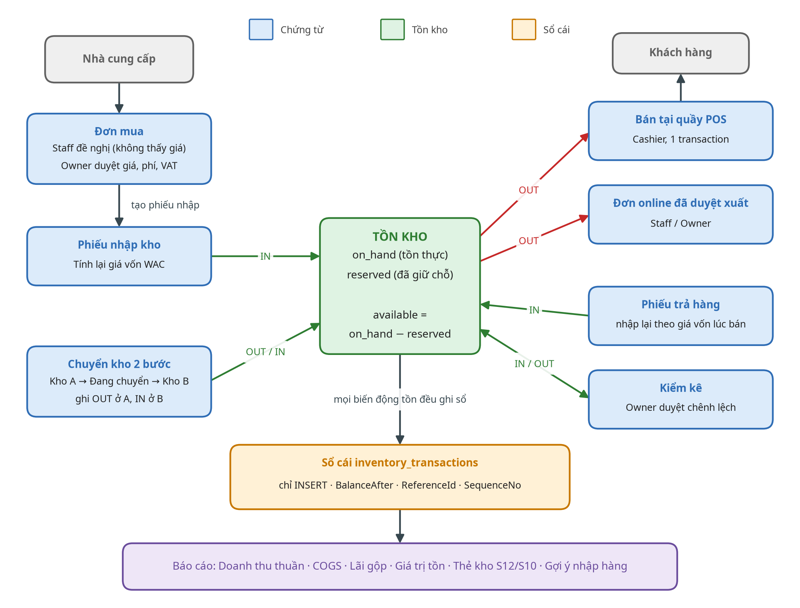
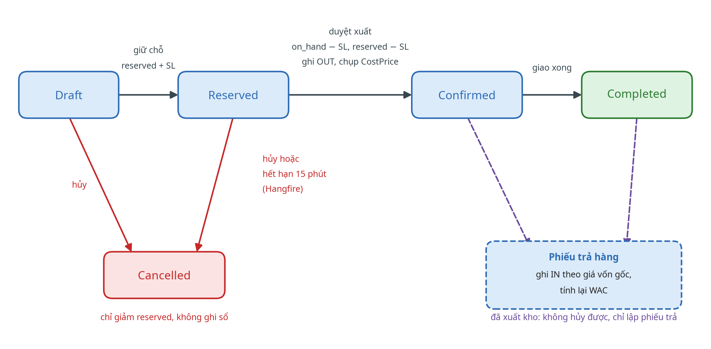
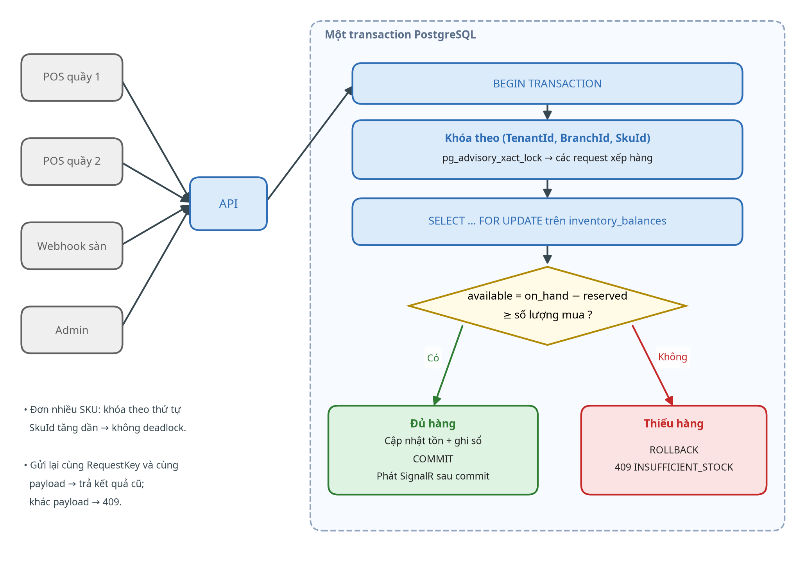
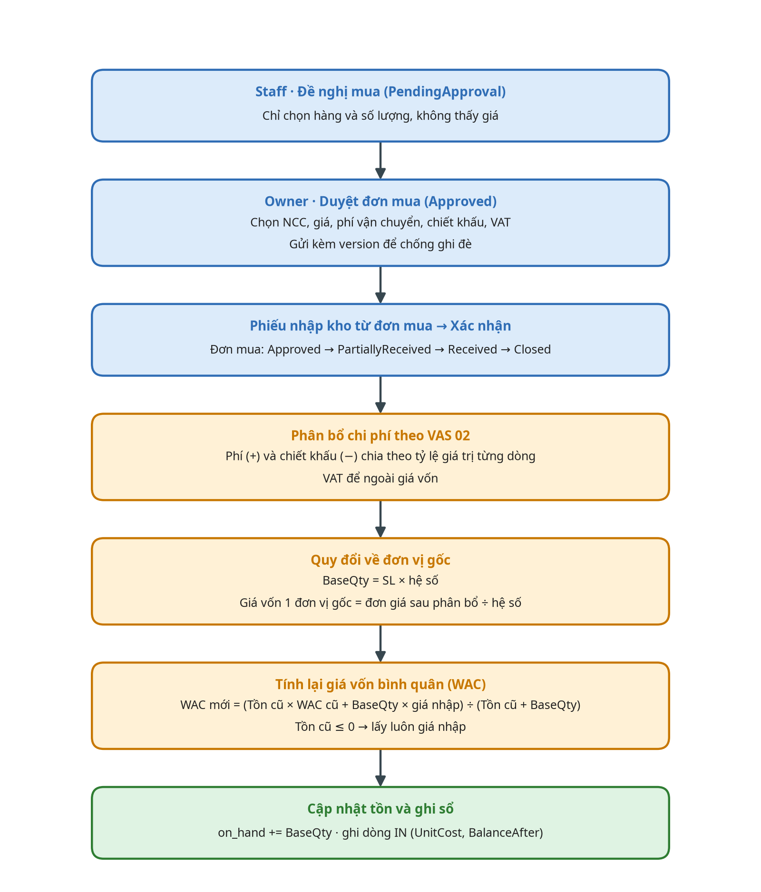
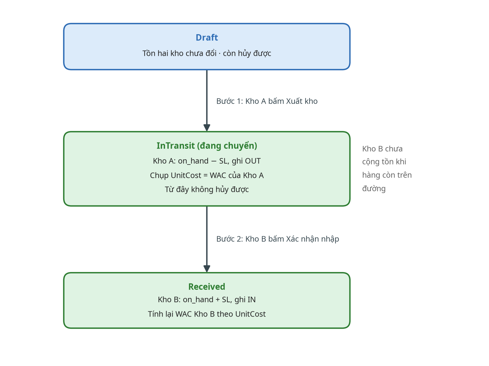
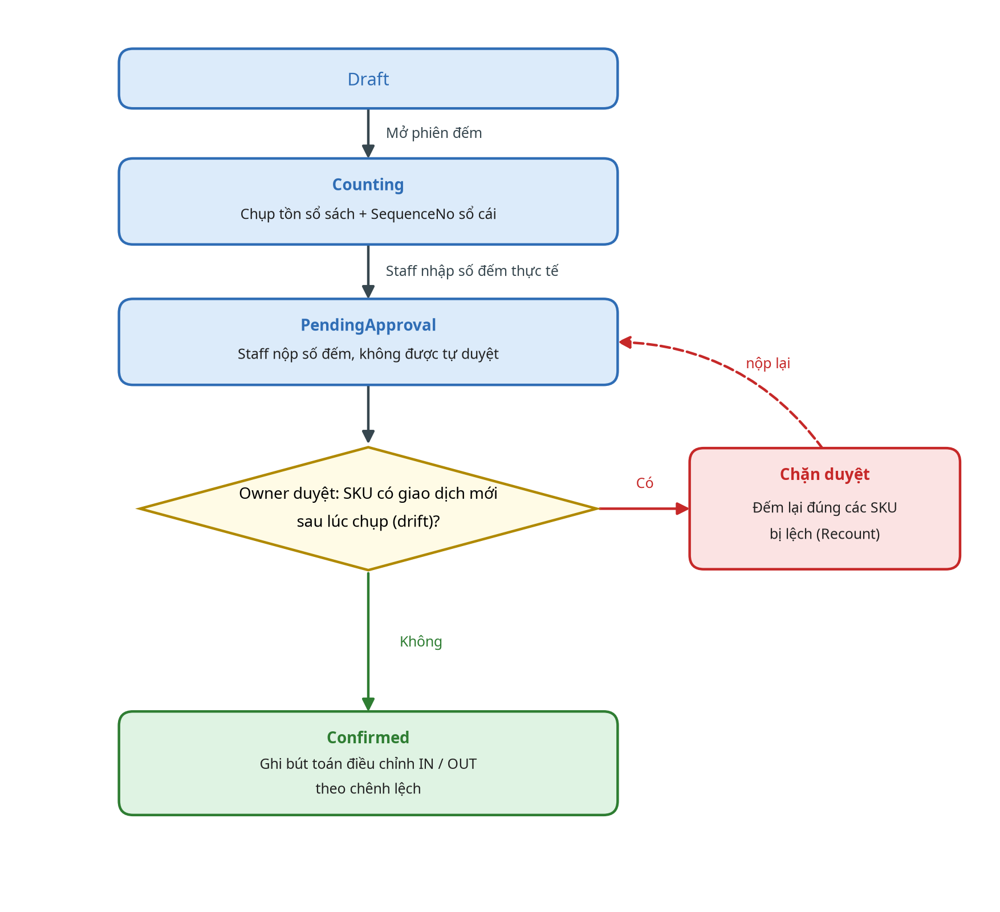
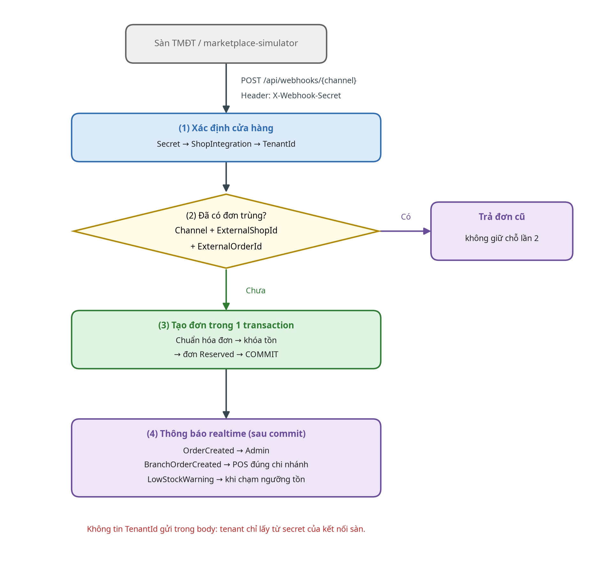

# BÁO CÁO CÁ NHÂN: PHÙNG MINH NHỰT

| Thông tin | Chi tiết |
| :--- | :--- |
| **Họ và tên** | **Phùng Minh Nhựt** |
| **Tài khoản GitHub** | `nhutpm32` *(tổng 25 commits trên repo)* |
| **Vai trò trong nhóm** | Backend 2 Lead (Authentication, RBAC, Catalog, Pricing, Reports & AI APIs) |
| **Giảng viên hướng dẫn** | **ThS. Nguyễn Văn Chiến** |
| **Đề tài** | OISMS — Hệ thống Quản lý Bán hàng và Tồn kho Đa kênh |

---

## 1. Pull Request & Commit Đã Thực Hiện Trên GitHub

| PR | Trạng thái | Nhánh / Commit tiêu biểu | Nội dung công việc chính trong PR |
| :---: | :---: | :--- | :--- |
| **#1** | MERGED | `feature/OISMS-01-dang-ky-va-xac-thuc-jwt` (`6b98844`, `eea825a`) | Xây dựng API đăng ký Tenant + Owner (ACID), xác thực JWT 60 phút + Refresh Token + BCrypt; quản lý Danh mục cây cha–con chống vòng lặp, Thương hiệu, Sản phẩm, Biến thể SKU, sinh EAN-13 và 24/24 Unit/Integration test. |
| **#4** | MERGED | `feature/OISMS-27-bo-sung-kho-hang-va-bao-cao-nghiem-thu` (`dce5abc`, `c80b5b4`) | Bổ sung API Quản lý Kho hàng, Chi nhánh, Nhà cung cấp và Báo cáo Nghiệm thu Sprint 2; chuẩn hóa tách `EnsureCreated()` khỏi `Program.cs`. |
| **#20** | MERGED | `feature/OISMS-42-sprint-3-backend-2` (`d7fa4bc`, `a477d53`) | Hoàn thiện API đơn hàng (`process`, `complete`), báo cáo tài chính (`ReportService`), alias `inventory-transactions` và API phục vụ webhook simulator Sprint 3. |
| **#29** | MERGED | `feature/sprint-4-backend-2` (`abe965f`, `3954514`) | Hoàn tất toàn bộ API Coming Soon (`CS-02` RBAC/nhân viên, `CS-03` ngưỡng tồn thấp, `CS-04` tìm kiếm toàn hệ thống, `CS-07` dashboard thật, `CS-08` AI dự báo nhập hàng) và các module Upgrade (đơn vị tính, bảng giá, đơn mua, lịch kiểm kê). |
| **#33** | MERGED | `feature/OISMS-46-fe-upgrades` (`10c0cbe`, `50097a8`, `7e99339`) | Đóng góp các màn hình Upgrade (`U01-A` đơn mua & nhập kho, `U04` bảng giá theo hiệu lực) và Coming Soon Đợt 1 & Đợt 2. |
| **#38** | MERGED | `fix/OISMS-47-master-review-fixes` (`78b65b0`, `35039e2`, `cf157bc`, `2de4898`) | Rà soát toàn diện & sửa lỗi `ForwardedHeaders`, thứ tự CORS middleware, null warnings, lỗi khóa dòng đa đơn vị, race condition phân trang, bổ sung Redis healthcheck và tài liệu ERD 43 thực thể. |

*(Ngoài ra có các PR đã đóng/thay thế trong quá trình rà soát: `#14`, `#19`, `#31`.)*

---

## 2. Nhiệm Vụ Cá Nhân & Cách Giải Quyết Chi Tiết

- **Xác thực & Phân quyền (`FR-AUTH-01..04`, `Upgrade 10`, `CS-02`):** Triển khai `FindUserByIdentifierAsync` hỗ trợ đăng nhập Email/SĐT, BCrypt, JWT 60 phút + Refresh Token xoay vòng, quên mật khẩu qua email token tự ký, che `averageCost = null` với `Staff`/`Cashier`, phân công nhiều chi nhánh qua `user_branches`.
- **Catalog, Bảng giá & Đa đơn vị (`FR-PROD-01..04`, `U04`, `U05`):** Kiểm tra đệ quy chặn vòng lặp danh mục cha–con, đảm bảo SKU duy nhất theo Tenant, sinh EAN-13 có check digit, tách giá bán theo hiệu lực khỏi giá vốn WAC.
- **Báo cáo & Tối ưu (`FR-REP-01..03`):** Phân bổ chiết khấu cấp đơn và khấu trừ hàng trả theo từng dòng SKU (`skuBreakdown`, tối đa 20 SKU), chuẩn hóa mốc UTC+7 nửa mở, đạt coverage báo cáo **89,35%** và tốc độ `p95 ≤ 1,16 s` trên 100.000 dòng.

---

## 3. Toàn Bộ Vấn Đề Nghiệp Vụ & Giải Pháp Của Dự Án OISMS (Full Project)

| STT | Vấn đề nghiệp vụ toàn dự án | Giải pháp đề xuất & đã thực hiện trong OISMS |
| :---: | :--- | :--- |
| **1** | **Rò rỉ dữ liệu giữa nhiều cửa hàng dùng chung hệ thống (`NFR-TENANT-01`, `02`)** | Mô hình Shared Database với `TenantId` trên 50/51 bảng (trừ chính bảng `tenants`), áp dụng **EF Core Global Query Filters**, khóa ngoại ghép kèm `TenantId` và index `(TenantId, CreatedAt)`, `(TenantId, SKUId)`. |
| **2** | **Xác thực, bảo mật & phân quyền chi nhánh (`FR-AUTH-01..04`, `NFR-SEC-01`, `CS-02`, `U10`)** | Băm mật khẩu bằng **BCrypt**, đăng nhập Email/SĐT, JWT 60 phút + Refresh Token xoay vòng, quên mật khẩu qua email token tự ký; RBAC 3 vai trò (`Owner`, `Staff`, `Cashier`), che giá vốn với `Staff`/`Cashier` và phân công chi nhánh qua `user_branches`. |
| **3** | **Quản lý danh mục đa cấp, SKU, mã vạch, bảng giá & đa đơn vị (`FR-PROD-01..04`, `U04`, `U05`)** | Cây danh mục cha–con chặn vòng lặp đệ quy, mã SKU duy nhất theo Tenant, sinh/kiểm tra EAN-13/Code128; bảng giá theo hiệu lực thời gian; đa đơn vị tính với hệ số quy đổi và snapshot giá/hệ số vào chứng từ. |
| **4** | **Sửa trực tiếp số tồn gây sai lệch đối soát kế toán (`FR-INV-01`, `NFR-SEC-03`)** | Ghi mọi biến động (`IN`/`OUT`) vào sổ cái `inventory_transactions` kèm `BalanceAfter` và `ReferenceId`; khóa sổ cái ở mức PostgreSQL bằng trigger `ledger_append_only` cấm `UPDATE`/`DELETE`/`TRUNCATE`. |
| **5** | **Tính giá vốn bình quân khi nhập hàng có phí/chiết khấu/VAT (`FR-INV-02`, `FR-COST-01..02`, `U01/U12`)** | Quy trình Đơn mua `PendingApproval` → Owner duyệt giá/phí/VAT → Phiếu nhập kho; tự động tính lại **WAC** theo đơn vị gốc (phân bổ phí & chiết khấu theo VAS 02, tách VAT) và snapshot `OrderItem.CostPrice` khi bán. |
| **6** | **Thất thoát khi chuyển kho & kiểm kê kho (`FR-INV-03`, `FR-INV-04`, `U03`)** | Chuyển kho 2 bước (`Out-bound InTransit` → `In-bound Received`) có ghi nhận sổ cái từng bước; kiểm kê định kỳ (giữa/cuối tháng) & đột xuất, bắt buộc `Owner` duyệt chênh lệch trước khi sinh bút toán điều chỉnh. |
| **7** | **Bán vượt tồn kho khi Flash Sale hoặc nhiều quầy checkout cùng lúc (`FR-RSE-01..03`, `NFR-PERF-02`)** | Duy trì `available = on_hand - reserved`; dùng khóa mức CSDL `pg_advisory_xact_lock` + `FOR UPDATE` và `RequestKey` UUID; POS checkout chạy 1 giao dịch nguyên tử, đơn Online chạy 2 giao dịch nguyên tử nối tiếp. |
| **8** | **Đồng bộ đơn đa kênh & xử lý khách trả hàng (`FR-ORD-01..03`, `CS-01 / U08`)** | Chuẩn hóa đơn POS, Admin và Sàn TMĐT về một `Canonical Order Model` với state machine `Draft → Reserved → Confirmed → Completed/Cancelled`; phiếu trả hàng gắn đơn gốc hoàn kho theo giá vốn lúc bán, tính lại WAC và khấu trừ doanh thu. |
| **9** | **Tốc độ quầy POS, thanh toán QR & in chứng từ (`FR-POS-01..04`, `NFR-USA-02`, `CS-05`, `CS-06`, `U14`)** | Tách `pos-app` độc lập hỗ trợ thao tác 2 bước (`Barcode + Enter → F4`), chống race condition giỏ hàng (`BF-019`, `BF-020`), thanh toán Tiền mặt/VietQR, tự động in biên nhận 58/80 mm và phiếu xuất kho `02-VT`. |
| **10** | **Giả lập tải sàn TMĐT, cảnh báo tức thì & tự động hóa nền (`FR-SIM-01..03`)** | App `marketplace-simulator` bắn 1–200 webhook đồng thời; **SignalR** đẩy thông báo đơn mới theo chi nhánh và cảnh báo tồn thấp; **Hangfire** tự hủy đơn giữ chỗ quá hạn, tổng hợp báo cáo ngày và sinh kỳ kiểm kê. |
| **11** | **Báo cáo lợi nhuận gộp, tốc độ bán & dự báo nhập hàng (`FR-REP-01..03`, `FR-AI-01`, `FR-AI-02`)** | Báo cáo Doanh thu thuần, COGS, Lãi gộp lọc theo thời gian (UTC+7), chi nhánh, kênh, tối đa 20 SKU (`skuBreakdown`); thống kê Best-sellers/Slow-moving; AI gợi ý nhập hàng (`WAPE 7,70%`, `Recall 100%`) và Trợ lý OISMS. |
| **12** | **Kiến trúc bảo trì, hiệu năng dưới tải lớn & độ phủ test (`NFR-MAINT-01`, `02`, `NFR-PERF-01`)** | Clean Architecture 4 tầng khóa bằng `ArchitectureRulesTests`; tối ưu truy vấn báo cáo (`FIN-J`) đạt `p95 ≤ 1,16 s` trên 100.000 dòng; duy trì **434/434 Unit**, **481/481 Integration PostgreSQL**, coverage lõi **89,35–100%**. |

---

## 4. Bộ Câu Hỏi Vấn Đáp Sâu Toàn Dự Án (Full Functions Q&A)

### A. Lõi Kho, Giá Vốn & Chống Bán Vượt (Backend Core)
1. **Khi 50 đơn online cùng tranh 1 SKU cuối, hệ thống khóa thế nào để không bán âm và không deadlock?**
   - Dùng khóa mức giao dịch PostgreSQL **`pg_advisory_xact_lock`** kết hợp **`SELECT ... FOR UPDATE`** theo `(TenantId, BranchId, SkuId)` (sắp xếp thứ tự SKU khi đơn có nhiều mặt hàng để tránh deadlock chéo). PostgreSQL tuần tự hóa tại dòng tồn kho: request đầu tiên trừ `available` từ `1` về `0` và commit; 49 request sau thấy `available = 0` nên bị từ chối với **HTTP `409 Conflict`**.
2. **Tại sao sổ cái cấm `UPDATE`/`DELETE` bằng trigger? Nếu nhập sai số lượng thì xử lý ra sao?**
   - Theo chuẩn kế toán kho, sổ cái phải đảm bảo tính truy vết tuyệt đối (*auditability*). Trigger `ledger_append_only` trên PostgreSQL chặn mọi `UPDATE`, `DELETE`, `TRUNCATE`. Nếu nhập sai, hệ thống xử lý bằng **bút toán bù trừ** (phiếu kiểm kê điều chỉnh hoặc phiếu xuất/nhập điều chỉnh) để ghi thêm dòng `IN`/`OUT` mới cân bằng số dư.
3. **Tại sao POS Checkout chạy 1 giao dịch nguyên tử, còn Đơn Online tách 2 giao dịch?**
   - Tại POS, khách trả tiền và lấy hàng ngay nên `PosCheckoutService` gộp `Reserve → Confirm → Deduct → Thanh toán → Ghi sổ OUT` vào **1 transaction duy nhất** (lỗi bước nào rollback toàn bộ). Đơn Online khi mới về chỉ **giữ chỗ (`Reserved`)** để bảo vệ tồn kho, chờ nhân viên xác nhận (`FR-ORD-03`) mới trừ `on_hand` và ghi sổ `OUT` (`Confirmed`), hoặc giải phóng `reserved` nếu hủy/quá hạn.
4. **Công thức WAC tính thế nào khi có phí vận chuyển, chiết khấu và VAT (VAS 02)?**
   - Theo VAS 02, **phí vận chuyển/bốc dỡ cộng vào** và **chiết khấu thương mại trừ ra** khỏi tổng giá trị nhập (phân bổ theo tỷ lệ giá trị từng dòng SKU), **VAT tách riêng không tính vào giá vốn**. Công thức: `WAC_mới = (Tồn_cũ × WAC_cũ + Giá_trị_nhập_sau_phân_bổ) / (Tồn_cũ + SL_nhập_quy_đổi_đơn_vị_gốc)`.
5. **Tại sao 10 quầy POS cùng bán 1 SKU có `p95` 379–577 ms?**
   - Đây là đánh đổi có chủ đích để đảm bảo `NFR-PERF-02` (không bán âm). Vì 10 quầy tranh đúng 1 SKU cùng lúc, khóa `pg_advisory_xact_lock` buộc 10 giao dịch xếp hàng tuần tự (~`40 ms`/giao dịch). Khi 10 quầy bán khác SKU, `p95` chỉ `53–58 ms` (đạt xa ngưỡng `< 500 ms`).

### B. Xác Thực, Danh Mục, Đa Đơn Vị & Báo Cáo (Auth, Catalog, Reports & AI)
6. **Xử lý JWT 60 phút + Refresh Token và đăng xuất an toàn như thế nào?**
   - Access Token hạn **60 phút** chứa `TenantId`, `UserId`, `Role`. Khi làm mới, backend thực hiện **Token Rotation** — cấp cặp token mới và thu hồi ngay Refresh Token cũ (lưu hash trong DB). Khi đăng xuất hoặc khóa tài khoản, Refresh Token bị vô hiệu hóa ngay.
7. **Làm sao chặn vòng lặp khi sửa cây danh mục cha–con (`CategoryService`)?**
   - Khi cập nhật `ParentCategoryId`, hệ thống kiểm tra không cho chọn chính nó và duyệt đệ quy ngược lên các cấp cha tổ tiên; nếu gặp lại ID danh mục đang sửa thì chặn ngay (`400/409`), đảm bảo cây danh mục không có chu trình.
8. **Lọc báo cáo theo tối đa 20 SKU (`skuBreakdown`) khi có chiết khấu tổng đơn và hàng trả thì tính ra sao?**
   - Phân bổ **chiết khấu cấp đơn hàng** theo tỷ lệ doanh thu từng dòng `OrderItem`, sau đó trừ phần doanh thu và giá vốn của các **phiếu trả hàng (`SalesReturns`)** gắn đơn gốc trong kỳ lọc (chuẩn UTC+7 nửa mở `[start, end)`), khớp tới từng đồng trong `PostgresReportSkuFilterIntegrationTests`.
9. **Kiểm soát che giá vốn và phân quyền chi nhánh cho `Staff` / `Cashier` ở API thế nào?**
   - Áp dụng `[Authorize]` tại Controller và lọc DTO ở Service: với `Cashier` và `Staff` (không có quyền giá vốn), `averageCost`, `costPrice`, `grossProfit` trả về `null` trên API tồn kho, báo cáo và in chứng từ. Bảng `user_branches` khóa phạm vi thao tác của `Cashier` theo đúng chi nhánh được gán.
10. **Cơ chế đa đơn vị tính (`Upgrade 05`) và xử lý `BF-027` khác đơn vị gốc hoạt động ra sao?**
    - Chứng từ nhập/xuất/POS **snapshot** đơn vị tính, hệ số quy đổi tại thời điểm giao dịch và ghi số lượng đã quy đổi về đơn vị gốc vào sổ cái nên đổi hệ số sau này không làm sai lịch sử. Khi tổng hợp báo cáo nhiều đơn vị khác nhau (`BF-027`), hệ thống quy đổi về đơn vị gốc để tính giá trị tồn hoặc trả `null` cho `total*Quantity` tránh cộng gộp sai.
11. **Báo cáo tồn kho theo kỳ (`Upgrade 13`) liên kết với truy vết xuất kho (`Upgrade 02`) và AI dự báo (`FR-AI-01`) thế nào?**
    - Thẻ kho S12/S10 tính `Đầu kỳ + Nhập - Xuất = Cuối kỳ` từ sổ cái bất biến (hỗ trợ xuất Excel) và liên kết ngược từ dòng `OUT` về hóa đơn gốc. AI dự báo (`CS-08`) dựa trên tốc độ bán lịch sử, tồn khả dụng và *lead time* nhà cung cấp để gợi ý nhập hàng (backtest đạt **WAPE 7,70%**, **Recall 100%**).

### C. Giao Diện Admin & POS (Frontend & Realtime)
12. **Làm sao giao diện Admin chống tạo trùng phiếu khi rớt mạng hoặc đóng/mở modal (`F1`, `F2`)?**
    - Frontend sinh **`RequestKey` (UUID RFC4122)** cho mỗi thao tác tạo mới và lưu tạm vào `sessionStorage` theo `tenantId`. Khi retry, frontend gửi lại đúng `RequestKey` cũ (cờ `isRetry` chỉ để client bỏ kiểm tra tồn phía trình duyệt); backend thấy cùng key và cùng payload thì trả kết quả cũ, khác payload trả `409`. Khi mở lại modal phiếu nhập, UI tự đối soát `GET /api/goods-receipts/{id}`.
13. **Xử lý Race Condition khi chuyển kho nhanh (`F3`) và tách lỗi API khỏi trạng thái rỗng (`F4`) thế nào?**
    - Dùng bộ đếm tuần tự **`balanceReqSeqRef`** để hủy các phản hồi API đến muộn không khớp kho đang chọn. Tách state `ledgerError` khỏi `ledgerItems.length === 0` để khi API lỗi 500 hiển thị banner đỏ + nút thử lại, không báo nhầm `"Chưa có bút toán"`.
14. **Gỡ giới hạn 1.000 dòng khi tải sổ kho lớn (`F6`) bằng cách nào?**
    - Gỡ giới hạn cứng 10 trang trong `fetchAllPages`: sau trang 1 để lấy `totalPages`, tải các trang còn lại theo batch **5 request song song/lượt** (đã kiểm chứng tải đủ `2.345` dòng qua 24 trang).
15. **Lỗi `BF-020` (checkout muộn xóa nhầm giỏ mới) và `BF-019` (HTTP 200 thiếu mã đơn) trên POS sửa ra sao?**
    - Khóa giỏ hàng khi đang gửi thanh toán và đối chiếu mã phiên checkout để phản hồi muộn không xóa giỏ của khách tiếp theo (`BF-020`); kiểm tra chặt response HTTP 200 bắt buộc phải có `orderId`/`orderCode` hợp lệ mới xóa giỏ và mở in (`BF-019`).
16. **POS đạt thanh toán dưới 3 thao tác (`NFR-USA-02`) và chặn bán vượt giữ chỗ online như thế nào?**
    - Quy trình **2 bước**: Quét barcode + `Enter` → Nhấn `F4` → Xác nhận (`PASS 8/8` ở `npm run test:live`). Giỏ hàng kiểm tra tức thì `available = on_hand - reserved` để chặn bán lấn vào hàng đã giữ chỗ cho đơn online.
17. **Luồng VietQR và thông báo SignalR theo chi nhánh trên POS hoạt động ra sao?**
    - `Owner` cấu hình sẵn tài khoản ngân hàng; POS sinh mã VietQR động theo tổng tiền đơn, thu ngân xác nhận đã nhận tiền để lưu tài khoản nhận vào giao dịch. `realtimeService` kết nối SignalR theo group chi nhánh (`BranchOrderCreated`) để phát toast + âm thanh đơn mới.

---

## 5. Vai Trò Của Từng Role (`Owner` / `Staff` / `Cashier`) Trong Các Luồng Hoạt Động

| Luồng hoạt động | `Owner` (Chủ cửa hàng) | `Staff` (Quản lý Kho & Đơn) | `Cashier` (Thu ngân POS) |
| :--- | :--- | :--- | :--- |
| **1. Tài khoản, Phân quyền & Chi nhánh/Kho** (`FR-AUTH`, `CS-02`) | Toàn quyền tạo/sửa/khóa `Staff`/`Cashier`, gán role, phân công nhiều chi nhánh (`user_branches`), đặt lại mật khẩu hộ; tạo/sửa/bật-tắt Chi nhánh & Kho. | Chỉ xem chi nhánh/kho; **không** tạo/sửa/bật-tắt kho (`403`) và không quản lý tài khoản. | Chỉ thao tác tại chi nhánh được phân công; không vào màn quản trị tài khoản/kho. |
| **2. Tạo Sản phẩm, Danh mục, Bảng giá & Đa đơn vị** (`FR-PROD`, `U04`, `U05`) | Toàn quyền tạo, sửa, **xóa** danh mục/thương hiệu/sản phẩm/SKU; duyệt phiếu đổi giá và cấu hình đơn vị tính. | Tạo/sửa sản phẩm, xem giá bán; **không được xóa** catalog; **không thấy giá vốn** (`averageCost = null`). | Chỉ tìm kiếm & xem giá bán tại quầy POS; không thêm/sửa/xóa catalog. |
| **3. Mua hàng & Nhập kho** (`FR-INV-02`, `U01/U12`) | Chọn NCC, nhập giá/phí/chiết khấu/VAT, **duyệt đơn mua** (`PendingApproval → Approved`); xác nhận phiếu nhập tăng `on_hand`, ghi `IN` và tính WAC theo VAS 02. | Lập đề nghị mua (`PendingApproval`, **không thấy giá/phí**) và lập phiếu nhập từ đơn đã duyệt (không thấy giá vốn). | Bị chặn (`403`), không tham gia luồng mua/nhập kho. |
| **4. Bán hàng POS & Thanh toán** (`FR-POS`, `CS-05`, `U14`) | Toàn quyền thao tác POS và cấu hình tài khoản ngân hàng nhận VietQR. | Không phải vai trò thu ngân POS chuyên trách (tập trung Admin). | Quét barcode/tìm SKU, kiểm tra `available`, checkout nguyên tử (Tiền mặt/VietQR), tự in biên nhận 58/80 mm & phiếu `02-VT` (giá vốn `null`). |
| **5. Đơn Online & Trả hàng** (`FR-ORD`, `FR-RSE`, `CS-01`) | Toàn quyền duyệt/hủy/hoàn tất đơn, xử lý trả hàng và xem `CostPrice`/lãi gộp từng đơn. | Xem đơn chờ, duyệt xuất (`Confirmed` → trừ tồn, ghi `OUT`), hoàn tất, hủy đơn (hoàn giữ chỗ), in phiếu giao hàng, lập phiếu trả hàng. | Nhận thông báo `BranchOrderCreated` đúng chi nhánh qua SignalR trên POS; không xử lý đơn trên Admin. |
| **6. Chuyển kho 2 bước** (`FR-INV-03`) | Toàn quyền tạo, xuất gửi, xác nhận nhận, hủy phiếu `Draft` và theo dõi tồn chuyển kho. | Tạo phiếu (`Draft`), xuất kho gửi (`InTransit`, ghi `OUT`) và xác nhận nhập kho nhận (`Received`, ghi `IN`). | Bị chặn (`403`), không thao tác chuyển kho. |
| **7. Kiểm kê & Duyệt chênh lệch** (`FR-INV-04`, `U03`) | Xem đối chiếu thực tế vs sổ sách và **duyệt chênh lệch** để hệ thống sinh bút toán điều chỉnh (`IN`/`OUT`). | Tạo/mở phiên kiểm kê, nhập số đếm thực tế và gửi duyệt (`PendingApproval`); **không được tự duyệt**. | Bị chặn (`403`), không tham gia kiểm kê. |
| **8. Báo cáo, Sổ kho & AI** (`FR-REP`, `FR-AI`, `U14`) | Xem đầy đủ Doanh thu, **COGS**, **Lãi gộp**, giá trị tồn, Sổ kho/Thẻ kho S12-S10, in chứng từ kèm giá vốn, AI dự báo & Trợ lý OISMS. | Xem doanh thu, số lượng, tồn kho, in chứng từ (giá vốn & lãi gộp bị che `null`), xem AI dự báo & Trợ lý OISMS. | Bị chặn (`403`) báo cáo tài chính & sổ kho Admin; chỉ in phiếu `02-VT` của đơn POS mình bán (không giá vốn). |

### Ví dụ 1: Khi 1 đơn hàng Online được bắn vào hệ thống (2 sản phẩm `SKU-AT01`)

*Giả sử kho chi nhánh đang có `on_hand = 10`, `reserved = 0`, `available = 10`.*

1. **Hệ thống tự động (Webhook + Anti-Oversell + SignalR):**
   - Payload từ sàn TMĐT (hoặc `marketplace-simulator`) gọi vào `/api/webhooks/*`.
   - Backend khóa dòng tồn kho (`pg_advisory_xact_lock` + `FOR UPDATE`), kiểm tra `available (10) >= 2`, tạo đơn ở trạng thái **`Reserved`**, cập nhật `reserved = 2` (`available` còn `8`).
   - **SignalR** đẩy thông báo `OrderCreated` lên Admin và `BranchOrderCreated` tới đúng chi nhánh trên POS.
2. **`Cashier` (Thu ngân tại quầy POS):**
   - Nhận popup + âm thanh báo có đơn online mới của chi nhánh mình trên `pos-app` (chỉ theo dõi, **không** duyệt/hủy đơn online trên Admin).
   - Nếu có khách tại quầy hỏi mua `9` cái `SKU-AT01`, POS chỉ cho bán tối đa **`8`** (`available = 8`), bảo vệ `2` cái đã giữ chỗ cho đơn online.
3. **`Staff` (Nhân viên Kho & Đơn hàng trên Admin):**
   - Kiểm tra đơn `Reserved` trên Admin.
   - **Nếu giao hàng:** Bấm **Duyệt xuất (`Confirmed`)** → Hệ thống trừ `on_hand (10 → 8)`, giảm `reserved (2 → 0)`, snapshot `OrderItem.CostPrice`, ghi sổ cái `OUT (-2)` → In phiếu giao hàng A4/80 mm → Giao xong chuyển **`Completed`**.
   - **Nếu hủy đơn (hoặc quá hạn bị Hangfire tự hủy):** Chuyển **`Cancelled`** → Giảm `reserved (2 → 0)`, hoàn lại `available = 10` (không ghi sổ `OUT` vì chưa xuất kho).
4. **`Owner` (Chủ cửa hàng):**
   - Có toàn quyền xử lý đơn như `Staff`, đồng thời xem được **COGS (giá vốn đã snapshot)** và **Lãi gộp** của đơn hàng này trên Báo cáo (trong khi `Staff` bị che giá vốn `null`).

### Ví dụ 2: Đề nghị mua hàng → Duyệt đơn mua → Nhập kho & Tính WAC (`Upgrade 01 & 12`)

*Giả sử kho đang có `on_hand = 10` cái `SKU-AT01` với giá vốn `WAC = 100.000đ`.*

1. **`Staff`:** Lập **Đề nghị mua hàng (`PendingApproval`)** `10` cái `SKU-AT01` (**không thấy** giá nhập, phí vận chuyển hay chiết khấu).
2. **`Owner`:** Mở đơn mua `PendingApproval`, chọn Nhà cung cấp, nhập giá mua `110.000đ/cái` (`1.100.000đ`), phí vận chuyển `100.000đ`, chiết khấu `0đ`, VAT `10%` (`110.000đ`) và bấm **Duyệt (`Approved`)** (bắt buộc `version` để chống ghi đè).
3. **`Staff` / `Owner`:** Lập **Phiếu nhập kho** từ đơn mua đã duyệt (`Staff` vẫn bị che giá nhập/giá vốn).
4. **Hệ thống & `Owner` (Xác nhận nhập kho):** Khi xác nhận phiếu nhập, `on_hand` tăng `10 → 20`, ghi sổ cái `IN (+10)`, và tự động tính lại **WAC theo VAS 02** (phí vận chuyển cộng vào giá vốn, VAT tách riêng): `WAC_mới = (10 × 100.000 + 1.100.000 + 100.000) / 20 = 110.000đ`.
5. **`Cashier`:** Bị chặn (`403`), không tham gia luồng mua hàng/nhập kho.

### Ví dụ 3: Chuyển kho 2 bước từ Chi nhánh A sang Chi nhánh B (`FR-INV-03`)

*Giả sử Kho A có `on_hand = 20`, Kho B có `on_hand = 5`. Cần chuyển `4` cái `SKU-AT01` từ A → B.*

1. **`Staff` (hoặc `Owner`):** Tạo phiếu chuyển kho ở trạng thái **`Draft`** (tồn Kho A và Kho B chưa thay đổi).
2. **Bước 1 — `Staff` Kho A bấm Xuất kho (`InTransit`):** Hệ thống trừ tồn Kho A (`20 → 16`), ghi bút toán **`OUT (-4)`** vào sổ cái Kho A. Hàng ở trạng thái đang vận chuyển.
3. **Bước 2 — `Staff` Kho B bấm Xác nhận nhập (`Received`):** Hệ thống cộng tồn Kho B (`5 → 9`), ghi bút toán **`IN (+4)`** vào sổ cái Kho B.
4. **`Cashier`:** Bị chặn (`403`), không thao tác chuyển kho.

### Ví dụ 4: Kiểm kê kho & Duyệt chênh lệch (`FR-INV-04`, `Upgrade 03`)

*Giả sử phần mềm ghi nhận Kho A có `on_hand = 16` cái `SKU-AT01` (hoặc Hangfire tự sinh kỳ kiểm kê cuối tháng).*

1. **`Staff`:** Mở phiên kiểm kê, đếm thực tế ngoài kho chỉ còn **`14`** cái (lệch `-2`), nhập số đếm `14` và bấm **Gửi duyệt (`PendingApproval`)**. Tồn kho chưa đổi và hệ thống **chặn `Staff` tự duyệt**.
2. **`Owner`:** Xem bảng đối chiếu (`Hệ thống: 16 | Thực tế: 14 | Lệch: -2`) và bấm **Duyệt chênh lệch** → Hệ thống cập nhật `on_hand (16 → 14)` và tự động sinh bút toán điều chỉnh **`OUT (-2)`** vào sổ cái `inventory_transactions`.
3. **`Cashier`:** Bị chặn (`403`).

### Ví dụ 5: Bán hàng tại quầy POS (VietQR) & Khách trả hàng (`FR-POS`, `CS-05`, `CS-01`)

1. **Bán tại quầy (`Cashier`):** Khách mua `2` cái `SKU-AT01` thanh toán VietQR. `Cashier` quét barcode + `Enter` → nhấn `F4` → xác nhận đã nhận tiền QR → Backend chạy **1 giao dịch nguyên tử** (trừ `on_hand` `14 → 12`, chụp `CostPrice = 110.000đ`, ghi sổ `OUT (-2)`) → POS tự mở in biên nhận 80 mm (và có thể in phiếu `02-VT` không có giá vốn).
2. **Khách trả hàng (`Staff` / `Owner`):** Khách quay lại trả `1` cái gắn với hóa đơn gốc. `Staff` lập phiếu trả hàng (`SalesReturns`) → Hệ thống hoàn tồn `on_hand (12 → 13)`, ghi sổ `IN (+1)` theo đúng giá vốn lúc bán (`110.000đ`), tính lại WAC và khấu trừ doanh thu trên Báo cáo của `Owner`.

---

## 6. Câu Hỏi Xoáy Trọng Tâm Nghiệp Vụ (Góc Nhìn Giảng Viên Phản Biện)

*(Tập trung vào tính đúng đắn của nghiệp vụ bán lẻ, kế toán kho và các tình huống biên thực tế)*

1. **Giảng viên hỏi: *"Hôm nay bán đơn giá vốn 100k, ngày mai nhập lô mới giá vốn lên 120k, rồi khách quay lại trả hàng của đơn hôm nay. Hệ thống hoàn kho theo giá 100k hay 120k? Báo cáo lãi gộp tính sao?"***
   - **Trả lời:** Hoàn kho theo **đúng giá vốn tại thời điểm bán (`OrderItem.CostPrice = 100k`)** được snapshot trên đơn gốc, không lấy giá `120k` hiện tại. Sau đó hệ thống tính lại **WAC** bình quân của kho và **khấu trừ doanh thu thuần + COGS** tương ứng của phiếu trả hàng vào kỳ báo cáo để lợi nhuận gộp không bị sai lệch.

2. **Giảng viên hỏi: *"Tại sao phải tách `on_hand` và `reserved`? Nếu đơn Shopee đổ về xong khách bùng/không xác nhận thì hàng bị 'treo' mãi ở `reserved`, quầy POS không bán được sao?"***
   - **Trả lời:** Tách `available = on_hand - reserved` để bảo vệ phần hàng đã giữ cho đơn online khỏi bị quầy POS bán mất. Để chống treo hàng mãi, **Hangfire** chạy job nền định kỳ quét các đơn `Reserved` quá thời hạn cấu hình, tự động chuyển `Cancelled` và giải phóng `reserved` trả lại về `available`.

3. **Giảng viên hỏi: *"Nhân viên kiểm kê đếm thiếu 2 cái sao không cho sửa thẳng tồn kho từ 16 xuống 14 cho nhanh, mà bắt gửi `PendingApproval` rồi `Owner` duyệt?"***
   - **Trả lời:** Có 2 lý do nghiệp vụ: (1) **Chống gian lận nội bộ** — ngăn nhân viên tự kiểm kê rồi tự giảm tồn để che giấu thất thoát; (2) **Bảo toàn sổ cái bất biến (`append-only`)** — mọi thay đổi tồn kho bắt buộc có chứng từ được `Owner` phê duyệt và ghi thêm bút toán bù trừ `IN`/`OUT` có dấu vết người duyệt, thời điểm duyệt.

4. **Giảng viên hỏi: *"Tại sao chuyển kho phải chia 2 bước `InTransit` rồi `Received`, sao không trừ Kho A và cộng thẳng Kho B trong 1 bước?"***
   - **Trả lời:** Thực tế hàng đi đường giữa hai chi nhánh mất thời gian (vài giờ đến vài ngày). Nếu cộng thẳng vào Kho B ngay khi xuất thì Kho B sẽ hiện tồn ảo và bán nhầm hàng chưa tới; ngược lại nếu đợi Kho B nhận mới trừ Kho A thì Kho A có thể bán trùng hàng đang trên xe. Tách 2 bước ghi `OUT` ở Kho A khi xuất (`InTransit`) và ghi `IN` ở Kho B khi thực nhận (`Received`) phản ánh đúng tồn vật lý thực tế.

5. **Giảng viên hỏi: *"Sáng bán 1 thùng 240k (quy đổi 24 lon), trưa Owner sửa giá lên 260k hoặc đổi quy cách 1 thùng = 20 lon. Đơn buổi sáng có bị nhảy số theo không?"***
   - **Trả lời:** Không. Mọi đơn hàng và chứng từ kho đều **snapshot đơn giá bán, giá vốn (`CostPrice`), đơn vị tính và hệ số quy đổi** ngay tại thời điểm giao dịch. Bảng giá theo hiệu lực (`Upgrade 04`) và lịch sử hệ số (`Upgrade 05`) đảm bảo dữ liệu lịch sử bất biến.

6. **Giảng viên hỏi: *"Tại sao `Staff` lập đề nghị mua hàng lại bị che giá, còn `Owner` duyệt đơn mua lại cộng phí ship vào giá vốn nhưng tách VAT ra ngoài?"***
   - **Trả lời:** Về quản trị, nhiều chủ shop cần bảo mật giá nhập và biên lợi nhuận (`averageCost = null` với `Staff`/`Cashier`). Về kế toán (**VAS 02**), phí vận chuyển/bốc dỡ là chi phí trực tiếp đưa hàng về trạng thái sẵn sàng bán nên **cộng vào giá vốn**, còn VAT đầu vào là thuế được khấu trừ nên **tách riêng ngoài giá vốn**.

7. **Giảng viên hỏi: *"Đơn hàng có Áo (200k) và Quần (300k), tổng 500k, giảm giá toàn đơn 50k còn 450k. Khi lọc báo cáo riêng mã Áo thì doanh thu hiện 200k hay 180k?"***
   - **Trả lời:** Hiện **`180k`**. Hệ thống phân bổ chiết khấu cấp đơn hàng theo tỷ lệ giá trị từng dòng (`200/500 × 50k = 20k`), giúp tổng doanh thu lọc theo từng SKU cộng lại khớp 100% với doanh thu thực thu toàn đơn.

8. **Giảng viên hỏi: *"Hủy đơn lúc `Reserved` khác gì với Trả hàng lúc đơn đã `Completed`?"***
   - **Trả lời:** Lúc `Reserved`, hàng **chưa rời kho** (`on_hand` chưa trừ, chưa ghi sổ cái), nên Hủy đơn chỉ giải phóng `reserved` về `available`. Lúc `Completed`, hàng **đã xuất kho** (`on_hand` đã trừ, đã ghi sổ `OUT` và tính doanh thu), nên không được hủy ngược mà phải lập **Phiếu trả hàng** để ghi bút toán `IN` hoàn kho, tính lại WAC và khấu trừ doanh thu.

---

## 7. Sơ Đồ Nghiệp Vụ & Cách OISMS Giải Quyết

*(Các sơ đồ dưới đây đối chiếu với code tại nhánh `feature/OISMS-66-ra-soat-tong-du-an-phat-trien-tinh-nang-con-thieu-lan-2`, ngày 23/11/2026.)*

### 7.1. Bức tranh tổng thể: hàng hóa và chứng từ

**Nguyên tắc xuyên suốt:** tồn kho chỉ thay đổi qua chứng từ; mỗi chứng từ ghi bút toán vào sổ cái; báo cáo đọc từ sổ cái và giá vốn đã chụp trên chứng từ, không đọc từ giá hiện tại.

### 7.2. Vòng đời đơn hàng và tác động lên tồn kho (`FR-ORD-02`, `FR-RSE`)

| Chuyển trạng thái | `on_hand` | `reserved` | Sổ cái | Giá vốn |
| :--- | :---: | :---: | :---: | :--- |
| `Draft → Reserved` | giữ nguyên | `+SL` | không ghi | — |
| `Reserved → Confirmed` | `−SL` | `−SL` | `OUT` | chụp `OrderItem.CostPrice` = WAC lúc xuất |
| `Draft`/`Reserved → Cancelled` (hủy hoặc hết hạn) | giữ nguyên | `−SL` | không ghi | — |
| `Confirmed → Completed` | giữ nguyên | giữ nguyên | không ghi | — |
| POS checkout | `−SL` | giữ chỗ rồi tiêu thụ trong cùng 1 transaction | `OUT` | chụp `CostPrice` |
| Phiếu trả hàng (đơn `Confirmed`/`Completed`) | `+SL` | — | `IN` | theo `CostPrice` gốc, tính lại WAC |

- Chuyển trạng thái không hợp lệ (ví dụ `Completed → Cancelled`) bị chặn với `409 INVALID_STATE_TRANSITION`.
- Đơn sàn giữ chỗ **15 phút**; Hangfire (`ReservationExpiryJob`) quét đơn quá hạn, chuyển `Cancelled` và giải phóng `reserved`.

### 7.3. Chống bán vượt khi nhiều nguồn cùng trừ một SKU (`FR-RSE`, `FR-POS-02`, `NFR-PERF-02`)

- Đơn nhiều SKU: khóa theo thứ tự `SkuId` tăng dần, nên hai giao dịch không chờ chéo nhau (không deadlock).
- Gửi lại cùng `RequestKey`/`Idempotency-Key` và cùng payload: trả kết quả cũ, không trừ tồn lần hai; khác payload: `409 IDEMPOTENCY_PAYLOAD_MISMATCH`.
- Sự kiện SignalR chỉ phát **sau khi commit**, nên màn hình không báo đơn mà sau đó bị rollback.

### 7.4. Mua hàng → Nhập kho → Giá vốn WAC (`FR-INV-02`, `FR-COST-01`, Upgrade 01/05/12)

### 7.5. Chuyển kho hai bước và kiểm kê (`FR-INV-03`, `FR-INV-04`, Upgrade 03)

**a) Chuyển kho từ Kho A sang Kho B**

**b) Kiểm kê và duyệt chênh lệch**

### 7.6. Đơn từ sàn TMĐT qua webhook (`FR-ORD-01`, `FR-SIM-01`, `FR-SIM-02`)

Ghi chú: backend **không tin** `TenantId` gửi trong body; tenant chỉ lấy từ secret của kết nối sàn.

### 7.7. Gợi ý nhập hàng (`FR-AI-01`, công thức `reorder-v1`)

| Chỉ số | Cách tính | Ghi chú |
| :--- | :--- | :--- |
| Tốc độ bán/ngày | Tổng SL xuất bán 30 ngày gần nhất ÷ 30 | Loại dòng `OUT` của chuyển kho nội bộ |
| Số ngày đến hết hàng | `available` ÷ tốc độ bán | Không có bán → 999 ngày |
| Điều kiện cần nhập | `available` ≤ ngưỡng tồn thấp, **hoặc** số ngày đến hết ≤ lead time + số ngày an toàn | Một trong hai là đủ |
| Số lượng gợi ý | ⌈tốc độ bán × (lead time + ngày an toàn)⌉ + max(ngưỡng, 5) − `available` | Tối thiểu 1 |
| Độ tin cậy | High: ≥ 14 ngày có bán · Medium: ≥ 5 · Low: < 5 | Đếm trong 30 ngày |

Tính riêng theo từng **chi nhánh + SKU**, nên nhu cầu của chi nhánh này không bị cộng sang chi nhánh khác.

---

## 8. Mapping Đề Bài → Giải Pháp → Bằng Chứng

*(Nguồn đối chiếu chính: `checklist.md` (mục 3–5), RTM `docs/06-testing-and-qa/01-requirements-matrix-rtm.md`, kết quả `docs/06-testing-and-qa/05-ket-qua-kiem-thu-tong-hop.md`.)*

### 8.1. Yêu cầu chức năng (`30 FR` + `FR-AI-01`)

| Mã | Đề bài yêu cầu | OISMS hiện thực | Bằng chứng tiêu biểu | KQ |
| :--- | :--- | :--- | :--- | :---: |
| `FR-AUTH-01` | Đăng ký cửa hàng, `TenantId` riêng, cô lập dữ liệu | Đăng ký Tenant + Owner trong 1 transaction; Global Query Filter; chặn đổi `TenantId` khi `SaveChanges` | `AuthIntegrationTests`, `PostgresTenantIsolationTests` | Đạt |
| `FR-AUTH-02` | Đăng nhập/đăng xuất, JWT chứa tenant, user, role | Email hoặc SĐT; JWT 60 phút; refresh token 7 ngày, xoay vòng, lưu hash | `AuthIntegrationTests`, `AuthStaleTokenIntegrationTests` | Đạt |
| `FR-AUTH-03` | RBAC trên API và giao diện | `[Authorize(Roles=...)]` từng action; menu/route theo role; che giá vốn qua `ICostVisibilityService` | `InventoryAndWarehouseRbacIntegrationTests`, `PostgresCostVisibilityScanIntegrationTests` | Đạt |
| `FR-AUTH-04` | Owner quản lý chi nhánh, kho | API chi nhánh/kho chỉ Owner ghi; phân công chi nhánh `user_branches` | `BranchAndSupplierIntegrationTests`, `UserBranchAssignmentIntegrationTests` | Đạt |
| `FR-PROD-01` | Danh mục cha–con, thương hiệu | Cây danh mục chặn vòng lặp đệ quy | `CatalogAndProductIntegrationTests` | Đạt |
| `FR-PROD-02` | Sản phẩm, biến thể, SKU duy nhất theo tenant | Ràng buộc unique `(tenant_id, code)` và `(tenant_id, barcode)` trên bảng `skus` | `CatalogAndProductIntegrationTests` | Đạt |
| `FR-PROD-03` | Mã vạch EAN-13/Code128, quét tại POS **và khi kiểm kê** | Sinh/kiểm tra mã, quét tại POS đã có; **không làm quét ở màn kiểm kê** (quyết định 21/11/2026, thiếu thiết bị) | `BarcodeAndCatalogTests` | Thiếu một phần |
| `FR-PROD-04` | Giá bán lẻ/sỉ theo SKU, tách giá vốn | Bảng giá theo hiệu lực + phiếu đổi giá (U04); WAC lưu riêng ở số dư kho | `PricingIntegrationTests` | Đạt |
| `FR-INV-01` | Sổ cái chỉ ghi thêm, cấm sửa tồn trực tiếp | `inventory_transactions` + trigger `ledger_append_only` | `Sprint3PersistenceIntegrationTests`, `/health/ready` kiểm tra trigger | Đạt |
| `FR-INV-02` | Phiếu nhập tăng tồn, cập nhật giá vốn | Đơn mua `PendingApproval` → phiếu nhập → WAC (VAS 02) | `InventoryAndGoodsReceiptIntegrationTests`, `PostgresPurchaseOrderU12IntegrationTests` | Đạt |
| `FR-INV-03` | Chuyển kho hai bước | `Draft → InTransit → Received`, ghi `OUT`/`IN` từng bước | `StockTransferIntegrationTests`, E2E FIN-H 8/8 | Đạt |
| `FR-INV-04` | Kiểm kê, đối chiếu, bút toán điều chỉnh | Lịch kiểm kê, chống drift, Owner duyệt chênh lệch | `StockCountIntegrationTests`, `StockCountU03IntegrationTests` | Đạt |
| `FR-COST-01` | WAC khi xác nhận nhập | `WacCalculator`, làm tròn 6 chữ số | `WacCalculatorTests` | Đạt |
| `FR-COST-02` | Chụp `OrderItem.CostPrice` khi xuất/POS | Snapshot tại `Confirm` và POS checkout | `PosCheckoutIntegrationTests`, `OnlineOrderLifecycleIntegrationTests` | Đạt |
| `FR-RSE-01` | `available = on_hand − reserved` | Tính ở cả cấp kho và chi nhánh; trigger chặn âm | `OnlineOrderLifecycleIntegrationTests` | Đạt |
| `FR-RSE-02` | Giữ chỗ khi nhận đơn online, từ chối nếu thiếu | Khóa tồn + `409 INSUFFICIENT_STOCK` | `WebhookIntegrationTests` | Đạt |
| `FR-RSE-03` | Xác nhận thì trừ tồn + ghi sổ; hủy thì giải phóng | Xem bảng mục 7.2 | `ReservationExpiryIntegrationTests` | Đạt |
| `FR-ORD-01` | Đơn POS, Admin, sàn về một mô hình | Bảng `orders` chung, cột `Channel`, `ExternalOrderId` | `WebhookIntegrationTests` | Đạt |
| `FR-ORD-02` | Vòng đời `Draft → Reserved → Confirmed → Completed`, `Cancelled` | Kiểm tra chuyển trạng thái, sai thì `409` | `DocumentStateTests`, `PostgresOrderLifecycleAtomicityTests` | Đạt |
| `FR-ORD-03` | Xem đơn chờ, duyệt, in phiếu giao, hủy | Orders Center trên Admin, in A4/80 mm | `OrderProcessAndSimulatorRegressionTests` | Đạt |
| `FR-POS-01` | Tìm nhanh tên/SKU/mã vạch, cảm ứng, phím tắt | `/api/pos/search`, `/api/pos/barcode/{code}`, `F2`/`F4` | `npm test` POS 101/101 | Đạt |
| `FR-POS-02` | Chặn bán vào tồn đã giữ cho đơn online | Giỏ kiểm tra `available`; backend khóa lại khi checkout | `npm run test:live` 8/8 | Đạt |
| `FR-POS-03` | Tiền mặt hoặc QR, tự mở in biên nhận | VietQR theo tài khoản Owner, thu ngân xác nhận; in 58/80 mm | `PaymentAccountIntegrationTests` | Đạt |
| `FR-POS-04` | Checkout nguyên tử | Giữ chỗ, xác nhận, trừ tồn, thanh toán trong 1 transaction | `PosCheckoutIntegrationTests` | Đạt |
| `FR-SIM-01` | Giả lập webhook Shopee/TikTok/Lazada | `marketplace-simulator`, bắn 1–200 đơn | `WebhookSimulatorControllerTests`, simulator 9/9 | Đạt |
| `FR-SIM-02` | Thông báo realtime đơn mới | SignalR `/hubs/notifications` | `RealtimeHubIntegrationTests` | Đạt |
| `FR-SIM-03` | Hangfire hủy giữ chỗ quá hạn, tổng hợp ngày | `ReservationExpiryJob`, `oisms-daily-sales-summary` 00:30 | `ReservationExpiryIntegrationTests`, `DailySalesSummaryIntegrationTests` | Đạt |
| `FR-REP-01` | Doanh thu thuần, COGS, lãi gộp; lọc thời gian, chi nhánh, kênh, SKU | Lọc tối đa 20 SKU, `skuBreakdown`, UTC+7 nửa mở | `PostgresReportSkuFilterIntegrationTests`, `ReportServiceTests` | Đạt |
| `FR-REP-02` | Giá trị tồn, bán chạy, bán chậm | Báo cáo tồn theo giá vốn, best/slow-moving | `ReportServiceTests` | Đạt |
| `FR-REP-03` | Cảnh báo tồn thấp | Ngưỡng theo SKU + chi nhánh, `LowStockWarning` | `ReorderPointTests` | Đạt |
| `FR-AI-01` | Dự báo và gợi ý nhập hàng | Công thức mục 7.7; backtest WAPE 7,70%, Recall 100% | `AiForecastingTests`, FIN-C-fix1 | Đạt |

### 8.2. Yêu cầu phi chức năng (`11 NFR`)

| Mã | Đề bài yêu cầu | Cách đáp ứng | Bằng chứng |
| :--- | :--- | :--- | :--- |
| `NFR-PERF-01` | Tìm SKU < 200 ms, ghi < 500 ms, báo cáo < 2 s | Index theo tenant, tối ưu truy vấn báo cáo (FIN-J) | `test-oisms/nfr/measure-latency.mjs`, đo local 100.000 dòng |
| `NFR-PERF-02` | 50 đơn tranh 1 SKU cuối, không âm tồn | Advisory lock + `FOR UPDATE` | `OnlineOrderLifecycleIntegrationTests` (`AC06`) |
| `NFR-TENANT-01` | Cô lập dữ liệu tenant | Global Query Filter + khóa ngoại ghép `TenantId` | `PostgresTenantIsolationTests` |
| `NFR-TENANT-02` | Index `(TenantId, CreatedAt)`, `(TenantId, SKUId)` | Index trong `oisms_schema.sql` | `EXPLAIN ANALYZE` (FIN-E) |
| `NFR-SEC-01` | BCrypt, TLS 1.3, JWT 60 phút + refresh | `IPasswordHasher` BCrypt, Caddy chỉ TLS 1.3 | Đo trên Caddy local (FIN-E) |
| `NFR-SEC-02` | Giao dịch ACID, rollback toàn phần | Transaction + execution strategy | `PostgresOrderLifecycleAtomicityTests` |
| `NFR-SEC-03` | Sổ cái cấm `UPDATE`/`DELETE` | Trigger `ledger_append_only` | Schema + `/health/ready` |
| `NFR-USA-01` | Uptime 99,5% khung 07:00–22:00 | Script probe | **Chưa đo dài giờ** |
| `NFR-USA-02` | POS < 3 thao tác, đa thiết bị | Quét + `Enter` → `F4` → xác nhận | `test:live` 8/8; **chưa thử máy cầm tay** |
| `NFR-MAINT-01` | Clean Architecture 4 tầng | Quy tắc phụ thuộc khóa bằng test | `ArchitectureRulesTests` 5/5 |
| `NFR-MAINT-02` | Coverage ≥ 80% Ledger, Reserve, COGS | Unit + Integration PostgreSQL | FIN-F: 90,90% / 92,51% / 100% / 89,35% |

### 8.3. Gói công việc và hồ sơ bàn giao

| Hạng mục đề bài | Trạng thái | Phần còn mở |
| :--- | :---: | :--- |
| Gói 1 Nền tảng · Gói 2 Catalog & sổ cái · Gói 3 Đơn hàng & chống bán vượt · Gói 4 Frontend & realtime | Đạt | — |
| Gói 5 Báo cáo, AI, test, triển khai | Chưa đóng | Đo uptime, thử máy POS cầm tay, hồ sơ mục 5.2 |
| Hồ sơ 4 Đặc tả API · Hồ sơ 5 Tài liệu kiểm thử | Đạt | — |
| Hồ sơ 1 URS/RTM · 2 Kiến trúc · 3 UML 2.0 · 6 Triển khai & HDSD | Đang rà soát | Đồng bộ tên class, số bảng, sơ đồ với code hiện tại |
| Ngoài đề bài | Làm thêm | CS-01..08, Upgrade 01–14, Trợ lý OISMS (`FR-AI-02`), demo AWS |

---

## 9. Câu Hỏi Vấn Đáp Bổ Sung (Mapping Đề Bài & Nghiệp Vụ)

### 9.1. Câu hỏi về mapping đề bài

1. **"Đề bài có bao nhiêu yêu cầu chức năng, nhóm làm được bao nhiêu, thiếu gì, vì sao?"**
   - Đề có `30 FR` và `FR-AI-01`. Nhóm đạt `29/30 FR` và `FR-AI-01`. Thiếu một phần `FR-PROD-03`: sinh/nhập mã vạch và quét tại POS đã có, nhưng **chưa quét ở màn kiểm kê**. Ngày 21/11/2026 nhóm quyết định không làm vì không có thiết bị quét để triển khai và kiểm chứng; nhập số đếm kiểm kê vẫn làm bằng tay.
2. **"Lấy một yêu cầu bất kỳ, chỉ cho tôi code và test chứng minh."**
   - Mở `checklist.md` (mục 3–4): mỗi mã FR/NFR có link tới code, test và bằng chứng. Ví dụ `FR-RSE-02` → `ReservationService` / `OrderIntakeService` → test `WebhookIntegrationTests`, và test tải `AC06` trong `OnlineOrderLifecycleIntegrationTests`.
3. **"Đề yêu cầu tích hợp Shopee/TikTok. Nhóm có kết nối sàn thật không?"**
   - Đề yêu cầu **giả lập** webhook (`FR-SIM-01`) để kiểm thử thông lượng và khóa giữ chỗ. Nhóm làm app `marketplace-simulator` gọi đúng API webhook của backend, xác thực bằng secret riêng của từng kết nối sàn. Khi tích hợp thật chỉ cần thêm lớp chuyển payload của sàn về mô hình đơn chung; phần giữ chỗ, chống trùng và realtime giữ nguyên.
4. **"`NFR-PERF-01` đo ở đâu? Có đo trên server thật không?"**
   - Đo trên Docker local, dữ liệu 100.000 dòng hàng, có ghi cấu hình máy. Bản demo AWS là phần nhóm làm thêm để trình diễn, không phải môi trường nghiệm thu. Kết quả đều dưới ngưỡng, trừ một giới hạn đã nêu: 10 quầy cùng bán **một** SKU có p95 379–577 ms do khóa tuần tự để không bán âm.
5. **"Đề nói kiến trúc Clean Architecture nghiêm ngặt. Nhóm chứng minh thế nào, còn điểm nào chưa sạch?"**
   - `ArchitectureRulesTests` (5/5) chặn sai hướng phụ thuộc giữa 4 project; controller không dùng `AppDbContext`, SQL khóa nằm ở Infrastructure sau `ISqlLockService`. Điểm còn nợ, nhóm ghi rõ trong tài liệu: Application vẫn tham chiếu EF Core để truy vấn qua `IAppDbContext`, và vài service còn raw SQL. Nhóm chưa tách vì cần test bảo vệ transaction/concurrency trước khi refactor.
6. **"Coverage 80% là của toàn bộ code hay phần nào?"**
   - Đề yêu cầu cho phần lõi: sổ cái, giữ chỗ, COGS. Nhóm đo bằng coverlet trên Unit + Integration PostgreSQL rồi gộp theo phần lõi: Ledger 90,90%, Reserve 92,51%, WAC 100%, Doanh thu/COGS/Lãi 89,35%.
7. **"Đề chỉ cần khoảng 29 bảng, sao hệ thống có 51 bảng?"**
   - 29 bảng là phạm vi đề bài ban đầu. Các bảng thêm đến từ yêu cầu nâng cấp của GVHD: đơn mua, bảng giá theo hiệu lực, đa đơn vị, lịch kiểm kê, hóa đơn bán, trả hàng, phiếu xuất 02-VT, phân công chi nhánh... Mỗi lần thêm bảng đều có script nâng cấp riêng trong `docker/postgres/migrations/`, không sửa file cũ.
8. **"Đề yêu cầu cô lập tenant. Nếu người dùng tự sửa `TenantId` trong request thì sao?"**
   - Backend không đọc `TenantId` từ body hay header mà lấy từ JWT đã xác thực (`CurrentTenantService`). Truy vấn luôn qua Global Query Filter; nếu code cố đổi `TenantId` của bản ghi, `SaveChanges` ném `SecurityException`. Webhook không có JWT thì tenant lấy từ secret của kết nối sàn.
9. **"Phần nào làm ngoài đề bài?"**
   - Coming Soon CS-01..08 (trả hàng, nhân viên, ngưỡng tồn, tìm kiếm, VietQR, in chứng từ, Dashboard KPI, đánh giá dự báo), Upgrade 01–14 theo góp ý GVHD, Trợ lý OISMS (`FR-AI-02`) và bản demo AWS.
10. **"Còn gì chưa đạt so với đề?"**
    - `FR-PROD-03` (quét ở kiểm kê), `NFR-USA-01` (chưa đo uptime dài giờ), `NFR-USA-02` phần thiết bị cầm tay, Gói 5 và 4 nhóm hồ sơ (URS/RTM, kiến trúc, UML, HDSD) đang rà soát cho khớp code.

### 9.2. Câu hỏi nghiệp vụ bổ sung

1. **"Tại sao phải tách giá bán và giá vốn?"**
   - Giá bán là quyết định kinh doanh, đổi theo chính sách (bảng giá có ngày hiệu lực). Giá vốn là kết quả kế toán, chỉ đổi khi nhập hàng (WAC). Gộp chung thì sửa giá bán sẽ làm sai lãi gộp của các đơn đã bán.
2. **"Nhập 2 thùng, mỗi thùng 24 lon, giá 240.000đ/thùng. Tồn và giá vốn ghi thế nào?"**
   - Tồn và WAC luôn theo đơn vị gốc (lon): `BaseQty = 2 × 24 = 48` lon, giá vốn nhập `240.000 / 24 = 10.000đ/lon`. Phiếu nhập lưu snapshot hệ số 24, nên sau này đổi quy cách cũng không làm sai phiếu cũ.
3. **"Đơn online đã `Confirmed` (đã xuất kho) thì khách hủy được không?"**
   - Không chuyển `Cancelled` được, vì `Cancelled` chỉ hợp lệ từ `Draft`/`Reserved`. Hàng đã rời kho và đã ghi `OUT`, nên phải lập **phiếu trả hàng**: ghi `IN` theo giá vốn lúc bán và trừ doanh thu.
4. **"Sàn gửi trùng cùng một đơn 2 lần thì sao?"**
   - Backend tìm theo bộ `(TenantId, Channel, ExternalShopId, ExternalOrderId)`. Nếu đã có thì trả về đơn cũ, không tạo đơn mới và không giữ chỗ lần hai.
5. **"Đang kiểm kê mà quầy vẫn bán thì số đếm có sai không?"**
   - Khi mở phiên, hệ thống chụp tồn sổ sách và số thứ tự sổ cái (`SequenceNo`). Lúc duyệt, nếu SKU nào có giao dịch mới sau thời điểm chụp (drift), hệ thống chặn và yêu cầu đếm lại đúng các SKU đó, nên không ghi điều chỉnh dựa trên số liệu đã cũ.
6. **"Chuyển kho thì giá vốn ở kho nhận tính sao?"**
   - Lúc xuất, phiếu chụp `UnitCost` = WAC của kho gửi. Lúc nhận, kho nhận tính lại WAC của mình theo giá vốn đó (giống một lần nhập). Tổng giá trị tồn toàn hệ thống không đổi.
7. **"Hàng đang `InTransit` mà đổi ý thì hủy phiếu được không?"**
   - Chỉ hủy được khi phiếu còn `Draft`. Đã xuất (`InTransit`) thì kho gửi đã ghi `OUT`; muốn đưa hàng về phải nhận ở kho đích rồi lập phiếu chuyển ngược, để sổ cái giữ đủ dấu vết.
8. **"Đơn tạo lúc 23:30 đêm 31/10 giờ Việt Nam thì vào báo cáo tháng 10 hay 11?"**
   - Tháng 10. Báo cáo đổi ngày nghiệp vụ theo `UTC+07:00` rồi lọc nửa mở `[đầu kỳ, đầu kỳ sau)`. 23:30 ngày 31/10 giờ Việt Nam là 16:30 UTC cùng ngày, vẫn nằm trong kỳ tháng 10.
9. **"`Staff` xem được doanh thu mà không xem được lãi gộp, có mâu thuẫn không?"**
   - Không. Staff cần doanh thu và số lượng để vận hành. Giá vốn và lãi gộp là thông tin nhạy cảm của chủ shop. API vẫn trả doanh thu cho Staff nhưng mọi trường giá vốn/lãi gộp là `null`, kiểm tra ở tầng dữ liệu chứ không chỉ ẩn trên giao diện.
10. **"Cashier chi nhánh A có bán tồn của chi nhánh B được không?"**
    - Không, nếu Owner đã phân công. Khi tạo hoặc sửa nhân viên ở màn **Tổ chức**, Owner chọn chi nhánh làm việc; dữ liệu lưu ở `user_branches`. `BranchAccessService` kiểm tra ở POS checkout, danh sách chi nhánh và khi vào group SignalR của chi nhánh; sai chi nhánh trả `403 BRANCH_NOT_ASSIGNED`. Nếu Owner để trống, giao diện hiển thị "Tất cả chi nhánh" và nhân viên được làm ở mọi chi nhánh, đây là lựa chọn có chủ đích của Owner (CS-02).
11. **"Muốn tăng giá từ ngày mai thì làm thế nào, đơn hôm nay có bị ảnh hưởng không?"**
    - Lập phiếu đổi giá có `valid_from` là ngày mai, Owner duyệt. Bảng giá chỉ thêm dòng mới, không sửa dòng cũ. Đơn hôm nay đã chụp đơn giá lúc bán nên không đổi.
12. **"VietQR có tự biết khách đã chuyển tiền không?"**
    - Chưa. Thu ngân kiểm tra rồi bấm xác nhận đã nhận tiền; hệ thống lưu tài khoản nhận vào giao dịch. Xác nhận tự động bằng webhook ngân hàng (Upgrade 07 giai đoạn C) đang tạm gác.
13. **"Xác nhận nhầm phiếu nhập (sai số lượng) thì sửa thế nào?"**
    - Không sửa phiếu đã xác nhận và không sửa sổ cái. Sai lệch được xử lý bằng chứng từ bù: kiểm kê và điều chỉnh có Owner duyệt, ghi thêm dòng `IN`/`OUT` để số dư đúng mà vẫn giữ dấu vết sai sót ban đầu.
14. **"Tại sao giữ chỗ đơn sàn có hạn 15 phút?"**
    - Để hàng không bị treo mãi khi đơn không được xử lý. Hết hạn, Hangfire chuyển đơn sang `Cancelled` và trả `reserved` về `available` cho quầy POS bán tiếp. Lưu ý: Hangfire tắt mặc định ở môi trường local, nên khi demo cần bật `HANGFIRE_ENABLED`.
