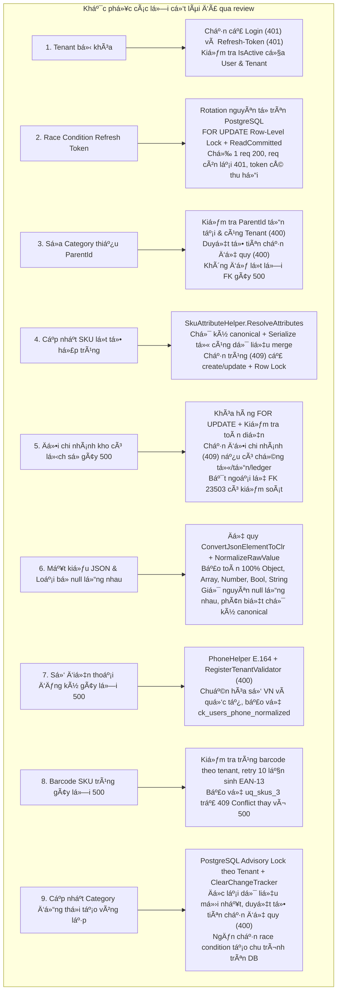

# BÁO CÁO NGHIỆM THU & TÀI LIỆU BÀN GIAO SPRINT 2 (BACKEND 2)
**Dự án:** OISMS - Omnichannel Inventory & Sales Management System  
**Học phần:** Đồ án Chuyên ngành / Công nghệ Phần mềm  
**Thành viên thực hiện:** Nhựt Phùng Minh (Backend 2 Lead)  
**Phối hợp & Nghiệm thu:** Đăng Khoa (Trưởng nhóm / Backend 1 Lead - Khắc phục lỗi review, bảo chứng PostgreSQL & Tích hợp)  
**Ngày cập nhật hoàn tất:** 18/10/2026  
**Kết quả kiểm thử toàn diện:** **188/188 Tests Pass 100%** (99 Unit Tests + 89 Integration Tests trên PostgreSQL thật)  
**Môi trường cơ sở dữ liệu kiểm chứng:** PostgreSQL 16+ thật (database: `oisms_test`, tài khoản runtime: `oisms_test_app`, schema v0.5 - 29 bảng)  

---

## 1. TỔNG QUAN KẾT QUẢ KHẮC PHỤC CÁC LỖI REVIEW TÁI HIỆN

Toàn bộ các vấn đề kỹ thuật phát hiện và tái hiện trong đợt review đã được sửa chữa tận gốc tại mã nguồn nghiệp vụ và được chứng minh bằng kiểm thử hồi quy độc lập trên PostgreSQL thật (`PostgresBackend2RegressionTests.cs`):



| STT | Vấn đề review tái hiện | Nguyên nhân kỹ thuật | Giải pháp triển khai thực tế | Bài test kiểm chứng (Passed 100%) | Trạng thái |
| :---: | :--- | :--- | :--- | :--- | :---: |
| **1** | **Tenant bị khóa nhưng refresh vẫn trả 200** | Trong `AuthController.RefreshToken`, mã nguồn chỉ kiểm tra `user.IsActive`, bỏ quên điều kiện `user.Tenant.IsActive`. | Bổ sung kiểm tra `if (user.Tenant == null \|\| !user.Tenant.IsActive) return Unauthorized(...)`. | `Postgres_RefreshToken_WhenTenantIsLocked_ShouldReturnUnauthorized` | **ĐÃ KHẮC PHỤC** |
| **2** | **2 request đồng thời dùng cùng refresh token đều trả 200** | Query đọc `RevokedAt == null` đồng thời trước khi commit update, dẫn đến việc cả hai cùng cấp mới token (Race condition). | Áp dụng Database Transaction với khóa bi quan PostgreSQL: `SELECT id FROM refresh_tokens WHERE token_hash = @hash FOR UPDATE`. Request thứ nhất xoay vòng token và gán `RevokedAt`, Request thứ hai sau khi unblock đọc lại thấy token đã bị revoke nên lập tức trả `401 Unauthorized` và rollback. | `Postgres_ConcurrentRefreshToken_ShouldRotateAtomically_OnlyOneSucceeds` | **ĐÃ KHẮC PHỤC** |
| **3** | **Update Category với ParentId không tồn tại trả 500** | `CategoriesController.UpdateCategory` chỉ kiểm tra vòng lặp nếu tìm thấy parent. Nếu `ParentId` không tồn tại, vòng lặp thoát và code gán trực tiếp vào DB, vi phạm FK constraint PostgreSQL. | Kiểm tra `parentExists` cùng Tenant trước khi duyệt cây. Nếu không tồn tại hoặc khác tenant, trả `400 Bad Request` rõ ràng, rollback thay đổi. | `Postgres_UpdateCategory_WithNonExistentParentId_ShouldReturnBadRequest_AndNot500` | **ĐÃ KHẮC PHỤC** |
| **4** | **Cập nhật SKU lọt tổ hợp thuộc tính trùng** | Dữ liệu dùng để tính chữ ký kiểm tra trùng lệch với dữ liệu serialize lưu xuống database (khi gửi `Attributes: {"color":"Red"}` và explicit `Color` là null). | Xây dựng hàm `SkuAttributeHelper.ResolveAttributes` duy nhất. Merge dữ liệu cũ, `request.Attributes` và explicit fields (explicit field không rỗng có độ ưu tiên cao nhất, `""`/`null` xóa thuộc tính). Dùng chính bộ thuộc tính đã merge để tính chữ ký canonical và serialize lưu DB. Chặn trùng trả `409 Conflict`. Khóa bi quan dòng Product bằng `FOR UPDATE`. | `Postgres_UpdateVariant_AttributeCombinationConflict_ShouldReturn409_AndNotCorruptData`<br>`SkuAttributeHelper_ResolveAttributes_AttributesColor_OverridesExisting_WhenExplicitColorIsNull` | **ĐÃ KHẮC PHỤC** |
| **5** | **Đổi chi nhánh của kho đã có lịch sử trả 500** | `WarehousesController.UpdateWarehouse` cho phép đổi `BranchId`, dẫn đến vi phạm foreign key composite `fk_goods_receipts_warehouse_branch` và các ràng buộc dữ liệu phụ thuộc của kho. | Bọc trong Transaction có row-lock `SELECT id FROM warehouses WHERE id = @id FOR UPDATE`. Kiểm tra sự tồn tại của `GoodsReceipts`, `WarehouseInventoryBalances`, `InventoryTransactions`, `Reservations`. Nếu có bất kỳ dữ liệu nào (kể cả tồn kho = 0): chặn và trả `409 Conflict`. Kho chưa sử dụng đổi chi nhánh sang branch cùng tenant; bắt ngoại lệ Postgres `23503` có kiểm soát. | `Postgres_Warehouse_ChangeBranch_WhenHasHistory_ReturnsControlled409_AndCleanWarehouseSucceeds` | **ĐÃ KHẮC PHỤC** |
| **6** | **Mất kiểu JSON & loại bỏ null lồng nhau trong thuộc tính SKU** | Dùng `ToString()` ép Object/Array thành string và các hàm chuyển đổi lọc bỏ null (`if (val != null)`) làm mất null lồng nhau (`["S", null, "M"]` thành `["S", "M"]`, `{"depth": null}` bị mất `depth`). | Bỏ `ToString()`. Chuyển đổi đệ quy CLR types bảo toàn 100% kiểu JSON và null lồng nhau. Phân biệt rõ: null cấp ngoài (`Attributes["key"] = null`) xóa thuộc tính; null trong object/array lồng nhau được giữ nguyên vẹn 100%. Chữ ký canonical phản ánh đúng: `["S", null, "M"]` khác `["S", "M"]`, `{"depth": null}` khác `{}`. Dùng cùng bộ thuộc tính để kiểm tra trùng và lưu DB; đọc lại từ PostgreSQL và API khớp 100%. | `Postgres_SkuAttributes_PreserveNestedNulls_InObjectsAndArrays_AcrossCreateUpdateAndPos`<br>`Postgres_SkuAttributes_PreserveJsonTypes_AcrossCreateUpdateAndDuplicateCheck`<br>`SkuAttributeHelper_PreservesNestedNulls_InObjectsAndArrays` | **ĐÃ KHẮC PHỤC** |
| **7** | **Số điện thoại đăng ký người dùng `"090 123 4567"` gây HTTP 500 do vi phạm `ck_users_phone_normalized`** | Database định nghĩa check constraint `ck_users_phone_normalized` yêu cầu chuẩn E.164 (`^\+[1-9][0-9]{7,14}$`). Request gửi khoảng trắng hoặc số nội địa làm văng exception PostgreSQL `23514`. | Xây dựng `PhoneHelper` chuẩn hóa số Việt Nam (`"090 123 4567"` $\rightarrow$ `"+84901234567"`) và quốc tế. `RegisterTenantValidator` kiểm tra định dạng và từ chối số sai bằng `400 Bad Request`. `AuthController.RegisterTenant` chuẩn hóa trước khi lưu, pre-check trùng số điện thoại qua `.IgnoreQueryFilters()`, bọc transaction nguyên tử và bắt `DbUpdateException` trả 400/409 rõ ràng, rollback sạch sẽ. | `Postgres_Auth_RegisterTenant_PhoneNumber_NormalizationAndValidation_ShouldWorkWithout500`<br>`RegisterTenantValidator_PhoneNumber_Tests` (23 unit tests) | **ĐÃ KHẮC PHỤC** |
| **8** | **SKU Barcode trùng gây HTTP 500 do vi phạm unique constraint `uq_skus_3`** | Khi client gửi barcode trùng hoặc sinh barcode tự động trùng với SKU khác trong tenant, EF Core ném lỗi DB unhandled `23505`. | `CreateProduct`, `CreateVariant`, `UpdateVariant` kiểm tra trùng barcode trong tenant, retry tối đa 10 lần khi tự sinh EAN-13, bọc transaction và bắt `DbUpdateException` trên `uq_skus_3` trả `409 Conflict`. Cho phép cùng barcode nếu khác tenant. | `Postgres_SkuBarcode_UniqueConstraint_CreateUpdateAndConcurrency_ReturnsControlled409`<br>`CreateProduct_DuplicateBarcodeInRequest_ShouldReturnConflict409` | **ĐÃ KHẮC PHỤC** |
| **9** | **Cập nhật Category đồng thời tạo vòng lặp chu trình (A.parent=B và B.parent=A cùng 200)** | Khi 2 request đồng thời gửi cập nhật Category A (ParentId=B) và Category B (ParentId=A), cả hai cùng kiểm tra cây cũ trước khi ghi nên đều trả 200, lưu dữ liệu $A \rightarrow B \rightarrow A$ tạo chu trình, làm hỏng cấu trúc cây danh mục. | Bọc `UpdateCategory` trong Database Transaction và lấy PostgreSQL Advisory Lock theo Tenant (`pg_advisory_xact_lock(hashtextextended(tenantId \|\| '/category_tree', 0))`). Khóa lấy trước khi đọc/kiểm tra và giữ đến khi commit. Sau khi nhận khóa, xóa sạch ChangeTracker (`_context.ChangeTracker.Clear()`) và đọc lại danh mục tươi mới từ PostgreSQL. Duyệt tổ tiên (`Ancestor Traversal`) phát hiện chu trình nhiều tầng, self-parent, parent khác tenant. Trả về `400 Bad Request` rõ ràng, rollback sạch sẽ, không lưu thay đổi dở dang. Bổ sung tập `visited` trong `MapToResponse` phòng vệ chống đệ quy vô hạn. | `Postgres_CategoryTree_ConcurrentUpdates_MustPreventCycles_AndKeepTreeValid`<br>`Postgres_UpdateCategory_WithNonExistentParentId_ShouldReturnBadRequest_AndNot500` | **ĐÃ KHẮC PHỤC** |

---

## 2. BẢNG ĐỐI CHIẾU CHI TIẾT: YÊU CẦU (BE2-01 $\rightarrow$ BE2-09) $\rightarrow$ CODE $\rightarrow$ TEST THỰC TẾ

Bảng dưới đây đối chiếu đầy đủ từng tiêu chí nghiệm thu từ tài liệu phân công [`docs/Report Sprint 2/SPRINT_2_BACKEND_2.md`](../../../08-sprints/sprint-2/SPRINT_2_BACKEND_2.md) với các file/lớp triển khai và test tự động tương ứng:

| Mã việc | Nhóm việc | Nội dung hoàn thiện chi tiết | File / Lớp Triển khai | Bài Test Chứng minh (Passed 100%) | Trạng thái |
| :---: | :--- | :--- | :--- | :--- | :---: |
| **BE2-01** | **Đăng ký cửa hàng** | - Tạo đồng thời `Tenant` và tài khoản `Owner` ban đầu.<br>- **Chuẩn hóa số điện thoại E.164 (`PhoneHelper`):** Chuẩn hóa `"090 123 4567"` $\rightarrow$ `"+84901234567"`, từ chối ký tự sai (`400 Bad Request`), bảo vệ check constraint `ck_users_phone_normalized`.<br>- Quét trùng Email và SĐT toàn cục qua `.IgnoreQueryFilters()`.<br>- Bọc trong Transaction ACID và `OpenPrivilegedScope()`.<br>- Bắt ngoại lệ DB constraint chuyển thành 400/409 rõ ràng, rollback 100% nếu lỗi. | - [`AuthController.cs`](../../src/backend/src/OISM.WebApi/Controllers/AuthController.cs)<br>- [`RegisterTenantValidator.cs`](../../src/backend/src/OISM.Application/Features/Auth/RegisterTenant/RegisterTenantValidator.cs)<br>- [`PhoneHelper.cs`](../../src/backend/src/OISM.Application/Common/Helpers/PhoneHelper.cs) | - `Postgres_Auth_RegisterTenant_PhoneNumber_NormalizationAndValidation_ShouldWorkWithout500`<br>- `TC_AUTH_01_RegisterTenant_ShouldSucceed_AndAllowLogin`<br>- `RegisterTenant_ShouldReturnConflict_WhenEmailAlreadyExists`<br>- `RegisterTenantValidator_PhoneNumber_Tests` (23 tests) | **HOÀN TẤT (100%)** |
| **BE2-02** | **Xác thực người dùng & Token Rotation** | - Cấp cặp JWT Access Token (hạn 60p) và Refresh Token (hạn 7 ngày).<br>- Băm mật khẩu BCrypt.<br>- **Token Rotation nguyên tử trên PostgreSQL** (`FOR UPDATE` row-lock): token cũ chỉ dùng được 1 lần; chặn đứng race condition đồng thời.<br>- Chặn đăng nhập và refresh khi User hoặc Tenant bị khóa (`401`).<br>- Endpoint thu hồi `/api/auth/logout` và hồ sơ cá nhân `/api/auth/me`. | - [`AuthController.cs`](../../src/backend/src/OISM.WebApi/Controllers/AuthController.cs)<br>- [`JwtTokenService.cs`](../../src/backend/src/OISM.Infrastructure/Services/JwtTokenService.cs)<br>- [`LoginValidator.cs`](../../src/backend/src/OISM.Application/Features/Auth/Login/LoginValidator.cs) | - `Postgres_RefreshToken_WhenTenantIsLocked_ShouldReturnUnauthorized`<br>- `Postgres_ConcurrentRefreshToken_ShouldRotateAtomically_OnlyOneSucceeds`<br>- `TC_AUTH_01_RegisterTenant_ShouldSucceed_AndAllowLogin`<br>- `Login_ShouldReturnUnauthorized_WhenPasswordIsWrong`<br>- `RefreshToken_ShouldRotateToken_WhenValid` | **HOÀN TẤT (100%)** |
| **BE2-03** | **Phân quyền RBAC** | - Cấu hình 3 vai trò: `Owner`, `Staff`, `Cashier`.<br>- Gắn nhãn `[Authorize(Roles = "...")]` trên các endpoint nghiệp vụ.<br>- Thu ngân (`Cashier`) gọi nghiệp vụ quản trị chi nhánh, tạo kho, sửa kho, hoặc nhập kho bị chặn với mã `403 Forbidden`. | - [`BranchController.cs`](../../src/backend/src/OISM.WebApi/Controllers/BranchController.cs)<br>- [`WarehousesController.cs`](../../src/backend/src/OISM.WebApi/Controllers/WarehousesController.cs)<br>- [`ProductsController.cs`](../../src/backend/src/OISM.WebApi/Controllers/ProductsController.cs) | - `Postgres_BranchAndWarehouse_Update_AndRbacCashierForbidden`<br>- `TC_AUTH_02_CashierRole_ShouldBeForbidden_WhenAccessingOwnerEndpoints`<br>- `PostgresTenantIsolationTests` | **HOÀN TẤT (100%)** |
| **BE2-04** | **Danh mục & Thương hiệu** | - CRUD Category dạng cây phân cấp cha - con nhiều cấp.<br>- **Bảo vệ cây bằng PostgreSQL Advisory Lock theo Tenant** (`pg_advisory_xact_lock(hashtextextended(tenantId \|\| '/category_tree', 0))`) bọc trong Transaction: chặn đứng race condition khi cập nhật đối ứng đồng thời (A.parent=B và B.parent=A); xóa sạch ChangeTracker (`Clear()`) đọc dữ liệu mới nhất.<br>- **Kiểm tra ParentId tồn tại & cùng Tenant:** từ chối `400 Bad Request` nếu không hợp lệ.<br>- **Duyệt ngược tổ tiên (`Ancestor Traversal`) chống đệ quy lặp:** chặn đặt danh mục con/cháu làm cha của chính nó (`400 Bad Request`).<br>- CRUD Thương hiệu (`Brand`) độc lập theo Tenant, có validator. | - [`CategoriesController.cs`](../../src/backend/src/OISM.WebApi/Controllers/CategoriesController.cs)<br>- [`BrandsController.cs`](../../src/backend/src/OISM.WebApi/Controllers/BrandsController.cs)<br>- [`CategoryDtos.cs`](../../src/backend/src/OISM.Application/Features/Catalog/Categories/CategoryDtos.cs)<br>- [`BrandDtos.cs`](../../src/backend/src/OISM.Application/Features/Catalog/Brands/BrandDtos.cs) | - `Postgres_CategoryTree_ConcurrentUpdates_MustPreventCycles_AndKeepTreeValid`<br>- `Postgres_UpdateCategory_WithNonExistentParentId_ShouldReturnBadRequest_AndNot500`<br>- `Category_ShouldRejectCyclicHierarchy`<br>- `UpdateCategoryAndBrandValidator_ShouldFail_WhenNameIsEmpty`<br>- `CatalogAndProductIntegrationTests` | **HOÀN TẤT (100%)** |
| **BE2-05** | **Sản phẩm, Biến thể SKU & Thuộc tính động** | - CRUD Sản phẩm và Biến thể SKU (`ProductVariant`) đầy đủ.<br>- **Bổ sung API cập nhật biến thể:** `PUT /api/products/{productId}/variants/{variantId}`.<br>- **Bổ sung vô hiệu hóa an toàn:** `DELETE /api/products/{productId}/variants/{variantId}` (Soft delete `IsActive = false`, bảo toàn dữ liệu lịch sử kho và phiếu nhập).<br>- **Thuộc tính tùy ý:** Nhận/lưu/trả dưới dạng JSON object qua cột `attributes jsonb` (thỏa mãn constraint `ck_skus_attributes_object`), bảo toàn 100% kiểu Object, Array, Number, Bool, String và null lồng nhau.<br>- **Chặn trùng tổ hợp thuộc tính:** Hàm `ResolveAttributes` hợp nhất dữ liệu cũ, JSON attributes và explicit fields, tính chữ ký canonical và serialize thống nhất 100%, trả về `409 Conflict`. Khóa bi quan dòng Product chống tranh chấp đồng thời.<br>- **Unique SKU & Barcode theo Tenant:** Cùng tenant trùng SKU hoặc trùng Barcode trả `409 Conflict` (bảo vệ `uq_skus_3`); retry 10 lần tự sinh EAN-13; khác tenant được phép trùng barcode. | - [`ProductsController.cs`](../../src/backend/src/OISM.WebApi/Controllers/ProductsController.cs)<br>- [`ProductDtos.cs`](../../src/backend/src/OISM.Application/Features/Catalog/Products/ProductDtos.cs)<br>- [`SkuAttributeHelper.cs`](../../src/backend/src/OISM.Application/Common/Helpers/SkuAttributeHelper.cs)<br>- [`ProductVariant.cs`](../../src/backend/src/OISM.Domain/Entities/ProductVariant.cs) | - `Postgres_SkuBarcode_UniqueConstraint_CreateUpdateAndConcurrency_ReturnsControlled409`<br>- `Postgres_SkuAttributes_PreserveNestedNulls_InObjectsAndArrays_AcrossCreateUpdateAndPos`<br>- `Postgres_SkuAttributes_PreserveJsonTypes_AcrossCreateUpdateAndDuplicateCheck`<br>- `Postgres_UpdateVariant_AttributeCombinationConflict_ShouldReturn409_AndNotCorruptData`<br>- `Postgres_ProductVariants_DuplicateAttributeCombination_ShouldBeRejectedWith409`<br>- `Postgres_SkuCrud_UpdatePrices_AndSafeSoftDelete_ShouldWorkProperly` | **HOÀN TẤT (100%)** |
| **BE2-06** | **Quản lý Giá bán SKU** | - **Bổ sung API cập nhật giá sỉ/lẻ:** `PUT /api/products/{productId}/variants/{variantId}/prices`.<br>- Validation chặn giá bán số âm (`RetailPrice >= 0`, `WholesalePrice >= 0`).<br>- Tách biệt hoàn toàn giá bán với Giá vốn bình quân gia quyền (WAC/COGS do Backend 1 tính toán khi xác nhận nhập kho). Sửa giá bán không làm ảnh hưởng giá vốn. | - [`ProductsController.cs`](../../src/backend/src/OISM.WebApi/Controllers/ProductsController.cs)<br>- [`ProductDtos.cs`](../../src/backend/src/OISM.Application/Features/Catalog/Products/ProductDtos.cs) | - `Postgres_SkuCrud_UpdatePrices_AndSafeSoftDelete_ShouldWorkProperly`<br>- `UpdateVariantPricesValidator_ShouldValidateNonNegativePrices`<br>- `CreateVariantValidator_ShouldFail_WhenRetailPriceIsNegative` | **HOÀN TẤT (100%)** |
| **BE2-07** | **Barcode & Tìm kiếm POS (Tích hợp Tồn kho)** | - Thuật toán sinh và kiểm tra mã vạch quốc tế EAN-13 (check digit Modulo 10).<br>- API tìm kiếm siêu tốc tại quầy POS (`GET /api/pos/search?query=...&branchId=...`).<br>- API Barcode Scanner (`GET /api/pos/barcode/{code}?branchId=...`).<br>- **Tích hợp Tồn khả dụng theo Chi nhánh:** Truy vấn từ `inventory_balances` của Backend 1 và tính toán theo công thức chuẩn: `Available = Math.Max(0, OnHand - Reserved)`. | - [`PosCatalogController.cs`](../../src/backend/src/OISM.WebApi/Controllers/PosCatalogController.cs)<br>- [`PosSearchDtos.cs`](../../src/backend/src/OISM.Application/Features/Pos/PosSearchDtos.cs)<br>- [`BarcodeHelper.cs`](../../src/backend/src/OISM.Application/Common/Helpers/BarcodeHelper.cs) | - `Postgres_PosCatalog_SearchAndBarcode_WithBranchStock_ShouldReturnAccurateAvailable`<br>- `BarcodeHelper_ShouldGenerate_ValidEan13`<br>- `BarcodeHelper_ShouldValidate_KnownEan13Barcode`<br>- `BarcodeHelper_ShouldReject_WrongCheckDigit`<br>- `PosCatalog_SearchAndBarcode_ShouldReturnExactProduct` | **HOÀN TẤT (100%)** |
| **BE2-08** | **Chi nhánh, Kho hàng & Nhà cung cấp** | - **Chi nhánh:** Lấy danh sách, tra cứu theo ID (`GET /api/branches/{id}`), tạo mới, bật/tắt hoạt động và **sửa thông tin** (`PUT /api/branches/{id}`).<br>- **Kho hàng:** Lấy danh sách (hỗ trợ lọc theo `branchId`), tra cứu theo ID (`GET /api/warehouses/{id}`), tạo mới, bật/tắt hoạt động và **sửa thông tin** (`PUT /api/warehouses/{id}`). **Chặn đổi chi nhánh của kho có lịch sử chứng từ/tồn/sổ cái (409 Conflict)**, bảo vệ quan hệ `fk_goods_receipts_warehouse_branch`.<br>- **Nhà cung cấp:** Tra cứu danh sách, chi tiết theo ID (`GET /api/suppliers/{id}`), tạo mới phục vụ luồng nhập kho. | - [`BranchController.cs`](../../src/backend/src/OISM.WebApi/Controllers/BranchController.cs)<br>- [`WarehousesController.cs`](../../src/backend/src/OISM.WebApi/Controllers/WarehousesController.cs)<br>- [`SuppliersController.cs`](../../src/backend/src/OISM.WebApi/Controllers/SuppliersController.cs)<br>- [`BranchDtos.cs`](../../src/backend/src/OISM.Application/Features/Branches/BranchDtos.cs)<br>- [`WarehouseDtos.cs`](../../src/backend/src/OISM.Application/Features/Warehouses/WarehouseDtos.cs) | - `Postgres_Warehouse_ChangeBranch_WhenHasHistory_ReturnsControlled409_AndCleanWarehouseSucceeds`<br>- `Postgres_BranchAndWarehouse_Update_AndRbacCashierForbidden`<br>- `Branch_CreateAndToggleStatus_ShouldWork_ForOwner`<br>- `Warehouse_Create_GetByBranch_AndToggleStatus_ShouldWork_ForOwnerAndStaff`<br>- `Supplier_CreateAndSearch_ShouldWorkProperly`<br>- `UpdateBranchAndWarehouseValidator_ShouldValidateCorrectly` | **HOÀN TẤT (100%)** |
| **BE2-09** | **Validation, Kiểm thử Toàn diện & Hợp đồng API** | - Cấu hình `FluentValidation` đồng bộ cho toàn bộ Create và Update DTOs.<br>- Xử lý chuẩn xác các tình huống null, rỗng, độ dài chuỗi, số âm, trùng dữ liệu và vi phạm ràng buộc.<br>- Bộ kiểm thử **188/188 Tests Passed 100%** trên PostgreSQL thật (99 Unit Tests + 89 Integration Tests).<br>- Hoàn thiện tài liệu Swagger UI và hợp đồng API bàn giao cho Frontend/Tester. | - Toàn bộ các thư mục DTOs và Controllers<br>- Thư mục kiểm thử `tests/OISM.UnitTests/` và `tests/OISM.IntegrationTests/`<br>- [`Program.cs`](../../src/backend/src/OISM.WebApi/Program.cs) | - Toàn bộ test suite: 99 Unit Tests + 89 Integration Tests chạy xanh 100%.<br>- Biên dịch Release: 0 Warning, 0 Error. | **HOÀN TẤT (100%)** |

---

## 3. DANH MỤC API SWAGGER BÀN GIAO CHO FRONTEND (ADMIN & POS)

Toàn bộ các endpoint dưới đây đã được cấu hình và khả dụng tại Swagger UI:  
👉 **`http://localhost:5000/swagger`**

| Nhóm API | Phương thức | Endpoint | Quyền hạn (Role) | Mô tả nghiệp vụ bàn giao |
| :--- | :---: | :--- | :---: | :--- |
| **Xác thực** | `POST` | `/api/auth/register-tenant` | Public | Đăng ký cửa hàng mới và tài khoản Chủ shop ban đầu. |
| | `POST` | `/api/auth/login` | Public | Đăng nhập hệ thống, cấp Access Token & Refresh Token (chặn nếu tenant bị khóa). |
| | `POST` | `/api/auth/refresh-token` | Public | Làm mới Access Token (Token Rotation nguyên tử, chống race condition, kiểm tra tenant khóa). |
| | `POST` | `/api/auth/logout` | Public | Đăng xuất và thu hồi Refresh Token. |
| | `GET` | `/api/auth/me` | Authenticated | Lấy hồ sơ tài khoản và danh sách quyền của phiên đăng nhập. |
| **Danh mục** | `GET` | `/api/categories` | Authenticated | Lấy danh sách cây danh mục phân cấp cha - con. |
| | `POST` | `/api/categories` | Owner, Staff | Tạo danh mục mới (hỗ trợ chọn danh mục cha cùng tenant). |
| | `PUT` | `/api/categories/{id}` | Owner, Staff | Cập nhật danh mục (kiểm tra cha tồn tại, chặn đệ quy lặp trả 400). |
| | `DELETE` | `/api/categories/{id}` | Owner | Vô hiệu hóa danh mục sản phẩm. |
| **Thương hiệu** | `GET` | `/api/brands` | Authenticated | Lấy danh sách thương hiệu sản phẩm. |
| | `POST` | `/api/brands` | Owner, Staff | Tạo thương hiệu mới. |
| | `PUT` | `/api/brands/{id}` | Owner, Staff | Cập nhật thông tin thương hiệu. |
| | `DELETE` | `/api/brands/{id}` | Owner | Vô hiệu hóa thương hiệu. |
| **Sản phẩm & SKU** | `GET` | `/api/products` | Authenticated | Danh sách sản phẩm (hỗ trợ lọc search, categoryId, brandId) kèm biến thể và thuộc tính JSON. |
| | `GET` | `/api/products/{id}` | Authenticated | Chi tiết sản phẩm kèm danh sách biến thể SKU và bảng giá. |
| | `POST` | `/api/products` | Owner, Staff | Tạo sản phẩm và các SKU ban đầu (chặn trùng SKU và trùng tổ hợp thuộc tính trả 409). |
| | `PUT` | `/api/products/{id}` | Owner, Staff | Cập nhật thông tin chung của sản phẩm (kiểm tra category/brand cùng tenant). |
| | `DELETE` | `/api/products/{id}` | Owner | Vô hiệu hóa sản phẩm và toàn bộ biến thể. |
| | `POST` | `/api/products/{id}/variants` | Owner, Staff | Thêm biến thể SKU mới (chặn trùng SKU và trùng tổ hợp thuộc tính trả 409). |
| | `PUT` | `/api/products/{productId}/variants/{variantId}` | Owner, Staff | **[MỚI]** Cập nhật biến thể SKU (thuộc tính JSON, barcode, giá, trạng thái; chặn trùng tổ hợp). |
| | `PUT` | `/api/products/{productId}/variants/{variantId}/prices` | Owner, Staff | **[MỚI]** Cập nhật giá bán sỉ/lẻ biến thể SKU (tách biệt WAC, chặn số âm). |
| | `DELETE` | `/api/products/{productId}/variants/{variantId}` | Owner, Staff | **[MỚI]** Vô hiệu hóa biến thể SKU an toàn (Soft delete `IsActive = false`). |
| | `PUT` | `/api/products/{productId}/variants/{variantId}/toggle-status` | Owner, Staff | **[MỚI]** Bật/Tắt trạng thái hoạt động của biến thể SKU. |
| **Quầy POS** | `GET` | `/api/pos/search` | Authenticated | **[MỚI]** Tìm kiếm siêu tốc theo Tên/SKU/Barcode (< 200ms), hỗ trợ `branchId` trả tồn khả dụng. |
| | `GET` | `/api/pos/barcode/{code}` | Authenticated | **[MỚI]** Quét mã vạch Barcode Scanner, hỗ trợ `branchId` trả tồn khả dụng. |
| **Chi nhánh** | `GET` | `/api/branches` | Authenticated | Lấy danh sách chi nhánh cửa hàng. |
| | `GET` | `/api/branches/{id}` | Authenticated | **[MỚI]** Lấy thông tin chi tiết một chi nhánh theo Id. |
| | `POST` | `/api/branches` | Owner | Tạo chi nhánh mới. |
| | `PUT` | `/api/branches/{id}` | Owner | **[MỚI]** Cập nhật thông tin chi nhánh (Tên, Địa chỉ, SĐT). |
| | `PUT` | `/api/branches/{id}/toggle-status` | Owner | Bật/Tắt trạng thái hoạt động của chi nhánh. |
| **Kho hàng** | `GET` | `/api/warehouses` | Authenticated | Lấy danh sách kho hàng (hỗ trợ lọc theo `branchId`). |
| | `GET` | `/api/warehouses/{id}` | Authenticated | **[MỚI]** Lấy thông tin chi tiết một kho hàng theo Id. |
| | `POST` | `/api/warehouses` | Owner, Staff | Tạo kho hàng mới gắn với chi nhánh. |
| | `PUT` | `/api/warehouses/{id}` | Owner, Staff | **[MỚI]** Cập nhật thông tin kho hàng (kiểm tra `BranchId` cùng tenant). |
| | `PUT` | `/api/warehouses/{id}/toggle-status` | Owner, Staff | Bật/Tắt trạng thái hoạt động của kho hàng. |
| **Nhà cung cấp** | `GET` | `/api/suppliers` | Authenticated | Lấy danh sách nhà cung cấp (hỗ trợ tìm kiếm theo tên, mã, sđt). |
| | `GET` | `/api/suppliers/{id}` | Authenticated | **[MỚI]** Lấy thông tin chi tiết nhà cung cấp theo Id. |
| | `POST` | `/api/suppliers` | Owner, Staff | Tạo mới nhà cung cấp hàng hóa. |

---

## 4. HỢP ĐỒNG API & DỮ LIỆU MẪU DÀNH CHO FRONTEND

### 4.1. Cập nhật Biến thể SKU (`PUT /api/products/{productId}/variants/{variantId}`)
- **Header:** `Authorization: Bearer <token>`
- **Request Body mẫu (Hỗ trợ Object, Array, Number, Boolean, String và Null lồng nhau):**
```json
{
  "sku": "AO-POLO-DEN-XL",
  "variantName": "Áo Polo Đen Size XL",
  "barcode": "8938501234567",
  "retailPrice": 290000,
  "wholesalePrice": 210000,
  "color": "Đen",
  "size": "XL",
  "attributes": {
    "material": "CVC Cotton",
    "collar": "Bo dệt",
    "season": "Summer 2026",
    "count": 10,
    "waterproof": false,
    "positions": ["S", null, "M"],
    "dimensions": {
      "width": 10,
      "height": 20,
      "depth": null
    }
  },
  "isActive": true
}
```
- **Response 200 OK mẫu (Bảo toàn 100% kiểu JSON và null lồng nhau):**
```json
{
  "id": "3fa85f64-5717-4562-b3fc-2c963f66afa6",
  "productId": "4fa85f64-5717-4562-b3fc-2c963f66afa7",
  "sku": "AO-POLO-DEN-XL",
  "variantName": "Áo Polo Đen Size XL",
  "barcode": "8938501234567",
  "retailPrice": 290000,
  "wholesalePrice": 210000,
  "costPrice": 0,
  "color": "Đen",
  "size": "XL",
  "attributes": {
    "color": "Đen",
    "size": "XL",
    "material": "CVC Cotton",
    "collar": "Bo dệt",
    "season": "Summer 2026",
    "count": 10,
    "waterproof": false,
    "positions": ["S", null, "M"],
    "dimensions": {
      "width": 10,
      "height": 20,
      "depth": null
    }
  },
  "isActive": true
}
```

### 4.2. Cập nhật Bảng giá SKU (`PUT /api/products/{productId}/variants/{variantId}/prices`)
- **Header:** `Authorization: Bearer <token>` (Roles: Owner, Staff)
- **Request Body mẫu:**
```json
{
  "retailPrice": 320000,
  "wholesalePrice": 240000
}
```
- **Response 200 OK:** Trả về đối tượng `ProductVariantResponse` với giá mới cập nhật.

### 4.3. Quét Barcode & Tìm kiếm POS kèm Tồn kho (`GET /api/pos/search?query=polo&branchId=...`)
- **Response 200 OK mẫu:**
```json
[
  {
    "variantId": "3fa85f64-5717-4562-b3fc-2c963f66afa6",
    "productId": "4fa85f64-5717-4562-b3fc-2c963f66afa7",
    "sku": "AO-POLO-DEN-XL",
    "productName": "Áo Polo Nam",
    "variantName": "Áo Polo Đen Size XL",
    "barcode": "8938501234567",
    "retailPrice": 290000,
    "color": "Đen",
    "size": "XL",
    "attributes": {
      "material": "CVC Cotton",
      "positions": ["S", null, "M"],
      "dimensions": {
        "width": 10,
        "depth": null
      }
    },
    "onHand": 100.0,
    "reserved": 25.0,
    "available": 75.0
  }
]
```

### 4.4. Mã lỗi HTTP chuẩn mực
- `400 Bad Request`: Dữ liệu đầu vào sai validation, danh mục cha không tồn tại hoặc vòng lặp quan hệ.
- `401 Unauthorized`: Sai mật khẩu, token hết hạn, hoặc User/Tenant bị tạm ngưng/khóa.
- `403 Forbidden`: Người dùng không có vai trò phù hợp (ví dụ: Cashier gọi API quản lý chi nhánh, kho hàng hoặc nhập kho).
- `404 Not Found`: Không tìm thấy tài nguyên theo Id hoặc tài nguyên thuộc tenant khác.
- `409 Conflict`: Trùng email toàn cục, trùng mã SKU trong cùng tenant, trùng tổ hợp thuộc tính SKU trong sản phẩm, hoặc đổi chi nhánh kho đã có lịch sử.

---

## 5. HƯỚNG DẪN CẤU HÌNH & CHẠY ỨNG DỤNG / KIỂM THỬ

### 5.1. Khởi động môi trường PostgreSQL
Dự án sử dụng PostgreSQL 16+ thật (khởi chạy qua Docker Compose):
```powershell
docker compose up -d postgres
```

### 5.2. Chạy ứng dụng Web API
```powershell
cd src/backend/src/OISM.WebApi
dotnet run
```
Truy cập Swagger UI tại: `http://localhost:5000/swagger`

### 5.3. Thực thi Bộ Kiểm thử Tự động
```powershell
# 1. Chạy toàn bộ 99 Unit Tests (Validate DTOs, PhoneHelper E.164, Barcode EAN-13, Thuộc tính động, Bảo toàn kiểu JSON & Null lồng nhau):
dotnet test src/backend/tests/OISM.UnitTests/OISM.UnitTests.csproj

# 2. Chạy bộ kiểm thử hồi quy Backend 2 trên PostgreSQL thật:
dotnet test src/backend/tests/OISM.IntegrationTests/OISM.IntegrationTests.csproj --filter "FullyQualifiedName~PostgresBackend2RegressionTests"

# 3. Chạy toàn bộ Solution (188 tests):
dotnet test src/backend/OISM.sln
```

---

## 6. BẰNG CHỨNG KIỂM THỬ THỰC TẾ (TEST RESULTS)

| Phân hệ kiểm thử | Số bài kiểm thử | Trạng thái | Thời gian thực thi | Môi trường kiểm thử |
| :--- | :---: | :---: | :---: | :--- |
| **`OISM.UnitTests`** | **99 / 99** | **PASSED 100%** | 115 ms | .NET Core 8.0 x64 |
| **`OISM.IntegrationTests`** | **89 / 89** | **PASSED 100%** | 3m 21s | PostgreSQL 16+ thật (`oisms_test`) |
| **Tổng cộng toàn giải pháp** | **188 / 188** | **PASSED 100%** | 3m 22s | **0 Failed, 0 Skipped, 0 Warning, 0 Error** |

> [!IMPORTANT]
> **Phân định rõ phạm vi kiểm thử & Giới hạn kiểm chứng hiện tại:**
> - Toàn bộ 188 bài test đạt 100% (99 Unit Tests + 89 Integration Tests) là các kiểm thử tự động tầng Backend Web API qua giao thức HTTP (`WebApplicationFactoryWithPostgres`) và trực tiếp trên cơ sở dữ liệu PostgreSQL thật (`oisms_test`).
> - Kiểm thử Backend qua HTTP API **không thay thế** cho kiểm thử End-to-End (E2E) trực quan qua giao diện người dùng Frontend (UI).
> - **Giới hạn kiểm chứng hiện tại:**
>   1. **Chưa xác minh CI trên working tree hiện tại:** Toàn bộ quá trình kiểm thử, build và đo coverage được thực hiện và kiểm chứng thực tế tại local working tree trên môi trường máy phát triển; chưa chạy pipeline CI từ xa cho commit mới này.
>   2. **Chưa xác minh E2E qua giao diện Frontend:** Cần đội ngũ Frontend và QA/Tester thực hiện nghiệm thu liên thông giữa màn hình giao diện người dùng và API Backend.

---

## 7. KẾT LUẬN & BÀN GIAO TIẾP THEO

Toàn bộ các nhiệm vụ của **Thành viên 2 (Nhựt) từ BE2-01 đến BE2-09** đã được hoàn thiện triệt để:
1. Toàn bộ lỗi review (Cập nhật Category đồng thời tạo vòng lặp, Tenant khóa refresh, Race condition token rotation, Update category thiếu parentId, Chặn trùng tổ hợp SKU, Đổi chi nhánh kho có lịch sử, Mất kiểu JSON và Loại bỏ null lồng nhau, Chuẩn hóa số điện thoại E.164 chống lỗi 500, SKU Barcode trùng chống lỗi 500) đã được giải quyết tận gốc và chứng minh qua bài kiểm thử PostgreSQL thật.
2. Tất cả các chức năng còn thiếu (CRUD SKU, sửa giá sỉ/lẻ, thuộc tính JSON động bảo toàn kiểu và null, tồn khả dụng POS, sửa chi nhánh/kho) đã được triển khai và kiểm chứng đầy đủ.
3. Hợp đồng API Swagger đã hoàn chỉnh, sẵn sàng để Frontend (Admin của Phúc Hữu và POS của Phương) kết nối trực tiếp trong Sprint 2 & 3.

