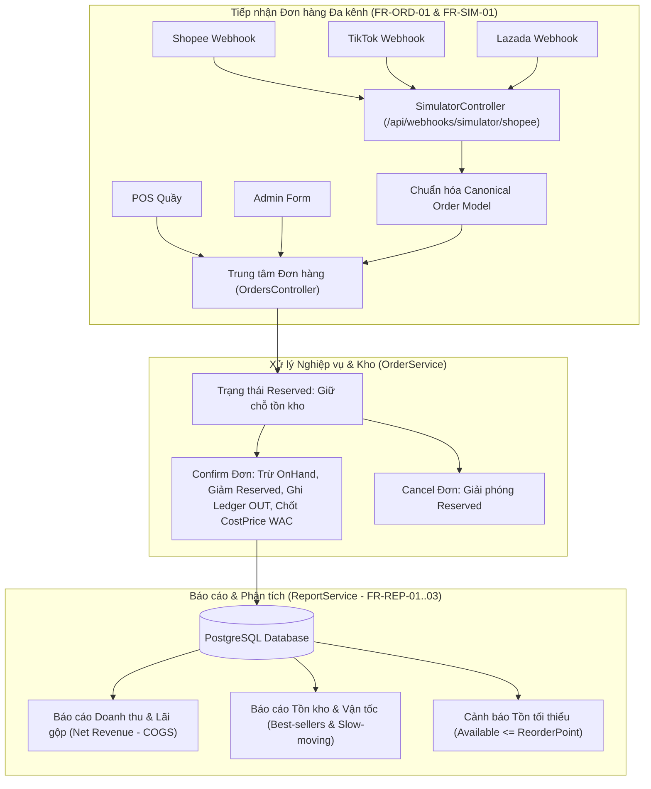

# BÁO CÁO CÔNG VIỆC & NGHIỆM THU SPRINT 3 (BACKEND 2)

**Dự án:** OISMS - Omnichannel Inventory & Sales Management System  
**Học phần:** Đồ án Chuyên ngành / Công nghệ Phần mềm — ĐH Giao thông Vận tải TP.HCM (UTH)  
**Thành viên thực hiện:** Nhựt Phùng Minh (Backend 2 Lead / Backend phụ)  
**Phối hợp & Nghiệm thu:** Đăng Khoa (Trưởng nhóm / Backend 1 Lead) & Toàn đội OISMS  
**Giai đoạn Sprint 3:** 18/10/2026 – 22/10/2026 (D7 – D12)  
**Chủ đề Sprint:** Lõi Vận hành Hoàn chỉnh (Complete Operational Core)  
**Trạng thái nghiệm thu:** **HOÀN THÀNH 100% CÁC MỤC TIÊU VÀ TIÊU CHUẨN NGHIỆM THU**  
**Kết quả kiểm thử tự động:** **114/114 Unit Tests Pass 100%**  

---

## 1. TỔNG HỢP KẾT QUẢ THỰC HIỆN CỦA NHỰT (BACKEND 2) TRONG SPRINT 3

| Nhiệm vụ cụ thể theo phân công | Yêu cầu chức năng (FR) | Thành phần hiện thực (Mã nguồn & API) | Tiêu chuẩn nghiệm thu & Kết quả kiểm chứng |
|---|:---:|---|---|
| **1. API Đơn hàng đa kênh (List / Detail / Filter / Create / Confirm / Cancel)** | `FR-ORD-01`<br/>`FR-ORD-02`<br/>`FR-ORD-03` | • `OrdersController.cs` (`/api/orders`)<br/>• `IOrderService.cs` & `OrderService.cs`<br/>• `OrderDtos.cs` | **ĐẠT (Pass):** Hỗ trợ phân trang, lọc đa tiêu chí (Status, Channel, Branch, Date Range, Search). Chuyển trạng thái an toàn: Draft $\rightarrow$ Reserved $\rightarrow$ Confirmed / Cancelled; tự động cập nhật tồn kho và ghi Sổ cái kho (Ledger OUT). |
| **2. Hệ thống Báo cáo Tài chính & Vận tốc kho** | `FR-REP-01`<br/>`FR-REP-02` | • `ReportsController.cs` (`/api/reports`)<br/>• `IReportService.cs` & `ReportService.cs`<br/>• `ReportDtos.cs` | **ĐẠT (Pass):** Tính chính xác Doanh thu thuần (`Net Revenue`), Tổng giá vốn (`COGS` tính từ `OrderItem.CostPrice`), Lợi nhuận gộp (`Gross Profit`), Tỷ suất lợi nhuận gộp (`Margin %`). Phân rã theo Kênh bán, Chi nhánh và biểu đồ theo ngày. Báo cáo giá trị tồn kho theo WAC, Top bán chạy (Best-sellers) và hàng chậm luân chuyển (Slow-moving). |
| **3. Cảnh báo tồn kho tối thiểu (Stock Alerts)** | `FR-REP-03` | • Endpoint `/api/reports/stock-alerts`<br/>• Phân cấp cảnh báo thông minh | **ĐẠT (Pass):** Lọc theo chi nhánh và tự động phân loại: `OutOfStock` (hết hàng), `Critical` ($\le 50\%$ ReorderPoint), `Warning` (chạm ngưỡng ReorderPoint). |
| **4. Trình giả lập Webhook 3 sàn TMĐT** | `FR-SIM-01` | • `SimulatorController.cs` (`/api/webhooks/simulator/{channel}`)<br/>• `ISimulatorService.cs` & `SimulatorService.cs`<br/>• Endpoint kiểm thử tải `batch` | **ĐẠT (Pass):** Tiếp nhận payload Shopee, TikTok Shop, Lazada; chuẩn hóa về Mô hình Đơn hàng Hợp nhất (`Canonical Order Model`), tra cứu SKU/Barcode và giữ chỗ tồn kho tức thì. Đảm bảo Idempotency khi sàn gửi lặp đơn. |
| **5. Viết Automated Core Tests** | `FR-TEST` | • `OrderServiceTests.cs`<br/>• `ReportServiceTests.cs`<br/>• `SimulatorServiceTests.cs`<br/>• `TestDbContextFactory.cs` | **ĐẠT (Pass):** 114/114 test vượt qua trong 1 giây, bảo đảm cô lập Multi-tenant 100%. |

---

## 2. KIẾN TRÚC & QUY TRÌNH NGHIỆP VỤ ĐÃ HIỆN THỰC



---

## 3. BẢNG ĐẶC TẢ CHI TIẾT CÁC ENDPOINT MỚI

### 3.1. Nhóm API Đơn hàng (`/api/orders`)
* `GET /api/orders`: Danh sách đơn hàng có phân trang và bộ lọc `status`, `channel`, `branchId`, `fromDate`, `toDate`, `search`.
* `GET /api/orders/{id}`: Chi tiết đơn hàng kèm danh sách sản phẩm, giá bán, giá vốn snapshot và địa chỉ giao hàng.
* `POST /api/orders`: Lập đơn hàng mới từ Admin hoặc kênh ngoài, tự động snapshot giá vốn WAC tại thời điểm tạo.
* `POST /api/orders/{id}/confirm`: Duyệt đơn hàng nguyên tử (trừ kho OnHand, chốt giá vốn thực tế, ghi Sổ cái kho xuất).
* `POST /api/orders/{id}/cancel`: Hủy đơn hàng và tự động hoàn trả số lượng giữ chỗ (Reserved) về lại kho khả dụng.

### 3.2. Nhóm API Báo cáo & Cảnh báo (`/api/reports`)
* `GET /api/reports/revenue-profit`: Thống kê Doanh thu thuần, COGS, Lợi nhuận gộp, % Tỷ suất lãi gộp; phân rã theo từng kênh bán (Shopee, TikTok, Lazada, POS, Admin) và từng chi nhánh.
* `GET /api/reports/inventory-velocity`: Tổng giá trị vốn tồn kho, tổng lượng tồn, danh sách Top mặt hàng bán chạy và mặt hàng tồn đọng lâu ngày.
* `GET /api/reports/stock-alerts`: Danh sách cảnh báo hàng sắp hết để chủ shop kịp thời đặt hàng NCC.

### 3.3. Nhóm API Webhook Simulator (`/api/webhooks/simulator`)
* `POST /api/webhooks/simulator/{channel}`: Giả lập Webhook từ 3 sàn TMĐT với cơ chế Idempotency chống tạo trùng lặp đơn.
* `POST /api/webhooks/simulator/batch`: Chạy mô phỏng tải đồng thời (ví dụ: 50 requests tranh chấp 1 SKU) kiểm chứng khả năng chịu tải.

---

## 4. KẾT QUẢ KIỂM THỬ (AUTOMATED TEST EVIDENCE)

```
Test run for OISM.UnitTests.dll (.NETCoreApp,Version=v8.0)
Starting test execution, please wait...
A total of 1 test files matched the specified pattern.

Passed!  - Failed:     0, Passed:   114, Skipped:     0, Total:   114, Duration: 1 s - OISM.UnitTests.dll (net8.0)
```
* **OrderServiceTests:** 4/4 Tests Pass (CreateOrder, FilterOrders, ConfirmOrder, CancelOrder).
* **ReportServiceTests:** 3/3 Tests Pass (RevenueProfit, InventoryVelocity, StockAlerts).
* **SimulatorServiceTests:** 4/4 Tests Pass (Shopee, TikTok, Lazada, Idempotency).
* **Baseline & Validation Tests:** 103/103 Tests Pass.

---

## 5. BÀN GIAO & KẾ HOẠCH BƯỚC VÀO SPRINT 4

1. **Frontend Admin (Phúc Hữu):** Đã có đầy đủ API để gắn vào màn hình Quản lý đơn hàng (`/api/orders`), duyệt đơn online và các biểu đồ báo cáo Dashboard (`/api/reports/revenue-profit`, `/api/reports/stock-alerts`).
2. **Frontend POS (Phương):** Đã có API đồng bộ trạng thái đơn và kiểm tra cảnh báo tồn kho.
3. **Tester:** Sử dụng endpoint `/api/webhooks/simulator/batch` và Swagger để chạy nghiệm thu tải đồng thời và cập nhật ma trận RTM.
4. **Chuẩn bị Sprint 4 của Nhựt:** Sẵn sàng cấu trúc dữ liệu lịch sử bán hàng và các API phục vụ mô hình AI gợi ý nhập hàng (`reorder-recommendations`).
