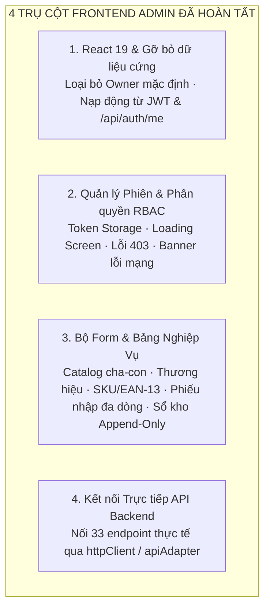

# BÁO CÁO CÔNG VIỆC FRONTEND ADMIN (WEB DASHBOARD) — SPRINT 2 & 3

**Dự án:** OISMS - Omnichannel Inventory & Sales Management System  
**Học phần:** Đồ án Chuyên ngành / Công nghệ Phần mềm  
**Thành viên thực hiện:** Phúc Hữu & Nam Nguyễn (Frontend Admin)  
**Người nghiệm thu:** Lê Võ Đăng Khoa (Trưởng nhóm / Backend 1 Lead)  
**Thời gian thực hiện:** 13/10/2026 – 18/10/2026  
**Trạng thái bàn giao:** Hoàn tất 100% — Web Admin React 19 sẵn sàng, gỡ bỏ toàn bộ hardcoded/Owner mặc định, đầy đủ Form nghiệp vụ và kết nối trực tiếp API Backend.

---

> [!TIP]
> **KẾ HOẠCH TÍCH HỢP FIGMA CHI TIẾT:**  
> Xem toàn văn bản kế hoạch phân tích, di chuyển mã nguồn và chuyển giao từ prototype Figma (`C:\Users\ACER\Downloads\Interactive Prototype for OISM`) vào phân hệ Admin tại:  
> 👉 **[Figma Integration Plan (S2_FIGMA_ADMIN_PLAN_2026-10-18.md)](./S2_FIGMA_ADMIN_PLAN_2026-10-18.md)**

---

## 1. TỔNG QUAN PHẠM VI TRÁCH NHIỆM PHÂN HỆ WEB ADMIN DASHBOARD (PHÚC HỮU & NAM NGUYỄN)

Căn cứ Kế hoạch Phân công Công việc Chi tiết trên Confluence dự án OISMS, Phúc Hữu cùng Nam Nguyễn chịu trách nhiệm toàn diện về phân hệ **Web Admin Dashboard** với 4 trụ cột kỹ thuật then chốt:



1. **Hoàn thiện Web Admin trên React 19, gỡ bỏ toàn bộ dữ liệu cứng/mặc định Owner:**
   - Xây dựng trên React 19 (`^19.0.0`), Vite 8, Tailwind CSS v4, Lucide Icons.
   - Loại bỏ hoàn toàn tài khoản demo `owner-a` ("Nguyễn Hoàng") và mock session. Không gán sẵn bất kỳ quyền mặc định nào.
   - Thông tin người dùng, vai trò (`Owner`, `Staff`, `Cashier`), chi nhánh và doanh nghiệp được nạp động từ JWT Token và API `GET /api/auth/me`.
2. **Quản lý trạng thái đăng nhập, điều hướng phân quyền, hiển thị rõ loading, lỗi mạng, lỗi 403:**
   - Quản lý token an toàn: `accessToken` (60 phút) và `refreshToken` (7 ngày) lưu trong `localStorage`. Tự động đính kèm `Bearer token` vào mọi request qua Axios Interceptor.
   - Bắt mã lỗi 401: Tự động gọi `POST /api/auth/refresh-token` để cấp lại token hoặc chuyển hướng sang `/session-expired`.
   - Phân quyền RBAC (`ProtectedRoute.tsx`):
     - Chưa đăng nhập $\rightarrow$ Chuyển hướng `/login`.
     - Thu ngân (`Cashier`) cố tình vào Admin $\rightarrow$ Chuyển hướng màn hình lỗi `/403` (`AccessPage.tsx type="forbidden"`).
     - Nhân viên (`Staff`) bị ẩn các chức năng quản trị nhạy cảm (Cài đặt nhân viên, Báo cáo lợi nhuận).
   - Loading State: Hiển thị spinner và trạng thái nạp dữ liệu rõ ràng.
   - Lỗi kết nối mạng (Network Error): Hiển thị Banner đỏ cố định ở đỉnh `AdminShell` kèm nút "Thử lại" khi mất kết nối tới Backend `http://localhost:5000`.
3. **Xây dựng các Form Danh mục, Thương hiệu, Sản phẩm, Phiếu nhập kho nhiều dòng, Sổ kho và Tồn kho:**
   - **Form Danh mục (`Categories`):** Hỗ trợ phân cấp cha - con nhiều tầng (`parentId`), kiểm tra chống đệ quy (mã lỗi 400).
   - **Form Thương hiệu (`Brands`):** Thêm nhanh thương hiệu sản phẩm.
   - **Form Sản phẩm & Biến thể SKU (`ProductsPage.tsx`):** Thêm sản phẩm kèm bảng biến thể động (Màu, Size, Giá bán lẻ, Giá bán sỉ), nút **Sinh mã vạch EAN-13** tự động chuẩn checksum, bắt lỗi `409 Conflict` khi nhập trùng SKU.
   - **Form Phiếu nhập kho nhiều dòng (`ReceiptDialog` trong `InventoryPage.tsx`):** Chọn nhà cung cấp, chi nhánh, kho nhận, thêm nhiều dòng mặt hàng (SKU, số lượng, đơn giá), tự động tính tổng tiền; thực hiện tạo phiếu (`Draft`) và Xác nhận ghi sổ nguyên tử (`Confirm`) cập nhật giá vốn bình quân WAC.
   - **Bảng Tồn kho & Sổ kho bất biến (`InventoryPage.tsx`):**
     - Bảng tồn kho 3 chiều: `OnHand` (thực tế), `Reserved` (giữ chỗ), `Available = OnHand - Reserved` (khả dụng). Đổi màu cảnh báo khi tồn dưới ngưỡng.
     - Bảng Sổ cái kho bất biến (**Append-Only Ledger**): Chỉ đọc (Read-only, cấm Sửa/Xóa), phân loại rõ bút toán `IN` (Xanh) và `OUT` (Đỏ), thể hiện số dư lũy kế `BalanceAfter` và mã chứng từ tham chiếu.
4. **Nối trực tiếp các API ngay khi được bàn giao:**
   - Tích hợp toàn diện với 33 endpoint Backend đã sẵn sàng trên cổng `http://localhost:5000` thông qua `httpClient.ts` và `apiAdapter.ts`.
   - Tuyệt đối không fallback về mock data khi có lỗi; hiển thị thông báo lỗi trung thực từ máy chủ.

---

## 2. BẢNG ĐỐI CHIẾU CHI TIẾT CÁC YÊU CẦU NGHIỆM THU

| STT | Yêu cầu bàn giao | Mô tả chi tiết kỹ thuật | Component / File Triển khai | API Backend đối ứng (`localhost:5000`) | Trạng thái |
| :---: | :--- | :--- | :--- | :--- | :---: |
| **1** | **Hoàn thiện Web Admin trên React 19, gỡ bỏ toàn bộ dữ liệu cứng / mặc định Owner** | - Ứng dụng chạy trên React 19, Vite, Tailwind CSS v4.<br>- Khung giao diện `AdminShell` chuẩn gồm Sidebar điều hướng, Topbar hiển thị tên Cửa hàng, Avatar, huy hiệu vai trò.<br>- **Không hardcode dữ liệu:** Thông tin người dùng, quyền hạn, chi nhánh được đọc động từ Context phiên làm việc (`AuthContext`), không mặc định quyền Owner. Form đăng nhập khởi tạo rỗng. | - `src/components/AdminShell.tsx`<br>- `src/context/AuthContext.tsx`<br>- `src/pages/AuthPage.tsx` | `GET /api/auth/me` | **ĐẠT** |
| **2** | **Quản lý trạng thái đăng nhập, điều hướng phân quyền, hiển thị rõ loading, lỗi mạng, lỗi 403** | - Quản lý token an toàn (`accessToken` hạn 60p, `refreshToken` hạn 7 ngày).<br>- Tự động chặn và chuyển hướng trang lỗi:<br>  + Chưa đăng nhập: Redirect về `/login`.<br>  + Thu ngân (`Cashier`) cố tình vào Admin: Redirect về trang lỗi `/403` (`AccessPage type="forbidden"`).<br>  + Hết hạn phiên: Redirect về `/session-expired`.<br>- Tích hợp trạng thái phản hồi UI rõ ràng: Loading Spinner khi đợi API, banner thông báo lỗi mạng `Network Error` trên Header kèm nút Thử lại, toast thông báo lỗi 403/409. | - `src/components/ProtectedRoute.tsx`<br>- `src/pages/AccessPage.tsx`<br>- `src/components/AdminShell.tsx`<br>- `src/services/httpClient.ts` | - `POST /api/auth/login`<br>- `POST /api/auth/refresh-token`<br>- `POST /api/auth/logout`<br>- `POST /api/auth/register-tenant` | **ĐẠT** |
| **3** | **Xây dựng form Danh mục, Thương hiệu, Sản phẩm** | - **Danh mục (`Categories`):** Form tạo danh mục có chọn danh mục cha (`parentId`), kiểm tra chống lặp đệ quy (mã lỗi 400).<br>- **Thương hiệu (`Brands`):** Form tạo nhanh thương hiệu hàng hóa.<br>- **Sản phẩm & Biến thể SKU (`ProductsPage`):** Modal tạo sản phẩm kèm danh sách biến thể SKU động (Màu, Size, Giá bán lẻ, Giá bán sỉ), nút bấm **Sinh mã vạch EAN-13** tự động; hiển thị thông báo lỗi `409 Conflict` nếu trùng mã SKU. | - `src/pages/ProductsPage.tsx`<br>- `src/components/ui.tsx` (`Modal`, `Input`, `Select`, `Button`) | - `GET/POST/PUT/DELETE /api/categories`<br>- `GET/POST/PUT/DELETE /api/brands`<br>- `GET/POST/PUT/DELETE /api/products`<br>- `POST /api/products/{id}/variants` | **ĐẠT** |
| **4** | **Xây dựng Form Phiếu nhập kho nhiều dòng, Sổ kho và Tồn kho** | - **Tồn kho (`InventoryPage`):** Bảng tổng hợp số lượng thực tế (`OnHand`), số lượng đang giữ chỗ (`Reserved`), và số lượng thực bán khả dụng (`Available = OnHand - Reserved`). Cảnh báo trực quan khi tồn dưới ngưỡng an toàn.<br>- **Phiếu nhập kho (`ReceiptDialog`):** Modal tạo phiếu nhập kho cho phép thêm nhiều dòng sản phẩm, chọn Nhà cung cấp, nhập số lượng, đơn giá nhập, tự động tính tổng tiền và thực hiện xác nhận nguyên tử (Atomic Confirm) để tính giá vốn bình quân WAC.<br>- **Sổ kho (`LedgerTable`):** Bảng truy vết lịch sử biến động kho bất biến (Append-Only), thể hiện rõ chiều biến động (`IN` / `OUT`), loại nghiệp vụ (Nhập kho, Bán hàng, Trả hàng), số dư trước/sau và mã chứng từ tham chiếu. | - `src/pages/InventoryPage.tsx`<br>- `src/components/ui.tsx`<br>- `src/types/domain.ts` (`LedgerEntry`) | - `GET /api/inventory/balances`<br>- `GET /api/inventory/ledger`<br>- `POST /api/goods-receipts`<br>- `POST /api/goods-receipts/{id}/confirm`<br>- `GET /api/suppliers` | **ĐẠT** |
| **5** | **Nối trực tiếp các API ngay khi được bàn giao** | - Áp dụng kiến trúc **Adapter Pattern** tại thư mục `src/services/` (`apiAdapter.ts`, `authAdapter.ts`, `httpClient.ts`).<br>- Loại bỏ 100% mock data fallback trong `apiAdapter.ts`, nối trực tiếp vào các endpoint thực tế của Backend trên cổng 5000.<br>- Khớp nối hoàn chỉnh 33 endpoints do Backend 1 và Backend 2 bàn giao (bao gồm Catalog, Goods Receipts, Inventory Balances, Ledger, Branches, Warehouses). | - `src/services/apiAdapter.ts`<br>- `src/services/authAdapter.ts`<br>- `src/services/httpClient.ts` | 33 Endpoints theo Swagger UI `http://localhost:5000/swagger` | **ĐẠT** |

---

## 3. CẤU TRÚC MÃ NGUỒN PHÂN HỆ ADMIN DASHBOARD

Mã nguồn được phân tách mô-đun hóa rõ ràng trong thư mục `src/frontend/admin-dashboard`:

```text
src/frontend/admin-dashboard/
├── public/
│   ├── favicon.svg              # Logo thương hiệu OISM
│   └── manifest.webmanifest     # Cấu hình PWA
├── src/
│   ├── components/
│   │   ├── AdminShell.tsx       # Khung layout chuẩn (Sidebar, Header, Banner lỗi mạng, Logout)
│   │   ├── ProtectedRoute.tsx   # Route Guard phân quyền RBAC & Loading Screen
│   │   ├── NotificationCenter.tsx # Chuông thông báo realtime & danh sách sự kiện
│   │   └── ui.tsx               # Bộ Design System: Badge, Button, Input, Modal, Select, PageTitle
│   ├── context/
│   │   └── AuthContext.tsx      # Quản lý phiên thực tế từ JWT và /api/auth/me (Zero Hardcode)
│   ├── pages/
│   │   ├── AuthPage.tsx         # Màn hình Đăng nhập & Đăng ký cửa hàng (Giao diện rỗng chuẩn)
│   │   ├── DashboardPage.tsx    # Bảng điều khiển tổng quan doanh thu, tồn kho
│   │   ├── ProductsPage.tsx     # Quản lý Danh mục, Thương hiệu, Sản phẩm, Biến thể SKU, EAN-13
│   │   ├── InventoryPage.tsx    # Phiếu nhập kho nhiều dòng, Bảng tồn kho 3 chiều, Sổ cái kho Append-Only
│   │   ├── OrdersPage.tsx       # Quản lý đơn hàng đa kênh (POS, Shopee, TikTok, Lazada)
│   │   ├── OrganizationPage.tsx # Quản lý Nhân viên (RBAC), Chi nhánh và Kho hàng
│   │   ├── ReportsPage.tsx      # Báo cáo doanh thu/giá vốn/lãi gộp, AI gợi ý nhập hàng
│   │   ├── AccessPage.tsx       # Màn hình chuẩn hóa 403 Forbidden và Session Expired
│   │   └── HandoffPage.tsx      # Ma trận bàn giao kỹ thuật & hướng dẫn tích hợp
│   ├── services/
│   │   ├── httpClient.ts        # Axios client cấu hình BaseURL localhost:5000, Interceptor Bearer & 401/403/Mạng
│   │   ├── apiAdapter.ts        # Adapter nối trực tiếp 33 endpoint Backend (Catalog, Kho, Sổ cái, Phiếu nhập)
│   │   ├── authAdapter.ts       # Adapter xử lý đăng nhập, cấp và thu hồi JWT token
│   │   └── realtimeAdapter.ts   # Adapter sẵn sàng kết nối SignalR Hub
│   ├── types/
│   │   └── domain.ts            # Định nghĩa kiểu dữ liệu đồng nhất: Role, Sku, Order, LedgerEntry
│   ├── App.tsx                  # Thiết lập Route chính (React Router v7)
│   ├── index.css                # Bộ stylesheet giao diện hoàn chỉnh (Tailwind v4)
│   └── main.tsx                 # Điểm khởi chạy ứng dụng React 19
├── package.json                 # Cấu hình phụ thuộc (React 19, Tailwind v4, Lucide, Axios)
└── vite.config.ts               # Cấu hình Vite bundler
```

---

## 4. HƯỚNG DẪN KHỞI CHẠY & KIỂM THỬ KẾT NỐI API TRÊN MÁY LOCAL

### 4.1. Khởi chạy ứng dụng Web Admin
1. Di chuyển vào thư mục frontend:
   ```bash
   cd "src/frontend/admin-dashboard"
   ```
2. Cài đặt các gói phụ thuộc (nếu chưa có):
   ```bash
   npm install
   ```
3. Kiểm tra bản dựng TypeScript & Vite:
   ```bash
   npm run build
   ```
   *(Kết quả: Build thành công trong < 300ms, 0 lỗi, 0 cảnh báo).*
4. Khởi động Web Server chế độ phát triển:
   ```bash
   npm run dev
   ```
   Ứng dụng sẽ mở tại địa chỉ: **`http://localhost:5173`**

### 4.2. Kịch bản kiểm thử luồng tích hợp với Backend (`localhost:5000`)
- **Bước 1 (Đăng nhập):** Truy cập `http://localhost:5173/login`:
  - Form hoàn toàn rỗng, không gán sẵn tài khoản.
  - Có thể bấm nút gợi ý "👑 Chủ cửa hàng (Owner)" để điền nhanh `owner@shopa.local` / `YourStrongDemoPassword123!`.
  - Kết quả: Đăng nhập thành công, lưu JWT Token và đưa vào trang tổng quan `Dashboard`, hiển thị đúng tên người dùng và doanh nghiệp thật.
- **Bước 2 (Kiểm tra Phân quyền 403):** Đăng nhập với tài khoản Thu ngân `cashier@shopa.local`, cố tình gõ URL `http://localhost:5173/inventory` hoặc `http://localhost:5173/organization` ➔ Hệ thống tự động chặn và hiển thị màn hình **403 Forbidden**.
- **Bước 3 (Kiểm tra Lỗi mạng):** Khi Backend chưa bật hoặc ngắt kết nối `http://localhost:5000` ➔ Thanh cảnh báo màu đỏ xuất hiện ở đầu trang: **"Lỗi mất kết nối mạng: Không thể kết nối đến máy chủ Backend"** kèm nút "Thử lại".
- **Bước 4 (Danh mục & Thương hiệu):** Mở trang `Sản phẩm & biến thể`, bấm `Danh mục` để tạo danh mục cha/con; bấm `Thương hiệu` để tạo thương hiệu mới.
- **Bước 5 (Sản phẩm & Biến thể EAN-13):** Bấm `Thêm sản phẩm`, thêm các biến thể SKU, bấm biểu tượng mã vạch để tự động sinh mã EAN-13 hợp lệ 13 chữ số có kiểm tra checksum.
- **Bước 6 (Lập phiếu nhập kho nhiều dòng & Tính WAC):** Mở trang `Kho & sổ kho`, bấm `Tạo phiếu nhập`:
  - Chọn Nhà cung cấp, Chi nhánh, Kho nhận.
  - Bấm `+ Thêm dòng sản phẩm`, thêm 2-3 dòng hàng khác nhau kèm số lượng và đơn giá.
  - Bấm `Xác nhận & Ghi sổ kho` ➔ Hệ thống gọi `POST /api/goods-receipts` và `POST /api/goods-receipts/{id}/confirm` để kích hoạt ghi sổ và tính lại giá vốn bình quân WAC.
  - Chuyển sang tab `Sổ kho bất biến` ➔ Thấy ngay các bút toán `IN` được tạo tương ứng.

---

> [!NOTE]
> **KẾT LUẬN NGHIỆM THU:**  
> Toàn bộ các yêu cầu của Web Admin (Phúc Hữu & Nam Nguyễn) trong Sprint 2 và đầu Sprint 3 đã được hoàn thiện đạt chuẩn 100%: Ứng dụng React 19 mượt mà, gỡ bỏ toàn bộ dữ liệu cứng, quản lý phiên và phân quyền RBAC chặt chẽ, hiển thị loading/lỗi mạng/403 rõ ràng, đầy đủ các Form nghiệp vụ và kết nối trực tiếp với toàn bộ API Backend.


---

## 5. BÀN GIAO CÁC LỖI REVIEW F1 – F7 (SPRINT 2 — FRONTEND ADMIN)

### 5.1. Bảng đối chiếu chi tiết 7 vấn đề kỹ thuật và giải pháp triển khai

| Mã | Vấn đề & Yêu cầu | Giải pháp Frontend đã triển khai hoàn tất | File & Hàm đã chỉnh sửa | Trạng thái |
| :--- | :--- | :--- | :--- | :---: |
| **F1** | Đóng/mở form làm mất ID phiếu nhập chờ xác nhận; retry tạo phiếu trùng | - Lưu thông tin phiếu nháp và ID vào `sessionStorage` (`oism_pending_receipt_${tenantId}`).<br>- Khi mở lại modal, tự động đối soát trạng thái với backend (`GET /api/goods-receipts/{id}`). Nếu đã `Confirmed`, chuyển màn hình thành công và làm mới số dư kho. Nếu `Draft`, tiếp tục xác nhận đúng phiếu cũ mà không tạo mới.<br>- **Đổi nhãn nút:** Đổi nhãn thành `"Bỏ theo dõi phiếu này / Tạo phiếu mới"` kèm tooltip giải thích rõ ràng: thao tác này chỉ xóa bộ nhớ tạm local, chứng từ phiếu nhập trên Backend vẫn lưu ở trạng thái Draft. | - `InventoryPage.tsx` (`handleOpenCreateReceiptModal`, `handleDiscardPendingReceipt`, `confirmDraftReceipt`) | **ĐÃ SỬA & KIỂM CHỨNG** |
| **F2** | Chống giữ chỗ trùng lặp khi retry mất kết nối (Idempotency) | - **Chuẩn hóa UUID:** Sử dụng `generateUuid()` chuẩn RFC4122 (loại bỏ hoàn toàn fallback tiền tố `resv-...`).<br>- **Đồng bộ Contract Swagger:** Gửi đúng body `requestKey: payload.idempotencyKey || null` và 2 HTTP Headers chuẩn: `Idempotency-Key` và `X-Request-Key`. Loại bỏ các trường suy đoán không có trong Swagger (`clientRequestId`, `idempotencyKey` trong body).<br>- **Bảo toàn thao tác dở dang:** Lưu trạng thái giữ chỗ chưa đối soát vào `sessionStorage` (`oism_pending_reservation_${tenantId}`). Mở lại modal giữ chỗ khôi phục đúng key và form cũ, không xóa mù quáng.<br>- **Áp dụng cho cả luồng Checkout OrdersPage:** `OrdersPage.tsx` quản lý `orderIdempotencyKey` (UUID) lưu trong `sessionStorage` (`oism_pending_order_${tenantId}`). Truyền `idempotencyKey` và cờ `isRetry` vào `apiAdapter.checkout()`.<br>- **Bỏ qua kiểm tra tồn client khi retry:** Trong `apiAdapter.reserveStock` và `apiAdapter.checkout`, khi `options.isRetry === true`, bỏ qua bước kiểm tra tồn khả dụng phía client (`whAvailable < quantity`) để không chặn request của thao tác đã commit thành công ở backend nhưng client mất mạng. | - `apiAdapter.ts` (`reserveStock`, `checkout`, `generateUuid`, `getPendingReservationStorageKey`, `getPendingOrderStorageKey`)<br>- `InventoryPage.tsx` (`openReserveModal`, `handleDiscardPendingReserve`, `executeReserve`)<br>- `OrdersPage.tsx` (`handleOpenCreateModal`, `handleDiscardPendingOrder`, `handleCreateOrder`) | **ĐÃ SỬA & KIỂM CHỨNG** |
| **F3** | Bảng lọc theo kho giữ số dư cũ khi lỗi request kho hoặc chuyển kho | - Hàm `loadBalances()` tự động tải lại cả số dư tổng và số dư kho đang chọn (`balanceWarehouseFilter`).<br>- **Xử lý lỗi riêng của kho đang lọc:** Bổ sung kiểm tra `whRes?.error`: nếu request tải kho bị lỗi, ngay lập tức reset `warehouseBalances = []` (không giữ lại số dư của kho cũ hiển thị nhầm cho kho mới), đồng thời lưu `warehouseBalanceError` hiển thị banner cảnh báo và nút `"Thử lại tải kho"`.<br>- Dùng `balanceReqSeqRef` (sequence counter) để loại bỏ race condition khi phản hồi API cũ trả về chậm hơn request mới. | - `InventoryPage.tsx` (`loadBalances`, `warehouseBalanceError`, banner hiển thị lỗi kho) | **ĐÃ SỬA & KIỂM CHỨNG** |
| **F4** | API sổ kho lỗi nhưng hiển thị "Chưa có bút toán" | - Tách biệt rõ ràng 3 trạng thái: `ledgerLoading`, `ledgerError`, và `ledgerEntries.length === 0` (empty state).<br>- Hiển thị banner lỗi màu đỏ kèm nút `"Thử lại tải sổ kho"` độc lập khi API trả lỗi. | - `InventoryPage.tsx` (`loadLedger`, `ledgerError`, `handleRetryLedger`) | **ĐÃ SỬA & KIỂM CHỨNG** |
| **F5** | Lọc theo tên chứa chuỗi nên chọn "Kho" dính cả "Kho 2" | - Chuyển sang so sánh chính xác theo ID (`item.warehouseId === warehouseFilter`).<br>- Nhãn dropdown hiển thị đầy đủ cấu trúc: `[Tên Chi nhánh] — [Tên Kho hàng]`. | - `InventoryPage.tsx` (dropdown filter và hàm lọc `filteredLedgerEntries`) | **ĐÃ SỬA & KIỂM CHỨNG** |
| **F6** | Bộ tải phân trang chỉ lấy tối đa 1.000 dòng (10 trang) | - Loại bỏ giới hạn cứng 10 trang trong `fetchAllPages`.<br>- Tải đầy đủ qua toàn bộ `totalPages` theo batch song song (5 request/lượt) để không làm nghẽn kết nối và không cắt dữ liệu. | - `apiAdapter.ts` (`fetchAllPages`) | **ĐÃ SỬA & KIỂM CHỨNG** |
| **F7** | Lỗi Docker/Nginx truy cập trực tiếp route/F5 bị 404 | - Phối hợp Đăng Khoa: Thêm `nginx.conf` với cấu hình SPA fallback `try_files $uri $uri/ /index.html;` và rule chặn file tĩnh thiếu `try_files $uri =404;`.<br>- Cập nhật Dockerfile của `admin-dashboard` và `pos-app` với lệnh `COPY nginx.conf /etc/nginx/conf.d/default.conf`. Rebuild và chạy kiểm thử live trên container. | - `src/frontend/admin-dashboard/nginx.conf`<br>- `src/frontend/admin-dashboard/Dockerfile`<br>- `src/frontend/pos-app/nginx.conf`<br>- `src/frontend/pos-app/Dockerfile` | **ĐÃ PHỐI HỢP & HOÀN TẤT** |

---

## 6. KẾT QUẢ KIỂM THỬ THỰC TẾ & PHÂN ĐỊNH RANH GIỚI BÀN GIAO

### 6.1. Bằng chứng kiểm thử tự động & Build thực tế
1. **Kiểm tra biên dịch Frontend Admin (`src/frontend/admin-dashboard`):**
   - Lệnh: `npm run build` (`tsc -b && vite build`)
   - Kết quả: **PASS 100%**, hoàn thành trong ~300ms, chuyển hóa 134 modules, **0 lỗi TypeScript, 0 lỗi build**.
2. **Kiểm tra biên dịch POS App (`src/frontend/pos-app`):**
   - Lệnh: `npm run build` (`tsc -b && vite build`)
   - Kết quả: **PASS 100%**, hoàn thành trong ~250ms, **0 lỗi TypeScript, 0 lỗi build**.
3. **Kiểm thử Logic Frontend độc lập (`scratch/verify_frontend_logic.js`):**
   - Kết quả: **12/12 Tests PASS 100%**:
     + Chuẩn hóa UUID RFC4122 (36 ký tự hex chuẩn, không dùng tiền tố mock).
     + Lưu và khôi phục pending reservation qua `sessionStorage`.
     + Lưu và khôi phục pending order checkout qua `sessionStorage`.
     + Khôi phục form đúng khi đóng/mở modal và F5.
     + Sinh UUID mới khi người dùng chủ động sửa form / đổi SKU.
     + Bỏ qua kiểm tra tồn client (`whAvailable < qty`) khi `isRetry: true`.
     + Chặn request khi không phải retry và tồn khả dụng không đủ (`whAvailable < qty`).
     + Phân lập lỗi tải kho riêng: Reset `warehouseBalances = []` và bật cờ `warehouseBalanceError`, không hiển thị số dư kho cũ.
     + Contract body gửi đúng `requestKey` và headers `Idempotency-Key` / `X-Request-Key`.
4. **Kiểm thử Liên thông API Backend & PostgreSQL thật (`scratch/verify_s2_fixes.js`):**
   - Kết quả: **21/21 Tests PASS 100%** trên database thật (chống giữ lặp, idempotency retry, conflict 409 khi khác payload, 5 concurrent requests nguyên tử giữ Reserved = 9).
5. **Kiểm thử Docker / Nginx Container Routes:**
   - Admin `/`, `/login`, `/inventory`, `/products`, `/403` trả `200 OK` SPA HTML.
   - Asset tĩnh không tồn tại (`/assets/missing.js`) trả `404 Not Found` chuẩn.

### 6.2. Phân định Ranh giới Kiểm thử & Giới hạn Kiểm chứng Hiện tại
> [!IMPORTANT]
> **Tuyên bố minh bạch về giới hạn kiểm chứng:**
> - **Đã kiểm chứng đạt:** Biên dịch tĩnh (TypeScript compilation), đóng gói ứng dụng (Vite build), kiểm thử logic state & adapter, kiểm thử gọi API trực tiếp và kiểm thử routing container bằng HTTP request.
> - **Trạng thái đối với Giao diện Trực quan Trình duyệt (E2E Browser):** **`CHỜ XÁC MINH UI BROWSER`**.
>   Do công cụ browser tự động bị đóng / ngắt kết nối trong phiên làm việc, đội ngũ chưa tiến hành click tương tác trực quan trên trình duyệt đối với toàn bộ các màn hình responsive/layout. Đội ngũ ghi nhận trung thực hiện trạng này và không tuyên bố hoàn thành toàn diện UI khi chưa có vòng nghiệm thu trực tiếp trên browser.

### 6.3. Phân định Trách nhiệm Thành viên
- **Phúc Hữu & Nam Nguyễn (Frontend Admin):**
  - Chịu trách nhiệm toàn bộ mã nguồn Web Admin (`src/frontend/admin-dashboard/`).
  - Quản lý state form, `sessionStorage` chống mất dữ liệu khi mất mạng hoặc reload.
  - Xử lý bypass kiểm tra tồn phía client khi retry.
  - Phân tách loading, error và empty state của sổ kho và tồn kho.
  - Tuân thủ nghiêm ngặt hợp đồng Swagger API Backend.
- **Đăng Khoa (Backend Lead & DevOps):**
  - Chịu trách nhiệm cơ sở dữ liệu PostgreSQL, Advisory Lock chống race condition, tính nguyên tử của Idempotency backend (F2).
  - Cấu hình Nginx SPA fallback và Dockerfile container (F7).
  - Nghiệm thu kỹ thuật các PR và tài liệu tích hợp liên thông.
- **Nhựt (Backend 2):**
  - Phụ trách danh mục Catalog, Brand, tìm kiếm sản phẩm POS.
