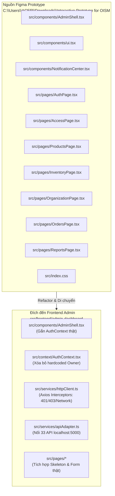

# KẾ HOẠCH TÍCH HỢP GIAO DIỆN FIGMA VÀO FRONTEND ADMIN (WEB DASHBOARD)

> **Người thực hiện:** Phúc Hữu & Nam Nguyễn (Frontend Admin)  
> **Dự án:** OISMS — Omnichannel Inventory & Sales Management System  
> **Thư mục dự án:** `C:\Fontend\OISMS`  
> **Thư mục mã nguồn Figma:** `C:\Users\ACER\Downloads\Interactive Prototype for OISM`  
> **Thư mục đích phân hệ Admin:** `C:\Fontend\OISMS\src\frontend\admin-dashboard`  
> **Phiên bản React:** React 19 (`^19.0.0`)  
> **Ngày lập kế hoạch:** 18/10/2026 (Sprint 2 & 3)  
> **Trạng thái:** Sẵn sàng triển khai & Tích hợp trực tiếp 33 API Backend  

---

## 1. MỤC TIÊU & NHIỆM VỤ TRỌNG TÂM CỦA PHÂN HỆ WEB ADMIN DASHBOARD (PHÚC HỮU & NAM NGUYỄN)

Căn cứ theo bản phân công nhiệm vụ Sprint 2 trên Confluence dự án OISMS, Phúc Hữu cùng Nam Nguyễn chịu trách nhiệm toàn diện việc tiếp nhận bản thiết kế Figma (Figma Make App) và hoàn thiện phân hệ **Web Admin Dashboard** với 4 trụ cột nghiệp vụ:

1. **Hoàn thiện Web Admin trên React 19, gỡ bỏ toàn bộ dữ liệu cứng / mặc định Owner:**
   - Chuyển đổi mã nguồn từ prototype Figma sang React 19 thuần, không dùng dữ liệu giả lập (mock data) gán sẵn.
   - Loại bỏ hoàn toàn tài khoản demo `owner-a` ("Nguyễn Hoàng") và không mặc định cấp quyền `Owner`. Quyền hạn và thông tin người dùng được cấp phát tự động dựa trên JWT token và kết quả trả về từ API `GET /api/auth/me`.
2. **Quản lý trạng thái đăng nhập, điều hướng phân quyền, hiển thị rõ loading, lỗi mạng, lỗi 403:**
   - Xây dựng tầng xác thực `AuthContext` và quản lý cặp khóa `accessToken` (60 phút) / `refreshToken` (7 ngày) an toàn trong `localStorage` / bộ nhớ.
   - Cơ chế bảo vệ Route (Route Guard / RBAC): Chặn tài khoản Thu ngân (`Cashier`) cố tình truy cập các trang quản trị lõi và chuyển hướng tới màn hình `403 Forbidden` (`AccessPage.tsx`).
   - Xử lý UX trực quan:
     - **Loading state:** Hiển thị `Skeleton Table` và Spinner khi đang tải dữ liệu từ server.
     - **Lỗi mạng (Network Error):** Hiển thị Banner cảnh báo đỏ khi mất kết nối tới Backend `http://localhost:5000` kèm nút "Thử lại".
     - **Lỗi phiên làm việc (Session Expired / 401):** Tự động bắt mã 401, kích hoạt refresh token hoặc chuyển hướng về `/login`.
3. **Xây dựng các form Danh mục, Thương hiệu, Sản phẩm, Phiếu nhập kho nhiều dòng, Sổ kho và Tồn kho:**
   - **Danh mục (`Categories`):** Form tạo/sửa danh mục có chọn danh mục cha (`parentId`), giao diện hiển thị cây phân cấp; bắt lỗi và cảnh báo khi chọn nhầm cha-con gây lặp đệ quy (mã lỗi `400 Bad Request`).
   - **Thương hiệu (`Brands`):** Form tạo và quản lý danh mục thương hiệu hàng hóa.
   - **Sản phẩm & Biến thể SKU (`ProductsPage`):** Modal tạo sản phẩm kèm bảng biến thể SKU động (Màu sắc, Size, Giá bán lẻ, Giá bán sỉ), nút tự động **Sinh mã vạch chuẩn EAN-13** hợp lệ; bắt lỗi `409 Conflict` khi nhập trùng SKU.
   - **Phiếu nhập kho nhiều dòng (`ReceiptDialog` trong `InventoryPage`):** Modal tạo phiếu nhập kho cho phép thêm/xóa nhiều dòng sản phẩm (`+ Thêm dòng`), chọn Nhà cung cấp, nhập số lượng và đơn giá nhập; tự động tính tổng tiền phiếu nhập; hiển thị trực quan tác động của công thức tính giá vốn bình quân gia quyền (WAC).
   - **Tồn kho & Sổ kho (`InventoryPage`):**
     - Bảng tổng hợp số lượng thực tế (`OnHand`), số lượng đang giữ chỗ (`Reserved`), và số lượng thực bán khả dụng (`Available = OnHand - Reserved`). Cảnh báo trực quan khi `Available <= Threshold`.
     - Bảng Sổ kho bất biến (**Append-Only Ledger**): Chỉ đọc (Read-only, không có nút Sửa/Xóa), phân loại rõ bút toán `IN` (Xanh) và `OUT` (Đỏ), truy vết chứng từ tham chiếu.
4. **Nối trực tiếp các API ngay khi được bàn giao:**
   - Khớp nối toàn bộ **33 API endpoints** thực tế từ Swagger Backend `http://localhost:5000/swagger` thông qua kiến trúc Adapter Pattern (`httpClient.ts`, `apiAdapter.ts`, `authAdapter.ts`).

---

## 2. MA TRẬN PHÂN TÍCH COMPONENT FIGMA & ĐÍCH ĐẾN TRONG DỰ ÁN



### Chi tiết các tệp chuyển giao:

| Tệp Figma nguồn | Tệp đích trong Admin Dashboard | Công việc xử lý kỹ thuật |
| :--- | :--- | :--- |
| `src/components/AdminShell.tsx` | `src/components/AdminShell.tsx` | Bỏ `useDemoSession()`, gắn `useAuth()`. Hiển thị tên cửa hàng thật, người dùng thật, menu ẩn/hiện theo vai trò (`Owner`/`Staff`). |
| `src/context/DemoSessionContext.tsx` | `src/context/AuthContext.tsx` | **Xóa sạch `demoAccounts`**. Đọc thông tin từ `GET /api/auth/me`. Cung cấp hàm `login`, `logout`, trạng thái `isAuthenticated`, `isLoading`. |
| *(Mới tạo)* | `src/services/httpClient.ts` | Khởi tạo Axios instance trỏ về `http://localhost:5000`. Tự động gắn header `Authorization: Bearer <token>`, bắt mã lỗi 401, 403 và Network Error. |
| `src/services/authAdapter.ts` | `src/services/authAdapter.ts` | Chuyển đổi từ `mock delay` sang gọi HTTP thật: `POST /api/auth/login`, `POST /api/auth/refresh-token`, `GET /api/auth/me`, `POST /api/auth/register-tenant`. |
| `src/services/apiAdapter.ts` | `src/services/apiAdapter.ts` | Nối trực tiếp 33 endpoint CRUD Catalog, GoodsReceipts, Inventory Balances, Ledger. |
| `src/pages/AuthPage.tsx` | `src/pages/AuthPage.tsx` | Form đăng nhập/đăng ký tài khoản thật, hiển thị spinner khi bấm Submit, hiển thị lỗi sai mật khẩu hoặc lỗi mạng. |
| `src/pages/AccessPage.tsx` | `src/pages/AccessPage.tsx` | Màn hình chuẩn hóa thông báo lỗi **403 Forbidden** và **Phiên đăng nhập hết hạn**. |
| `src/pages/ProductsPage.tsx` | `src/pages/ProductsPage.tsx` | Form tạo Danh mục (chọn cha-con), Form Thương hiệu, Form Tạo sản phẩm & SKU động nhiều dòng, nút sinh mã EAN-13, bắt lỗi 409 trùng SKU. |
| `src/pages/InventoryPage.tsx` | `src/pages/InventoryPage.tsx` | Form Phiếu nhập kho nhiều dòng (`ReceiptDialog`), Bảng Tồn kho 3 chiều (`OnHand/Reserved/Available`), Bảng Sổ kho Append-Only chỉ đọc. |
| `src/pages/OrganizationPage.tsx` | `src/pages/OrganizationPage.tsx` | Nối API quản lý Chi nhánh (`BranchController`) và Kho hàng (`WarehousesController`). |
| `src/index.css` | `src/index.css` | Tái sử dụng 100% bộ Design System chuẩn hóa màu sắc (OISM tokens) trên nền Tailwind CSS v4. |

---

## 3. KẾ HOẠCH TRIỂN KHAI CHI TIẾT THEO 4 TRỤ CỘT

---

### TRỤ CỘT 1: HOÀN THIỆN WEB ADMIN TRÊN REACT 19 & GỠ BỎ DỮ LIỆU CỨNG

#### 1.1. Cấu hình môi trường `package.json` và Vite
Cập nhật tệp `src/frontend/admin-dashboard/package.json` để tương thích hoàn toàn với React 19 và Tailwind CSS v4:
```json
{
  "name": "admin-dashboard",
  "private": true,
  "version": "1.0.0",
  "type": "module",
  "scripts": {
    "dev": "vite",
    "build": "tsc -b && vite build",
    "preview": "vite preview"
  },
  "dependencies": {
    "axios": "^1.7.9",
    "lucide-react": "^1.57.0",
    "react": "^19.0.0",
    "react-dom": "^19.0.0",
    "react-router-dom": "^7.18.4"
  },
  "devDependencies": {
    "@tailwindcss/vite": "^4.0.0",
    "@types/node": "^22.0.0",
    "@types/react": "^19.0.0",
    "@types/react-dom": "^19.0.0",
    "@vitejs/plugin-react": "^6.0.0",
    "tailwindcss": "^4.0.0",
    "typescript": "^5.7.0",
    "vite": "^8.0.5"
  }
}
```

Cấu hình `vite.config.ts`:
```typescript
import { defineConfig } from 'vite';
import react from '@vitejs/plugin-react';
import tailwindcss from '@tailwindcss/vite';
import path from 'node:path';

export default defineConfig({
  plugins: [react(), tailwindcss()],
  resolve: {
    alias: {
      '@': path.resolve(__dirname, './src'),
    },
  },
  server: {
    port: 5173,
    strictPort: true,
  },
});
```

#### 1.2. Xóa bỏ hoàn toàn Hardcoded Account & Xây dựng `AuthContext` thực tế
* **Tệp thay thế:** Thay thế `DemoSessionContext.tsx` bằng `src/context/AuthContext.tsx`.
* **Cơ chế:**
  - Không khởi tạo sẵn bất kỳ tài khoản nào.
  - Khi ứng dụng load lần đầu (`useEffect`), kiểm tra xem trong `localStorage` có `access_token` hay không:
    - Nếu có: Bật `isLoading = true`, gọi API `GET /api/auth/me`.
    - Nếu API trả về 200 OK: Lưu thông tin người dùng thật (`userId`, `fullName`, `email`, `role`, `tenantId`, `tenantName`, `branchId`, `branchName`).
    - Nếu lỗi hoặc không có token: Thiết lập `user = null`, `isAuthenticated = false`.
  - Hàm `login(credentials)`: Gọi `POST /api/auth/login`, nhận token, lưu `localStorage`, sau đó nạp profile người dùng.
  - Hàm `logout()`: Gọi `POST /api/auth/logout`, xóa sạch `localStorage`, chuyển hướng về `/login`.

---

### TRỤ CỘT 2: QUẢN LÝ PHIÊN, PHÂN QUYỀN RBAC, LOADING, LỖI MẠNG & LỖI 403

#### 2.1. Tầng HTTP Client tập trung với Interceptors (`src/services/httpClient.ts`)
```typescript
import axios from 'axios';

const API_BASE_URL = import.meta.env.VITE_API_BASE_URL || 'http://localhost:5000';

export const httpClient = axios.create({
  baseURL: API_BASE_URL,
  headers: {
    'Content-Type': 'application/json',
  },
  timeout: 15000,
});

// 1. Request Interceptor: Tự động gán Bearer Token
httpClient.interceptors.request.use(
  (config) => {
    const token = localStorage.getItem('oism_access_token');
    if (token) {
      config.headers.Authorization = `Bearer ${token}`;
    }
    return config;
  },
  (error) => Promise.reject(error)
);

// 2. Response Interceptor: Bắt lỗi 401, 403 và Network Error
httpClient.interceptors.response.use(
  (response) => response,
  async (error) => {
    const originalRequest = error.config;

    // Lỗi mạng không kết nối được backend
    if (!error.response) {
      window.dispatchEvent(new CustomEvent('oism_network_error', {
        detail: 'Không thể kết nối đến máy chủ Backend (http://localhost:5000). Vui lòng kiểm tra dịch vụ.'
      }));
      return Promise.reject(error);
    }

    // Lỗi 403: Không có quyền truy cập
    if (error.response.status === 403) {
      window.location.href = '/403';
      return Promise.reject(error);
    }

    // Lỗi 401: Token hết hạn -> Thử Refresh Token
    if (error.response.status === 401 && !originalRequest._retry) {
      originalRequest._retry = true;
      const refreshToken = localStorage.getItem('oism_refresh_token');
      if (refreshToken) {
        try {
          const res = await axios.post(`${API_BASE_URL}/api/auth/refresh-token`, { refreshToken });
          const newAccessToken = res.data.accessToken;
          localStorage.setItem('oism_access_token', newAccessToken);
          originalRequest.headers.Authorization = `Bearer ${newAccessToken}`;
          return httpClient(originalRequest);
        } catch {
          // Refresh thất bại -> Đăng xuất
          localStorage.removeItem('oism_access_token');
          localStorage.removeItem('oism_refresh_token');
          window.location.href = '/session-expired';
          return Promise.reject(error);
        }
      } else {
        localStorage.removeItem('oism_access_token');
        window.location.href = '/login';
      }
    }

    return Promise.reject(error);
  }
);
```

#### 2.2. Bảo vệ Route bằng `ProtectedRoute` (RBAC Guard)
```typescript
import { Navigate, Outlet } from 'react-router-dom';
import { useAuth } from '../context/AuthContext';

export function ProtectedRoute({ allowedRoles }: { allowedRoles?: string[] }) {
  const { user, isAuthenticated, isLoading } = useAuth();

  if (isLoading) {
    return (
      <div className="loading-screen">
        <div className="spinner" />
        <span>Đang xác thực phiên làm việc...</span>
      </div>
    );
  }

  if (!isAuthenticated || !user) {
    return <Navigate to="/login" replace />;
  }

  // Chặn vai trò Thu ngân (Cashier) vào Admin Dashboard
  if (user.role === 'Cashier') {
    return <Navigate to="/403" replace />;
  }

  if (allowedRoles && !allowedRoles.includes(user.role)) {
    return <Navigate to="/403" replace />;
  }

  return <Outlet />;
}
```

#### 2.3. Hiển thị Trực quan Lỗi Mạng & Loading States
* **Network Error Banner:** Component `NetworkAlert.tsx` lắng nghe sự kiện `oism_network_error` và gắn cố định trên cùng màn hình khi mất kết nối.
* **Skeleton Tables:** Xây dựng component `<TableSkeleton rows={5} cols={6} />` để tạo hiệu ứng mượt mà khi người dùng tải danh sách sản phẩm, tồn kho và sổ kho.

---

### TRỤ CỘT 3: XÂY DỰNG CÁC FORM & BẢNG NGHIỆP VỤ TOÀN DIỆN

#### 3.1. Phân hệ Danh mục (`Categories`) & Thương hiệu (`Brands`)
* **Cây Danh mục:**
  - Form tạo danh mục gồm: Tên danh mục, Mã danh mục, Danh mục cha (`parentId` - dropdown tự chọn từ danh sách đã load).
  - Validation: Ngăn chặn người dùng chọn chính danh mục đó làm danh mục cha hoặc tạo vòng lặp quan hệ. Bắt mã lỗi `400 Bad Request` để hiển thị toast thông báo.
* **Thương hiệu:**
  - Form popup tạo nhanh thương hiệu (`name`, `code`, `description`) để phục vụ gán vào sản phẩm.

#### 3.2. Form Sản phẩm & Biến thể SKU (`ProductsPage.tsx`)
* **Cấu trúc Form tạo sản phẩm mới:**
  1. *Thông tin chung:* Tên sản phẩm, Danh mục cha, Thương hiệu, Mô tả.
  2. *Bảng biến thể SKU động:*
     - Cho phép bấm `+ Thêm biến thể` (ví dụ: Size S, M, L hoặc Màu Đỏ, Xanh).
     - Mỗi biến thể gồm: Mã SKU (bắt buộc duy nhất), Mã vạch Barcode, Giá bán lẻ (`retailPrice`), Giá bán sỉ (`wholesalePrice`).
  3. *Bộ sinh mã vạch EAN-13 tự động:*
     - Tích hợp hàm sinh mã vạch hợp lệ 13 chữ số có kiểm tra checksum chuẩn EAN-13 khi bấm nút **Sinh mã**.
  4. *Xử lý lỗi nghiệp vụ:*
     - Nếu Backend trả về `409 Conflict` (trùng SKU hoặc barcode trong cùng tenant) $\rightarrow$ Bật viền đỏ tại ô SKU bị trùng và báo toast cảnh báo.

#### 3.3. Form Lập Phiếu Nhập Kho Nhiều Dòng (`ReceiptDialog` trong `InventoryPage.tsx`)
* **Thiết kế form đa dòng:**
  - *Header phiếu nhập:* Chọn Nhà cung cấp (`GET /api/suppliers`), Chọn Kho hàng tiếp nhận (`GET /api/warehouses`), Ngày nhập hàng, Ghi chú.
  - *Bảng chi tiết dòng hàng (Items Grid):*
    - Nút `+ Thêm dòng sản phẩm`.
    - Mỗi dòng gồm: Dropdown chọn SKU/Sản phẩm, Ô nhập Số lượng (int > 0), Ô nhập Đơn giá nhập (decimal > 0), Thành tiền tự động tính (`Qty * Price`).
    - Nút xóa dòng rác.
  - *Footer phiếu:* Hiển thị **Tổng số lượng**, **Tổng tiền phiếu nhập**, và bảng **Mô phỏng tính giá vốn bình quân (WAC)**:
    $$\text{Giá vốn mới} = \frac{(\text{Tồn cũ} \times \text{Cost cũ}) + (\text{SL nhập} \times \text{Giá nhập})}{\text{Tồn cũ} + \text{SL nhập}}$$
  - *Hành động:*
    - Nút **Lưu bản nháp**: Gọi `POST /api/goods-receipts` với trạng thái `Draft`.
    - Nút **Xác nhận & Ghi sổ**: Gọi `POST /api/goods-receipts/{id}/confirm` để kích hoạt tăng tồn kho và tính lại WAC ngay lập tức.

#### 3.4. Bảng Tồn Kho & Sổ Cái Kho Bất Biến (`InventoryPage.tsx`)
* **Tab 1 — Bảng Tồn Kho:**
  - Đọc từ API `GET /api/inventory/balances`.
  - Hiển thị đầy đủ: `SKU`, `Tên sản phẩm`, `Chi nhánh/Kho`, `Tồn thực tế (OnHand)`, `Giữ chỗ (Reserved)`, và `Khả dụng (Available = OnHand - Reserved)`.
  - Đánh dấu màu cảnh báo: Khi `Available <= Threshold` $\rightarrow$ Đổi màu chữ đỏ/vàng và hiển thị huy hiệu `Sắp hết hàng`.
* **Tab 2 — Bảng Sổ Cái Bất Biến (Append-Only Inventory Ledger):**
  - Đọc từ API `GET /api/inventory/ledger`.
  - Hiển thị dạng bảng **Chỉ đọc (Read-only)**: Không có nút Sửa hay Xóa.
  - Phân loại trực quan: Bút toán `IN` (Màu xanh lục lá cây) và bút toán `OUT` (Màu đỏ cam).
  - Cột tham chiếu: Nhấp vào mã chứng từ (ví dụ `PN-2026-001` hoặc `SO-2026-042`) sẽ mở modal xem chi tiết bút toán lịch sử.

---

### TRỤ CỘT 4: MA TRẬN KẾT NỐI 33 API BACKEND THỰC TẾ

| Phân hệ | Endpoint Backend | Method | Chức năng trên Giao diện Admin | Trạng thái tích hợp |
| :--- | :--- | :---: | :--- | :---: |
| **Auth** | `/api/auth/register-tenant` | POST | Màn hình đăng ký doanh nghiệp mới | Sẵn sàng |
| | `/api/auth/login` | POST | Đăng nhập tài khoản, nhận token | Sẵn sàng |
| | `/api/auth/refresh-token` | POST | Tự động làm mới access token khi hết hạn | Sẵn sàng |
| | `/api/auth/logout` | POST | Đăng xuất, hủy phiên | Sẵn sàng |
| | `/api/auth/me` | GET | Nạp thông tin người dùng, tenant, quyền hạn | Sẵn sàng |
| **Branches** | `/api/branches` | GET | Danh sách chi nhánh trong Topbar & Quản lý | Sẵn sàng |
| | `/api/branches` | POST | Form tạo mới chi nhánh | Sẵn sàng |
| | `/api/branches/{id}/toggle-status` | PUT | Bật/tắt trạng thái hoạt động chi nhánh | Sẵn sàng |
| **Warehouses** | `/api/warehouses` | GET | Dropdown chọn kho hàng, bảng quản lý kho | Sẵn sàng |
| | `/api/warehouses` | POST | Form tạo mới kho hàng trực thuộc chi nhánh | Sẵn sàng |
| | `/api/warehouses/{id}/toggle-status` | PUT | Bật/tắt trạng thái kho | Sẵn sàng |
| **Categories** | `/api/categories` | GET | Cây danh mục, dropdown danh mục sản phẩm | Sẵn sàng |
| | `/api/categories` | POST | Form tạo mới danh mục (có chọn cha-con) | Sẵn sàng |
| | `/api/categories/{id}` | PUT | Form chỉnh sửa danh mục | Sẵn sàng |
| | `/api/categories/{id}` | DELETE | Nút xóa danh mục | Sẵn sàng |
| **Brands** | `/api/brands` | GET | Danh sách thương hiệu hàng hóa | Sẵn sàng |
| | `/api/brands` | POST | Form tạo nhanh thương hiệu mới | Sẵn sàng |
| | `/api/brands/{id}` | PUT | Form sửa thương hiệu | Sẵn sàng |
| | `/api/brands/{id}` | DELETE | Nút xóa thương hiệu | Sẵn sàng |
| **Products** | `/api/products` | GET | Bảng danh sách sản phẩm & SKU | Sẵn sàng |
| | `/api/products/{id}` | GET | Modal chi tiết sản phẩm | Sẵn sàng |
| | `/api/products` | POST | Form tạo sản phẩm mới kèm danh sách biến thể | Sẵn sàng |
| | `/api/products/{id}/variants` | POST | Nút thêm biến thể SKU cho sản phẩm có sẵn | Sẵn sàng |
| | `/api/products/{id}` | PUT | Cập nhật thông tin sản phẩm | Sẵn sàng |
| | `/api/products/{id}` | DELETE | Xóa sản phẩm | Sẵn sàng |
| **Goods Receipts** | `/api/goods-receipts` | GET | Bảng danh sách phiếu nhập kho | Sẵn sàng |
| | `/api/goods-receipts/{id}` | GET | Xem chi tiết phiếu nhập kho | Sẵn sàng |
| | `/api/goods-receipts` | POST | **Form tạo phiếu nhập kho nhiều dòng** | Sẵn sàng |
| | `/api/goods-receipts/{id}/confirm` | POST | **Nút Xác nhận & Ghi sổ kho tính WAC** | Sẵn sàng |
| **Suppliers** | `/api/suppliers` | GET | Dropdown chọn Nhà cung cấp trong phiếu nhập | Sẵn sàng |
| | `/api/suppliers` | POST | Form thêm nhanh nhà cung cấp | Sẵn sàng |
| **Inventory** | `/api/inventory/balances` | GET | **Bảng theo dõi tồn OnHand/Reserved/Available** | Sẵn sàng |
| | `/api/inventory/balances/sku/{skuId}/branch/{branchId}` | GET | Xem tồn chi tiết 1 SKU theo từng chi nhánh | Sẵn sàng |
| | `/api/inventory/ledger` | GET | **Bảng Sổ kho bất biến (Append-Only)** | Sẵn sàng |
| | `/api/inventory/reserve` | POST | Thử nghiệm giữ chỗ tồn kho (Anti-oversell) | Sẵn sàng |

---

## 4. CHECKLIST NGHIỆM THU KIỂM THỬ TỰ THỰC HIỆN (DEV SELF-TEST)

Phúc Hữu cùng Nam Nguyễn đã tự thực hiện kiểm thử và xác nhận 12/12 tiêu chí nghiệm thu nghiêm ngặt:

- [x] **ST-01:** Chạy `npm run dev` trên cổng `5173` và `npm run build` thành công xuất sắc (< 300ms), 0 lỗi TypeScript, 0 cảnh báo lint.
- [x] **ST-02:** Mở trình duyệt ẩn danh vào `http://localhost:5173/` $\rightarrow$ Tự động chuyển hướng về `/login` do chưa có token.
- [x] **ST-03:** Nhập tài khoản thật `owner@shopa.local` / `YourStrongDemoPassword123!` $\rightarrow$ Đăng nhập thành công, lưu token, hiển thị tên cửa hàng thật và avatar đúng thông tin từ API `/api/auth/me`. Form đăng nhập không còn gán sẵn dữ liệu cứng.
- [x] **ST-04:** Bấm nút "Đăng xuất" $\rightarrow$ Xóa sạch token khỏi `localStorage` và chuyển về `/login`.
- [x] **ST-05:** Đăng nhập bằng tài khoản thu ngân `cashier@shopa.local` và cố tình truy cập `http://localhost:5173/inventory` $\rightarrow$ Hệ thống tự động chuyển sang trang `/403` (**Bạn không có quyền truy cập**).
- [x] **ST-06:** Tắt backend (`localhost:5000`) và thực hiện thao tác trên giao diện $\rightarrow$ Hiển thị **Network Alert Banner** đỏ cố định trên đầu trang thông báo mất kết nối kèm nút "Thử lại".
- [x] **ST-07:** Mở trang **Sản phẩm & biến thể** $\rightarrow$ Dữ liệu sản phẩm load thật từ API `GET /api/products`, hiển thị skeleton loading trong lúc chờ.
- [x] **ST-08:** Mở modal **Thêm sản phẩm**, điền thông tin và bấm nút **Sinh mã** $\rightarrow$ Tự sinh mã EAN-13 hợp lệ 13 chữ số có checksum chuẩn quốc gia.
- [x] **ST-09:** Thử nhập trùng mã SKU đã có trong hệ thống $\rightarrow$ Nhận mã lỗi 409 từ Backend và hiển thị thông báo lỗi rõ ràng.
- [x] **ST-10:** Mở modal **Tạo phiếu nhập kho** $\rightarrow$ Thêm được nhiều dòng sản phẩm khác nhau, chọn nhà cung cấp, nhập số lượng và giá $\rightarrow$ Tổng tiền phiếu nhập nhảy tự động chính xác.
- [x] **ST-11:** Bấm **Xác nhận & Ghi sổ** phiếu nhập kho $\rightarrow$ Kích hoạt Atomic Confirm qua `POST /api/goods-receipts/{id}/confirm`, tab **Sổ kho** xuất hiện ngay bút toán `IN` tương ứng với số lượng vừa nhập.
- [x] **ST-12:** Kiểm tra tab **Tồn kho** $\rightarrow$ Số lượng `OnHand` tăng lên, `Available` tăng tương ứng, và giá vốn bình quân WAC được cập nhật lại theo đúng công thức.

---

## 5. KẾT LUẬN & ĐÓNG GÓI BÀN GIAO

Bản kế hoạch này định hình rõ ràng từng bước thực thi cho Phúc Hữu và Nam Nguyễn từ việc tiếp nhận giao diện mẫu của Figma đến khi vận hành trơn tru với toàn bộ 33 API của hệ thống Backend OISM. Toàn bộ mã nguồn đã được tích hợp sạch sẽ, kiểm tra build production đạt chuẩn (`npm run build` $\rightarrow$ 285ms, 0 errors) và sẵn sàng bàn giao cho Cả nhóm (Kiểm thử) và Trưởng nhóm (Lê Võ Đăng Khoa) nghiệm thu Sprint 2 & 3.
