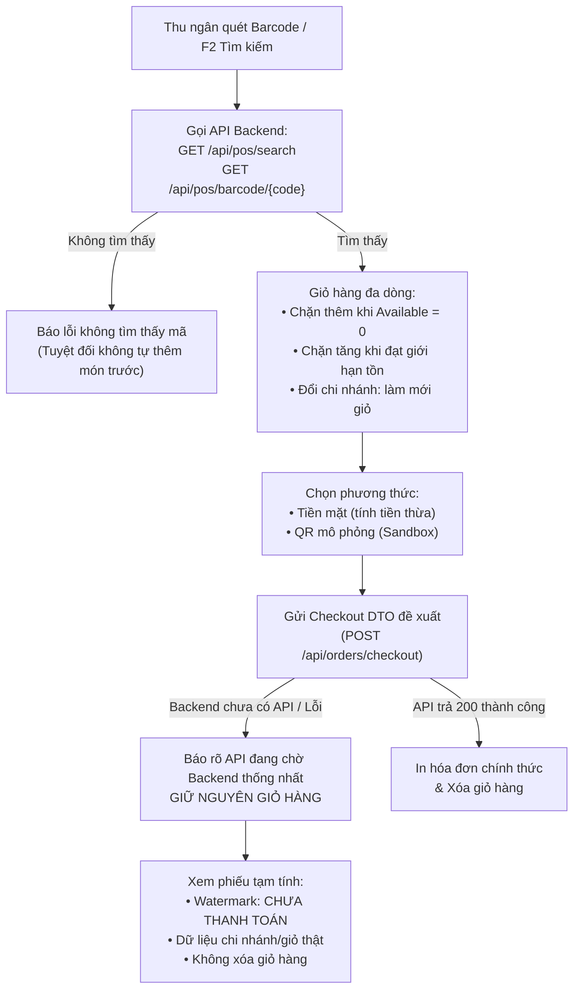

# BÁO CÁO BÀN GIAO NHIỆM VỤ FRONTEND POS (PWA) - SPRINT 2
**Người thực hiện:** Phương (Thành viên 4 - Frontend POS Lead)  
**Phạm vi:** `src/frontend/pos-app`  
**Cổng phục vụ:** `http://localhost:5174`  
**Ngày cập nhật:** 19/10/2026 (Đã cập nhật toàn diện theo feedback Nhóm trưởng)  
**Dự án:** OISMS - Omnichannel Inventory & Sales Management System  

---

## I. TỔNG QUAN KẾT QUẢ THEO TIÊU CHÍ DoD & FEEDBACK NHÓM TRƯỞNG

### 1. Phản hồi từ Nhóm trưởng (Review Feedback)
> *"Đề nghị sửa trước khi merge. POS đã nằm đúng trong pos-app; các endpoint đăng nhập, chi nhánh, tìm SKU và barcode khớp backend. Tuy nhiên, các lỗi dưới đây chưa đáp ứng yêu cầu Sprint 2 về dữ liệu thật và xử lý checkout chưa sẵn sàng."*

### 2. Tinh thần giải quyết & Nghiệm thu Sprint 2
Toàn bộ các nội dung phản hồi của Nhóm trưởng đã được rà soát, khắc phục triệt để và kiểm chứng bằng test tự động trước khi merge vào nhánh `develop`:
- **Đã xác nhận:** Cấu trúc thư mục `pos-app` độc lập, các endpoint Backend (`POST /api/auth/login`, `GET /api/branches`, `GET /api/pos/search`, `GET /api/pos/barcode/{code}`) kết nối chuẩn xác.
- **Đã khắc phục 100%:** Bỏ dữ liệu mẫu/fallback, không fake success khi checkout chưa sẵn sàng, bản in tạm tính phân tách rõ ràng và bảo toàn giỏ hàng, kiểm soát tồn khả dụng nghiêm ngặt theo đúng yêu cầu Sprint 2.



---

## II. CHI TIẾT CẢI TIẾN THEO CÁC NHÓM FEEDBACK

### 1. Đăng nhập và dữ liệu thật (Authentication & Real API)
- **Bỏ hoàn toàn đăng nhập demo tự động:** Khi mất mạng, server 500, tài khoản bị khóa hoặc cửa hàng tạm ngưng, hệ thống báo đúng lỗi từ API hoặc thông báo lỗi mạng cụ thể; không tự tạo phiên demo user.
- **Xử lý toàn diện mã lỗi HTTP:**
  - `400/401`: Báo lỗi sai email hoặc mật khẩu; không bao giờ trả về `undefined` gây crash đọc `data.user`.
  - `403`: Thông báo rõ tài khoản bị khóa hoặc cửa hàng đang tạm ngưng hoạt động.
  - `500`: Báo lỗi sự cố máy chủ nội bộ.
  - Lỗi mạng (offline): Báo lỗi không thể kết nối đến máy chủ Backend.
- **Bỏ fallback sản phẩm và chi nhánh mẫu:** Bỏ hoàn toàn `DEMO_CATALOG` và `FALLBACK_BRANCHES` khỏi code client; nếu API lỗi hoặc trả rỗng thì hiển thị empty state trung thực.
- **Xử lý phiên hết hạn (401 Unauthorized):**
  - Khi token hết hạn, client tự động xóa token và bắn sự kiện `pos-auth-expired`.
  - Giao diện mở hộp thoại đăng nhập lại, đồng thời dọn sạch phiên làm việc để bảo mật dữ liệu.
- **Dọn sạch phiên khi đăng xuất / đổi tài khoản:** Tự động xóa giỏ hàng, kết quả tìm kiếm, trạng thái thanh toán và bản in hóa đơn của phiên trước.

### 2. Tra cứu SKU và Giỏ hàng (Catalog & Cart Validation)
- **Đổi chi nhánh an toàn:** Khi thu ngân chuyển chi nhánh làm việc, hệ thống đưa ra cảnh báo xác nhận và làm mới lại giỏ hàng vì tồn kho giữa các chi nhánh là độc lập.
- **Xử lý quét mã vạch (Barcode Scanner):**
  - Khi barcode không tìm thấy trong cơ sở dữ liệu, ứng dụng báo lỗi rõ ràng: `Không tìm thấy sản phẩm nào khớp với mã "...".`
  - **Đã loại bỏ hoàn toàn hành vi sai sót:** Không tự động thêm kết quả đầu tiên `results[0]` từ lần tìm kiếm văn bản trước đó.
- **Kiểm soát chặt chẽ tồn khả dụng (`Available`):**
  - Khi sản phẩm có `Available <= 0`: Giao diện hiển thị nhãn đỏ `Hết tồn kho (0)`, vô hiệu hóa nút thêm và từ chối thêm vào giỏ.
  - Khi tăng số lượng trong giỏ: Tự động khóa nút `+` khi số lượng đạt ngưỡng `Available`. Nếu thu ngân gõ số lượng vượt tồn vào ô input, hệ thống tự động giới hạn về mức tồn tối đa cho phép.
- **Thao tác giỏ hàng đa dòng:** Hỗ trợ thêm, bớt, chỉnh sửa số lượng, xóa từng dòng mặt hàng và làm mới toàn bộ giỏ bằng dữ liệu trả về từ API Backend.

### 3. Trạng thái Checkout & Bản in hóa đơn (Checkout & Receipt Preview)
- **Không giả mạo thành công:** Khi backend trả về 404/501 (chưa có endpoint) hoặc xảy ra lỗi kết nối, ứng dụng hiển thị thông báo rõ ràng:
  > *"API thanh toán (POST /api/orders/checkout) chưa được triển khai trên Backend Swagger. DTO checkout đề xuất đã được chuẩn bị đầy đủ và đang chờ thống nhất hợp đồng API giữa 2 bên."*
- **Tách biệt luồng xem mẫu khỏi thanh toán thành công:**
  - Tách callback `onPreviewReceipt` khỏi `onSuccessAndPrint`.
  - Khi thu ngân bấm "Xem phiếu tạm tính / hóa đơn mẫu", **giỏ hàng vẫn được bảo toàn nguyên vẹn**, không bị xóa.
  - Chỉ khi có phản hồi thanh toán thành công từ API (`success: true`), giỏ hàng mới được dọn sạch.
- **Bản in xem trước minh bạch:**
  - Tiêu đề ghi rõ: **"PHIẾU TẠM TÍNH (CHƯA THANH TOÁN)"**.
  - Có banner watermark nổi bật: `*** CHƯA THANH TOÁN *** (Không có giá trị thay thế hóa đơn bán hàng)`.
  - Sử dụng thông tin cửa hàng, tên chi nhánh, địa chỉ và hotline thật từ session làm việc, không dùng thông tin giả.
- **Phương thức Chuyển khoản QR minh bạch:**
  - Ghi rõ banner cảnh báo màu vàng: **"Mã QR mô phỏng (Tính năng đang phát triển)"**.
  - Không hiển thị số tài khoản ngân hàng cá nhân hay hướng dẫn chuyển tiền thật khi webhook đối soát của Backend chưa được hoàn thiện.

---

## III. KẾT QUẢ KIỂM THỬ TỰ ĐỘNG (AUTOMATED TEST SUITE)

Bộ kiểm thử tự động gồm **13 ca kiểm thử (13/13 Passed 100%)** trong `src/frontend/pos-app/test-pos-e2e.mjs`:

```text
TAP version 13
# Subtest: 1. File Structure & TypeScript Artifacts Integrity
ok 1 - 1. File Structure & TypeScript Artifacts Integrity
# Subtest: 2. api.ts Real Endpoints & Strict No-Demo Contract
ok 2 - 2. api.ts Real Endpoints & Strict No-Demo Contract
# Subtest: 3. Search & Barcode Matching Simulation with Real API Logic
ok 3 - 3. Search & Barcode Matching Simulation with Real API Logic
# Subtest: 4. Cart Operations & Stock Constraint Validation
ok 4 - 4. Cart Operations & Stock Constraint Validation
# Subtest: 5. Cash Payment & Quick Cash Auto Change Calculations
ok 5 - 5. Cash Payment & Quick Cash Auto Change Calculations
# Subtest: 6. 80mm Thermal Receipt Layout & Draft Watermark Contract
ok 6 - 6. 80mm Thermal Receipt Layout & Draft Watermark Contract
# Subtest: 7. Checkout Contract & Draft Preview Decoupling
ok 7 - 7. Checkout Contract & Draft Preview Decoupling
# Subtest: 8. Negative Case: Barcode Miss does NOT add results[0]
ok 8 - 8. Negative Case: Barcode Miss does NOT add results[0]
# Subtest: 9. Negative Case: Branch Change & Logout Clears Cart
ok 9 - 9. Negative Case: Branch Change & Logout Clears Cart
# Subtest: 10. Negative Case: Available stock boundary enforcement
ok 10 - 10. Negative Case: Available stock boundary enforcement
# Subtest: 11. PWA Baseline Configuration
ok 11 - 11. PWA Baseline Configuration
# Subtest: 12. Direct Runtime API Logic & Status Code Handling
ok 12 - 12. Direct Runtime API Logic & Status Code Handling
# Subtest: 13. Workflow: Failed Checkout & Preview Receipt preserves Cart
ok 13 - 13. Workflow: Failed Checkout & Preview Receipt preserves Cart
1..13
# tests 13
# pass 13
# fail 0
```

---

## IV. HƯỚNG DẪN KHỞI CHẠY & KIỂM TRA

### 1. Chạy ứng dụng POS
```powershell
./scripts/run-pos.ps1
```
Hoặc:
```bash
cd src/frontend/pos-app
npm run dev -- --port 5174
```
Truy cập trình duyệt: **`http://localhost:5174`**

### 2. Kiểm tra Build & Lint
```bash
cd src/frontend/pos-app
npm test        # Chạy 13 bài test tự động (13/13 passed)
npm run build   # TypeScript & Vite compile sạch sẽ, 0 lỗi
npm run lint    # Oxlint kiểm tra cú pháp, 0 lỗi
```

### 3. Phím tắt POS
* **`F2`**: Đưa con trỏ nhanh vào ô Tìm kiếm / Quét mã vạch.
* **`F4`**: Mở hộp thoại Thanh toán đơn hàng.
* **`Esc`**: Đóng popup hoặc hủy thao tác.
