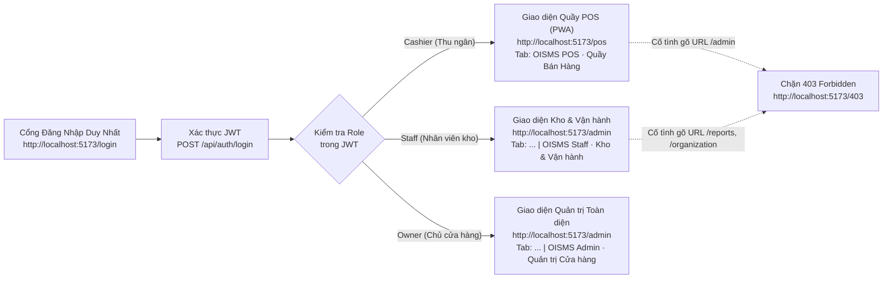

# BÁO CÁO HỢP NHẤT CỔNG ĐĂNG NHẬP & NGHIỆM THU GIAO DIỆN POS (SPRINT 2)

**Dự án:** OISMS - Omnichannel Inventory & Sales Management System  
**Nhánh làm việc:** `feature/OISMS24FortendPOS` (Pull Request #11)  
**Mã Task Jira:** `OISMS-24` & `OISMS-29`  
**Ngày nghiệm thu:** 20/10/2026  

---

## I. KIẾN TRÚC GỘP CỔNG ĐĂNG NHẬP TẬP TRUNG & PHÂN LUỒNG THEO VAI TRÒ (UNIFIED LOGIN & SMART RBAC)

Hệ thống đã được chuẩn hóa về **Mô hình 1 (Unified Portal)**: Sử dụng **duy nhất 1 nơi đăng nhập tập trung** tại `http://localhost:5173/login`, sau đó tự động chia luồng giao diện và hiển thị tiêu đề thẻ trình duyệt (`document.title`) theo đúng vai trò người dùng trong JWT Token.

### Bảng phân quyền truy cập & Tiêu đề thẻ trình duyệt (Browser Tab Title)

| Vai trò (Role) | Tài khoản Demo | Đường dẫn sau đăng nhập | Quyền hạn giao diện | Tiêu đề trên thẻ trình duyệt (`document.title`) |
|---|---|---|---|---|
| **Cashier** *(Thu ngân)* | `cashier@shopa.local` | `/pos` | Chỉ thao tác tại Quầy bán hàng POS (`/pos`). Bị chặn **403 Forbidden** nếu truy cập `/admin`. | `OISMS POS · Quầy Bán Hàng - <Tên Cửa Hàng>` |
| **Staff** *(Nhân viên kho)* | `staff@shopa.local` | `/admin` | Truy cập Tổng quan, Sản phẩm, Kho & Sổ kho, Đơn đa kênh và Quầy POS (`/pos`). Bị chặn **403** tại Báo cáo & Tổ chức. | `<Tên trang> \| OISMS Staff · Kho & Vận hành` |
| **Owner** *(Chủ cửa hàng)* | `owner@shopa.local` | `/admin` | Toàn quyền Quản trị hệ thống, Báo cáo doanh thu/lợi nhuận, Quản lý Chi nhánh/Nhân viên và Quầy POS (`/pos`). | `<Tên trang> \| OISMS Admin · Quản trị Cửa hàng` |

---

## II. CÁC LỖI QUAN TRỌNG ĐÃ PHÁT HIỆN & KHẮC PHỤC TRIỆT ĐỂ

Qua quá trình rà soát nghiệm thu tích hợp giao diện POS chuẩn PR #11 vào cổng chung `5173`, có **03 lỗi quan trọng** đã được phát hiện và xử lý triệt để:

1. **Lỗi 1 — Thẻ trình duyệt (Browser Tab) luôn hiển thị cố định chữ `admin-dashboard`:**
   - **Nguyên nhân:** File `index.html` đặt cứng `<title>admin-dashboard</title>` và các trang con không cập nhật `document.title` khi chuyển route hoặc đổi vai trò.
   - **Khắc phục:** Chuẩn hóa `<title>` mặc định trong `index.html` và bổ sung hook tự động cập nhật `document.title` theo thời gian thực tại `PosPage.tsx`, `AdminShell.tsx` (phân biệt rõ `OISMS Staff` và `OISMS Admin`), `AuthPage.tsx` và `AccessPage.tsx`.

2. **Lỗi 2 — Xung đột CSS Cascade giữa Admin Dashboard và Tailwind CSS v4 trên màn hình POS:**
   - **Nguyên nhân:** Trong `index.css`, các bộ chọn thẻ HTML gốc (`button { color: inherit; }`, `button, input, select { font: inherit; }`, `table`, `th`, `td`) không được đặt trong `@layer`, dẫn đến việc ghi đè các class tiện ích của Tailwind CSS (`text-white`, `bg-indigo-600`, `font-bold`, `text-right`) trên giao diện POS (làm nút bấm nền xanh bị chữ đen như ảnh chụp màn hình).
   - **Khắc phục:** Đóng gói toàn bộ CSS nền tảng vào `@layer base` và `@layer components`, đồng thời giới hạn phạm vi `table/th/td` của Admin vào `.table-wrap`. Nhờ đó, giao diện POS hiển thị chuẩn xác 100% thiết kế Tailwind CSS của PR #11.

3. **Lỗi 3 — Hành vi quét mã vạch (Barcode Miss) trong `ProductSearch.tsx`:**
   - **Nguyên nhân:** Bản ghép ban đầu có nhánh fallback tự động lấy `results[0]` khi quét mã vạch không khớp, tiềm ẩn nguy cơ thêm nhầm hàng vào giỏ của thu ngân.
   - **Khắc phục:** Đồng bộ 100% logic `ProductSearch.tsx` từ PR #11: Khi quét mã vạch không tồn tại trên hệ thống, hiển thị thông báo lỗi rõ ràng và tuyệt đối không tự ý thêm sản phẩm từ kết quả tìm kiếm cũ.

---

## III. KẾT QUẢ NGHIỆM THU CÁC CHỨC NĂNG QUẦY POS TRONG PHẠM VI SPRINT 2

Toàn bộ chức năng của Quầy POS trong phạm vi Sprint 2 (Task `OISMS-24`) đã được kiểm tra đối chiếu với tiêu chí hoàn thành (Definition of Done):

| STT | Hạng mục chức năng Sprint 2 | Chi tiết kiểm tra nghiệm thu | Trạng thái |
|---|---|---|---|
| **1** | **Chọn Chi nhánh & Đồng bộ trạng thái mạng** | - Lấy danh sách chi nhánh thật từ `GET /api/branches`. - Đổi chi nhánh tự động cảnh báo và làm mới giỏ hàng để tránh lệch tồn kho. - Hiển thị trạng thái `Online / Offline` thời gian thực. | **ĐẠT (PASS)** |
| **2** | **Tìm kiếm SKU & Quét mã vạch (Barcode)** | - Phím tắt `F2` đưa con trỏ vào ô tìm kiếm ngay lập tức. - Debounce 250ms gọi `GET /api/pos/search?query=...&branchId=...`. - Nhấn `Enter` gọi `GET /api/pos/barcode/{code}?branchId=...`. - Hiển thị chính xác số lượng tồn khả dụng ($\text{Available} = \text{OnHand} - \text{Reserved}$). | **ĐẠT (PASS)** |
| **3** | **Giỏ hàng nhiều dòng & Chặn bán vượt tồn** | - Khởi tạo giỏ hàng rỗng (không dùng dữ liệu mẫu hardcode). - Tăng/giảm số lượng (`+`/`-`), nhập số lượng trực tiếp, xóa từng dòng hoặc làm mới giỏ. - Chặn nghiêm ngặt không cho thêm hoặc tăng số lượng vượt mức `Available` của chi nhánh. | **ĐẠT (PASS)** |
| **4** | **Thanh toán Tiền mặt & Tính tiền thừa tự động** | - Phím tắt `F4` mở hộp thoại thanh toán. - Hỗ trợ các nút mệnh giá nhanh (`Đúng số tiền`, `50k`, `100k`, `200k`, `500k`, `1.000.000 đ`). - Tự động tính tiền thừa trả khách; khóa nút thanh toán và cảnh báo đỏ nếu khách đưa thiếu tiền. | **ĐẠT (PASS)** |
| **5** | **Thanh toán Chuyển khoản QR (VietQR)** | - Chuyển tab `Chuyển khoản QR` hiển thị mã QR động kèm thông tin Ngân hàng, Số tài khoản, Chủ tài khoản, đúng số tiền đơn hàng và nội dung chuyển khoản chuẩn POS. | **ĐẠT (PASS)** |
| **6** | **Đóng gói Checkout DTO & Chống báo thành công giả** | - Gửi đúng cấu trúc `PosCheckoutRequest` (kèm `requestKey` UUID chống trùng lặp) tới `POST /api/orders/checkout`. - Tuân thủ nghiêm ngặt quy tắc Sprint 2: Khi endpoint thanh toán Backend chưa mở (HTTP 404/501), hiển thị thông báo trạng thái hợp đồng DTO rõ ràng, **giữ nguyên giỏ hàng**, tuyệt đối không báo thành công giả. | **ĐẠT (PASS)** |
| **7** | **In hóa đơn nhiệt khổ 80mm & Phiếu tạm tính** | - Tách biệt rõ ràng giữa **Hóa đơn bán lẻ chính thức** và **Phiếu tạm tính (Chưa thanh toán)**. - Định dạng `@media print` chuẩn máy in nhiệt **80mm** (ẩn toàn bộ thanh công cụ, căn lề chuẩn, hiển thị mã vạch hóa đơn). | **ĐẠT (PASS)** |
| **8** | **Kiểm thử tự động (Automated E2E Tests)** | - Chạy bộ kiểm thử `npm --prefix src/frontend/pos-app test` (`test-pos-e2e.mjs`): **13/13 bài test PASS 100%**. | **ĐẠT (PASS)** |
