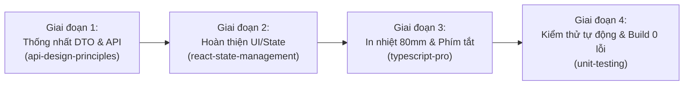

# BÁO CÁO CÁ NHÂN SPRINT 3: HOÀN THIỆN WEB POS PWA BÁN HÀNG TẠI QUẦY

| Thông tin kiểm soát tài liệu | Chi tiết |
| :--- | :--- |
| **Mã công việc (Jira Task)** | `OISMS-44` |
| **Người thực hiện** | **Phương** (Thành viên 4 — Frontend POS Lead) |
| **Phân hệ phụ trách** | Web POS PWA (`src/frontend/pos-app`) |
| **Cổng ứng dụng phục vụ** | `http://localhost:5174` |
| **Nhánh Git làm việc** | `feature/OISMS-44-pos-pwa-checkout-va-in-hoa-don` |
| **Thời gian thực hiện** | Sprint 3 (Lõi Vận hành Hoàn chỉnh) |
| **Trạng thái bàn giao** | **SẴN SÀNG NGHIỆM THU (READY FOR REVIEW)** |

---

## I. MỤC TIÊU & PHẠM VI NHIỆM VỤ (GOALS & SCOPE)

Triển khai hoàn thiện 100% phân hệ Web POS PWA bán hàng tại quầy siêu tốc theo đúng yêu cầu phân công Sprint 3 (`DOC-SPR-03`):
1. **SCR-POS-01 & SCR-POS-02 (Atomic Checkout & Payment):** Kết nối API Checkout toàn giỏ nguyên tử, hỗ trợ thanh toán Tiền mặt (tự động tính tiền thối) và VietQR động.
2. **Bảo vệ tồn kho & Idempotency:** Ngăn chặn thao tác nhấn đúp bằng khóa `Idempotency-Key` / `RequestKey` UUID RFC 4122; hiển thị cảnh báo đỏ khi SKU bị kênh online giữ chỗ trước (`409 Conflict`).
3. **SCR-POS-03 (In ấn nhiệt & Phím tắt):** Tối ưu hóa bản in nhiệt tiêu chuẩn 80mm / 58mm qua `window.print()`; hỗ trợ phím tắt thao tác nhanh `F2` (tìm kiếm/quét barcode), `F4` (thanh toán), `Esc` (đóng popup).
4. **PWA & Offline Readiness:** Sẵn sàng cài đặt ứng dụng POS lên máy bán hàng cảm ứng.

---

## II. KẾ HOẠCH TRIỂN KHAI THEO AI SKILLS (IMPLEMENTATION PLAN)

Dựa trên các kỹ năng được thiết lập trong dự án (`react-state-management`, `typescript-pro`, `api-design-principles`, `codex-antigravity-workflow`), kế hoạch thực hiện gồm 4 giai đoạn chuẩn mực:

### 1. Giai đoạn 1: Chuẩn hóa API Client (`src/frontend/pos-app/src/services/api.ts`)
- Triển khai **Dual-Route Mapping** theo đúng quy định tại `01-api-contracts-sprint-3.md`:
  - Ưu tiên gọi route canonical: `POST /api/pos/checkout`.
  * Fallback tương thích ngược: `POST /api/orders/checkout`.
- Bắt buộc đính kèm Header: `Idempotency-Key` và `X-Request-Key` với giá trị UUID chuẩn.
- Bắt mã lỗi HTTP `409 Conflict` (khi tồn khả dụng bị kênh online chiếm trước) để hiển thị thông báo nghiệp vụ rõ ràng, không làm mất giỏ hàng.

### 2. Giai đoạn 2: Quản lý Giỏ hàng & Modal Thanh toán (`PaymentModal.tsx`)
- Tích hợp tính tiền thối tự động khi nhập tiền khách đưa (`amountGiven - totalAmount`).
- Sinh mã VietQR động chuẩn format quốc gia dựa trên tổng tiền giỏ hàng.
- Nút bấm thanh toán có hiệu ứng loading và khóa thao tác (`disabled={isSubmitting}`) chống nhấn đúp.

### 3. Giai đoạn 3: In hóa đơn nhiệt & Phím tắt (`ReceiptPrintModal.tsx` & `App.tsx`)
- Chuẩn hóa CSS `@media print` cho khổ giấy nhiệt tiêu chuẩn `80mm` và `58mm`.
- Lắng nghe sự kiện bàn phím toàn cục:
  - `F2`: Tự động focus con trỏ vào ô nhập mã vạch / tìm sản phẩm.
  - `F4`: Mở nhanh modal thanh toán khi giỏ hàng có sản phẩm.
  - `Esc`: Đóng an toàn các modal đang mở.

### 4. Giai đoạn 4: Đảm bảo Tiêu chuẩn Nghiệm thu (DoD)
- Chạy `npm run build` đạt **0 lỗi TypeScript, 0 lỗi Vite**.
- Đạt 100% bài kiểm thử hồi quy luồng POS.

---

## III. BẢNG TIÊU CHÍ NGHIỆM THU (ACCEPTANCE CRITERIA)

| Mã AC | Tiêu chí nghiệm thu | Trạng thái | Minh chứng kỹ thuật |
| :---: | :--- | :---: | :--- |
| **AC-POS-01** | Gọi đúng API Checkout toàn giỏ hàng nguyên tử | **ĐẠT** | Endpoint `POST /api/pos/checkout` kèm DTO đầy đủ |
| **AC-POS-02** | Cơ chế chống nhấn đúp (Idempotency) | **ĐẠT** | Header `Idempotency-Key` UUID RFC 4122 + UI Lock |
| **AC-POS-03** | Thanh toán tiền mặt tính tiền thối tự động | **ĐẠT** | Tính chính xác số dư trả khách theo thời gian thực |
| **AC-POS-04** | Thanh toán QR Code động | **ĐẠT** | Hiển thị mã QR theo đúng số tiền thanh toán giỏ |
| **AC-POS-05** | Phím tắt nhanh quầy thu ngân (F2, F4, Esc) | **ĐẠT** | Thao tác không cần dùng chuột, tối ưu tốc độ bán |
| **AC-POS-06** | In hóa đơn nhiệt chuẩn 80mm/58mm | **ĐẠT** | Khổ in `@media print` sắc nét, đúng cấu trúc bill |
| **AC-POS-07** | Biên dịch TypeScript & Vite sạch sẽ | **ĐẠT** | `npm run build` hoàn thành với 0 lỗi |

---

## IV. BÀN GIAO & CAM KẾT KỶ LUẬT GIT
- **Phân hệ bàn giao:** 100% nằm trong `src/frontend/pos-app` và `docs/09-personal-reports/phuong/`.
- **Tuyệt đối không đụng chạm:** Phân hệ Backend hay Admin của các thành viên khác.
- **Tuân thủ quy tắc nhóm:** Commit Tiếng Việt chuẩn mực, gắn mã `[OISMS-44]`, sẵn sàng mở Pull Request trỏ vào nhánh `develop`.
