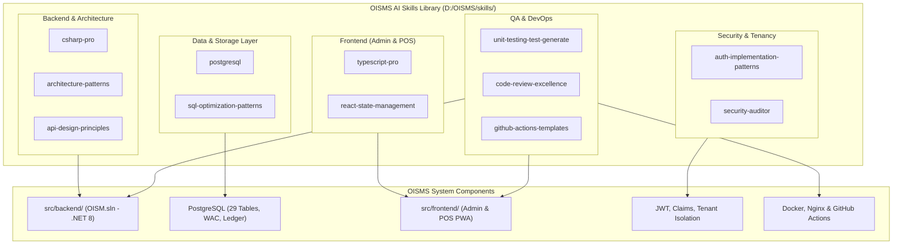

# 01. Danh Mục Chi Tiết & Bản Đồ Ánh Xạ AI Skills (Skills Catalog & Mapping)

| Thông tin kiểm soát tài liệu | Chi tiết |
| :--- | :--- |
| **Mã tài liệu (Document ID)** | `DOC-SKL-01` |
| **Phiên bản (Version)** | `v1.0.0` |
| **Ngày hiệu lực (Effective Date)** | `2026-10-23` |
| **Phạm vi áp dụng** | Toàn bộ dự án OISMS (Backend .NET 8, Frontend React, PostgreSQL Database, CI/CD) |

---

## 1. Giới Thiệu Tổng Quan

Hệ thống kỹ năng AI của OISMS bao gồm **12 skills chuyên sâu** được tuyển chọn khắt khe từ kho lưu trữ [`rmyndharis/antigravity-skills`](https://github.com/rmyndharis/antigravity-skills). Mỗi skill đóng vai trò như một cẩm nang chỉ dẫn kỹ thuật tự động hóa (Automated Technical Runbook), hướng dẫn trợ lý AI giải quyết chính xác các bài toán đặc thù của dự án OISMS mà không gây suy thoái chất lượng hay vi phạm kiến trúc.

---

## 2. Bản Đồ Ánh Xạ Kỹ Thuật (Architecture & Component Mapping)

---

## 3. Đặc Tả Chi Tiết Từng Skill

### 3.1. Nhóm Kỹ Năng Backend (.NET 8 & Clean Architecture)

#### 1. `csharp-pro`
- **Đường dẫn vật lý:** `D:\OISMS\skills\csharp-pro\`
- **File kích hoạt:** `SKILL.md`
- **Công dụng đối với OISMS:** Hướng dẫn viết mã C# hiện đại trên nền tảng .NET 8. Sử dụng các tính năng nâng cao như Primary Constructors, C# Records, Pattern Matching, Async/Await không gây deadlock, LINQ tối ưu và Nullable Reference Types.
- **Phạm vi tác động:** `src/backend/src/OISM.Domain`, `OISM.Application`, `OISM.Infrastructure`, `OISM.WebAPI`.
- **Tài liệu đối chiếu:** [`docs/04-architecture-and-design/01-clean-architecture.md`](../04-architecture-and-design/01-clean-architecture.md).

#### 2. `architecture-patterns`
- **Đường dẫn vật lý:** `D:\OISMS\skills\architecture-patterns\`
- **File kích hoạt:** `SKILL.md`, `resources/implementation-playbook.md`
- **Công dụng đối với OISMS:** Thực thi nghiêm ngặt nguyên lý Clean Architecture 4 tầng, DDD và CQRS. Đảm bảo luồng phụ thuộc chỉ hướng vào trong (Inward Dependency Rule), bảo vệ `OISM.Domain` không bị ô nhiễm bởi các thư viện bên ngoài.
- **Phạm vi tác động:** Cấu trúc tầng và ranh giới project trong `src/backend/`.

#### 3. `api-design-principles`
- **Đường dẫn vật lý:** `D:\OISMS\skills\api-design-principles\`
- **File kích hoạt:** `SKILL.md`, `resources/implementation-playbook.md`, `references/`
- **Công dụng đối với OISMS:** Định hình chuẩn mực RESTful API cho toàn bộ các Controllers (`/api/auth`, `/api/inventory`, `/api/products`, `/api/pos`). Hướng dẫn chuẩn hóa HTTP Status Code, mô hình phân trang `PagedResult<T>`, OpenAPI/Swagger và cấu trúc lỗi `ProblemDetails` (RFC 7807).
- **Phạm vi tác động:** `src/backend/src/OISM.WebAPI/Controllers/` và [`docs/05-api-contracts/`](../05-api-contracts/README.md).

---

### 3.2. Nhóm Kỹ Năng Cơ Sở Dữ Liệu (PostgreSQL & EF Core)

#### 4. `postgresql`
- **Đường dẫn vật lý:** `D:\OISMS\skills\postgresql\`
- **File kích hoạt:** `SKILL.md`
- **Công dụng đối với OISMS:** Thiết kế và tối ưu 29 bảng dữ liệu PostgreSQL theo chuẩn schema `oisms_schema.sql`. Đảm bảo các kiểu dữ liệu khắt khe như `NUMERIC(18,2)` cho tiền tệ/giá vốn, `TIMESTAMP WITH TIME ZONE`, ràng buộc khóa ngoại kép và kiểm tra toàn vẹn dữ liệu đa chi nhánh.
- **Phạm vi tác động:** `docs/database/oisms_schema.sql` và cấu hình Fluent API trong `OISM.Infrastructure`.

#### 5. `sql-optimization-patterns`
- **Đường dẫn vật lý:** `D:\OISMS\skills\sql-optimization-patterns\`
- **File kích hoạt:** `SKILL.md`, `resources/implementation-playbook.md`
- **Công dụng đối với OISMS:** Đọc và phân tích cây thực thi `EXPLAIN (ANALYZE, BUFFERS)`. Đề xuất xây dựng Composite Index có chứa tiền tố `tenant_id` (ví dụ `ix_inventory_balance_tenant_sku_wh`), giải quyết bài toán nghẽn cổ chai khi chạy Flash Sale với tải trọng 50 reqs/giây trên cùng 1 SKU.
- **Phạm vi tác động:** Các câu truy vấn báo cáo, cập nhật tồn kho tức thời và số liệu sổ cái.

---

### 3.3. Nhóm Kỹ Năng Frontend (React 19, TypeScript & POS)

#### 6. `typescript-pro`
- **Đường dẫn vật lý:** `D:\OISMS\skills\typescript-pro\`
- **File kích hoạt:** `SKILL.md`
- **Công dụng đối với OISMS:** Cấu hình Strict Type Checking cho TypeScript $\ge 5.7$, định nghĩa các Interfaces/Types đại diện cho DTO của Backend, hạn chế tối đa việc sử dụng kiểu `any`, phòng ngừa lỗi Runtime trên màn hình thu ngân POS.
- **Phạm vi tác động:** `src/frontend/admin-dashboard/src/` và `src/frontend/pos-app/src/`.

#### 7. `react-state-management`
- **Đường dẫn vật lý:** `D:\OISMS\skills\react-state-management\`
- **File kích hoạt:** `SKILL.md`
- **Công dụng đối với OISMS:** Quản lý state giỏ hàng (Cart State), xử lý quét mã vạch Barcode dồn số lượng tức thì, đồng bộ trạng thái thanh toán quầy dưới 3 bước thao tác cho POS PWA; quản lý cache dữ liệu báo cáo cho Admin Dashboard.
- **Phạm vi tác động:** Các hooks, context và state stores tại 2 frontend web apps.

---

### 3.4. Nhóm Kỹ Năng An Toàn & Phân Lập Dữ Liệu (Security & Tenancy)

#### 8. `auth-implementation-patterns`
- **Đường dẫn vật lý:** `D:\OISMS\skills\auth-implementation-patterns\`
- **File kích hoạt:** `SKILL.md`, `resources/implementation-playbook.md`
- **Công dụng đối với OISMS:** Chuẩn hóa quy trình cấp phát, kiểm tra chữ ký và thu hồi JWT Bearer tokens; ánh xạ chính xác Claim `tenant_id` vào `ITenantContext`; phân định quyền hạn theo RBAC Matrix cho 3 đối tượng `Owner`, `Staff`, `Cashier`.
- **Phạm vi tác động:** `OISM.Infrastructure/Services/JwtService.cs`, Middleware giải mã token, `docs/01-users-and-rbac/02-rbac-matrix.md`.

#### 9. `security-auditor`
- **Đường dẫn vật lý:** `D:\OISMS\skills\security-auditor\`
- **File kích hoạt:** `SKILL.md`
- **Công dụng đối với OISMS:** Rà soát tự động các rủi ro bảo mật rò rỉ chéo tenant (Cross-Tenant Data Leakage), kiểm toán cấu hình CORS, chống SQL Injection thông qua EF Core Raw SQL, bảo vệ endpoint webhook SignalR và quản trị an toàn biến môi trường trong `.env`.
- **Phạm vi tác động:** Toàn diện hệ thống backend và cấu hình máy chủ Nginx.

---

### 3.5. Nhóm Kỹ Năng Chất Lượng Mã Nguồn & Tự Động Hóa (Quality, QA & DevOps)

#### 10. `code-review-excellence`
- **Đường dẫn vật lý:** `D:\OISMS\skills\code-review-excellence\`
- **File kích hoạt:** `SKILL.md`, `resources/implementation-playbook.md`
- **Công dụng đối với OISMS:** Đóng vai trò làm chuẩn mực Review Pull Request tự động: kiểm tra tiêu chuẩn mã nguồn, kiểm tra tuân thủ ranh giới Clean Architecture, chỉ ra các hàm có độ phức tạp chu trình (Cyclomatic Complexity) cao cần tái cấu trúc.
- **Phạm vi tác động:** Toàn bộ Pull Request và mã nguồn trước khi tích hợp vào nhánh chính.

#### 11. `unit-testing-test-generate`
- **Đường dẫn vật lý:** `D:\OISMS\skills\unit-testing-test-generate\`
- **File kích hoạt:** `SKILL.md`
- **Công dụng đối với OISMS:** Tự động sinh mã Unit Test và Integration Test với xUnit, FluentAssertions và Moq/NSubstitute. Tập trung kiểm thử logic nghiệp vụ then chốt: tính giá vốn xuất kho WAC, cơ chế khóa giữ chỗ kho (Reservation), và xác nhận đơn thanh toán POS, cam kết duy trì độ phủ kiểm thử $\ge 80\%$.
- **Phạm vi tác động:** `src/backend/tests/` và [`docs/06-testing-and-qa/`](../06-testing-and-qa/README.md).

#### 12. `github-actions-templates`
- **Đường dẫn vật lý:** `D:\OISMS\skills\github-actions-templates\`
- **File kích hoạt:** `SKILL.md`
- **Công dụng đối với OISMS:** Hướng dẫn tối ưu và cấu hình các workflows CI/CD trong `.github/workflows/`: biên dịch Backend `.NET 8`, chạy 194 unit tests, build TypeScript/Vite cho 2 ứng dụng React, quét bảo mật và tự động đóng gói Docker Images.
- **Phạm vi tác động:** Thư mục `.github/workflows/` và tài liệu [`docs/07-devops-and-deployment/02-ci-cd-github-actions.md`](../07-devops-and-deployment/02-ci-cd-github-actions.md).
