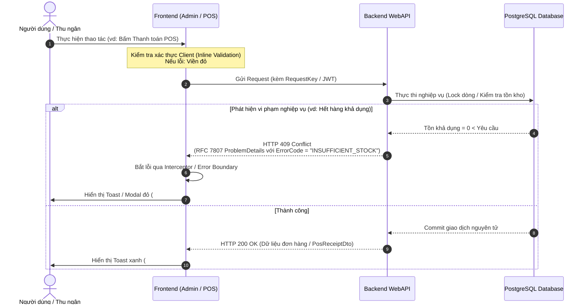

# 12. QUY ĐỊNH CHUẨN TRẢ VỀ MÃ LỖI VÀ HỆ THỐNG MÃ MÀU TRẠNG THÁI (ERROR CODES & UI COLOR SYSTEM)

| Thông tin kiểm soát thư mục | Chi tiết |
| :--- | :--- |
| **Mã phân hệ (Module ID)** | `MOD-ERR-12` |
| **Phiên bản hiện hành** | `v1.0.0` |
| **Ngày cập nhật gần nhất** | `2026-10-25` |
| **Tiêu chuẩn tuân thủ** | `RFC 7807 (Problem Details for HTTP APIs)`, `WCAG 2.1 AA (Color Contrast)` |
| **Phạm vi áp dụng** | Toàn bộ Backend (`OISM.WebApi`, `OISM.Application`) và Frontend (`admin-dashboard`, `pos-app`) |

---

## 1. Giới Thiệu Phân Hệ

Phân hệ **`12-error-and-status-codes`** quy định chuẩn hóa hai trụ cột trải nghiệm người dùng và giao tiếp hệ thống cốt lõi trong toàn bộ hệ thống OISMS:
1. **Chuẩn hóa phản hồi lỗi (Error Response Standardization):** 
   - Đồng nhất 100% phản hồi từ Backend theo chuẩn quốc tế **RFC 7807 (Problem Details for HTTP APIs)**.
   - Loại bỏ hoàn toàn các thông báo lỗi mập mờ, cấu trúc phản hồi tùy tiện (`{ "message": "error" }`), hoặc để lộ `StackTrace` kỹ thuật gây mất an toàn thông tin trên môi trường Production.
   - Định danh duy nhất từng mã lỗi nghiệp vụ bằng chuỗi định danh viết hoa `SNAKE_CASE` (ví dụ: `INSUFFICIENT_STOCK`, `PRICE_MISMATCH`, `IDEMPOTENCY_PAYLOAD_MISMATCH`).
2. **Hệ thống mã màu trạng thái & phản hồi thị giác (Status Color & UI Feedback Tokens):**
   - Chuẩn hóa bộ Design Tokens màu sắc (Danger, Warning, Success, Info, Neutral) đồng bộ với hệ thống CSS Variables và Tailwind CSS của hai ứng dụng `admin-dashboard` và `pos-app`.
   - Quy định chi tiết nguyên tắc hiển thị phản hồi người dùng: Toast notifications, Thông báo lỗi trên trường nhập liệu (Inline Field Errors), Huy hiệu trạng thái (Status Badges), Hộp thoại xác nhận phá hủy (Destructive Modals).

---

## 2. Danh Mục Tài Liệu Chi Tiết

| STT | Mã tài liệu | Tên file | Phiên bản | Nội dung chính |
| :---: | :---: | :--- | :---: | :--- |
| **1** | `DOC-ERR-01` | [`01-error-response-spec.md`](./01-error-response-spec.md) | `v1.0.0` | Đặc tả cấu trúc JSON Problem Details chuẩn RFC 7807, Bảng ánh xạ mã trạng thái HTTP chuẩn (400, 401, 403, 404, 409, 422, 500) và cơ chế xử lý ngoại lệ tập trung trên Backend & Frontend. |
| **2** | `DOC-ERR-02` | [`02-error-codes-catalog.md`](./02-error-codes-catalog.md) | `v1.0.0` | Từ điển toàn diện các mã lỗi nghiệp vụ (`ErrorCode Catalog`) được phân loại theo phân hệ: Xác thực & Tenant, Danh mục & Sản phẩm, Tồn kho & Sổ cái, Đơn hàng đa kênh & POS Checkout, Chuyển kho & Kiểm kê. |
| **3** | `DOC-ERR-03` | [`03-color-system-tokens.md`](./03-color-system-tokens.md) | `v1.0.0` | Bảng mã màu Design Tokens (HEX, RGB, CSS Variables, Tailwind classes) cho các cấp độ thông báo: Danger (Đỏ), Warning (Vàng cam), Success (Xanh lá), Info/Brand (Xanh dương) và Neutral (Xám). |
| **4** | `DOC-ERR-04` | [`04-ui-feedback-guidelines.md`](./04-ui-feedback-guidelines.md) | `v1.0.0` | Hướng dẫn triển khai phản hồi thị giác trên Frontend: Quy chuẩn Toast, Inline validation, Modal chặn tương tác, Ma trận màu sắc cho Badge trạng thái Đơn hàng, Phiếu kho, và Trạng thái mạng POS. |

---

## 3. Kiến Trúc Luồng Báo Lỗi & Xử Lý Thị Giác (End-to-End Error Flow)

---

## 4. Liên Kết Tham Chiếu Chéo (Cross-References)

* **Đặc tả hợp đồng API tương ứng:**
  * [`../05-api-contracts/01-auth-endpoints.md`](../05-api-contracts/01-auth-endpoints.md) — Hợp đồng lỗi Xác thực & Phân quyền.
  * [`../05-api-contracts/02-catalog-endpoints.md`](../05-api-contracts/02-catalog-endpoints.md) — Hợp đồng lỗi Sản phẩm & Mã vạch.
  * [`../05-api-contracts/03-inventory-endpoints.md`](../05-api-contracts/03-inventory-endpoints.md) — Hợp đồng lỗi Sổ cái tồn kho & Nhập hàng.
  * [`../05-api-contracts/04-order-endpoints.md`](../05-api-contracts/04-order-endpoints.md) — Hợp đồng lỗi Đơn hàng & Máy trạng thái.
  * [`../05-api-contracts/05-pos-endpoints.md`](../05-api-contracts/05-pos-endpoints.md) — Hợp đồng lỗi Bán hàng & Thanh toán tại quầy.
* **Đặc tả các màn hình giao diện liên quan:**
  * [`../11-ui-screens/README.md`](../11-ui-screens/README.md) — Danh mục toàn bộ màn hình hệ thống OISMS.
