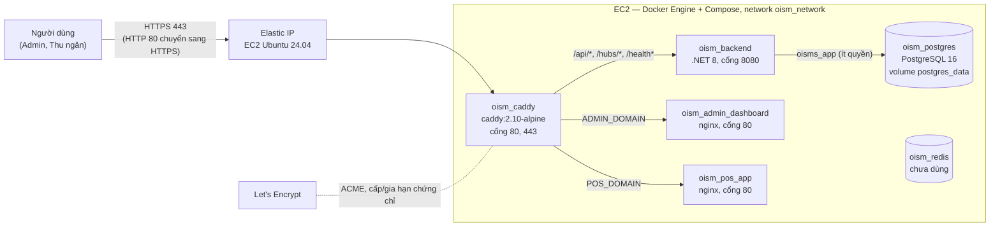

# 01. Kiến Trúc Triển Khai Trên AWS

| Thông tin kiểm soát tài liệu | Chi tiết |
| :--- | :--- |
| **Mã tài liệu (Document ID)** | `DOC-AWS-01` |
| **Phiên bản (Version)** | `v1.0.0` |
| **Ngày hiệu lực (Effective Date)** | `2026-11-06` |
| **Phạm vi áp dụng** | `docker-compose.yml`, `docker-compose.prod.yml`, `docker/caddy/Caddyfile` |

---

## 1. Mô Hình Một Máy Chủ

Chỉ Caddy publish cổng ra máy host. Các container khác chỉ nghe trong `oism_network`, nên từ Internet không chạm được PostgreSQL, Redis hay cổng 8080 của backend.

## 2. Thành Phần

| Container | Image | Nhiệm vụ trên production |
| :--- | :--- | :--- |
| `oism_caddy` | `caddy:2.10-alpine` | Kết thúc TLS, tự xin và gia hạn chứng chỉ, nén gzip, định tuyến theo domain và đường dẫn. Lưu chứng chỉ trong volume `caddy_data`, cấu hình runtime trong `caddy_config`. |
| `oism_backend` | build từ `src/backend/Dockerfile` | Web API + SignalR. `ASPNETCORE_ENVIRONMENT=Production`, `Jwt__Secret` lấy từ `JWT_SECRET`. Không Swagger, không seed. |
| `oism_admin_dashboard` | build từ `src/frontend/admin-dashboard` | File tĩnh React; `VITE_API_BASE_URL=https://${ADMIN_DOMAIN}`. |
| `oism_pos_app` | build từ `src/frontend/pos-app` | File tĩnh React PWA + `sw.js`; `VITE_API_BASE_URL=https://${POS_DOMAIN}`. |
| `oism_postgres` | `postgres:16-alpine` | Database, chỉ trong mạng nội bộ. |
| `oism_redis` | `redis:7-alpine` | Vẫn khởi động vì backend `depends_on` redis, nhưng code chưa dùng. |
| `oism_pgadmin` | `dpage/pgadmin4` | **Không chạy** trên production (đưa vào profile `tools`). |

## 3. Luồng Một Request

1. Trình duyệt mở `https://<ADMIN_DOMAIN>/admin/products`. DNS trả Elastic IP; Caddy nhận ở cổng 443, chọn site theo tên miền (SNI/Host).
2. Đường dẫn không khớp `/api/*`, `/hubs/*`, `/health*` nên Caddy chuyển tới `admin-dashboard:80`. Nginx không có file `/admin/products`, trả `index.html` (SPA fallback); React Router dựng trang.
3. Trang gọi `https://<ADMIN_DOMAIN>/api/products`. Vì URL API trùng domain với trang (same-origin), trình duyệt không cần CORS. Caddy chuyển tới `backend:8080`.
4. Backend xác thực JWT, lấy `tenantId` từ claim, truy vấn PostgreSQL bằng tài khoản `oisms_app`.
5. SignalR mở `wss://<domain>/hubs/notifications?access_token=...`. Caddy tự chuyển tiếp WebSocket (Upgrade header) mà không cần cấu hình thêm.

POS PWA đi đúng luồng trên với `POS_DOMAIN`; cả hai domain dùng chung một backend và một database.

## 4. Cổng Và Mạng

| Cổng | Local (`docker-compose.yml`) | Production (thêm `docker-compose.prod.yml`) |
| :--- | :--- | :--- |
| 80, 443 | — | Caddy, mở ra Internet |
| 5000 | backend | đóng (`ports: !reset []`) |
| 5173, 5174 | admin, pos | đóng |
| 5432, 6379 | postgres, redis | đóng |
| 5050 | pgadmin | không chạy |
| 22 | — | SSH, Security Group chỉ cho IP quản trị |

## 5. Dữ Liệu Bền Vững

| Volume | Nội dung | Mất thì sao |
| :--- | :--- | :--- |
| `postgres_data` | Toàn bộ dữ liệu nghiệp vụ | Mất dữ liệu; phải restore từ bản `pg_dump` |
| `caddy_data` | Chứng chỉ và khóa TLS | Caddy xin lại chứng chỉ; xin lại nhiều lần có thể chạm giới hạn của Let's Encrypt |
| `caddy_config` | Cấu hình runtime của Caddy | Tự sinh lại |
| `redis_data` | Chưa có dữ liệu quan trọng | Không ảnh hưởng |

Volume nằm trên ổ EBS của EC2. Terminate instance (không phải Stop) mà ổ được đặt xóa theo máy thì mất toàn bộ volume.

## 6. Khác Biệt Local Và Production

| Khía cạnh | Local | Production |
| :--- | :--- | :--- |
| Lệnh | `docker compose up -d` | `docker compose --env-file .env.production -f docker-compose.yml -f docker-compose.prod.yml up -d --build` |
| File biến | `.env` | `.env.production` |
| Môi trường backend | `Development` (Swagger bật) | `Production` (không Swagger, không seed) |
| JWT secret | fallback trong code nếu không đặt | bắt buộc `JWT_SECRET`, thiếu thì Compose dừng |
| URL API frontend | `http://localhost:5000` | `https://<domain của chính frontend>` |
| HTTPS | không | Caddy + Let's Encrypt |
| pgAdmin | có | không |

Không chạy bản local và bản production cùng lúc trên một máy với cùng tên project Compose: hai bản dùng chung tên container và volume.

## 7. Giới Hạn Của Mô Hình Hiện Tại

- Một máy, không dự phòng: máy dừng là hệ thống dừng.
- Database chạy trong container trên cùng máy, backup phải tự làm (chưa dùng RDS hay snapshot tự động).
- Build image ngay trên EC2, tốn RAM/CPU lúc deploy; chưa có registry (ECR) hay pipeline CD.
- Hangfire chưa bật trên bản demo nên không có job hết hạn giữ chỗ và sinh kỳ kiểm kê tự động. Cách bật: [cấu hình backend trên production](./03-cau-hinh-moi-truong-production.md#4-cấu-hình-backend-trên-production).
- `/health/ready` công khai qua Caddy và trả kèm tên user database đang kết nối, số bảng; chấp nhận được cho bản demo nhưng nên chặn hoặc rút gọn nếu dùng thật.
