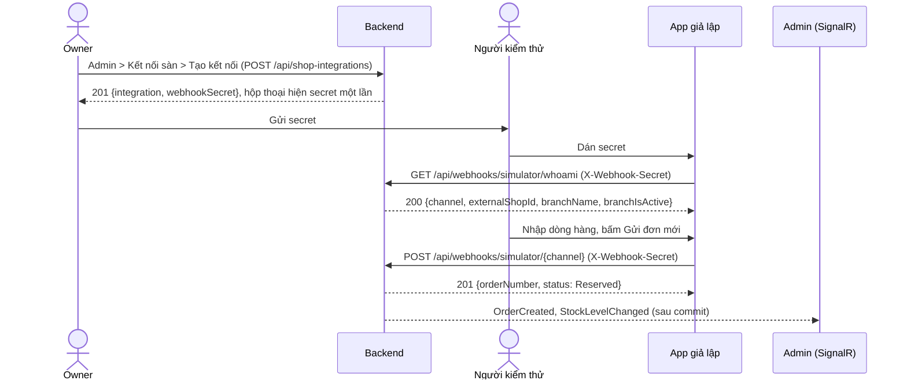

# 14. Giả Lập Đơn Sàn Qua Webhook (Webhook Simulator)

| Thông tin | Chi tiết |
| :--- | :--- |
| **Mã tài liệu** | `DOC-SIM-14` |
| **Phiên bản** | `v1.1.0` |
| **Ngày cập nhật** | `2026-11-06` |
| **Yêu cầu liên quan** | [`FR-SIM-01`](../02-functional-requirements/fr-08-marketplace-sync.md), `FR-ORD-01`, `NFR-PERF-02` |
| **Mã công việc** | `OISMS-48` |
| **Code** | `src/frontend/marketplace-simulator`, `admin-dashboard/src/pages/ShopIntegrationsPage.tsx`, `ShopIntegrationsController`, `WebhooksController`, `ShopIntegrationService`, `WebhookService` |

---

## 1. Mục đích

OISMS nhận đơn Shopee, TikTok Shop, Lazada qua webhook `POST /api/webhooks/simulator/{channel}`. Đồ án không nối sàn thật, nên cần một công cụ đóng vai sàn để:

- Bắn đơn vào hệ thống và xem đơn `Reserved` hiện ở Admin theo thời gian thực.
- Kiểm tra chống trùng: gửi lại cùng mã đơn trả kết quả cũ, đổi nội dung trả 409.
- Kiểm tra chống bán vượt: bắn nhiều đơn cùng lúc tranh một SKU ít tồn.
- Kiểm tra xác thực: secret sai, đã đổi hoặc kết nối đã tắt đều bị từ chối.

Công cụ gồm ba phần:

| Phần | Vai trò |
| :--- | :--- |
| Màn **Kết nối sàn** trong Admin (`/shop-integrations`) | Owner tạo kết nối, copy secret, đổi secret, bật/tắt. Đặc tả: [`10-shop-integration-screens.md`](../11-ui-screens/10-shop-integration-screens.md) |
| API kết nối sàn `/api/shop-integrations` | Backend của màn trên; gọi trực tiếp được bằng JWT Owner |
| API `GET /api/webhooks/simulator/whoami` | Cho biết secret thuộc gian hàng nào, để app giả lập tự điền |
| App `marketplace-simulator` | Giao diện bắn đơn, chạy trên domain riêng, chỉ gọi `/api/webhooks/*` |

Database không đổi. Mọi dữ liệu nằm trong bảng `shop_integrations` đã có từ Sprint 3.

---

## 2. Luồng sử dụng



1. Owner đăng nhập Admin, vào **Kết nối sàn** (cuối thanh menu), bấm **Tạo kết nối**, chọn sàn, nhập mã gian hàng, chọn chi nhánh. Hộp thoại hiện secret kèm nút **Copy**; phải copy hoặc đánh dấu "Tôi đã lưu secret" mới đóng được. Mỗi kết nối có một secret riêng.
2. Người kiểm thử mở app giả lập và dán secret. App gọi `whoami` rồi tự chọn sàn và điền mã gian hàng. Không cần đăng nhập.
3. Dán nhiều secret để có nhiều kết nối, chọn qua lại trong danh sách. Danh sách chỉ nằm trong bộ nhớ tab, đóng tab là mất.
4. Nhập mã SKU, số lượng, đơn giá rồi gửi. Kết quả hiện trong nhật ký; bấm một dòng để xem JSON request và response.

## 2a. Lấy secret

| Tình huống | Cách làm |
| :--- | :--- |
| Lần đầu | Admin > **Kết nối sàn** > **Tạo kết nối** > copy secret trong hộp thoại |
| Lỡ đóng hộp thoại hoặc mất secret | Bấm **Đổi secret** ở dòng kết nối đó. Secret cũ hết hiệu lực ngay, secret mới hiện một lần |
| Không phải Owner | Nhờ Owner tạo hoặc đổi secret rồi gửi qua kênh riêng |
| Không dùng được giao diện | Gọi API bằng JWT Owner: Swagger khi chạy local, Postman hoặc `Invoke-RestMethod` trên bản deploy (Production không có Swagger) |

**Không xem lại được secret cũ**, kể cả trong Admin hay qua API: backend chỉ lưu SHA-256 của secret. Đây là thiết kế có chủ đích, giống cách các sàn và cổng thanh toán quản lý khóa webhook.

App giả lập cũng nhắc 3 bước này khi chưa có kết nối nào, kèm link sang trang Kết nối sàn của Admin.

---

## 3. API

Chi tiết hợp đồng: [`04-order-endpoints.md` mục 1.0a](../05-api-contracts/04-order-endpoints.md). Mã lỗi: [`02-error-codes-catalog.md`](../12-error-and-status-codes/02-error-codes-catalog.md).

### 3.1. Kết nối sàn (chỉ Owner)

| Method | Endpoint | Kết quả |
| :---: | :--- | :--- |
| `GET` | `/api/shop-integrations` | Danh sách kết nối của tenant, không có secret hay hash |
| `GET` | `/api/shop-integrations/{id}` | Chi tiết; không thuộc tenant trả 404 `SHOP_INTEGRATION_NOT_FOUND` |
| `POST` | `/api/shop-integrations` | Body `{ channel, externalShopId, branchId }`, trả 201 `{ integration, webhookSecret }` |
| `PUT` | `/api/shop-integrations/{id}` | Body `{ branchId, isActive }`; không đổi được sàn và mã gian hàng |
| `POST` | `/api/shop-integrations/{id}/rotate-secret` | Sinh secret mới, secret cũ hết hiệu lực ngay |

Lỗi thường gặp:

| Trường hợp | Mã lỗi |
| :--- | :--- |
| Sàn ngoài `Shopee`, `TikTok`, `Lazada`, thiếu mã gian hàng | 400 `VALIDATION_ERROR` |
| Gian hàng đã kết nối trên cùng sàn | 409 `SHOP_INTEGRATION_DUPLICATE` |
| Chi nhánh không tồn tại, đã tắt hoặc thuộc tenant khác | 404 `BRANCH_INACTIVE_OR_INVALID` |
| `Staff`, `Cashier` gọi API | 403 |

### 3.2. `whoami`

```http
GET /api/webhooks/simulator/whoami
X-Webhook-Secret: whsec_...
```

```json
{ "channel": "Shopee", "externalShopId": "SHOP_DEMO_1", "branchName": "CN Quận 1", "branchIsActive": true }
```

- Không cần JWT. Không tạo dữ liệu.
- Thiếu secret, secret sai, kết nối tắt hoặc doanh nghiệp ngừng hoạt động: 401, cùng điều kiện như luồng nhận đơn.
- Chi nhánh đã tắt vẫn trả 200 với `branchIsActive: false`; app báo trước rằng đơn sẽ bị từ chối.
- Không trả `tenantId`, `branchId` hay tên doanh nghiệp.

### 3.3. Nhận đơn

`POST /api/webhooks/simulator/{channel}` giữ nguyên hợp đồng cũ. App gửi payload đúng `CanonicalWebhookPayloadDto`:

```json
{
  "channel": "Shopee",
  "externalShopId": "SHOP_DEMO_1",
  "externalOrderId": "SPE-1A2B3C4D5E6F",
  "customerName": "Khách giả lập",
  "customerPhone": "0901234567",
  "shippingAddress": "123 Lê Lợi, Quận 1, TP.HCM",
  "totalAmount": 150000,
  "orderTimestamp": "2026-11-06T03:00:00.000Z",
  "items": [{ "skuCode": "SKU-001", "quantity": 2, "unitPrice": 75000 }]
}
```

- `externalOrderId` sinh mới cho mỗi lần "Gửi đơn mới" (tiền tố `SPE`, `TTS`, `LZD`). Gửi lại giữ nguyên mã.
- `totalAmount` tính như backend: cộng `quantity × unitPrice` rồi làm tròn 2 chữ số kiểu AwayFromZero. App dùng số nguyên để tránh sai số dấu phẩy động.
- Đơn sàn luôn tính theo đơn vị gốc của SKU và dùng giá sàn gửi (`price_source = Marketplace`).

Thay đổi đi kèm: `WebhookService` tìm kết nối thẳng theo `secret_hash` (có ràng buộc UNIQUE) thay vì tải toàn bộ kết nối của mọi tenant rồi so từng dòng.

---

## 4. Giao diện giả lập

| Khu vực | Chức năng |
| :--- | :--- |
| Kết nối gian hàng | Dán secret, bấm **Thêm**. App gọi `whoami`, thêm vào danh sách và chọn luôn. Secret sai hiện lỗi ngay. Kết nối có chi nhánh tắt được đánh dấu màu vàng |
| Đơn hàng | Khách hàng, điện thoại, địa chỉ (không bắt buộc), nhiều dòng hàng theo mã SKU. App kiểm tra số lượng tối đa 3 chữ số lẻ, đơn giá tối đa 2 chữ số lẻ, cùng SKU không được hai đơn giá |
| Gửi | **Gửi đơn mới**, **Gửi lại**, **Đổi nội dung**, **Bắn N đơn cùng lúc** (1–200), tùy chọn dùng chung một mã đơn |
| Nhật ký | Giờ, loại, gian hàng, mã đơn sàn, HTTP status, mã lỗi, thời gian phản hồi. Bấm một dòng để xem JSON |

"Gửi lại" và "Đổi nội dung" luôn dùng kết nối của đơn gần nhất, kể cả khi đã chọn kết nối khác.

Thông tin đơn (khách, dòng hàng) được nhớ trong `localStorage` để mở lại không phải nhập lại. Secret và danh sách kết nối không được lưu.

---

## 5. Kịch bản kiểm thử

| # | Thao tác | Kết quả mong đợi |
| :---: | :--- | :--- |
| 1 | Dán secret sai | Báo "Webhook Secret không hợp lệ.", không thêm kết nối |
| 2 | Dán secret đúng | Kết nối hiện đúng sàn, mã gian hàng, chi nhánh |
| 3 | Gửi đơn mới | 201, đơn `Reserved`; Admin nhận `OrderCreated` |
| 4 | Gửi lại | 200 kèm kết quả cũ, không tạo đơn mới, tồn giữ chỗ không đổi |
| 5 | Đổi nội dung | 409 `WEBHOOK_PAYLOAD_MISMATCH` |
| 6 | Bắn N đơn tranh SKU có tồn khả dụng K < N | Đúng K đơn 201, phần còn lại báo thiếu tồn; `Available` không âm |
| 7 | Bắn N đơn chung một mã | Đúng một 201, còn lại 200 |
| 8 | Owner đổi secret, gửi bằng secret cũ | 401 |
| 9 | Owner tắt kết nối, gửi tiếp | 401 |
| 10 | Gửi SKU không có trong cửa hàng | Lỗi SKU từ backend, không tạo đơn |

Test tự động:

| Bộ test | Phạm vi |
| :--- | :--- |
| `OISM.UnitTests/ShopIntegrationServiceTests.cs` | Tạo, trùng, chi nhánh sai, đổi secret, sửa, cô lập tenant, validator |
| `OISM.UnitTests/WebhookIdentityTests.cs` | `whoami`: secret đúng, sai, thiếu; kết nối tắt; doanh nghiệp ngừng; chi nhánh tắt |
| `OISM.IntegrationTests/ShopIntegrationApiIntegrationTests.cs` | Trên PostgreSQL: tạo kết nối, `whoami`, bắn webhook, đổi secret, tắt kết nối, chặn Staff/Cashier/tenant khác |
| `test-oisms/frontend/marketplace-simulator/test-payload.mjs` | Tính tổng tiền, dựng payload, kiểm tra nhập liệu, đọc body lỗi |

```bash
dotnet test test-oisms/backend/OISM.UnitTests/OISM.UnitTests.csproj --filter "FullyQualifiedName~ShopIntegration|FullyQualifiedName~WebhookIdentity"
dotnet test test-oisms/backend/OISM.IntegrationTests/OISM.IntegrationTests.csproj --filter "FullyQualifiedName~ShopIntegrationApi|FullyQualifiedName~Webhook"
npm test --prefix src/frontend/marketplace-simulator
```

Integration test cần PostgreSQL thật và các biến `OISM_TEST_*`, đặt như `.github/workflows/ci.yml`.

---

## 6. Chạy và deploy

| Môi trường | Cách chạy | Đường `/api/webhooks/*` |
| :--- | :--- | :--- |
| Dev | `npm run dev --prefix src/frontend/marketplace-simulator`, cổng 5175 | Vite proxy sang `http://localhost:5000` (đổi bằng `VITE_DEV_API_TARGET`) |
| Docker Compose local | Service `marketplace-simulator`, cổng `SIM_PORT` (mặc định 5175) | nginx của app chuyển sang `backend:8080` |
| AWS | Domain `SIM_DOMAIN`, ví dụ `sim.oisms.khoadang.site` | Caddy chuyển sang `backend:8080` |

Hai app trỏ link sang nhau qua biến build: Admin dùng `VITE_SIMULATOR_URL` cho nút "Mở app giả lập", app giả lập dùng `VITE_ADMIN_URL` cho link "mở trang Kết nối sàn". `docker-compose.prod.yml` tự đặt từ `SIM_DOMAIN` và `ADMIN_DOMAIN`; khi chạy dev mặc định là cổng 5175 và 5173.

Deploy lần đầu:

1. Thêm bản ghi DNS A cho `SIM_DOMAIN` trỏ về Elastic IP.
2. Thêm `SIM_DOMAIN=...` vào `.env.production` trên máy chủ. Thiếu biến này thì Compose dừng.
3. Chạy lại `up -d --build` như [quy trình deploy](../13-deploy-aws/04-quy-trinh-deploy-va-cap-nhat.md). Caddy tự xin chứng chỉ cho domain mới.

App gọi API cùng domain nên không phải sửa CORS. Cấu hình chi tiết: [`03-cau-hinh-moi-truong-production.md`](../13-deploy-aws/03-cau-hinh-moi-truong-production.md).

---

## 7. Bảo mật

- Domain giả lập chỉ mở `/api/webhooks/*`. Caddy và nginx trả 404 cho mọi `/api/*` khác, nên không lộ đăng nhập hay API quản trị.
- Secret có dạng `whsec_` + 64 ký tự hex (32 byte ngẫu nhiên). CSDL chỉ lưu SHA-256 kèm salt, secret chỉ trả về lúc tạo hoặc đổi.
- `TenantId` lấy từ secret (webhook, `whoami`) hoặc JWT (API kết nối sàn), không bao giờ từ body.
- App giả lập và màn Admin không lưu secret vào trình duyệt và không đưa secret lên URL. Nút "Mở app giả lập" chỉ mở trang, người dùng tự dán secret.
- Endpoint webhook không cần đăng nhập. Nên thêm rate limit trước khi mở bản demo cho nhiều người dùng.

---

## 8. Hiện trạng và việc còn lại

| Hạng mục | Trạng thái |
| :--- | :--- |
| API kết nối sàn, `whoami`, tra secret theo hash | Xong. Build và unit test PASS |
| App giả lập, Docker, Caddy, CI | Xong. Build, lint, test PASS |
| Màn Kết nối sàn trong Admin | Xong. Đã chạy thử với backend local: tạo kết nối, hộp thoại secret chặn đóng khi chưa lưu, đổi secret; secret dán sang app giả lập được `whoami` nhận đúng |
| Integration test trên PostgreSQL | Chưa chạy ở máy local; cần chạy trước khi gộp |
| Rate limit cho webhook | Chưa làm |
