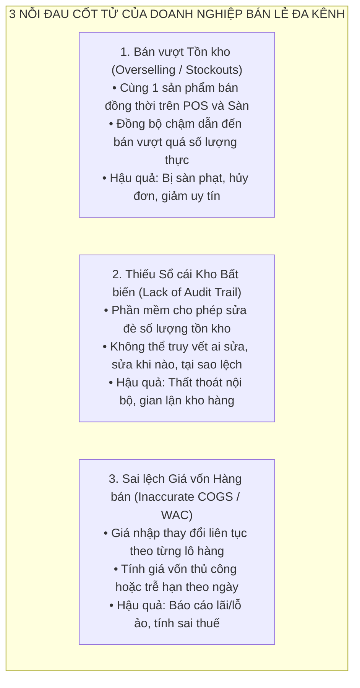

# [DOC-02] PHẦN I: TỔNG QUAN DỰ ÁN & KHẢO SÁT HỆ THỐNG (PROJECT INTRODUCTION)

> **Dự án:** OISMS — Omnichannel Inventory & Sales Management System (Hệ thống Quản lý Bán hàng & Tồn kho Đa kênh)  
> **Mã nhiệm vụ Jira:** OISMS-16 (`[DOC-02]`)  
> **Người thực hiện:** Nhựt Phùng Minh (Backend 2 - Auth, Catalog, POS & Warehouse API Lead)  
> **Học phần:** Đồ án Chuyên ngành / Công nghệ Phần mềm  
> **Cấu trúc theo mẫu:** Template Capstone Project Document (Mục I.1, I.2, I.3)  

---

# I. Project Introduction

## 1. Overview (Tổng quan Đề tài)

### 1.1 Project Information (Thông tin Dự án)
* **Project Name (Tên dự án):** Omnichannel Inventory & Sales Management System (OISMS)
* **Vietnamese Name (Tên tiếng Việt):** Hệ thống Quản lý Bán hàng và Tồn kho Đa kênh Tích hợp
* **Project Code (Mã dự án):** OISMS_FA26
* **Software Type (Loại phần mềm):** Web-based SaaS Application (Quản trị Admin Dashboard & Điểm bán hàng nhanh Web POS)

### 1.2 Project Team (Đội ngũ Thực hiện)
| Họ và tên | Vai trò trong nhóm (Role) | Email liên hệ | Phân hệ phụ trách chính |
| :--- | :--- | :--- | :--- |
| **Lê Võ Đăng Khoa** | Nhóm trưởng / Backend 1 | `khoalvd839764@fpt.edu.vn` | Kiến trúc CSDL, DbContext, Migration, Sổ cái kho, Khóa giữ chỗ & WAC |
| **Nhựt Phùng Minh** | Thành viên / Backend 2 | `nhutpm952432@ut.edu.vn` | Xác thực JWT/BCrypt, RBAC, Danh mục, Biến thể SKU, Mã vạch & Kho hàng |
| **Phúc Hữu** | Thành viên / Frontend 1 | `phuchuu@fpt.edu.vn` | Giao diện Quản trị Web Admin (React 19, Tailwind CSS, Quản lý kho & đơn) |
| **Phuongw Le** | Thành viên / Frontend 2 | `phuongle@fpt.edu.vn` | Giao diện Quầy bán hàng nhanh Web POS (Touch UI, Barcode Scanner, In bill) |
| **Nam Nguyễn** | Thành viên / QA & Tester | `namnguyen@fpt.edu.vn` | Kịch bản kiểm thử, RTM Matrix, Bug Tracking trên Jira & Kiểm thử E2E |

### 1.3 Project Mission & Target Beneficiaries (Mục đích & Đối tượng Hưởng lợi)
* **Mục đích chính:** OISMS được xây dựng nhằm cung cấp một nền tảng bán lẻ đa kênh toàn diện, giải quyết triệt để bài toán đồng bộ dữ liệu thời gian thực giữa quầy bán hàng vật lý (Web POS) và các kênh bán hàng trực tuyến (Shopee, TikTok Shop, Lazada). Trọng tâm của hệ thống là bảo vệ tính toàn vẹn của dữ liệu kho hàng thông qua cơ chế sổ cái bất biến (Append-only Ledger), thuật toán khóa dữ liệu chống bán vượt (Concurrency Reservation Guard) và tự động cập nhật giá vốn bình quân gia quyền (Weighted Average Cost - WAC).
* **Đối tượng hưởng lợi:**
  1. *Chủ cửa hàng / Doanh nghiệp bán lẻ (Store Owner):* Nắm bắt chính xác 100% doanh thu, lợi nhuận gộp theo thời gian thực; loại bỏ hoàn toàn rủi ro thất thoát hàng hóa và sai lệch báo cáo tài chính.
  2. *Nhân viên Quản lý Kho & Vận hành (Warehouse & Inventory Staff):* Quy trình nhập - xuất - chuyển kho minh bạch, tự động chốt giá vốn và theo dõi lịch sử luân chuyển hàng hóa mà không cần tính toán thủ công trên Excel.
  3. *Thu ngân tại Quầy (POS Cashier):* Thao tác bán hàng cảm ứng mượt mà, tra cứu sản phẩm và quét mã vạch siêu tốc (<200ms), in hóa đơn tức thì, giảm thiểu thời gian chờ đợi của khách hàng.
  4. *Khách hàng mua sắm (End Consumers):* Trải nghiệm mua sắm liền mạch, không còn gặp tình trạng đặt hàng thành công nhưng bị hủy đơn do hệ thống báo hết hàng ảo (bán vượt tồn kho).

---

## 2. Product Background (Bối cảnh Sản phẩm & Nỗi đau Thực tế)

Trong kỷ nguyên chuyển đổi số và sự bùng nổ của thương mại điện tử tại Việt Nam, mô hình bán hàng đa kênh (**Omnichannel Retail**) đã trở thành chiến lược sống còn đối với các doanh nghiệp bán lẻ từ quy mô vừa và nhỏ (SMEs) đến các chuỗi cửa hàng lớn. Một doanh nghiệp ngày nay không chỉ bán hàng tại cửa hàng truyền thống mà còn đồng thời vận hành nhiều gian hàng trên các sàn TMĐT (Shopee, Lazada, TikTok Shop, Tiki) và các nền tảng mạng xã hội.

Tuy nhiên, việc mở rộng kênh bán hàng nhanh chóng đã bộc lộ những lỗ hổng kỹ thuật và khó khăn vận hành nghiêm trọng:

1. **Khủng hoảng bán vượt tồn kho (Overselling) trong các khung giờ cao điểm (Flash Sale):**
   * Khi cửa hàng tung ra các chương trình khuyến mãi hoặc livestream bán hàng, hàng trăm đơn hàng có thể phát sinh trong cùng một giây. Nếu hệ thống không có cơ chế **Khóa dữ liệu đồng thời (Pessimistic / Distributed Locking)** và cơ chế **Giữ chỗ tạm thời (Inventory Reservation)**, tồn kho khả dụng sẽ bị tính sai, dẫn đến việc cùng 1 sản phẩm bị bán cho nhiều người cùng lúc. Hậu quả là doanh nghiệp bị sàn TMĐT đánh điểm phạt vận hành (sao quả tạ), bị khóa gian hàng và mất khách hàng.
2. **Sổ kho bị ghi đè, thiếu tính minh bạch và bất biến (Audit Trail Deficiency):**
   * Hầu hết các phần mềm bán hàng phổ thông hiện nay cho phép nhân viên có quyền quản trị vào chỉnh sửa trực tiếp con số tồn kho trên giao diện để "cân đối số liệu". Việc cho phép câu lệnh `UPDATE / DELETE` trực tiếp trên bảng tồn kho phá vỡ nguyên tắc kế toán kép, khiến doanh nghiệp không thể truy vết được lịch sử thất thoát xuất phát từ nhân viên, hư hỏng cơ học hay sai sót giao nhận.
3. **Biến động giá nhập và bài toán tính Giá vốn bình quân gia quyền (WAC):**
   * Trong bối cảnh chuỗi cung ứng biến động, cùng một mã SKU nhưng mỗi lần nhập từ nhà cung cấp lại có đơn giá và chi phí vận chuyển khác nhau. Việc tính giá vốn không chuẩn xác hoặc tính gộp chung làm sai lệch toàn bộ chỉ số Lợi nhuận gộp (**Gross Profit**), khiến nhà quản lý đưa ra các quyết định định giá bán sai lầm.

---

## 3. Existing Systems (Khảo sát & Đánh giá Các Hệ thống Hiện có)

Để làm rõ tính cấp thiết của đề tài OISMS, nhóm đã tiến hành khảo sát và phân tích chuyên sâu 3 giải pháp phần mềm quản lý bán hàng phổ biến nhất tại thị trường Việt Nam hiện nay:

### 3.1 KiotViet (kiotviet.vn)
* **Đơn vị phát triển:** Công ty Cổ phần Phần mềm Phổ Biến (Citigo).
* **Mô tả:** Nền tảng quản lý bán hàng phổ biến nhất tại Việt Nam dành cho các cửa hàng bán lẻ truyền thống và hộ kinh doanh cá thể.
* **Đối tượng sử dụng (Actors):** Chủ cửa hàng, Thu ngân, Nhân viên bán hàng, Thủ kho.
* **Tính năng tiêu biểu:**
  * Bán hàng POS tại quầy, quản lý sản phẩm, in hóa đơn.
  * Kết nối đồng bộ đơn hàng với Shopee, Lazada, TikTok Shop.
  * Báo cáo doanh thu, công nợ khách hàng và nhà cung cấp.
* **Ưu điểm:**
  * Giao diện tiếng Việt thân thiện, dễ sử dụng, thời gian làm quen nhanh (<1 giờ).
  * Chi phí đầu tư ban đầu thấp, hỗ trợ nhiều ngành hàng (thời trang, tạp hóa, nhà thuốc).
* **Nhược điểm & Lỗ hổng kỹ thuật:**
  * ❌ **Độ trễ đồng bộ tồn kho cao:** Cơ chế đồng bộ tồn kho giữa cửa hàng và các sàn TMĐT thường có độ trễ từ 5 đến 15 phút, gây ra tỷ lệ bán vượt tồn kho rất cao trong các đợt Flash Sale.
  * ❌ **Cho phép sửa trực tiếp tồn kho:** Hỗ trợ tính năng "Kiểm kho" bằng cách ghi đè trực tiếp giá trị tồn mới, không bắt buộc ghi sổ cái kế toán kép bất biến, dễ dẫn đến thất thoát nội bộ.
  * ❌ **Cơ chế tính giá vốn chưa chuẩn mực:** Khi phát sinh các đơn hàng hoàn/trả hoặc đổi hàng đa kênh, giá vốn WAC thường bị tính sai lệch hoặc phải chạy lại script cuối ngày để cân chỉnh.

---

### 3.2 Sapo Omnichannel (sapo.vn)
* **Đơn vị phát triển:** Công ty Cổ phần Công nghệ Sapo.
* **Mô tả:** Hệ sinh thái quản lý và bán hàng đa kênh từ Online (Website, Sàn TMĐT, Facebook) đến Offline (chuỗi cửa hàng POS).
* **Đối tượng sử dụng (Actors):** Chủ doanh nghiệp, Quản trị viên sàn, Nhân viên kho, Nhân viên giao vận, Thu ngân.
* **Tính năng tiêu biểu:**
  * Quản lý tập trung đơn hàng đa sàn, tự động trừ tồn kho khi có đơn mới.
  * Quản lý xuất/nhập/chuyển kho giữa các chi nhánh.
  * Tích hợp các đơn vị vận chuyển (GHN, GHTK, Viettel Post) và cổng thanh toán.
* **Ưu điểm:**
  * Khả năng kết nối đa kênh mạnh mẽ, quản lý được hệ thống nhiều chi nhánh.
  * Báo cáo phân tích kinh doanh đa chiều theo từng kênh bán hàng.
* **Nhược điểm & Lỗ hổng kỹ thuật:**
  * ❌ **Xử lý bất đồng bộ Webhook chưa tối ưu:** Khi lượng đơn hàng từ TikTok Shop hoặc Shopee đổ về dồn dập, hàng đợi webhook thường xuyên bị nghẽn (bottleneck), dẫn đến việc tồn kho thực tế tại quầy POS không phản ánh đúng lượng hàng đã giữ chỗ trên sàn.
  * ❌ **Hệ thống nặng và phức tạp:** Cấu trúc module đồ sộ khiến tốc độ tải trang và phản hồi của quầy POS bị ảnh hưởng, chưa đạt chuẩn phản hồi tức thì (<200ms) khi quét mã vạch liên tục.
  * ❌ **Chi phí duy trì đắt đỏ:** Doanh nghiệp phải trả phí thuê bao theo từng kênh kết nối và từng chi nhánh, không tối ưu cho mô hình kinh doanh tinh gọn.

---

### 3.3 Haravan Omnichannel (haravan.com)
* **Đơn vị phát triển:** Công ty Cổ phần Công nghệ Haravan.
* **Mô tả:** Giải pháp công nghệ hàng đầu về xây dựng website thương mại điện tử, bán hàng mạng xã hội (Social Commerce) và bán lẻ đa kênh.
* **Đối tượng sử dụng (Actors):** Doanh nghiệp bán lẻ, Marketer, Quản lý đơn hàng trực tuyến, Thu ngân.
* **Tính năng tiêu biểu:**
  * Nền tảng thiết kế Website bán hàng chuẩn SEO, đồng bộ tự động sản phẩm lên Google Shopping và sàn TMĐT.
  * Quản lý tập trung đơn hàng, khách hàng (CRM) và chiến dịch khuyến mãi đa kênh.
* **Ưu điểm:**
  * Rất mạnh về mặt tiếp thị trực tuyến, tự động hóa quy trình chăm sóc khách hàng và tích hợp quảng cáo đa nền tảng.
* **Nhược điểm & Lỗ hổng kỹ thuật:**
  * ❌ **Trọng tâm nghiêng về E-commerce hơn là Quản trị kho lõi:** Phân hệ quản lý kho bãi còn đơn giản, thiếu các thuật toán chuyên sâu về luân chuyển kho nội bộ nhiều bước và quản lý định mức tồn an toàn.
  * ❌ **Không có kiến trúc Sổ cái Append-only:** Cơ sở dữ liệu không áp dụng trigger khóa cứng chống sửa đổi trên bảng lịch sử giao dịch kho, chưa đáp ứng được yêu cầu kiểm toán kế toán khắt khe.

---

### 3.4 Bảng Đối chiếu & So sánh Tính năng (Competitive Analysis Matrix)

Bảng dưới đây chứng minh sự vượt trội và tính cấp thiết của giải pháp **OISMS** so với các hệ thống hiện có trên thị trường:

| Tiêu chí So sánh | KiotViet | Sapo Omnichannel | Haravan | Giải pháp Đề tài OISMS | Lợi ích Đột phá của OISMS |
| :--- | :---: | :---: | :---: | :---: | :--- |
| **1. Cơ chế chống bán vượt (Concurrency Guard)** | ❌ Không có (Đồng bộ trễ 5-15p) | ⚠️ Có hạn chế (Dễ nghẽn Webhook) | ❌ Không có (Phụ thuộc API sàn) | ✅ **Khóa dữ liệu đồng thời & Giữ chỗ tạm thời (Reservation Engine)** | Triệt tiêu 100% tình trạng hủy đơn do bán vượt tồn kho trong Flash Sale. |
| **2. Tính toàn vẹn Sổ kho (Inventory Ledger)** | ❌ Cho phép sửa đè con số tồn kho | ❌ Cho phép điều chỉnh trực tiếp | ❌ Ghi đè dữ liệu tồn | ✅ **Sổ cái bất biến chỉ thêm (Append-only Ledger)** | Bắt buộc trigger DB `ledger_append_only`, cấm tuyệt đối UPDATE/DELETE, minh bạch 100% kiểm toán. |
| **3. Tính Giá vốn tự động (WAC Calculation)** | ⚠️ Tính trễ cuối ngày / Bù trừ | ⚠️ Tính định kỳ | ❌ Tính thủ công / Đơn giá cố định | ✅ **Tính giá vốn bình quân tức thì (Atomic WAC Trigger)** | Cập nhật lại giá vốn ngay khi bấm Xác nhận phiếu nhập kho (GRN), phản ánh đúng lãi gộp. |
| **4. Tốc độ Quét mã vạch tại Quầy POS** | ⚠️ 400ms – 800ms | ⚠️ 500ms – 1s | ⚠️ 500ms – 1s | ✅ **Siêu tốc < 200ms (`.AsNoTracking` + In-memory Cache)** | Phục vụ quầy thu ngân quét mã laser liên tục, không gây gián đoạn thanh toán. |
| **5. Kiến trúc Cô lập Dữ liệu (Multi-tenancy)** | ⚠️ Shared Schema chung | ⚠️ Phân vùng logic | ⚠️ Shared Schema chung | ✅ **Composite Key `(TenantId, Id)` + Global Query Filter** | Đảm bảo tính bảo mật tuyệt đối, ngăn chặn triệt để tấn công đọc/ghi chéo cửa hàng. |
| **6. Khả năng Kiểm thử & Kiểm toán (Auditability)** | ❌ Đóng mã nguồn | ❌ Đóng mã nguồn | ❌ Đóng mã nguồn | ✅ **108/108 Tests tự động, 0 Warning 0 Error, Swagger UI mở** | Đạt chuẩn nghiệm thu kỹ thuật công nghệ phần mềm chuyên nghiệp. |

---

### 🎯 KẾT LUẬN TÍNH CẤP THIẾT CỦA ĐỀ TÀI:
Từ kết quả khảo sát trên, có thể khẳng định đề tài **OISMS** không đơn thuần là một bản sao chép các phần mềm bán hàng hiện có, mà là một **bước đột phá kỹ thuật tập trung giải quyết 3 bài toán hóc búa nhất của ngành bán lẻ đa kênh**:
1. Ứng dụng mô hình **Sổ cái bất biến (Append-only Ledger)** lấy cảm hứng từ công nghệ kế toán tài chính và ngân hàng.
2. Thiết lập cơ chế **Giữ chỗ tồn kho (Reservation)** và **Distributed Locking** giải quyết dứt điểm vấn nạn bán vượt tồn kho khi kết nối sàn TMĐT.
3. Tối ưu hóa hiệu năng tầng Presentation để quầy **Web POS** vận hành siêu tốc, độc lập và bảo mật cao theo từng Tenant.
