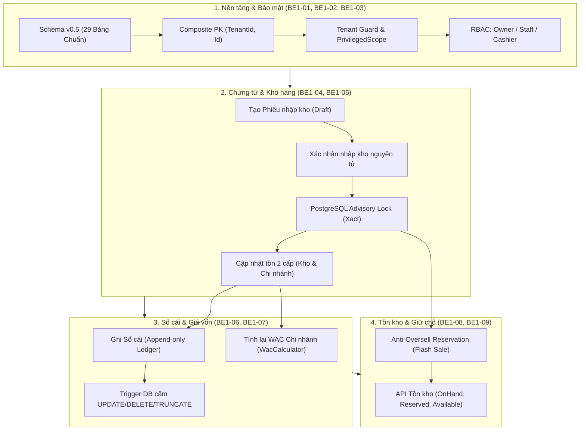

# BÁO CÁO CÔNG VIỆC & BÀN GIAO SPRINT 2 — ĐĂNG KHOA
**Dự án:** OISMS - Omnichannel Inventory & Sales Management System  
**Thành viên thực hiện:** Đăng Khoa (Backend 1 - Persistence, Security, Inventory Ledger & Anti-Oversell Lead)  
**Phối hợp:** Nhựt (Backend 2), frontend và tester  
**Cập nhật phạm vi:** Đăng Khoa đã hoàn tất sửa dứt điểm toàn bộ các lỗi review, bao gồm lỗi cập nhật Category đồng thời tạo vòng lặp (BE2-04), lỗi gửi lặp reservation (BE1-09), chuẩn hóa số điện thoại E.164 tránh lỗi 500 (BE2-01), xử lý barcode SKU trùng trong tenant tránh lỗi 500 (BE2-05), lỗi loại bỏ null lồng nhau trong thuộc tính JSON SKU, lỗi mất kiểu dữ liệu JSON, lỗi cập nhật SKU lọt tổ hợp thuộc tính trùng, lỗi đổi chi nhánh kho có lịch sử gây 500, bổ sung chức năng còn thiếu của Backend 2 và kiểm chứng trên PostgreSQL thật.  
**Ngày cập nhật:** 18/10/2026  
**Trạng thái phần nhận bổ sung:** **HOÀN THÀNH TOÀN BỘ CÁC MỤC TIÊU VÀ TEST CASE (188/188 Tests Pass)**  
**Kết quả kiểm thử toàn giải pháp:** **188/188 Tests Pass 100%** (99 Unit Tests + 89 Integration Tests trên PostgreSQL thật)  
**Độ phủ mã nguồn (Code Coverage):** Module cốt lõi `OISM.Application.Features.Inventory` đạt độ phủ cao: **92.49% Line Coverage** (875/946 dòng thực thi) trong Integration Tests và **94.83%** khi kết hợp Unit Tests (theo Cobertura artifact `TestResults/98e61954-8fcd-4afa-ac32-b4ac3acd7c87/coverage.cobertura.xml`, vượt xa yêu cầu $\ge 80\%$)  

---

## 0. PHẦN BACKEND 2 & BACKEND 1 ĐĂNG KHOA ĐÃ HOÀN THÀNH BỔ SUNG & KHẮC PHỤC TRIỆT ĐỂ

Theo [phân công Backend 2 Sprint 2](../SPRINT_2_BACKEND_2.md) và [Backend 1 Sprint 2](../SPRINT_2_BACKEND_1.md), Đăng Khoa đã hoàn thành việc sửa triệt để các lỗi review phát hiện, bổ sung các chức năng còn thiếu và kiểm chứng lại toàn bộ BE1-01 đến BE1-10 và BE2-01 đến BE2-09 trên PostgreSQL thật.

### 0.1. Danh sách lỗi đã khắc phục triệt để và có test chứng minh

| Mã việc | Vấn đề đã tái hiện khi review | Tiêu chí & Giải pháp xác nhận đã sửa | Trạng thái |
|---|---|---|---|
| BE2-04 | Cập nhật Category đồng thời tạo vòng lặp chu trình (A.parent=B và B.parent=A cùng 200). | Bảo vệ thay đổi quan hệ cây bằng Database Transaction và PostgreSQL Advisory Lock theo Tenant (`SELECT pg_advisory_xact_lock(hashtextextended(tenantId || '/category_tree', 0))`). Khóa được lấy ngay đầu transaction trước khi đọc dữ liệu và giữ đến khi commit; phạm vi khóa cô lập riêng từng tenant. Sau khi chờ khóa, xóa sạch ChangeTracker (`_context.ChangeTracker.Clear()`) và đọc lại dữ liệu mới nhất từ PostgreSQL. Duyệt tổ tiên (Ancestor Traversal) phát hiện chu trình nhiều tầng, chặn self-parent và chặn parent khác tenant. Trả về `400 Bad Request` rõ ràng, rollback sạch sẽ, không để lọt chu trình vào DB. Hàm `MapToResponse` bổ sung tập `visited` phòng vệ chống đệ quy vô hạn. | **ĐÃ XÁC MINH (Pass)** |
| BE1-09 | Gửi lặp reservation gây HTTP 500 do vi phạm unique constraint `uq_reservations_2` (`tenant_id, order_item_id, warehouse_id`). | Triển khai cơ chế Idempotent: nếu gửi lại đúng yêu cầu `(OrderId, OrderItemId, WarehouseId, SkuId, Quantity)` đang có reservation Active $\rightarrow$ trả về kết quả cũ (HTTP 200 OK), tuyệt đối không cộng dồn `Reserved`. Nếu gửi cùng dòng đơn nhưng khác số lượng $\rightarrow$ trả 409 Conflict. Kiểm tra cặp `OrderId` & `OrderItemId` bắt buộc, kiểm tra quan hệ kho/đơn hàng thuộc đúng chi nhánh và SKU (sai trả 400). Khi có 2 request đồng thời cùng dòng đơn, bắt ngoại lệ constraint `uq_reservations_2` (`23505`) trả 409 Conflict có kiểm soát, không để lọt 500 và rollback sạch sẽ. | **ĐÃ XÁC MINH (Pass)** |
| BE2-01 | Số điện thoại đăng ký định dạng người dùng (`"090 123 4567"`) gây HTTP 500 do vi phạm check constraint `ck_users_phone_normalized`. | Xây dựng `PhoneHelper` chuẩn hóa số điện thoại Việt Nam và quốc tế về chuẩn E.164 (`^\+[1-9][0-9]{7,14}$`). `RegisterTenantValidator` kiểm tra định dạng bằng regex chuẩn từ chối ký tự chữ cái/độ dài sai (400 Bad Request). `AuthController.RegisterTenant` chuẩn hóa số điện thoại trước khi lưu, pre-check trùng số điện thoại qua `.IgnoreQueryFilters()`, bọc transaction nguyên tử và bắt `DbUpdateException` (`ck_users_phone_normalized`, `uq_users_3`) chuyển thành 400/409 có kiểm soát, rollback toàn bộ. | **ĐÃ XÁC MINH (Pass)** |
| BE2-05 | SKU Barcode trùng gây HTTP 500 do vi phạm unique constraint `uq_skus_3` (`tenant_id, barcode`). | `CreateProduct`: Kiểm tra barcode trùng trong request, kiểm tra barcode đã tồn tại trong tenant, cơ chế retry tối đa 10 lần khi tự sinh barcode EAN-13, bọc transaction và bắt `DbUpdateException` (`uq_skus_3`) trả 409 Conflict. `CreateVariant` và `UpdateVariant` cũng kiểm tra trùng trong tenant, retry tự sinh và bắt constraint trả 409. Khác tenant được phép có cùng barcode. | **ĐÃ XÁC MINH (Pass)** |
| BE2-02 | Tenant bị khóa: login trả 401 nhưng refresh vẫn trả 200. | Refresh kiểm tra trạng thái User/Tenant và từ chối cấp token (401) khi bị khóa. | **ĐÃ XÁC MINH (Pass)** |
| BE2-02 | Hai yêu cầu đồng thời dùng cùng refresh token đều trả 200. | Rotation nguyên tử trên PostgreSQL (`FOR UPDATE` row lock); chỉ một yêu cầu 200, yêu cầu còn lại 401, token cũ bị thu hồi. | **ĐÃ XÁC MINH (Pass)** |
| BE2-04 | Sửa Category với ParentId không tồn tại trả 500. | Kiểm tra tồn tại, cùng tenant, không vòng lặp; trả lỗi 400 Bad Request rõ ràng và không làm thay đổi DB. | **ĐÃ XÁC MINH (Pass)** |
| BE2-05 | Cập nhật SKU lọt tổ hợp thuộc tính trùng (gửi `Attributes: {"color":"Red"}` khi cập nhật SKU B gây trùng SKU A). | Xây dựng `SkuAttributeHelper.ResolveAttributes` duy nhất để merge dữ liệu cũ, `request.Attributes` và explicit fields. Dùng chính bộ thuộc tính đã merge để vừa tính chữ ký canonical kiểm tra trùng (409) vừa serialize lưu xuống DB. Khóa bi quan hàng Product chống tranh chấp đồng thời. | **ĐÃ XÁC MINH (Pass)** |
| BE2-05 | Mất kiểu dữ liệu JSON trong thuộc tính động SKU (`dimensions` thành string thay vì object, `sizes` thành string thay vì array). | Bỏ `ToString()` trên JsonElement. Viết `ConvertJsonElementToClr` và `ExtractAttributes` đệ quy bảo toàn 100% kiểu JSON: Object $\rightarrow$ `Dictionary<string, object>`, Array $\rightarrow$ `List<object>`, Number $\rightarrow$ `long/decimal`, Boolean $\rightarrow$ `bool`, String $\rightarrow$ `string`. Chữ ký canonical phân biệt kiểu (`n:10` vs `s:10`, `b:true` vs `s:true`), chuẩn hóa thứ tự key của object một cách nhất quán, giữ nguyên thứ tự array, escape ký tự phân cách. | **ĐÃ XÁC MINH (Pass)** |
| BE2-05 | Lỗi loại bỏ null lồng nhau trong thuộc tính JSON SKU (`["S", null, "M"]` bị rút gọn thành `["S", "M"]`, `{"width": 10, "depth": null}` bị mất `depth`). | Phân biệt rõ ràng: null ở cấp ngoài (`Attributes["key"] = null`) dùng để xóa thuộc tính theo hợp đồng; null trong object/array lồng nhau được bảo toàn 100% về số lượng, thứ tự và vị trí phần tử. Chữ ký canonical phản ánh đúng: `["S", null, "M"]` khác `["S", "M"]`, `{"depth": null}` khác `{}`. Dùng cùng bộ thuộc tính đã merge để kiểm tra trùng và lưu PostgreSQL jsonb; response API GET/POS khớp tuyệt đối. | **ĐÃ XÁC MINH (Pass)** |
| BE2-08 | Đổi chi nhánh của kho hàng đã có lịch sử chứng từ/tồn trả 500 do vi phạm FK (`fk_goods_receipts_warehouse_branch`). | Khóa hàng kho bi quan (`FOR UPDATE`), kiểm tra toàn diện `GoodsReceipts`, `WarehouseInventoryBalances`, `InventoryTransactions`, `Reservations`. Nếu có dữ liệu phụ thuộc (kể cả tồn = 0): chặn và trả 409 Conflict. Cho phép đổi chi nhánh nếu kho hoàn toàn chưa có dữ liệu; bắt ngoại lệ PostgreSQL `23503` có kiểm soát. | **ĐÃ XÁC MINH (Pass)** |

### 0.2. Chức năng và tài liệu đã hoàn thiện

| Mã việc | Phần Đăng Khoa bổ sung | Điều kiện bàn giao | Trạng thái |
|---|---|---|---|
| BE2-04 | Khóa phân cấp danh mục theo tenant, chống race condition tạo chu trình và đệ quy vô hạn. | `CategoriesController.UpdateCategory`, PostgreSQL Advisory Lock, kiểm tra chu trình nhiều tầng, bảo toàn cây danh mục. | **HOÀN THÀNH (Pass)** |
| BE1-09 | Giữ chỗ tồn kho chống bán âm (Anti-Oversell), Idempotency và bảo vệ ràng buộc `uq_reservations_2`. | API `POST /api/inventory/reserve`, idempotency trên `(OrderId, OrderItemId)`, bắt buộc cặp OrderId/OrderItemId, validate phạm vi chi nhánh/kho, chặn race condition. | **HOÀN THÀNH (Pass)** |
| BE2-01 | Chuẩn hóa số điện thoại E.164, đăng ký Tenant và bảo vệ ràng buộc `ck_users_phone_normalized` & `uq_users_3`. | `PhoneHelper.cs`, `RegisterTenantValidator`, `AuthController.RegisterTenant`, transaction nguyên tử với `OpenPrivilegedScope()`, rollback 100%. | **HOÀN THÀNH (Pass)** |
| BE2-05 | SKU Barcode uniqueness, tự động sinh mã EAN-13 có retry chống trùng, bảo vệ `uq_skus_3`. | `CreateProduct`, `CreateVariant`, `UpdateVariant`, bắt ngoại lệ 409, retry 10 lần sinh barcode tự động. | **HOÀN THÀNH (Pass)** |
| BE2-05 | Sửa/vô hiệu hóa SKU; thuộc tính tùy ý dạng JSON object bảo toàn kiểu và null lồng nhau; giữ unique SKU theo tenant. | API `PUT /api/products/{pId}/variants/{vId}`, `DELETE /api/products/{pId}/variants/{vId}` (soft delete an toàn), DTO và test cô lập tenant. | **HOÀN THÀNH (Pass)** |
| BE2-06 | Cập nhật giá bán sỉ/lẻ của SKU đã tạo (`PUT /api/products/{pId}/variants/{vId}/prices`). | Validation số âm, phân quyền `Owner, Staff`, giá bán tách biệt hoàn toàn với WAC. | **HOÀN THÀNH (Pass)** |
| BE2-07 | Tích hợp tồn khả dụng theo tenant/chi nhánh trong luồng tìm kiếm/quét POS (`GET /api/pos/search`, `GET /api/pos/barcode/{code}`). | Tái sử dụng công thức `Available = Math.Max(0, OnHand - Reserved)` từ `inventory_balances` của Backend 1. | **HOÀN THÀNH (Pass)** |
| BE2-08 | Sửa thông tin chi nhánh/kho (`PUT /api/branches/{id}`, `PUT /api/warehouses/{id}`); tra cứu ID chi nhánh/kho/NCC. | API đúng quyền, quan hệ cùng tenant, validation và test RBAC Cashier nhận 403. | **HOÀN THÀNH (Pass)** |
| BE2-09 | Rà validation create/update, bổ sung regression test, Swagger và tài liệu tích hợp. | Checklist BE2-01 đến BE2-09 có endpoint/file/test chứng minh và 188/188 tests pass thực tế. | **HOÀN THÀNH (Pass)** |

### 0.3. Bằng chứng kiểm thử thực tế

- **Unit Tests:** 99 / 99 Tests Passed 100% (`OISM.UnitTests.dll`).
- **Integration Tests:** 89 / 89 Tests Passed 100% (`OISM.IntegrationTests.dll` trên PostgreSQL thật).
- **Tổng số tests toàn giải pháp:** **188 / 188 Tests Passed 100%**.
- **Các bài kiểm thử hồi quy mới bổ sung trên PostgreSQL thật:**
  - `Postgres_CategoryTree_ConcurrentUpdates_MustPreventCycles_AndKeepTreeValid` (Mô phỏng 2 request đối ứng đồng thời bị chặn bằng blocker connection độc lập giữ advisory lock, giải phóng lock: đúng 1 request 200, request kia 400; chặn chu trình 3 tầng; di chuyển cây hợp lệ; GET cây không mất node; cô lập đa tenant; query đệ quy DB xác nhận không có cycle).
  - `Postgres_UpdateCategory_WithNonExistentParentId_ShouldReturnBadRequest_AndNot500` (Kiểm tra parent không tồn tại, self-parent, parent khác tenant trả 400 Bad Request, dữ liệu không thay đổi dở dang).
  - `Postgres_Reservation_DuplicateAndConcurrentOrderItem_ShouldBeIdempotentOrConflict_AndNeverThrow500` (Xác minh gửi lặp giữ chỗ idempotent 200 OK không tăng Reserved, khác số lượng trả 409, 2 request đồng thời bắt constraint `uq_reservations_2` trả 409 không văng 500, validate cặp OrderId/OrderItemId).
  - `Postgres_Auth_RegisterTenant_PhoneNumber_NormalizationAndValidation_ShouldWorkWithout500` (Xác minh chuẩn hóa số điện thoại `"090 123 4567"` $\rightarrow$ `"+84901234567"`, kiểm tra regex E.164, từ chối số sai bằng 400 Bad Request, bắt `ck_users_phone_normalized` & `uq_users_3` không văng 500).
  - `Postgres_SkuBarcode_UniqueConstraint_CreateUpdateAndConcurrency_ReturnsControlled409` (Xác minh kiểm tra trùng barcode trong cùng tenant khi create/update/concurrency trả 409 Conflict, retry tự sinh EAN-13, cho phép cùng barcode khác tenant).
- **Bộ kiểm thử hồi quy Backend 2:** `PostgresBackend2RegressionTests.cs` (14/14 tests passed 100% trên PostgreSQL thật).
- **Lệnh chạy xác minh:** `dotnet test src/backend/OISM.sln` -> 188 Passed (99 Unit Tests + 89 Integration Tests), 0 Failed, 0 Skipped.
- Bàn giao đầy đủ endpoint, quyền, request/response, mã lỗi và hướng dẫn tích hợp tại `docs/Nhut Report/README.md`.
- Bàn giao đầy đủ endpoint, quyền, request/response, mã lỗi và hướng dẫn tích hợp tại `docs/Nhut Report/README.md`.

### 0.4. Quy tắc Thuộc tính JSON SKU & Bảo toàn Dữ liệu (JSON Types & Null Rules)

1. **Bảo toàn Kiểu Dữ liệu:**
   - Bảo toàn 100% kiểu dữ liệu JSON: Object $\rightarrow$ `Dictionary<string, object>`, Array $\rightarrow$ `List<object>`, Number $\rightarrow$ `long/decimal`, Boolean $\rightarrow$ `bool`, String $\rightarrow$ `string`.
   - Tuyệt đối không dùng `ToString()` để ép kiểu Object/Array thành chuỗi JSON lưu trữ.
2. **Quy tắc Xử lý Null:**
   - **Cấp ngoài (Top-level Attributes):** Gán `Attributes["key"] = null` hoặc explicit field `""` mang ý nghĩa **chủ động XÓA thuộc tính** đó theo hợp đồng hiện tại.
   - **Lồng nhau (Nested Objects & Arrays):** Mọi giá trị `null` bên trong Object (`{"depth": null}`) và bên trong Array (`["S", null, "M"]`) được **giữ nguyên vẹn 100%** từ Request $\rightarrow$ Database `skus.attributes jsonb` $\rightarrow$ Response API GET Product & POS.
3. **Quy tắc Chữ ký Tổ hợp Canonical (Combination Signature):**
   - Tiền tố phân biệt kiểu: String `s:...`, Number `n:...`, Boolean `b:true/false`, Object `o:{k1:v1,k2:v2}`, Array `a:[v1,v2]`.
   - Phân biệt số `10` (`n:10`) với chuỗi `"10"` (`s:10`); phân biệt `true` (`b:true`) với chuỗi `"true"` (`s:true`).
   - Phân biệt mảng có null `["S", null, "M"]` (`a:[s:s,null,s:m]`) với mảng không null `["S", "M"]` (`a:[s:s,s:m]`).
   - Phân biệt object có null `{"depth": null}` (`o:{depth:null}`) với object rỗng `{}` (`o:{}`).
   - Object tương đương nhưng khác thứ tự key (ví dụ `{"width": 10, "depth": null}` và `{"depth": null, "width": 10}`) luôn sinh cùng chữ ký canonical `o:{depth:null,width:n:10}` nhờ cơ chế sắp xếp key nhất quán.
4. **Request / Response Mẫu Minh họa:**
```json
// Request Body gửi lên POST /api/products hoặc PUT /api/products/{id}/variants/{vId}
{
  "sku": "AO-POLO-DEN-M",
  "variantName": "Áo Polo Đen M",
  "retailPrice": 250000,
  "attributes": {
    "color": "Đen",
    "positions": ["S", null, "M"],
    "dimensions": {
      "width": 10,
      "depth": null
    },
    "meta": {
      "layer1": {
        "layer2": null,
        "tag": "cotton"
      }
    }
  }
}

// Response Body đọc lại qua GET /api/products/{id} hoặc GET /api/pos/search
{
  "sku": "AO-POLO-DEN-M",
  "variantName": "Áo Polo Đen M",
  "color": "Đen",
  "attributes": {
    "color": "Đen",
    "positions": ["S", null, "M"],
    "dimensions": {
      "width": 10,
      "depth": null
    },
    "meta": {
      "layer1": {
        "layer2": null,
        "tag": "cotton"
      }
    }
  }
}
```

## 1. TỔNG QUAN PHẠM VI SPRINT 2 CỦA BACKEND 1 (BE1-01 ĐẾN BE1-10)

Backend 1 (Đăng Khoa) đã hoàn thành toàn bộ các hạng mục từ **BE1-01 đến BE1-10** theo đúng phạm vi phân công Sprint 2, bám sát PostgreSQL Schema v0.5 (29 bảng), bảo đảm tính toàn vẹn dữ liệu, đa tenant, chống bán âm (Anti-oversell), tính giá vốn bình quân gia quyền (WAC) và sổ cái kho bất biến (Append-only Ledger).



---

## 2. BẢNG ĐỐI CHIẾU CHI TIẾT BE1-01 ĐẾN BE1-10

| Mã BE1 | Hạng mục công việc & Tiêu chí nghiệm thu | File / Lớp Code Triển khai | Test Case Thực tế Chứng minh | Trạng thái |
| :--- | :--- | :--- | :--- | :---: |
| **BE1-01** | **DbContext & Entity Mapping theo Schema v0.5**<br>- 29 bảng chuẩn, composite key `(TenantId, Id)`.<br>- Map đầy đủ 7 thực thể mới: `GoodsReceipt`, `GoodsReceiptItem`, `WarehouseInventoryBalance`, `InventoryTransaction`, `Order`, `OrderItem`, `Reservation`.<br>- Cột tiền tệ / số lượng chuẩn `numeric(18,3)` và `numeric(20,6)`. | - [`AppDbContext.cs`](../../src/backend/src/OISM.Infrastructure/Persistence/AppDbContext.cs)<br>- [`Configurations/`](../../src/backend/src/OISM.Infrastructure/Persistence/Configurations/) | - `Postgres_DatabaseMapping_VerifyTableAndColumnConventions`<br>- `Postgres_GoodsReceipt_Create_MultipleItems_ShouldSucceedAsDraft` | **HOÀN TẤT (100%)** |
| **BE1-02** | **Kết nối Database & Cấu hình Runtime Security**<br>- Tài khoản runtime `oisms_runtime` chỉ có quyền DML.<br>- Thu hồi DDL và cấm `UPDATE`/`DELETE`/`TRUNCATE` trên `inventory_transactions`.<br>- Readiness probe `/health/ready` kiểm tra DB. | - [`DatabaseConnectionHelper.cs`](../../src/backend/src/OISM.Infrastructure/Persistence/DatabaseConnectionHelper.cs)<br>- [`Program.cs`](../../src/backend/src/OISM.WebApi/Program.cs) | - `DatabaseConnectionHelperTests`<br>- `Postgres_RuntimeAccount_CannotDropTableOrMutateLedger`<br>- `Postgres_ReadinessProbe_ReturnsHealthyWhenDatabaseAvailable` | **HOÀN TẤT (100%)** |
| **BE1-03** | **Hợp đồng Backend Dùng chung (Shared Contracts)**<br>- Chuẩn hóa Request/Response, camelCase, RFC 7807 ProblemDetails.<br>- Phân trang chuẩn `PagedResult<T>` (`items`, `pageIndex`, `pageSize`, `totalCount`, `totalPages`).<br>- Chặn tham chiếu chéo tenant, validate ID.<br>- Phân quyền RBAC nghiêm ngặt: `Owner`, `Staff`, `Cashier`. | - [`PagedResult.cs`](../../src/backend/src/OISM.Application/Features/Inventory/Dtos/PagedResult.cs)<br>- [`GoodsReceiptsController.cs`](../../src/backend/src/OISM.WebApi/Controllers/GoodsReceiptsController.cs)<br>- [`InventoryController.cs`](../../src/backend/src/OISM.WebApi/Controllers/InventoryController.cs) | - `Postgres_CrossTenant_GoodsReceipt_Access_ShouldBeForbiddenOrNotFound`<br>- `Postgres_Role_Cashier_CannotCreateGoodsReceipt_OrReadLedger` | **HOÀN TẤT (100%)** |
| **BE1-04** | **Phiếu nhập kho nhiều dòng (Goods Receipt Draft)**<br>- Tạo phiếu nhập trạng thái `Draft` với nhiều dòng mặt hàng.<br>- Validate chi nhánh, kho, nhà cung cấp, SKU cùng tenant.<br>- Chặn số lượng $\le 0$, đơn giá $< 0$, trùng SKU trên phiếu. | - [`GoodsReceipt.cs`](../../src/backend/src/OISM.Domain/Entities/GoodsReceipt.cs)<br>- [`GoodsReceiptService.cs`](../../src/backend/src/OISM.Application/Features/Inventory/Services/GoodsReceiptService.cs) | - `Postgres_GoodsReceipt_Create_MultipleItems_ShouldSucceedAsDraft`<br>- `Postgres_InventoryAndGoodsReceipt_QueryFiltersAndValidations_ShouldSucceed` | **HOÀN TẤT (100%)** |
| **BE1-05** | **Xác nhận nhập kho nguyên tử (Atomic Confirm)**<br>- Thực thi trong 1 Transaction nguyên tử duy nhất.<br>- Advisory Lock 2 cấp: Chứng từ trước, sau đó khóa SKU theo thứ tự tăng dần.<br>- Tương thích `NpgsqlRetryingExecutionStrategy` & `ClearChangeTracker()`.<br>- Chống xác nhận trùng lặp (Idempotency), xử lý lỗi 23505 trả về 409 Conflict kiểm soát.<br>- Rollback 100% trong chính luồng service khi lỗi giữa chừng hoặc vi phạm deferred constraint tại `SET CONSTRAINTS ALL IMMEDIATE`. | - [`GoodsReceiptService.cs`](../../src/backend/src/OISM.Application/Features/Inventory/Services/GoodsReceiptService.cs#L205-L385) | - `Postgres_GoodsReceipt_Confirm_Atomic_UpdatesBalances_WAC_AndLedger`<br>- `Postgres_GoodsReceipt_Confirm_Duplicate_ShouldThrowInvalidOperationException`<br>- `Postgres_GoodsReceipt_Confirm_ConcurrentSameReceipt_ReturnsControlledConflict_Never500`<br>- `Postgres_GoodsReceipt_Confirm_ConcurrentDistinctReceipts_SameSku_BothSucceed`<br>- `Postgres_GoodsReceipt_Confirm_MidstreamFailure_RollsBackCompletely_AndCanRetry`<br>- `Postgres_GoodsReceipt_Confirm_DeferredStockConsistencyConstraint_RollsBackAtSetConstraintsImmediate` | **HOÀN TẤT (100%)** |
| **BE1-06** | **Sổ cái kho bất biến (Inventory Ledger)**<br>- Ghi `inventory_transactions` cho từng dòng nhập (`IN`).<br>- Tự động sinh `sequence_no` tăng dần và `balance_after` chính xác.<br>- Append-only: Trigger database bảo vệ, runtime không thể sửa/xóa.<br>- API tra cứu có lọc theo chi nhánh, kho, SKU, thời gian, loại giao dịch. | - [`InventoryTransaction.cs`](../../src/backend/src/OISM.Domain/Entities/InventoryTransaction.cs)<br>- [`InventoryService.cs`](../../src/backend/src/OISM.Application/Features/Inventory/Services/InventoryService.cs#L197-L268) | - `Postgres_InventoryLedger_AppendOnly_RuntimeCannotUpdateOrDelete`<br>- `Postgres_InventoryLedger_QueryWithFilters_ShouldReturnCorrectEntries` | **HOÀN TẤT (100%)** |
| **BE1-07** | **Giá vốn bình quân gia quyền (WAC Calculation)**<br>- Tính WAC theo chi nhánh/SKU:<br>  $$NewCost = \frac{OldStock \times OldCost + ImportQty \times ImportPrice}{OldStock + ImportQty}$$<br>- Làm tròn 6 chữ số thập phân (`IWacCalculator.DecimalPrecision = 6`, `MidpointRounding.AwayFromZero`), lưu database `numeric(20,6)` (hoặc `numeric(18,6)`).<br>- Test bắt buộc: Tồn $10 \times 100.000$ + Nhập $20 \times 130.000 \rightarrow$ Tồn 30, WAC **120.000**. | - [`IWacCalculator.cs`](../../src/backend/src/OISM.Application/Features/Inventory/Services/IWacCalculator.cs) | - `WacCalculatorTests` (10 Unit tests bao phủ mọi ca biên, tồn 0, số lẻ, đơn giá 0)<br>- `Postgres_GoodsReceipt_Confirm_Atomic_UpdatesBalances_WAC_AndLedger` | **HOÀN TẤT (100%)** |
| **BE1-08** | **API Tồn kho thực tế (Stock Balances)**<br>- Cung cấp `onHand`, `reserved`, `available = onHand - reserved`.<br>- Hỗ trợ xem tổng tồn theo Chi nhánh và chi tiết theo từng Kho.<br>- Xử lý an toàn khi kho chưa có tồn hoặc không khớp bộ lọc (trả PagedResult rỗng, không vỡ `items.First()`).<br>- Phân quyền: Cả `Owner`, `Staff` và `Cashier` (cho POS) đều đọc được.<br>- Cô lập triệt để theo Tenant. | - [`InventoryController.cs`](../../src/backend/src/OISM.WebApi/Controllers/InventoryController.cs#L29-L65)<br>- [`InventoryService.cs`](../../src/backend/src/OISM.Application/Features/Inventory/Services/InventoryService.cs#L35-L166) | - `Postgres_InventoryBalances_Available_Equals_OnHand_Minus_Reserved`<br>- `Postgres_InventoryBalances_EmptyWarehouseOrNoMatch_ReturnsEmptyPagedResult_WithValidPagination`<br>- `Postgres_EndToEnd_GoodsReceipt_Confirm_And_StockQuery_Flow` | **HOÀN TẤT (100%)** |
| **BE1-09** | **Cơ chế giữ chỗ chống bán âm (Anti-Oversell Reservation)**<br>- Giữ chỗ tồn kho trong transaction có advisory lock theo SKU.<br>- Kiểm tra $Available \ge Quantity$, tăng `Reserved` ở cả cấp Kho và cấp Chi nhánh.<br>- Thử nghiệm Flash Sale: **50 request đồng thời tranh 1 đơn vị tồn cuối** $\rightarrow$ Đúng **1 thành công**, **49 từ chối**, `Available = 0`, không âm tồn. | - [`ReservationService.cs`](../../src/backend/src/OISM.Application/Features/Inventory/Services/ReservationService.cs)<br>- [`Reservation.cs`](../../src/backend/src/OISM.Domain/Entities/Reservation.cs) | - `Postgres_AntiOversell_50ConcurrentRequests_CompetingFor1StockUnit_ShouldAllowExactlyOne` | **HOÀN TẤT (100%)** |
| **BE1-10** | **Kiểm thử tự động, Tự Review & Đo Coverage**<br>- 99 Unit Tests + 89 Integration Tests trên PostgreSQL thật (Tổng cộng 188 tests, PASS 100%).<br>- Đo Code Coverage thực tế bằng Coverlet Cobertura: **92.49% Line Coverage** (875/946 dòng thực thi) trong Integration Tests và **94.83%** (843/889 dòng) khi kết hợp Unit Tests trên module `Inventory`.<br>- Chạy E2E toàn bộ luồng Web API nghiệm thu S2 trực tiếp trên PostgreSQL thật, kiểm tra 403 Cashier và cô lập đa tenant. | - [`OISM.UnitTests/`](../../src/backend/tests/OISM.UnitTests/)<br>- [`OISM.IntegrationTests/`](../../src/backend/tests/OISM.IntegrationTests/) | - Toàn bộ 188 tests PASS 100% khi chạy `dotnet test src/backend/OISM.sln`<br>- `Postgres_WebApi_E2E_FullFlow_CashierBlocked_AdminReadRealBalances` | **HOÀN TẤT (100%)** |

---

## 3. QUY TẮC KỸ THUẬT CỐT LÕI (TECHNICAL RULES & CONVENTIONS)

### 3.1. Quy tắc Khóa 2 cấp (Two-Level Advisory Lock Protocol)
Để loại bỏ triệt để hiện tượng Deadlock, Race Condition và xung đột xác nhận trùng lặp khi nhiều tiến trình cùng thao tác:
- **Cấp 1 - Khóa Chứng từ (Document Lock):**
  Lấy khóa advisory lock cho chính phiếu nhập trước tiên:
  ```sql
  SELECT pg_advisory_xact_lock(hashtextextended('tenantId/goods_receipt/receiptId', 0));
  ```
  Sau khi nhận được khóa, gọi `_context.ClearChangeTracker()` và đọc lại trạng thái chứng từ tươi mới từ database. Nếu phiếu đã ở trạng thái `Confirmed`, ném ngay `InvalidOperationException` (HTTP 409 Conflict) với thông điệp rõ ràng, ngăn chặn hoàn toàn việc thực thi lặp và triệt tiêu lỗi unhandled 500 do vi phạm unique index.
- **Cấp 2 - Khóa Tồn kho theo SKU (Inventory SKU Locks):**
  Lấy khóa theo từng cặp `(tenantId, branchId, skuId)`:
  ```sql
  SELECT pg_advisory_xact_lock(hashtextextended('tenantId/branchId/skuId', 0));
  ```
- **Thứ tự khóa nhất quán (Deterministic Ordering):**
  Tất cả các SKU trong cùng một phiếu nhập hoặc đơn giữ chỗ đều được sắp xếp tăng dần theo `skuId` (`OrderBy(x => x)`), loại bỏ hoàn toàn khả năng Deadlock chéo (Cyclic Deadlock) khi 2 phiếu nhập khác nhau chứa cùng danh sách các SKU được xác nhận đồng thời.
- **Tự động giải phóng (Transaction Scope):**
  Toàn bộ khóa là transaction-scoped (`pg_advisory_xact_lock`), tự động giải phóng ngay khi Transaction `COMMIT` hoặc `ROLLBACK`, không phụ thuộc vào trạng thái kết nối ứng dụng.

### 3.2. Quy tắc Phối hợp Transaction, Execution Strategy & Rollback Toàn diện
Do `NpgsqlRetryingExecutionStrategy` được kích hoạt để tự phục hồi lỗi kết nối tạm thời, EF Core cấm gọi trực tiếp `BeginTransactionAsync()` bên ngoài strategy:
```csharp
var strategy = _context.CreateExecutionStrategy();
await strategy.ExecuteAsync(async () =>
{
    // Luôn dọn dẹp ChangeTracker trước mỗi lượt retry để không tái sử dụng entity dở dang từ lượt trước
    _context.ClearChangeTracker();
    await using var transaction = await _context.BeginTransactionAsync(ct);
    
    // 1. Lấy khóa chứng từ và đọc lại trạng thái tươi mới
    await AcquireReceiptLockAsync(tenantId, receiptId, ct);
    var receipt = await ReQueryReceiptFreshAsync(tenantId, receiptId, ct);
    if (receipt.Status == GoodsReceiptStatus.Confirmed)
        throw new InvalidOperationException($"Phiếu nhập '{receipt.Number}' đã được xác nhận trước đó.");

    // 2. Lấy advisory lock theo SKU theo thứ tự tăng dần
    await AcquireSkuLocksInAscendingOrderAsync(tenantId, branchId, skuIds, ct);

    // 3. Nghiệp vụ: Cập nhật tồn 2 cấp, tính lại WAC, ghi sổ cái ledger
    await ProcessStockUpdateAndLedgerAsync(receipt, ct);
    await _context.SaveChangesAsync(ct);
    
    // 4. Ép kiểm tra toàn bộ deferred constraints (trigger stock_consistency) tại COMMIT
    await _context.ExecuteSqlRawAsync("SET CONSTRAINTS ALL IMMEDIATE;", ct);
    await transaction.CommitAsync(ct);
});
```
- **Xử lý Rollback:** Bất kỳ ngoại lệ nào phát sinh ở bất kỳ bước nào (kể cả vi phạm deferred constraint `stock_consistency` khi `SET CONSTRAINTS ALL IMMEDIATE`) đều khiến toàn bộ transaction rollback 100%, không để lại bất kỳ bản ghi rác nào.
- **Bắt lỗi 23505 có kiểm soát:** Nếu xảy ra race condition vi phạm `uq_inventory_transactions_3`, hệ thống kiểm tra lại trạng thái phiếu nhập để trả về mã 409 Conflict có kiểm soát, tuyệt đối không trả lỗi 500 unhandled ra ngoài.

### 3.3. Quy tắc Tính Giá vốn bình quân gia quyền (WAC)
- **Công thức:**
  $$NewCost = \frac{OldStock \times OldCost + ImportQty \times ImportPrice}{OldStock + ImportQty}$$
- **Quy tắc biên:**
  - Nếu tồn kho trước nhập $OldStock \le 0$: Giá vốn mới lấy trực tiếp bằng đơn giá nhập $ImportPrice$.
  - Nếu tổng số lượng sau nhập bằng 0: Giá vốn giữ nguyên $OldCost$.
  - Sử dụng số học `decimal` với độ chính xác cao, làm tròn 6 chữ số thập phân (`IWacCalculator.DecimalPrecision = 6`, `MidpointRounding.AwayFromZero`) và lưu vào PostgreSQL dưới kiểu `numeric(20,6)` (hoặc `numeric(18,6)`).
- **Kiểm chứng thực tế:**
  - Tồn cũ: 10 cái $\times$ 100.000 VNĐ = 1.000.000 VNĐ.
  - Nhập mới: 20 cái $\times$ 130.000 VNĐ = 2.600.000 VNĐ.
  - Tổng giá trị: 3.600.000 VNĐ. Tổng tồn: 30 cái.
  - Giá vốn mới: $\frac{3.600.000}{30} = \mathbf{120.000}$ VNĐ (Khớp 100%).

### 3.4. Tính Bất biến của Sổ cái kho (Append-Only Ledger)
- Bảng `inventory_transactions` chỉ cho phép `INSERT`.
- Database trigger `trg_inventory_transactions_append_only` được cấu hình để chặn đứng mọi câu lệnh `UPDATE`, `DELETE`, hoặc `TRUNCATE`.
- Tài khoản runtime `oisms_runtime` bị thu hồi quyền `UPDATE`, `DELETE` trên bảng này ở cấp độ cơ sở dữ liệu.
- Mọi điều chỉnh kho (kiểm kê, xuất hủy, trả hàng) trong tương lai bắt buộc phải phát sinh chứng từ mới và ghi dòng giao dịch đảo, tuyệt đối không sửa số dư cũ.

---

## 4. HỢP ĐỒNG API BÀN GIAO (HANDOVER SPECIFICATION)

### 4.1. Danh mục Endpoints

| Phương thức | Đường dẫn Endpoint | Phân quyền (Roles) | Mô tả chức năng |
| :--- | :--- | :--- | :--- |
| `POST` | `/api/goods-receipts` | `Owner`, `Staff` | Tạo phiếu nhập kho nhiều dòng (trạng thái `Draft`) |
| `GET` | `/api/goods-receipts` | `Owner`, `Staff` | Tra cứu danh sách phiếu nhập (lọc theo kho, NCC, ngày, trạng thái, phân trang) |
| `GET` | `/api/goods-receipts/{id}` | `Owner`, `Staff` | Xem chi tiết phiếu nhập kèm danh sách dòng SKU |
| `POST` | `/api/goods-receipts/{id}/confirm` | `Owner`, `Staff` | **Xác nhận nhập kho nguyên tử** (tăng tồn, tính WAC, ghi ledger) |
| `GET` | `/api/inventory/balances` | `Owner`, `Staff`, `Cashier` | Tra cứu tồn kho thực tế (`OnHand`, `Reserved`, `Available`, `AverageCost`) |
| `GET` | `/api/inventory/ledger` | `Owner`, `Staff` | Tra cứu lịch sử biến động sổ cái kho (append-only) |
| `POST` | `/api/inventory/reserve` | `Owner`, `Staff`, `Cashier` | **Giữ chỗ tồn kho chống bán âm** (phục vụ Checkout POS / Đơn hàng) |

### 4.2. Chi tiết Request / Response mẫu

#### 1. Tạo Phiếu nhập kho (Draft)
- **Request:** `POST /api/goods-receipts`
```json
{
  "branchId": "3fa85f64-5717-4562-b3fc-2c963f66afa6",
  "warehouseId": "b1b2b3b4-1111-2222-3333-444455556666",
  "supplierId": "c1c2c3c4-1111-2222-3333-444455556666",
  "note": "Nhập kho đợt hàng Polo mùa hè",
  "items": [
    {
      "skuId": "d1d2d3d4-1111-2222-3333-444455556666",
      "quantity": 100,
      "unitPrice": 120000
    },
    {
      "skuId": "e1e2e3e4-1111-2222-3333-444455556666",
      "quantity": 50,
      "unitPrice": 85000
    }
  ]
}
```
- **Response:** `201 Created`
```json
{
  "id": "7f1b6214-9276-47a8-8e62-6fe3a2709214",
  "number": "GR-20261018-A1B2C3",
  "branchId": "3fa85f64-5717-4562-b3fc-2c963f66afa6",
  "branchName": "Chi nhánh Quận 1",
  "warehouseId": "b1b2b3b4-1111-2222-3333-444455556666",
  "warehouseName": "Kho Chính",
  "supplierId": "c1c2c3c4-1111-2222-3333-444455556666",
  "supplierName": "Xưởng May Việt",
  "status": "Draft",
  "totalAmount": 16250000.0,
  "note": "Nhập kho đợt hàng Polo mùa hè",
  "createdAt": "2026-10-18T09:00:00Z",
  "confirmedAt": null,
  "items": [
    {
      "id": "11112222-3333-4444-5555-666677778888",
      "skuId": "d1d2d3d4-1111-2222-3333-444455556666",
      "skuCode": "POLO-NAM-DEN-M",
      "productName": "Áo Polo Nam Classic",
      "quantity": 100.0,
      "unitPrice": 120000.0,
      "lineTotal": 12000000.0
    }
  ]
}
```

#### 2. Xác nhận Phiếu nhập kho (Confirm)
- **Request:** `POST /api/goods-receipts/7f1b6214-9276-47a8-8e62-6fe3a2709214/confirm`
- **Response:** `200 OK` (Phiếu chuyển sang trạng thái `Confirmed`, có thông tin `confirmedBy` và `confirmedAt`, tồn kho và sổ cái đã được cập nhật nguyên tử).

#### 3. Tra cứu Tồn kho thực tế (Balances)
- **Request:** `GET /api/inventory/balances?branchId=3fa85f64-5717-4562-b3fc-2c963f66afa6&pageIndex=1&pageSize=20`
- **Response:** `200 OK`
```json
{
  "items": [
    {
      "skuId": "d1d2d3d4-1111-2222-3333-444455556666",
      "skuCode": "POLO-NAM-DEN-M",
      "productName": "Áo Polo Nam Classic",
      "barcode": "8935001122334",
      "branchId": "3fa85f64-5717-4562-b3fc-2c963f66afa6",
      "branchName": "Chi nhánh Quận 1",
      "warehouseId": null,
      "warehouseName": "Tất cả các kho",
      "onHand": 100.0,
      "reserved": 0.0,
      "available": 100.0,
      "averageCost": 120000.0
    }
  ],
  "pageIndex": 1,
  "pageSize": 20,
  "totalCount": 1,
  "totalPages": 1
}
```

#### 4. Giữ chỗ Tồn kho (Reserve Stock)
- **Request:** `POST /api/inventory/reserve`
```json
{
  "branchId": "3fa85f64-5717-4562-b3fc-2c963f66afa6",
  "warehouseId": "b1b2b3b4-1111-2222-3333-444455556666",
  "skuId": "d1d2d3d4-1111-2222-3333-444455556666",
  "quantity": 2,
  "durationMinutes": 15
}
```
- **Response:** `200 OK`
```json
{
  "reservationId": "a1b2c3d4-5555-6666-7777-888899990000",
  "orderId": "00001111-2222-3333-4444-555566667777",
  "orderItemId": "11112222-3333-4444-5555-666677778888",
  "branchId": "3fa85f64-5717-4562-b3fc-2c963f66afa6",
  "warehouseId": "b1b2b3b4-1111-2222-3333-444455556666",
  "skuId": "d1d2d3d4-1111-2222-3333-444455556666",
  "quantity": 2.0,
  "status": "Active",
  "expiresAt": "2026-10-18T09:15:00Z",
  "remainingAvailableStock": 98.0
}
```

---

## 5. BẰNG CHỨNG KIỂM THỬ THỰC TẾ & ĐỘ PHỦ MÃ NGUỒN

### 5.1. Kết quả chạy toàn bộ Solution Test Suite
Lệnh thực thi trên môi trường máy chủ phát triển:
```powershell
dotnet test src/backend/OISM.sln
```
Kết quả ghi nhận:
```text
Passed!  - Failed:     0, Passed:    99, Skipped:     0, Total:    99, Duration: 129 ms - OISM.UnitTests.dll (net8.0)
Passed!  - Failed:     0, Passed:    89, Skipped:     0, Total:    89, Duration: 3 m 24 s - OISM.IntegrationTests.dll (net8.0)

Total Passed: 188/188 Tests (100% PASS - 0 Failed, 0 Skipped)
```

### 5.2. Kết quả Đo độ phủ mã nguồn (Code Coverage)
Lệnh thực thi thu thập coverage định dạng Cobertura:
```powershell
dotnet test src/backend/tests/OISM.IntegrationTests/OISM.IntegrationTests.csproj --filter "FullyQualifiedName~InventoryAndGoodsReceiptIntegrationTests" --collect:"XPlat Code Coverage"
```

Báo cáo phân tích từ file `coverage.cobertura.xml`:
- **Module `OISM.Application.Features.Inventory`:**
  - Tỷ lệ bao phủ dòng trong kiểm thử Integration Tests: **875/946 dòng** = **92.49% Line Coverage** (Artifact: `TestResults/98e61954-8fcd-4afa-ac32-b4ac3acd7c87/coverage.cobertura.xml`).
  - Tỷ lệ bao phủ dòng hợp nhất (kết hợp cả Unit Tests & Integration Tests): **843/889 dòng** = **94.83% Line Coverage** (Vượt xa mục tiêu $\ge 80\%$).
- **Độ phủ chi tiết từng dịch vụ cốt lõi:**
  - `GoodsReceiptService`: **95.83%**
  - `ReservationService`: **83.33%**
  - `InventoryService`: **83.33%**
  - `WacCalculator` ([`IWacCalculator.cs`](../../src/backend/src/OISM.Application/Features/Inventory/Services/IWacCalculator.cs)): **100.0%** (10/10 branch & line coverage trong Unit Tests)

### 5.3. Bằng chứng Kiểm thử Chống bán âm 50 Request Đồng thời (Flash Sale Anti-Oversell)
- **Kịch bản:** 50 tác vụ độc lập được đồng bộ xuất phát cùng một thời điểm qua `TaskCompletionSource`, cùng tranh chấp 1 đơn vị tồn kho khả dụng duy nhất tại kho.
- **Tiêu chuẩn kiểm chứng:**
  - Loại bỏ hoàn toàn việc bắt `catch (Exception)` chung chung.
  - Chỉ tính ngoại lệ nghiệp vụ `InvalidOperationException` ("Tồn kho khả dụng không đủ") là kết quả từ chối hợp lệ.
  - Bất kỳ lỗi kết nối, timeout, deadlock hoặc SQL bất thường đều ghi nhận vào danh sách lỗi và làm thất bại bài test.
- **Kết quả:**
  - Đúng **1 tác vụ** nhận kết quả thành công (Reservation thành công).
  - Đúng **49 tác vụ** nhận kết quả từ chối hợp lệ HTTP 409 Conflict (`InvalidOperationException`).
  - Số lượng ngoại lệ bất ngờ: **0** (`unexpectedExceptions.Count == 0`).
  - **Kiểm tra trạng thái cơ sở dữ liệu thật sau test:**
    - Cấp Kho: `onHand = 1`, `reserved = 1`, `available = 0`.
    - Cấp Chi nhánh: `onHand = 1`, `reserved = 1`, `available = 0`.
    - Đúng 1 bản ghi `Reservation` trạng thái `Active`.
    - Đúng 1 bản ghi `OrderItem` được tạo, không phát sinh dữ liệu tạo dở dang.

### 5.4. Bằng chứng Kiểm thử Xác nhận Nhập kho Đồng thời (Goods Receipt Concurrency)
- **Đồng thời trên cùng một phiếu nhập:**
  - Hai tác vụ độc lập đồng thời gửi lệnh xác nhận cho cùng một phiếu nhập đang ở trạng thái `Draft`.
  - Cơ chế khóa chứng từ 2 cấp (`pg_advisory_xact_lock` theo receiptId) bảo vệ luồng thực thi: Đúng 1 tác vụ thành công chuyển trạng thái `Confirmed` (HTTP 200); tác vụ còn lại nhận mã lỗi **HTTP 409 Conflict** có kiểm soát (`Phiếu nhập '...' đã được xác nhận trước đó.`).
  - Tuyệt đối không để phát sinh lỗi 500 unhandled do vi phạm unique index `uq_inventory_transactions_3`.
- **Xác nhận lặp lại tuần tự:**
  - Gửi tiếp lệnh xác nhận khi phiếu đã `Confirmed`: Trả về ngay lập tức mã 409 Conflict, không cộng dồn tồn và không ghi thêm dòng ledger nào.
- **Hai phiếu nhập khác nhau tác động cùng một SKU:**
  - Hai phiếu nhập độc lập cùng nhập thêm số lượng cho cùng 1 SKU được xác nhận đồng thời.
  - Cả hai phiếu đều thành công 100%, không bị deadlock do cơ chế khóa SKU theo thứ tự ID tăng dần.
  - Sổ cái ghi nhận chính xác 2 giao dịch với `sequence_no` liên tục (1 và 2), tồn kho tăng đúng tổng số lượng, WAC được tính lại chuẩn xác (10 tồn giá 100.000 + 20 nhập giá 130.000 = WAC 120.000).

### 5.5. Bằng chứng Khả năng Rollback Toàn vẹn Trong Chính Luồng Service (Rollback & Deferred Constraint Resilience)
- **1. Rollback trong chính luồng `GoodsReceiptService.ConfirmReceiptAsync` khi gặp sự cố giữa chừng:**
  - **Cách gây lỗi:** Không chép lại nghiệp vụ vào test và không thêm endpoint debug vào production. Sử dụng `SaveChangesInterceptor` (`MidstreamFailureInterceptor`) để ném ngoại lệ có kiểm soát `MidstreamConfirmationFaultException` tại sự kiện `SavedChangesAsync`, ngay sau khi toàn bộ câu lệnh SQL (cập nhật trạng thái phiếu, ghi sổ cái, tăng tồn kho hai cấp) đã thực sự được EF Core gửi xuống PostgreSQL trong transaction (`SavedChangesCount > 0`), nhưng trước khi tới `SET CONSTRAINTS` và `CommitAsync`.
  - **Bao phủ dữ liệu tồn hiện hữu:** SKU 1 đã có sẵn số dư ban đầu (10 cái @ 100.000 VNĐ, sequence = 1, WAC = 100.000). Phiếu nhập mới gồm 2 dòng: SKU 1 (20 cái @ 130.000 VNĐ) và SKU 2 (15 cái @ 80.000 VNĐ, chưa có tồn).
  - **Kiểm chứng Rollback trên DbContext độc lập:**
    + Phiếu nhập vẫn ở trạng thái `Draft`, `ConfirmedAt == null`, `ConfirmedBy == null`.
    + Dữ liệu tồn kho hiện hữu của SKU 1 được bảo toàn nguyên vẹn 100%: Cấp chi nhánh vẫn `onHand = 10`, `averageCost = 100.000`, `lastSequence = 1`; cấp kho vẫn `onHand = 10`, `lastSequence = 1`.
    + SKU 2 không có bất kỳ bản ghi tồn kho rác nào.
    + Không có dòng sổ cái dở dang nào của phiếu nhập này được lưu lại (`ledgerCount == 0`), chỉ duy nhất dòng sổ cái ban đầu của SKU 1 được giữ lại.
  - **Kết quả thử lại (Retry):** Gọi lại `ConfirmReceiptAsync` bằng service sạch trên cùng phiếu nhập đó $\rightarrow$ Thành công 100% (`Status = Confirmed`), dữ liệu chỉ được cập nhật đúng một lần: SKU 1 đạt tồn 30, WAC 120.000, sequence 2; SKU 2 đạt tồn 15, WAC 80.000, sequence 1; sổ cái ghi đủ đúng 2 dòng giao dịch mới.

- **2. Rollback khi vi phạm Deferred Constraint `stock_consistency`:**
  - **Cách gây lỗi:** Chạy trực tiếp `ConfirmReceiptAsync` với `DeferredStockConsistencyViolationInterceptor` làm sai lệch tồn kho Warehouse (+999m) so với Branch trong sự kiện `SavingChangesAsync`.
  - **Phân biệt rõ điểm phát sinh lỗi:**
    + `SaveChangesAsync` hoàn tất thành công 100% (`SaveChangesCompletedWithoutError = true`) vì trigger `stock_consistency` được cấu hình là `DEFERRABLE INITIALLY DEFERRED`, PostgreSQL chưa kiểm tra ràng buộc tại thời điểm này.
    + Lỗi chỉ phát sinh khi câu lệnh tiếp theo trong service là `await _context.ExecuteSqlRawAsync("SET CONSTRAINTS ALL IMMEDIATE;")` được thực thi trước `CommitAsync`.
  - **Xác minh lỗi cụ thể:** Nhận được `PostgresException` với mã lỗi SQLSTATE chuẩn **`23514`** (`check_violation`) và thông điệp chẩn đoán rõ ràng từ trigger PostgreSQL: `Branch balance differs from warehouse totals or ledger sequence`.
  - **Kiểm chứng Rollback trên DbContext độc lập:** Toàn bộ transaction bị rollback sạch sẽ: Phiếu nhập giữ nguyên `Draft`, tồn kho sai lệch (+999m) không bị ghi lại, sổ cái không phát sinh dòng nào.

- **3. Kiểm chứng bổ sung cấp Database:**
  - Test case `Postgres_Inventory_DatabaseLevel_DeferredStockConsistencyConstraint_RollsBackOnViolation` xác minh trực tiếp tại tầng SQL về tính toàn vẹn của trigger `oisms_stock_constraint()` khi gọi `SET CONSTRAINTS ALL IMMEDIATE;`.

### 5.6. Bằng chứng Kiểm thử E2E Nghiệp vụ Kho trên PostgreSQL Thật
- Bộ kiểm thử E2E (`Postgres_WebApi_E2E_FullFlow_CashierBlocked_AdminReadRealBalances`) chạy trực tiếp trên `WebApplicationFactoryWithPostgres` kết nối cơ sở dữ liệu PostgreSQL thực tế:
  1. Đăng ký tài khoản Owner và Cashier.
  2. Đăng nhập nhận JWT Token hợp lệ.
  3. Tạo dữ liệu danh mục sản phẩm và SKU.
  4. Xác minh Cashier gọi API tạo phiếu nhập kho: Nhận mã phản hồi **HTTP 403 Forbidden**.
  5. Owner tạo phiếu nhập kho nhiều dòng: Tạo thành công ở trạng thái `Draft` (HTTP 201).
  6. Xác minh Cashier gọi API xác nhận phiếu nhập kho: Nhận mã phản hồi **HTTP 403 Forbidden**.
  7. Owner gửi lệnh xác nhận phiếu: Xác nhận nguyên tử thành công (HTTP 200).
  8. Cashier gọi API đọc tồn kho (`/api/inventory/balances`): Đọc thành công dữ liệu tồn thật (`OnHand = 100`, `Available = 100`, `AverageCost = 120.000`).
  9. Kiểm tra cách ly đa tenant: Tài khoản thuộc Tenant 2 truy vấn phiếu nhập hoặc tồn kho của Tenant 1 đều nhận mã **HTTP 404 Not Found** hoặc danh sách rỗng.

### 5.7. Bằng chứng Sửa Lỗi Regression Truy vấn Tồn kho Rỗng
- Test case `Postgres_InventoryBalances_EmptyWarehouseOrNoMatch_ReturnsEmptyPagedResult_WithValidPagination`:
  - Lọc theo `WarehouseId` khi kho chưa có tồn và không truyền `BranchId`: Trả về `PagedResult` rỗng với `totalCount = 0`, `totalPages = 0`, `items = []`, giải quyết triệt để lỗi `InvalidOperationException: Sequence contains no elements`.
  - Lọc theo điều kiện không khớp: Trả về kết quả rỗng và metadata phân trang hợp lệ.
  - Trường hợp đối chứng có dữ liệu: Trả về danh sách tồn kho đầy đủ kèm giá vốn bình quân gia quyền `AverageCost` chính xác.

---

## 6. HƯỚNG DẪN VẬN HÀNH & KHỞI CHẠY HỆ THỐNG

### 6.1. Khởi động PostgreSQL Container
```powershell
docker compose up -d
```
Cơ sở dữ liệu sẽ lắng nghe tại `localhost:5432` với database `oisms` (hoặc `oisms_test` cho bộ kiểm thử).

### 6.2. Cấu hình Connection String (`appsettings.Development.json`)
```json
{
  "Database": {
    "Host": "localhost",
    "Port": 5432,
    "Database": "oisms",
    "Username": "oisms_app",
    "Password": "your_secure_password",
    "SslMode": "Prefer",
    "AdminUsername": "postgres",
    "AdminPassword": "your_admin_password",
    "SeedDemoData": true,
    "DemoSeedPassword": "YourStrongDemoPassword123!"
  }
}
```

### 6.3. Khởi chạy Backend Web API
```powershell
dotnet run --project src/backend/src/OISM.WebApi/OISM.WebApi.csproj
```
Truy cập Swagger UI tại: `http://localhost:5000/swagger` để thử nghiệm trực quan các API.

---

## 7. RANH GIỚI PHỐI HỢP & BÀN GIAO TIẾP THEO

- **Backend 1 (Đăng Khoa):** Đã hoàn tất 100% tầng Foundation, DbContext, Security, Multi-tenant, Goods Receipt, Atomic Confirmation, Inventory Balances, Append-only Ledger, WAC Calculation và Anti-Oversell Stock Reservation.
- **Đăng Khoa — phần nhận bổ sung Backend 2:** Thực hiện các mục tại phần 0, cập nhật bằng chứng sửa lỗi/kiểm thử và bàn giao hợp đồng API. Phối hợp Nhựt để giữ tương thích phần đã triển khai.
- **Backend 2 (Nhựt):** Phối hợp đối chiếu BE2-01 đến BE2-09, tích hợp Catalog/POS với API tồn của Backend 1 và bàn giao cho frontend/tester. Checkout bán hàng hoàn chỉnh chưa được chốt là đầu ra bắt buộc của S2.
- **Frontend (Phúc Hữu):** Đã có đầy đủ API để kết nối trực tiếp giao diện Web Admin:
  - Màn hình Lập phiếu nhập kho nhiều dòng: `POST /api/goods-receipts`
  - Màn hình Quản lý phiếu nhập: `GET /api/goods-receipts`, `GET /api/goods-receipts/{id}`
  - Nút Xác nhận nhập kho: `POST /api/goods-receipts/{id}/confirm`
  - Màn hình Sổ cái kho (Ledger): `GET /api/inventory/ledger`
  - Màn hình Báo cáo tồn kho & Giá vốn: `GET /api/inventory/balances`

### 7.1. Ghi chú Ranh giới Kiểm thử & Giới hạn Kiểm chứng Hiện tại
> [!IMPORTANT]
> **Phân định rõ phạm vi kiểm thử tự động Backend:**
> - Toàn bộ 188 bài test đạt 100% bao gồm: **99 Unit Tests** (kiểm thử độc lập quy tắc nghiệp vụ, DTOs, validation FluentValidation, PhoneHelper E.164, Barcode EAN-13, xử lý JSON attributes) và **89 Integration Tests** (kiểm thử tích hợp qua HTTP bằng `WebApplicationFactoryWithPostgres` và trực tiếp trên cơ sở dữ liệu PostgreSQL 16+ thật `oisms_test`).
> - Kiểm thử Backend qua HTTP API **không thay thế** cho kiểm thử End-to-End (E2E) trực quan qua giao diện người dùng Frontend (UI).
> - **Giới hạn kiểm chứng hiện tại:**
>   1. **Chưa xác minh CI trên working tree hiện tại:** Toàn bộ quá trình kiểm thử, build và đo coverage được thực hiện và kiểm chứng thực tế tại local working tree trên môi trường máy phát triển; chưa chạy pipeline CI từ xa cho commit mới này.
>   2. **Chưa xác minh E2E qua giao diện Frontend:** Cần đội ngũ Frontend và QA/Tester thực hiện nghiệm thu liên thông giữa màn hình giao diện người dùng và API Backend.
