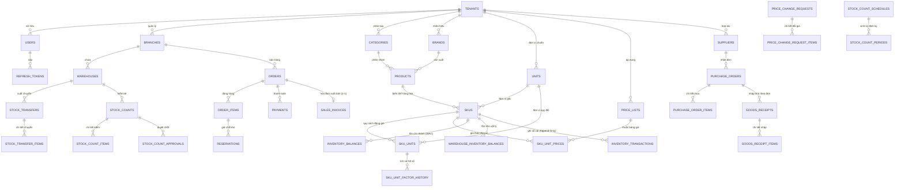

# TÀI LIỆU THIẾT KẾ THỰC THỂ LIÊN KẾT (ERD.MD) - HỆ THỐNG OISMS
**Hệ thống Quản lý Bán hàng & Tồn kho Đa kênh (Omnichannel Inventory and Sales Management System)**

---

## 1. MÔ HÌNH ÁNH XẠ CLEAN ARCHITECTURE & ORM

Hệ thống OISMS áp dụng kiến trúc **Clean Architecture 4 tầng** kết hợp **Object-Relational Mapping (ORM)** với **Entity Framework Core 8** trên nền tảng .NET 8. 

Mọi thực thể kinh doanh (Business Entities) được định nghĩa độc lập ở tầng lõi (**Domain Layer**) dưới dạng POCO (Plain Old CLR Objects), sau đó được ánh xạ một-một sang các bảng CSDL vật lý thông qua tầng **Infrastructure Layer** (sử dụng Fluent API `IEntityTypeConfiguration<T>`).

```
[ Domain Layer: Business Entities (POCO) ]
                     │
                     ▼
[ Infrastructure: EF Core Configurations (Fluent API) ]
                     │
                     ▼
[ Database Engine: PostgreSQL / MySQL / SQL Server (43 Tables) ]
```

### Tính độc lập & Khả năng chuyển đổi Cơ sở dữ liệu (Database Portability)
Nhờ nguyên lý đảo ngược phụ thuộc (Dependency Inversion) của Clean Architecture:
- Toàn bộ nghiệp vụ ở tầng **`OISM.Domain`** và **`OISM.Application`** hoàn toàn không phụ thuộc vào hệ quản trị CSDL cụ thể nào (không chứa câu lệnh SQL raw của PostgreSQL).
- Khi cần chuyển đổi giữa các HQT CSDL (**PostgreSQL $\leftrightarrow$ MS SQL Server $\leftrightarrow$ MySQL**), chỉ cần thay đổi cấu hình Provider tại tầng **`OISM.Infrastructure/DependencyInjection.cs`**:
  - **PostgreSQL**: `options.UseNpgsql(connStr)`
  - **MS SQL Server**: `options.UseSqlServer(connStr)`
  - **MySQL**: `options.UseMySql(connStr, ServerVersion.AutoDetect(connStr))`

---

## 2. SƠ ĐỒ THỰC THỂ QUAN HỆ TỔNG QUAN (CORE MERMAID ERD)



---

## 3. DANH MỤC 43 THỰC THỂ & ÁNH XẠ CODE (MAPPING DIRECTORY)

| STT | Tên Thực thể (Domain Entity) | Tên Bảng (Database Table) | Phân hệ (Subsystem) | Mô tả nghiệp vụ |
| :---: | :--- | :--- | :--- | :--- |
| 1 | `Tenant` | `tenants` | Multi-Tenant | Doanh nghiệp/Chủ gian hàng độc lập |
| 2 | `User` | `users` | Auth & RBAC | Tài khoản người dùng (Owner, Staff, Cashier) |
| 3 | `RefreshToken` | `refresh_tokens` | Auth & RBAC | Token xoay vòng duy trì phiên đăng nhập |
| 4 | `Branch` | `branches` | Organization | Chi nhánh kinh doanh (điểm chốt WAC) |
| 5 | `Warehouse` | `warehouses` | Organization | Kho vật lý trực thuộc chi nhánh |
| 6 | `Category` | `categories` | Catalog | Cây danh mục sản phẩm đa cấp |
| 7 | `Brand` | `brands` | Catalog | Thương hiệu sản phẩm |
| 8 | `Unit` | `units` | Catalog / U05 | Danh mục đơn vị tính (cái, hộp, thùng, kg...) |
| 9 | `Product` | `products` | Catalog | Sản phẩm thông tin chung (SP mẹ) |
| 10 | `ProductVariant` | `skus` | Catalog / SKU | Biến thể hàng hóa cụ thể (mã vạch, tồn, giá) |
| 11 | `SkuUnit` | `sku_units` | Catalog / U05 | Quy cách đơn vị quy đổi theo SKU |
| 12 | `SkuUnitFactorHistory` | `sku_unit_factor_history` | Catalog / U05 | Lịch sử biến động tỷ lệ quy đổi (Append-only) |
| 13 | `PriceList` | `price_lists` | Pricing / U04 | Bảng giá (Bán lẻ, Bán sỉ) |
| 14 | `PriceChangeRequest` | `price_change_requests` | Pricing / U04 | Phiếu đề xuất thay đổi giá bán |
| 15 | `PriceChangeRequestItem`| `price_change_request_items`| Pricing / U04 | Chi tiết đề xuất đổi giá từng SKU |
| 16 | `SkuUnitPrice` | `sku_unit_prices` | Pricing / U04 | Giá bán áp dụng theo đơn vị và bảng giá |
| 17 | `Supplier` | `suppliers` | Purchasing | Nhà cung cấp hàng hóa |
| 18 | `PurchaseOrder` | `purchase_orders` | Purchasing / U01-A | Đơn đặt mua hàng từ nhà cung cấp |
| 19 | `PurchaseOrderItem` | `purchase_order_items` | Purchasing / U01-A | Chi tiết số lượng và giá đặt mua |
| 20 | `GoodsReceipt` | `goods_receipts` | Purchasing / U01-A | Phiếu nhập kho thực tế |
| 21 | `GoodsReceiptItem` | `goods_receipt_items` | Purchasing / U01-A | Chi tiết nhập kho từng mặt hàng & giá vốn |
| 22 | `InventoryBalance` | `inventory_balances` | Inventory / Ledger | Tổng tồn và giá vốn bình quân (WAC) chi nhánh |
| 23 | `WarehouseInventoryBalance`| `warehouse_inventory_balances`| Inventory | Tồn vật lý và số lượng giữ chỗ riêng từng kho |
| 24 | `StockTransfer` | `stock_transfers` | Inventory | Phiếu điều chuyển hàng giữa các kho |
| 25 | `StockTransferItem` | `stock_transfer_items` | Inventory | Chi tiết danh mục và lượng hàng chuyển |
| 26 | `StockCount` | `stock_counts` | Inventory / U03 | Phiếu kiểm kê kho thực tế |
| 27 | `StockCountItem` | `stock_count_items` | Inventory / U03 | Chi tiết số lượng đếm, tồn sổ sách, chênh lệch |
| 28 | `InventoryAdjustment` | `inventory_adjustments` | Inventory | Phiếu điều chỉnh cân đối tồn kho phát sinh |
| 29 | `InventoryAdjustmentItem`| `inventory_adjustment_items`| Inventory | Chi tiết điều chỉnh tăng/giảm và lý do |
| 30 | `Order` | `orders` | Sales & POS | Đơn hàng bán (POS, Admin, Shopee, TikTok...) |
| 31 | `OrderItem` | `order_items` | Sales & POS | Chi tiết dòng hàng bán, chụp snapshot giá |
| 32 | `Reservation` | `reservations` | Sales & POS | Bản ghi giữ chỗ tồn kho chống bán vượt (Oversell) |
| 33 | `Payment` | `payments` | Sales & POS | Giao dịch thanh toán đơn hàng (Tiền mặt, CK) |
| 34 | `SalesInvoice` | `sales_invoices` | Invoicing / U02 | Hóa đơn bán hàng điện tử nội bộ (Truy vết) |
| 35 | `StockCountSchedule` | `stock_count_schedules` | Inventory / U03 | Cấu hình lịch kiểm kê tự động |
| 36 | `StockCountPeriod` | `stock_count_periods` | Inventory / U03 | Kỳ kiểm kê được kích hoạt theo lịch |
| 37 | `StockCountApproval` | `stock_count_approvals` | Inventory / U03 | Nhật ký nộp/duyệt/yêu cầu đếm lại kiểm kê |
| 38 | `SalesReturn` | `sales_returns` | Sales Returns | Phiếu khách hàng trả lại hàng |
| 39 | `SalesReturnItem` | `sales_return_items` | Sales Returns | Chi tiết số lượng và số tiền hoàn trả |
| 40 | `InventoryTransaction` | `inventory_transactions` | Inventory / Ledger | Sổ cái kho bất biến (Append-Only Transaction Log) |
| 41 | `DailySalesSummary` | `daily_sales_summaries` | Reporting | Báo cáo doanh số và giá vốn tổng hợp theo ngày |
| 42 | `ReplenishmentSuggestion`| `replenishment_suggestions` | AI Analytics | Gợi ý số lượng đặt hàng thông minh từ AI |
| 43 | `ShopIntegration` | `shop_integrations` | Omnichannel | Cấu hình kết nối API sàn TMĐT |

---

## 4. CHI TIẾT CÁC THỰC THỂ DỮ LIỆU CỐT LÕI (DETAILED ENTITY SPECIFICATIONS)

### 4.1. Phân hệ Tổ chức & Xác thực (Tenants, Users, Branches, Warehouses)

#### Bảng `tenants` (Doanh nghiệp đa thuê bao)
| Thuộc tính (Column) | Kiểu dữ liệu | Ràng buộc | Mô tả |
| :--- | :--- | :--- | :--- |
| `id` | `uuid` | PK | Mã định danh người thuê bao |
| `name` | `varchar(150)` | NOT NULL | Tên công ty/cửa hàng |
| `code` | `varchar(50)` | UNIQUE | Mã định danh viết tắt |
| `is_active` | `boolean` | DEFAULT true | Trạng thái hoạt động |
| `created_at` | `timestamptz` | DEFAULT now() | Ngày tạo |

#### Bảng `users` (Người dùng hệ thống)
| Thuộc tính (Column) | Kiểu dữ liệu | Ràng buộc | Mô tả |
| :--- | :--- | :--- | :--- |
| `id` | `uuid` | PK | Mã định danh người dùng |
| `tenant_id` | `uuid` | FK $\rightarrow$ tenants(id) | Thuộc doanh nghiệp nào |
| `email` | `varchar(150)` | UNIQUE | Địa chỉ email đăng nhập |
| `password_hash`| `varchar(255)` | NOT NULL | Mật khẩu băm (BCrypt) |
| `full_name` | `varchar(150)` | NOT NULL | Họ và tên hiển thị |
| `role` | `varchar(50)` | CHECK (Role IN ('Owner', 'Staff', 'Cashier')) | Phân quyền vai trò |
| `branch_id` | `uuid` | FK $\rightarrow$ branches(id) | Chi nhánh làm việc mặc định |
| `is_active` | `boolean` | DEFAULT true | Trạng thái tài khoản |

#### Bảng `branches` (Chi nhánh - Chốt giá vốn WAC)
| Thuộc tính (Column) | Kiểu dữ liệu | Ràng buộc | Mô tả |
| :--- | :--- | :--- | :--- |
| `id` | `uuid` | PK | Mã chi nhánh |
| `tenant_id` | `uuid` | FK $\rightarrow$ tenants(id) | Thuộc doanh nghiệp |
| `name` | `varchar(150)` | NOT NULL | Tên chi nhánh |
| `code` | `varchar(50)` | UNIQUE (tenant_id, code) | Mã chi nhánh |
| `address` | `text` | NULL | Địa chỉ chi nhánh |
| `phone` | `varchar(32)` | NULL | Số điện thoại liên hệ |

#### Bảng `warehouses` (Kho vật lý)
| Thuộc tính (Column) | Kiểu dữ liệu | Ràng buộc | Mô tả |
| :--- | :--- | :--- | :--- |
| `id` | `uuid` | PK | Mã kho |
| `tenant_id` | `uuid` | FK $\rightarrow$ tenants(id) | Thuộc doanh nghiệp |
| `branch_id` | `uuid` | FK $\rightarrow$ branches(id) | Trực thuộc chi nhánh |
| `name` | `varchar(150)` | NOT NULL | Tên kho hàng |
| `code` | `varchar(50)` | UNIQUE (tenant_id, code) | Mã kho |

---

### 4.2. Phân hệ Danh mục, Đơn vị tính & Bảng giá (Catalog, Units, Pricing)

#### Bảng `products` & `skus` (Sản phẩm & Biến thể SKU)
- `products`: Lưu thông tin chung (Tên, Danh mục, Thương hiệu).
- `skus`: Lưu biến thể hàng hóa độc lập:
  - `id`: `uuid` (PK)
  - `tenant_id`: `uuid` (FK)
  - `product_id`: `uuid` (FK)
  - `sku_code`: `varchar(80)` (Mã SKU duy nhất trong Tenant)
  - `barcode`: `varchar(50)` (Mã vạch EAN-13 quét tại POS)
  - `base_unit_id`: `uuid` (FK $\rightarrow$ `units`: đơn vị chuẩn cơ sở)
  - `retail_price`: `numeric(20,2)` (Giá bán lẻ)
  - `wholesale_price`: `numeric(20,2)` (Giá bán buôn)
  - `attributes`: `jsonb` (Thuộc tính biến thể: Màu, Size, Dung tích...)

#### Bảng `sku_units` (Đơn vị quy đổi - U05)
| Thuộc tính (Column) | Kiểu dữ liệu | Ràng buộc | Mô tả |
| :--- | :--- | :--- | :--- |
| `id` | `uuid` | PK | Khóa chính |
| `tenant_id` | `uuid` | FK | Doanh nghiệp |
| `sku_id` | `uuid` | FK $\rightarrow$ skus(id) | Thuộc SKU nào |
| `unit_id` | `uuid` | FK $\rightarrow$ units(id) | Đơn vị quy đổi (thùng, lốc, bao...) |
| `factor_to_base`| `numeric(18,6)`| CHECK > 0 | Hệ số quy đổi về đơn vị gốc |
| `barcode` | `varchar(50)` | NULL | Mã vạch riêng của quy cách đóng gói |
| `version` | `integer` | DEFAULT 1 | Phiên bản hệ số (chống sửa đè) |

#### Bảng `price_change_requests` & `price_change_request_items` (Quy trình duyệt giá - U04)
- Quy trình thay đổi giá minh bạch 2 bước:
  1. Nhân viên lập phiếu đề xuất thay đổi giá lẻ/giá sỉ/giá theo quy cách.
  2. Chủ cửa hàng (Owner) phê duyệt: Chỉ khi được duyệt, giá mới được ghi nhận vào `sku_unit_prices` và áp dụng cho các đơn hàng mới.
  3. Hỗ trợ Idempotency Key chống gửi lặp đề xuất khi mạng lag.

---

### 4.3. Phân hệ Mua hàng & Nhập kho (Purchasing & Goods Receipts - U01-A)

#### Bảng `purchase_orders` (Phiếu đặt mua hàng)
| Thuộc tính (Column) | Kiểu dữ liệu | Ràng buộc | Mô tả |
| :--- | :--- | :--- | :--- |
| `id` | `uuid` | PK | Mã phiếu mua |
| `tenant_id` | `uuid` | FK | Doanh nghiệp |
| `number` | `varchar(50)` | UNIQUE (tenant_id, number) | Mã chứng từ PO |
| `supplier_id` | `uuid` | FK $\rightarrow$ suppliers(id) | Nhà cung cấp |
| `branch_id` | `uuid` | FK $\rightarrow$ branches(id) | Chi nhánh đặt mua |
| `status` | `varchar(20)` | CHECK IN ('Draft', 'Approved', 'PartiallyReceived', 'Completed', 'Cancelled') | Trạng thái phê duyệt |
| `total_amount` | `numeric(20,2)`| NOT NULL | Tổng giá trị đặt hàng |

#### Bảng `goods_receipts` (Phiếu nhập kho thực tế)
- **Ràng buộc nghiệp vụ quan trọng**: Phiếu nhập kho từ nhà cung cấp **bắt buộc phải tham chiếu tới `purchase_order_id` đã được phê duyệt**.
- Hệ thống tự động kiểm tra số lượng nhập thực tế không được vượt quá số lượng còn được phép nhập trên đơn đặt mua (`received_quantity <= ordered_quantity`).

---

### 4.4. Phân hệ Bán hàng Đa kênh & POS (Orders, Reservations, Invoices - U02)

#### Bảng `orders` & `order_items`
- Lưu trữ mọi đơn hàng từ các kênh: POS, Admin Web, Shopee, TikTok Shop, Lazada.
- Mỗi dòng `order_items` lưu trữ:
  - `unit_id`: Đơn vị giao dịch (hộp/thùng/kg).
  - `quantity`: Số lượng giao dịch.
  - `factor_snapshot`: Hệ số quy đổi tại thời điểm đặt đơn.
  - `base_quantity`: `quantity * factor_snapshot` (Số lượng tính theo đơn vị gốc để trừ kho).
  - `cost_price`: Giá vốn WAC được chụp (snapshot) ngay khi xác nhận đơn.

#### Bảng `reservations` (Cơ chế giữ chỗ chống bán vượt)
- Khi đơn hàng được tiếp nhận, hệ thống sinh bản ghi giữ chỗ (`Active`) trên bảng `reservations` trỏ trực tiếp xuống từng kho vật lý.
- Khi xuất hàng thành công $\rightarrow$ chuyển trạng thái `Consumed`. Nếu hủy đơn $\rightarrow$ chuyển trạng thái `Released`.
- Đảm bảo tính nhất quán kể cả khi có nhiều nhân viên thu ngân POS cùng bán một mặt hàng cùng lúc.

#### Bảng `sales_invoices` (Hóa đơn xuất bán - U02)
- Hóa đơn điện tử nội bộ được sinh tự động khi đơn hàng hoàn tất xuất kho.
- Quan hệ 1-1 với đơn hàng (`order_id`).
- Bảng Append-Only: Không cho phép chỉnh sửa hoặc xóa hóa đơn sau khi đã phát hành.
- Cung cấp API `GET /api/sales-invoices/{id}/trace` cho phép truy vết xuyên suốt:
  **Hóa đơn (INV-) $\longrightarrow$ Đơn hàng (ORD-) $\longrightarrow$ Dòng xuất kho thực tế trong Sổ cái (OUT Ledger)**.

---

### 4.5. Phân hệ Sổ cái Bất biến & Kiểm kê kho (Ledger & Stock Counts - U03)

#### Bảng `inventory_transactions` (Sổ cái kho bất biến - Core Ledger)
- Lưu trữ mọi biến động kho với nguyên tắc **Append-Only** (nghiêm cấm mọi thao tác UPDATE/DELETE nhờ Database Trigger `trg_prevent_ledger_tampering`).
- Mỗi dòng giao dịch có:
  - `type`: `IN` (Nhập kho/Trả hàng) hoặc `OUT` (Xuất bán/Xuất hủy).
  - `quantity`: Số lượng biến động theo đơn vị chuẩn gốc.
  - `unit_cost`: Giá vốn WAC tương ứng.
  - `balance_after`: Số dư tồn lũy kế ngay sau giao dịch.
  - `sequence_no`: Số thứ tự giao dịch tăng đơn điệu theo cặp `(branch_id, sku_id)` để chống xung đột tương tranh.

#### Bảng `stock_counts` & `stock_count_approvals` (Kiểm kê kho 3 bước - U03)
- Quy trình kiểm kê phân quyền nghiêm ngặt:
  $$\text{Draft} \longrightarrow \text{Counting (Đang đếm)} \longrightarrow \text{PendingApproval (Chờ duyệt)} \longrightarrow \text{Confirmed (Đã chốt)}$$
- Nhân viên kho (`Staff`) chỉ có quyền nộp kết quả đếm (`/submit`).
- Chủ cửa hàng (`Owner`) có quyền:
  - Yêu cầu đếm lại (`/request-recount`): chuyển trạng thái về Counting.
  - Phê duyệt chốt kiểm kê (`/confirm`): Khi duyệt, hệ thống tự động sinh bút toán bù trừ cân đối kho vào Sổ cái `inventory_transactions` đúng một lần duy nhất.

---

## 5. HƯỚNG DẪN TRÌNH BÀY & DEBUG LUỒNG ĐI (DEBUG FLOW CHO SINH VIÊN)

Khi giảng viên yêu cầu: *"Đọc hiểu source code và giải thích luồng đi (debug) trong chương trình"*, sinh viên thực hiện các bước sau:

### Luồng mẫu: Quá trình Xác nhận Đơn hàng & Xuất kho (Order Confirmation Flow)
```
[Client / POS App]
       │
       ▼ (1) POST /api/orders/{id}/confirm
[WebAPI: OrdersController]
       │   - Middleware giải mã JWT (TenantId, UserId, Roles)
       │   - Validate trạng thái DTO
       ▼ (2) Execute Command
[Application: OrderProcessingService]
       │   - Kiểm tra tồn khả dụng (Available = OnHand - Reserved)
       │   - Khóa bản ghi (Distributed Lock / SQL Lock)
       ▼ (3) Domain Logic & Mutation
[Domain: Order & Inventory Entities]
       │   - Order.Confirm()
       │   - Cập nhật số dư kho (InventoryBalance, WarehouseInventoryBalance)
       │   - Tạo bản ghi sổ cái (InventoryTransaction: Type = 'OUT')
       ▼ (4) Data Persistence (ORM)
[Infrastructure: AppDbContext]
       │   - Ghi trong Database Transaction:
       │     BEGIN TRANSACTION;
       │     INSERT INTO inventory_transactions ...;
       │     UPDATE inventory_balances ...;
       │     INSERT INTO sales_invoices ...;
       │     COMMIT;
       ▼ (5) Return Response
[Client: Nhận mã Hóa đơn INV- và cập nhật giao diện]
```

### Các bước trả lời phản biện với Giảng viên:
1. **Chỉ ra vị trí Breakpoint**: Đặt breakpoint ở Controller (`src/backend/src/OISM.WebAPI/Controllers/`), sau đó bấm **F11 (Step Into)** để đưa giảng viên qua tầng **Application**, rồi vào phương thức Domain của Entity.
2. **Chứng minh ORM mapping**: Mở file Entity tương ứng trong `src/backend/src/OISM.Domain/Entities/` và file Configuration trong `src/backend/src/OISM.Infrastructure/Persistence/Configurations/` để chỉ rõ thuộc tính nào map với cột nào trong CSDL.
3. **Chứng minh tính bảo vệ dữ liệu**: Giải thích cách EF Core áp dụng **Global Query Filter** (`e.TenantId == _currentTenantId`) để tự động cô lập dữ liệu giữa các cửa hàng, không bao giờ lo lộ dữ liệu giữa các khách hàng khác nhau.
4. **Chứng minh khả năng đổi Database**: Mở `DependencyInjection.cs`, giải thích rằng toàn bộ Business Logic không có cú pháp SQL của riêng PostgreSQL; nếu muốn sang MySQL hay SQL Server thì chỉ cần thay `UseNpgsql` thành `UseSqlServer` / `UseMySql`.
