# TÀI LIỆU THỰC THỂ LIÊN KẾT (ERD) — OISMS

| Thông tin kiểm soát tài liệu | Chi tiết |
| :--- | :--- |
| **Mã tài liệu** | `DOC-ERD-FULL` |
| **Phiên bản** | `v2.1.1` |
| **Ngày hiệu lực** | `2026-11-08` |
| **Nguồn** | Đối chiếu với `docs/database/oisms_schema.sql` (cột, kiểu, khóa ngoại) và `OISM.Infrastructure/Persistence/Configurations/*.cs` (ánh xạ entity) |
| **Liên quan** | [`04-architecture-and-design/03-database-design.md`](./04-architecture-and-design/03-database-design.md) (ERD rút gọn, chỉ mục), [`database/README.md`](./database/README.md) (từ điển dữ liệu, ràng buộc CHECK) |

> Bảng cột ở mục 4 được đối chiếu với file schema. Khi đổi schema, cập nhật mục này theo DDL; `oisms_schema.sql` luôn là nguồn đúng nếu có chỗ lệch.

---

## 1. Ánh Xạ Clean Architecture & ORM

- Entity nằm ở `OISM.Domain/Entities`, ánh xạ sang bảng bằng Fluent API (`IEntityTypeConfiguration<T>`) trong `OISM.Infrastructure/Persistence/Configurations`. Tên cột dùng `snake_case` (`EFCore.NamingConventions`).
- Provider là **Npgsql** (PostgreSQL 16). Hệ thống **phụ thuộc PostgreSQL**: trigger `ledger_append_only`, cột sinh `reference_id`, `jsonb`, `pg_advisory_xact_lock` và `SELECT ... FOR UPDATE` trong một số service ở `OISM.Application` (`OrderService`, `ReservationService`, ...). Không thể đổi sang SQL Server/MySQL chỉ bằng cách thay `UseNpgsql`; đây là nợ kỹ thuật đã ghi nhận.
- Không dùng EF Core migrations. Schema cài mới từ `oisms_schema.sql`; nâng cấp bằng file trong `docker/postgres/migrations/`.
- Mọi bảng nghiệp vụ (trừ `tenants`) có `tenant_id`; khóa ngoại dùng cặp `(tenant_id, id)` nên không thể tham chiếu chéo tenant. Entity triển khai `IMustHaveTenant` và có global query filter trong `AppDbContext`.
- Số lượng (`on_hand`, `quantity`...) là `numeric(18,3)` theo **đơn vị gốc** của SKU; tiền `numeric(20,2)`; giá vốn `numeric(20,6)`.

## 2. Sơ Đồ Quan Hệ Chính

Chỉ vẽ quan hệ nghiệp vụ chính; quan hệ tới `tenants` (mọi bảng) và tới `users` (người tạo/duyệt) được lược bớt. Danh sách đủ khóa ngoại ở mục 4.

```mermaid
erDiagram
    BRANCHES ||--o{ WAREHOUSES : "branch_id"
    CATEGORIES ||--o{ CATEGORIES : "parent_id"
    CATEGORIES ||--o{ PRODUCTS : "category_id"
    BRANDS ||--o{ PRODUCTS : "brand_id"
    PRODUCTS ||--o{ SKUS : "product_id"
    BRANCHES ||--o{ GOODS_RECEIPTS : "branch_id"
    WAREHOUSES ||--o{ GOODS_RECEIPTS : "warehouse_id"
    SUPPLIERS ||--o{ GOODS_RECEIPTS : "supplier_id"
    GOODS_RECEIPTS ||--o{ GOODS_RECEIPT_ITEMS : "receipt_id"
    SKUS ||--o{ GOODS_RECEIPT_ITEMS : "sku_id"
    BRANCHES ||--o{ INVENTORY_BALANCES : "branch_id"
    SKUS ||--o{ INVENTORY_BALANCES : "sku_id"
    WAREHOUSES ||--o{ WAREHOUSE_INVENTORY_BALANCES : "warehouse_id"
    SKUS ||--o{ WAREHOUSE_INVENTORY_BALANCES : "sku_id"
    BRANCHES ||--o{ STOCK_TRANSFERS : "from_branch_id"
    WAREHOUSES ||--o{ STOCK_TRANSFERS : "from_warehouse_id"
    STOCK_TRANSFERS ||--o{ STOCK_TRANSFER_ITEMS : "transfer_id"
    SKUS ||--o{ STOCK_TRANSFER_ITEMS : "sku_id"
    BRANCHES ||--o{ STOCK_COUNTS : "branch_id"
    WAREHOUSES ||--o{ STOCK_COUNTS : "warehouse_id"
    INVENTORY_ADJUSTMENTS ||--o{ STOCK_COUNTS : "generated_adjustment_id"
    STOCK_COUNTS ||--o{ STOCK_COUNT_ITEMS : "stock_count_id"
    SKUS ||--o{ STOCK_COUNT_ITEMS : "sku_id"
    BRANCHES ||--o{ INVENTORY_ADJUSTMENTS : "branch_id"
    WAREHOUSES ||--o{ INVENTORY_ADJUSTMENTS : "warehouse_id"
    INVENTORY_ADJUSTMENTS ||--o{ INVENTORY_ADJUSTMENT_ITEMS : "adjustment_id"
    SKUS ||--o{ INVENTORY_ADJUSTMENT_ITEMS : "sku_id"
    INVENTORY_TRANSACTIONS ||--o{ INVENTORY_ADJUSTMENT_ITEMS : "original_transaction_id"
    BRANCHES ||--o{ ORDERS : "branch_id"
    ORDERS ||--o{ ORDER_ITEMS : "order_id"
    SKUS ||--o{ ORDER_ITEMS : "sku_id"
    WAREHOUSES ||--o{ RESERVATIONS : "warehouse_id"
    ORDER_ITEMS ||--o{ RESERVATIONS : "order_item_id"
    ORDERS ||--o{ RESERVATIONS : "order_id"
    ORDERS ||--o{ PAYMENTS : "order_id"
    PAYMENT_ACCOUNTS o|--o{ PAYMENTS : "payment_account_id"
    ORDERS ||--o{ SALES_RETURNS : "order_id"
    BRANCHES ||--o{ SALES_RETURNS : "branch_id"
    WAREHOUSES ||--o{ SALES_RETURNS : "warehouse_id"
    SALES_RETURNS ||--o{ SALES_RETURN_ITEMS : "sales_return_id"
    ORDER_ITEMS ||--o{ SALES_RETURN_ITEMS : "order_item_id"
    WAREHOUSES ||--o{ INVENTORY_TRANSACTIONS : "warehouse_id"
    SKUS ||--o{ INVENTORY_TRANSACTIONS : "sku_id"
    BRANCHES ||--o{ INVENTORY_TRANSACTIONS : "branch_id"
    GOODS_RECEIPT_ITEMS ||--o{ INVENTORY_TRANSACTIONS : "receipt_item_id"
    ORDER_ITEMS ||--o{ INVENTORY_TRANSACTIONS : "order_item_id"
    STOCK_TRANSFER_ITEMS ||--o{ INVENTORY_TRANSACTIONS : "transfer_item_id"
    STOCK_COUNT_ITEMS ||--o{ INVENTORY_TRANSACTIONS : "stock_count_item_id"
    SALES_RETURN_ITEMS ||--o{ INVENTORY_TRANSACTIONS : "sales_return_item_id"
    INVENTORY_ADJUSTMENT_ITEMS ||--o{ INVENTORY_TRANSACTIONS : "adjustment_item_id"
    BRANCHES ||--o{ DAILY_SALES_SUMMARIES : "branch_id"
    SKUS ||--o{ DAILY_SALES_SUMMARIES : "sku_id"
    BRANCHES ||--o{ REPLENISHMENT_SUGGESTIONS : "branch_id"
    SKUS ||--o{ REPLENISHMENT_SUGGESTIONS : "sku_id"
    BRANCHES ||--o{ SHOP_INTEGRATIONS : "branch_id"
    UNITS ||--o{ SKUS : "base_unit_id"
    SKUS ||--o{ SKU_UNITS : "sku_id"
    UNITS ||--o{ SKU_UNITS : "unit_id"
    SKU_UNITS ||--o{ SKU_UNIT_FACTOR_HISTORY : "sku_unit_id"
    UNITS ||--o{ GOODS_RECEIPT_ITEMS : "unit_id"
    UNITS ||--o{ ORDER_ITEMS : "unit_id"
    PRICE_CHANGE_REQUESTS ||--o{ PRICE_CHANGE_REQUEST_ITEMS : "request_id"
    PRICE_LISTS ||--o{ PRICE_CHANGE_REQUEST_ITEMS : "price_list_id"
    SKU_UNITS ||--o{ PRICE_CHANGE_REQUEST_ITEMS : "sku_id"
    PRICE_LISTS ||--o{ SKU_UNIT_PRICES : "price_list_id"
    PRICE_CHANGE_REQUEST_ITEMS ||--o{ SKU_UNIT_PRICES : "source_item_id"
    SKU_UNITS ||--o{ SKU_UNIT_PRICES : "sku_id"
    SKU_UNIT_PRICES ||--o{ ORDER_ITEMS : "sku_unit_price_id"
    SUPPLIERS ||--o{ PURCHASE_ORDERS : "supplier_id"
    BRANCHES ||--o{ PURCHASE_ORDERS : "branch_id"
    PURCHASE_ORDERS ||--o{ PURCHASE_ORDER_ITEMS : "purchase_order_id"
    SKUS ||--o{ PURCHASE_ORDER_ITEMS : "sku_id"
    UNITS ||--o{ PURCHASE_ORDER_ITEMS : "unit_id"
    PURCHASE_ORDERS ||--o{ GOODS_RECEIPTS : "purchase_order_id"
    PURCHASE_ORDER_ITEMS ||--o{ GOODS_RECEIPT_ITEMS : "purchase_order_item_id"
    ORDERS ||--o| SALES_INVOICES : "order_id"
    BRANCHES ||--o{ SALES_INVOICES : "branch_id"
    STOCK_COUNT_PERIODS ||--o{ STOCK_COUNTS : "period_id"
    WAREHOUSES ||--o{ STOCK_COUNT_SCHEDULES : "warehouse_id"
    STOCK_COUNT_SCHEDULES ||--o{ STOCK_COUNT_PERIODS : "schedule_id"
    WAREHOUSES ||--o{ STOCK_COUNT_PERIODS : "warehouse_id"
    STOCK_COUNTS ||--o{ STOCK_COUNT_APPROVALS : "stock_count_id"
```



## 3. Danh Mục 44 Bảng

| STT | Bảng | Entity (Domain) | Nhóm |
| :---: | :--- | :--- | :--- |
| 1 | `tenants` | `Tenant` | Tổ chức & xác thực |
| 2 | `users` | `User` | Tổ chức & xác thực |
| 3 | `refresh_tokens` | `RefreshToken` | Tổ chức & xác thực |
| 4 | `branches` | `Branch` | Tổ chức & xác thực |
| 5 | `warehouses` | `Warehouse` | Tổ chức & xác thực |
| 6 | `categories` | `Category` | Danh mục & đơn vị tính (U05) |
| 7 | `brands` | `Brand` | Danh mục & đơn vị tính (U05) |
| 8 | `units` | `Unit` | Danh mục & đơn vị tính (U05) |
| 9 | `products` | `Product` | Danh mục & đơn vị tính (U05) |
| 10 | `skus` | `ProductVariant` | Danh mục & đơn vị tính (U05) |
| 11 | `sku_units` | `SkuUnit` | Danh mục & đơn vị tính (U05) |
| 12 | `sku_unit_factor_history` | `SkuUnitFactorHistory` | Danh mục & đơn vị tính (U05) |
| 13 | `price_lists` | `PriceList` | Bảng giá theo thời gian (U04) |
| 14 | `price_change_requests` | `PriceChangeRequest` | Bảng giá theo thời gian (U04) |
| 15 | `price_change_request_items` | `PriceChangeRequestItem` | Bảng giá theo thời gian (U04) |
| 16 | `sku_unit_prices` | `SkuUnitPrice` | Bảng giá theo thời gian (U04) |
| 17 | `suppliers` | `Supplier` | Mua hàng & nhập kho (U01-A) |
| 18 | `purchase_orders` | `PurchaseOrder` | Mua hàng & nhập kho (U01-A) |
| 19 | `purchase_order_items` | `PurchaseOrderItem` | Mua hàng & nhập kho (U01-A) |
| 20 | `goods_receipts` | `GoodsReceipt` | Mua hàng & nhập kho (U01-A) |
| 21 | `goods_receipt_items` | `GoodsReceiptItem` | Mua hàng & nhập kho (U01-A) |
| 22 | `inventory_balances` | `InventoryBalance` | Tồn kho, chuyển kho, điều chỉnh |
| 23 | `warehouse_inventory_balances` | `WarehouseInventoryBalance` | Tồn kho, chuyển kho, điều chỉnh |
| 24 | `stock_transfers` | `StockTransfer` | Tồn kho, chuyển kho, điều chỉnh |
| 25 | `stock_transfer_items` | `StockTransferItem` | Tồn kho, chuyển kho, điều chỉnh |
| 26 | `inventory_adjustments` | `InventoryAdjustment` | Tồn kho, chuyển kho, điều chỉnh |
| 27 | `inventory_adjustment_items` | `InventoryAdjustmentItem` | Tồn kho, chuyển kho, điều chỉnh |
| 28 | `stock_counts` | `StockCount` | Kiểm kê (U03) |
| 29 | `stock_count_items` | `StockCountItem` | Kiểm kê (U03) |
| 30 | `stock_count_schedules` | `StockCountSchedule` | Kiểm kê (U03) |
| 31 | `stock_count_periods` | `StockCountPeriod` | Kiểm kê (U03) |
| 32 | `stock_count_approvals` | `StockCountApproval` | Kiểm kê (U03) |
| 33 | `orders` | `Order` | Bán hàng, POS, hóa đơn (U02) |
| 34 | `order_items` | `OrderItem` | Bán hàng, POS, hóa đơn (U02) |
| 35 | `reservations` | `Reservation` | Bán hàng, POS, hóa đơn (U02) |
| 36 | `payments` | `Payment` | Bán hàng, POS, hóa đơn (U02) |
| 37 | `sales_invoices` | `SalesInvoice` | Bán hàng, POS, hóa đơn (U02) |
| 38 | `sales_returns` | — *(chưa có entity, backend chưa dùng)* | Bán hàng, POS, hóa đơn (U02) |
| 39 | `sales_return_items` | — *(chưa có entity, backend chưa dùng)* | Bán hàng, POS, hóa đơn (U02) |
| 40 | `inventory_transactions` | `InventoryTransaction` | Sổ cái |
| 41 | `daily_sales_summaries` | — *(chưa có entity, backend chưa dùng)* | Báo cáo, AI, tích hợp sàn |
| 42 | `replenishment_suggestions` | — *(chưa có entity, backend chưa dùng)* | Báo cáo, AI, tích hợp sàn |
| 43 | `shop_integrations` | `ShopIntegration` | Báo cáo, AI, tích hợp sàn |
| 44 | `payment_accounts` | `PaymentAccount` | Bán hàng, POS, thanh toán VietQR (CS-05) |

Ghi chú:
- `skus` ánh xạ tới entity `ProductVariant`.
- `Role`, `UserRole` có trong `OISM.Domain/Entities` nhưng không có bảng; vai trò lưu ở cột `users.role` (`Owner`, `Staff`, `Cashier`).
- `Tenant.Code` là thuộc tính bỏ qua khi ánh xạ (`Ignore`), không có cột trong `tenants`.
- `sales_returns`, `sales_return_items` đã có entity và API từ CS-01 trả hàng (PR #41).
- 2 bảng chưa có entity: `daily_sales_summaries` (báo cáo tính trực tiếp từ đơn), `replenishment_suggestions` (gợi ý nhập tính trực tiếp từ sổ cái, đơn và tồn; Trợ lý OISMS cũng không lưu bảng).

## 4. Cột Và Khóa Ngoại Từng Bảng

Ký hiệu: **PK** khóa chính, **NN** NOT NULL, **GEN** cột sinh tự động. Khóa ngoại ghi dạng `cột → bảng`.

### Tổ chức & xác thực

#### `tenants` — `Tenant`

| Cột | Kiểu | Ràng buộc |
| :--- | :--- | :--- |
| `id` | `uuid` | PK, mặc định `gen_random_uuid()` |
| `name` | `varchar(200)` | NN |
| `is_active` | `boolean` | NN, mặc định `true` |
| `created_at` | `timestamptz` | NN, mặc định `now()` |
| `updated_at` | `timestamptz` |  |

#### `users` — `User`

| Cột | Kiểu | Ràng buộc |
| :--- | :--- | :--- |
| `id` | `uuid` | PK, mặc định `gen_random_uuid()` |
| `tenant_id` | `uuid` | NN, FK → `tenants` |
| `email` | `varchar(254)` |  |
| `phone` | `varchar(16)` |  |
| `password_hash` | `varchar(255)` | NN |
| `display_name` | `varchar(150)` | NN |
| `role` | `varchar(20)` | NN |
| `is_active` | `boolean` | NN, mặc định `true` |
| `created_at` | `timestamptz` | NN, mặc định `now()` |
| `updated_at` | `timestamptz` |  |

#### `refresh_tokens` — `RefreshToken`

| Cột | Kiểu | Ràng buộc |
| :--- | :--- | :--- |
| `id` | `uuid` | PK, mặc định `gen_random_uuid()` |
| `tenant_id` | `uuid` | NN, FK → `tenants` |
| `user_id` | `uuid` | NN, FK → `users` |
| `token_hash` | `varchar(128)` | NN |
| `expires_at` | `timestamptz` | NN |
| `revoked_at` | `timestamptz` |  |
| `created_at` | `timestamptz` | NN, mặc định `now()` |

#### `branches` — `Branch`

| Cột | Kiểu | Ràng buộc |
| :--- | :--- | :--- |
| `id` | `uuid` | PK, mặc định `gen_random_uuid()` |
| `tenant_id` | `uuid` | NN, FK → `tenants` |
| `name` | `varchar(200)` | NN |
| `address` | `text` |  |
| `is_active` | `boolean` | NN, mặc định `true` |
| `created_at` | `timestamptz` | NN, mặc định `now()` |
| `updated_at` | `timestamptz` |  |

#### `warehouses` — `Warehouse`

| Cột | Kiểu | Ràng buộc |
| :--- | :--- | :--- |
| `id` | `uuid` | PK, mặc định `gen_random_uuid()` |
| `tenant_id` | `uuid` | NN, FK → `tenants` |
| `branch_id` | `uuid` | NN, FK → `branches` |
| `name` | `varchar(200)` | NN |
| `is_active` | `boolean` | NN, mặc định `true` |
| `created_at` | `timestamptz` | NN, mặc định `now()` |
| `updated_at` | `timestamptz` |  |

### Danh mục & đơn vị tính (U05)

#### `categories` — `Category`

| Cột | Kiểu | Ràng buộc |
| :--- | :--- | :--- |
| `id` | `uuid` | PK, mặc định `gen_random_uuid()` |
| `tenant_id` | `uuid` | NN, FK → `tenants` |
| `parent_id` | `uuid` | FK → `categories` |
| `name` | `varchar(200)` | NN |
| `is_active` | `boolean` | NN, mặc định `true` |
| `created_at` | `timestamptz` | NN, mặc định `now()` |
| `updated_at` | `timestamptz` |  |

#### `brands` — `Brand`

| Cột | Kiểu | Ràng buộc |
| :--- | :--- | :--- |
| `id` | `uuid` | PK, mặc định `gen_random_uuid()` |
| `tenant_id` | `uuid` | NN, FK → `tenants` |
| `name` | `varchar(200)` | NN |
| `is_active` | `boolean` | NN, mặc định `true` |
| `created_at` | `timestamptz` | NN, mặc định `now()` |
| `updated_at` | `timestamptz` |  |

#### `units` — `Unit`

| Cột | Kiểu | Ràng buộc |
| :--- | :--- | :--- |
| `id` | `uuid` | PK, mặc định `gen_random_uuid()` |
| `tenant_id` | `uuid` | NN, FK → `tenants` |
| `code` | `varchar(30)` | NN |
| `name` | `varchar(100)` | NN |
| `symbol` | `varchar(20)` | NN |
| `measure_group` | `varchar(20)` | NN |
| `decimal_places` | `smallint` | NN, mặc định `3` |
| `is_active` | `boolean` | NN, mặc định `true` |
| `created_at` | `timestamptz` | NN, mặc định `now()` |
| `updated_at` | `timestamptz` |  |

#### `products` — `Product`

| Cột | Kiểu | Ràng buộc |
| :--- | :--- | :--- |
| `id` | `uuid` | PK, mặc định `gen_random_uuid()` |
| `tenant_id` | `uuid` | NN, FK → `tenants` |
| `category_id` | `uuid` | FK → `categories` |
| `brand_id` | `uuid` | FK → `brands` |
| `name` | `varchar(250)` | NN |
| `description` | `text` |  |
| `is_active` | `boolean` | NN, mặc định `true` |
| `created_at` | `timestamptz` | NN, mặc định `now()` |
| `updated_at` | `timestamptz` |  |

#### `skus` — `ProductVariant`

| Cột | Kiểu | Ràng buộc |
| :--- | :--- | :--- |
| `id` | `uuid` | PK, mặc định `gen_random_uuid()` |
| `tenant_id` | `uuid` | NN, FK → `tenants` |
| `product_id` | `uuid` | NN, FK → `products` |
| `code` | `varchar(80)` | NN |
| `attributes` | `jsonb` | NN, mặc định `'{}'::jsonb` |
| `unit` | `varchar(30)` | NN, mặc định `'piece'` |
| `barcode_type` | `varchar(20)` |  |
| `barcode` | `varchar(128)` |  |
| `retail_price` | `numeric(20,2)` | NN |
| `wholesale_price` | `numeric(20,2)` | NN |
| `base_unit_id` | `uuid` | FK → `units` |
| `is_active` | `boolean` | NN, mặc định `true` |
| `created_at` | `timestamptz` | NN, mặc định `now()` |
| `updated_at` | `timestamptz` |  |

#### `sku_units` — `SkuUnit`

| Cột | Kiểu | Ràng buộc |
| :--- | :--- | :--- |
| `id` | `uuid` | PK, mặc định `gen_random_uuid()` |
| `tenant_id` | `uuid` | NN, FK → `tenants` |
| `sku_id` | `uuid` | NN, FK → `skus` |
| `unit_id` | `uuid` | NN, FK → `units` |
| `factor_to_base` | `numeric(18,6)` | NN |
| `can_purchase` | `boolean` | NN, mặc định `true` |
| `can_sell` | `boolean` | NN, mặc định `true` |
| `is_default_purchase` | `boolean` | NN, mặc định `false` |
| `is_default_sale` | `boolean` | NN, mặc định `false` |
| `barcode` | `varchar(128)` |  |
| `quantity_decimal_places` | `smallint` | NN, mặc định `3` |
| `sale_price` | `numeric(20,2)` |  |
| `version` | `integer` | NN, mặc định `1` |
| `is_active` | `boolean` | NN, mặc định `true` |
| `updated_by` | `uuid` | FK → `users` |
| `created_at` | `timestamptz` | NN, mặc định `now()` |
| `updated_at` | `timestamptz` |  |

#### `sku_unit_factor_history` — `SkuUnitFactorHistory`

| Cột | Kiểu | Ràng buộc |
| :--- | :--- | :--- |
| `id` | `uuid` | PK, mặc định `gen_random_uuid()` |
| `tenant_id` | `uuid` | NN, FK → `tenants` |
| `sku_unit_id` | `uuid` | NN, FK → `sku_units` |
| `old_factor` | `numeric(18,6)` |  |
| `new_factor` | `numeric(18,6)` | NN |
| `old_version` | `integer` |  |
| `new_version` | `integer` | NN |
| `changed_by` | `uuid` | FK → `users` |
| `changed_at` | `timestamptz` | NN, mặc định `now()` |

### Bảng giá theo thời gian (U04)

#### `price_lists` — `PriceList`

| Cột | Kiểu | Ràng buộc |
| :--- | :--- | :--- |
| `id` | `uuid` | PK, mặc định `gen_random_uuid()` |
| `tenant_id` | `uuid` | NN, FK → `tenants` |
| `code` | `varchar(30)` | NN |
| `name` | `varchar(100)` | NN |
| `is_active` | `boolean` | NN, mặc định `true` |
| `created_at` | `timestamptz` | NN, mặc định `now()` |
| `updated_at` | `timestamptz` |  |

#### `price_change_requests` — `PriceChangeRequest`

| Cột | Kiểu | Ràng buộc |
| :--- | :--- | :--- |
| `id` | `uuid` | PK, mặc định `gen_random_uuid()` |
| `tenant_id` | `uuid` | NN, FK → `tenants` |
| `request_key` | `uuid` | NN |
| `kind` | `varchar(20)` | NN |
| `status` | `varchar(20)` | NN |
| `reason` | `varchar(500)` | NN |
| `requested_valid_from` | `timestamptz` |  |
| `created_by` | `uuid` | FK → `users` |
| `created_at` | `timestamptz` | NN, mặc định `now()` |
| `reviewed_by` | `uuid` | FK → `users` |
| `reviewed_at` | `timestamptz` |  |
| `review_note` | `varchar(500)` |  |

#### `price_change_request_items` — `PriceChangeRequestItem`

| Cột | Kiểu | Ràng buộc |
| :--- | :--- | :--- |
| `id` | `uuid` | PK, mặc định `gen_random_uuid()` |
| `tenant_id` | `uuid` | NN, FK → `tenants` |
| `request_id` | `uuid` | NN, FK → `price_change_requests` |
| `price_list_id` | `uuid` | NN, FK → `price_lists` |
| `sku_id` | `uuid` | NN, FK → `sku_units` |
| `unit_id` | `uuid` | NN, FK → `sku_units` |
| `new_price` | `numeric(20,2)` | NN |
| `created_at` | `timestamptz` | NN, mặc định `now()` |

#### `sku_unit_prices` — `SkuUnitPrice`

| Cột | Kiểu | Ràng buộc |
| :--- | :--- | :--- |
| `id` | `uuid` | PK, mặc định `gen_random_uuid()` |
| `tenant_id` | `uuid` | NN, FK → `tenants` |
| `price_list_id` | `uuid` | NN, FK → `price_lists` |
| `sku_id` | `uuid` | NN, FK → `sku_units` |
| `unit_id` | `uuid` | NN, FK → `sku_units` |
| `price` | `numeric(20,2)` | NN |
| `valid_from` | `timestamptz` | NN |
| `source_item_id` | `uuid` | NN, FK → `price_change_request_items` |
| `created_at` | `timestamptz` | NN, mặc định `now()` |
| `cancelled_at` | `timestamptz` |  |
| `cancelled_by` | `uuid` | FK → `users` |
| `cancel_reason` | `varchar(500)` |  |

### Mua hàng & nhập kho (U01-A)

#### `suppliers` — `Supplier`

| Cột | Kiểu | Ràng buộc |
| :--- | :--- | :--- |
| `id` | `uuid` | PK, mặc định `gen_random_uuid()` |
| `tenant_id` | `uuid` | NN, FK → `tenants` |
| `name` | `varchar(200)` | NN |
| `phone` | `varchar(32)` |  |
| `email` | `varchar(254)` |  |
| `address` | `text` |  |
| `is_active` | `boolean` | NN, mặc định `true` |
| `created_at` | `timestamptz` | NN, mặc định `now()` |
| `updated_at` | `timestamptz` |  |

#### `purchase_orders` — `PurchaseOrder`

| Cột | Kiểu | Ràng buộc |
| :--- | :--- | :--- |
| `id` | `uuid` | PK, mặc định `gen_random_uuid()` |
| `tenant_id` | `uuid` | NN, FK → `tenants` |
| `number` | `varchar(50)` | NN |
| `request_key` | `uuid` | NN |
| `supplier_id` | `uuid` | NN, FK → `suppliers` |
| `branch_id` | `uuid` | NN, FK → `branches` |
| `status` | `varchar(20)` | NN |
| `note` | `varchar(1000)` |  |
| `created_by` | `uuid` | NN, FK → `users` |
| `approved_by` | `uuid` | FK → `users` |
| `approved_at` | `timestamptz` |  |
| `closed_by` | `uuid` | FK → `users` |
| `closed_at` | `timestamptz` |  |
| `close_reason` | `varchar(500)` |  |
| `cancelled_by` | `uuid` | FK → `users` |
| `cancelled_at` | `timestamptz` |  |
| `created_at` | `timestamptz` | NN, mặc định `now()` |
| `updated_at` | `timestamptz` |  |

#### `purchase_order_items` — `PurchaseOrderItem`

| Cột | Kiểu | Ràng buộc |
| :--- | :--- | :--- |
| `id` | `uuid` | PK, mặc định `gen_random_uuid()` |
| `tenant_id` | `uuid` | NN, FK → `tenants` |
| `purchase_order_id` | `uuid` | NN, FK → `purchase_orders` |
| `sku_id` | `uuid` | NN, FK → `skus` |
| `unit_id` | `uuid` | FK → `units` |
| `unit_name_snapshot` | `varchar(100)` | NN, mặc định `''` |
| `factor_snapshot` | `numeric(18,6)` | NN, mặc định `1` |
| `quantity_decimal_places` | `smallint` | NN, mặc định `3` |
| `quantity` | `numeric(18,3)` | NN |
| `ordered_base_quantity` | `numeric(18,3)` | GEN |
| `unit_price` | `numeric(20,6)` | NN |
| `received_base_quantity` | `numeric(18,3)` | NN, mặc định `0` |
| `created_at` | `timestamptz` | NN, mặc định `now()` |
| `updated_at` | `timestamptz` |  |

#### `goods_receipts` — `GoodsReceipt`

| Cột | Kiểu | Ràng buộc |
| :--- | :--- | :--- |
| `id` | `uuid` | PK, mặc định `gen_random_uuid()` |
| `tenant_id` | `uuid` | NN, FK → `tenants` |
| `number` | `varchar(50)` | NN |
| `purchase_order_id` | `uuid` | FK → `purchase_orders` |
| `branch_id` | `uuid` | NN, FK → `branches`, `warehouses` |
| `warehouse_id` | `uuid` | NN, FK → `warehouses` |
| `supplier_id` | `uuid` | NN, FK → `suppliers` |
| `status` | `varchar(20)` | NN, mặc định `'Draft'` |
| `note` | `text` |  |
| `created_by` | `uuid` | NN, FK → `users` |
| `confirmed_at` | `timestamptz` |  |
| `confirmed_by` | `uuid` | FK → `users` |
| `created_at` | `timestamptz` | NN, mặc định `now()` |
| `updated_at` | `timestamptz` |  |

#### `goods_receipt_items` — `GoodsReceiptItem`

| Cột | Kiểu | Ràng buộc |
| :--- | :--- | :--- |
| `id` | `uuid` | PK, mặc định `gen_random_uuid()` |
| `tenant_id` | `uuid` | NN, FK → `tenants` |
| `receipt_id` | `uuid` | NN, FK → `goods_receipts` |
| `purchase_order_item_id` | `uuid` | FK → `purchase_order_items` |
| `sku_id` | `uuid` | NN, FK → `purchase_order_items`, `skus` |
| `unit_id` | `uuid` | FK → `units` |
| `unit_name_snapshot` | `varchar(100)` | NN, mặc định `''` |
| `factor_snapshot` | `numeric(18,6)` | NN, mặc định `1` |
| `quantity` | `numeric(18,3)` | NN |
| `base_quantity` | `numeric(18,3)` | GEN |
| `unit_price` | `numeric(20,6)` | NN |
| `created_at` | `timestamptz` | NN, mặc định `now()` |
| `updated_at` | `timestamptz` |  |

### Tồn kho, chuyển kho, điều chỉnh

#### `inventory_balances` — `InventoryBalance`

| Cột | Kiểu | Ràng buộc |
| :--- | :--- | :--- |
| `id` | `uuid` | PK, mặc định `gen_random_uuid()` |
| `tenant_id` | `uuid` | NN, FK → `tenants` |
| `branch_id` | `uuid` | NN, FK → `branches` |
| `sku_id` | `uuid` | NN, FK → `skus` |
| `on_hand` | `numeric(18,3)` | NN, mặc định `0` |
| `reserved` | `numeric(18,3)` | NN, mặc định `0` |
| `average_cost` | `numeric(20,6)` | NN, mặc định `0` |
| `reorder_point` | `numeric(18,3)` | NN, mặc định `0` |
| `last_sequence` | `bigint` | NN, mặc định `0` |
| `created_at` | `timestamptz` | NN, mặc định `now()` |
| `updated_at` | `timestamptz` |  |

#### `warehouse_inventory_balances` — `WarehouseInventoryBalance`

| Cột | Kiểu | Ràng buộc |
| :--- | :--- | :--- |
| `id` | `uuid` | PK, mặc định `gen_random_uuid()` |
| `tenant_id` | `uuid` | NN, FK → `tenants` |
| `branch_id` | `uuid` | NN, FK → `warehouses` |
| `warehouse_id` | `uuid` | NN, FK → `warehouses` |
| `sku_id` | `uuid` | NN, FK → `skus` |
| `on_hand` | `numeric(18,3)` | NN, mặc định `0` |
| `reserved` | `numeric(18,3)` | NN, mặc định `0` |
| `last_sequence` | `bigint` | NN, mặc định `0` |
| `created_at` | `timestamptz` | NN, mặc định `now()` |
| `updated_at` | `timestamptz` |  |

#### `stock_transfers` — `StockTransfer`

| Cột | Kiểu | Ràng buộc |
| :--- | :--- | :--- |
| `id` | `uuid` | PK, mặc định `gen_random_uuid()` |
| `tenant_id` | `uuid` | NN, FK → `tenants` |
| `number` | `varchar(50)` | NN |
| `request_key` | `uuid` |  |
| `payload_signature` | `varchar(128)` |  |
| `from_branch_id` | `uuid` | NN, FK → `branches`, `warehouses` |
| `to_branch_id` | `uuid` | NN, FK → `branches`, `warehouses` |
| `from_warehouse_id` | `uuid` | NN, FK → `warehouses` |
| `to_warehouse_id` | `uuid` | NN, FK → `warehouses` |
| `status` | `varchar(20)` | NN, mặc định `'Draft'` |
| `created_by` | `uuid` | NN, FK → `users` |
| `dispatched_by` | `uuid` | FK → `users` |
| `dispatched_at` | `timestamptz` |  |
| `received_at` | `timestamptz` |  |
| `received_by` | `uuid` | FK → `users` |
| `note` | `text` |  |
| `created_at` | `timestamptz` | NN, mặc định `now()` |
| `updated_at` | `timestamptz` |  |

#### `stock_transfer_items` — `StockTransferItem`

| Cột | Kiểu | Ràng buộc |
| :--- | :--- | :--- |
| `id` | `uuid` | PK, mặc định `gen_random_uuid()` |
| `tenant_id` | `uuid` | NN, FK → `tenants` |
| `transfer_id` | `uuid` | NN, FK → `stock_transfers` |
| `sku_id` | `uuid` | NN, FK → `skus` |
| `quantity` | `numeric(18,3)` | NN |
| `unit_cost` | `numeric(20,6)` |  |
| `created_at` | `timestamptz` | NN, mặc định `now()` |
| `updated_at` | `timestamptz` |  |

#### `inventory_adjustments` — `InventoryAdjustment`

| Cột | Kiểu | Ràng buộc |
| :--- | :--- | :--- |
| `id` | `uuid` | PK, mặc định `gen_random_uuid()` |
| `tenant_id` | `uuid` | NN, FK → `tenants` |
| `number` | `varchar(50)` | NN |
| `branch_id` | `uuid` | NN, FK → `branches`, `warehouses` |
| `warehouse_id` | `uuid` | NN, FK → `warehouses` |
| `reason` | `text` | NN |
| `status` | `varchar(20)` | NN, mặc định `'Draft'` |
| `created_by` | `uuid` | NN, FK → `users` |
| `confirmed_by` | `uuid` | FK → `users` |
| `confirmed_at` | `timestamptz` |  |
| `created_at` | `timestamptz` | NN, mặc định `now()` |
| `updated_at` | `timestamptz` |  |

#### `inventory_adjustment_items` — `InventoryAdjustmentItem`

| Cột | Kiểu | Ràng buộc |
| :--- | :--- | :--- |
| `id` | `uuid` | PK, mặc định `gen_random_uuid()` |
| `tenant_id` | `uuid` | NN, FK → `tenants` |
| `adjustment_id` | `uuid` | NN, FK → `inventory_adjustments` |
| `sku_id` | `uuid` | NN, FK → `skus` |
| `quantity_delta` | `numeric(18,3)` | NN |
| `unit_cost` | `numeric(20,6)` |  |
| `original_transaction_id` | `uuid` | FK → `inventory_transactions` |
| `created_at` | `timestamptz` | NN, mặc định `now()` |
| `updated_at` | `timestamptz` |  |

### Kiểm kê (U03)

#### `stock_counts` — `StockCount`

| Cột | Kiểu | Ràng buộc |
| :--- | :--- | :--- |
| `id` | `uuid` | PK, mặc định `gen_random_uuid()` |
| `tenant_id` | `uuid` | NN, FK → `tenants` |
| `number` | `varchar(50)` | NN |
| `branch_id` | `uuid` | NN, FK → `branches`, `inventory_adjustments`, `warehouses` |
| `warehouse_id` | `uuid` | NN, FK → `inventory_adjustments`, `warehouses` |
| `status` | `varchar(20)` | NN, mặc định `'Draft'` |
| `created_by` | `uuid` | NN, FK → `users` |
| `confirmed_by` | `uuid` | FK → `users` |
| `confirmed_at` | `timestamptz` |  |
| `note` | `text` |  |
| `created_at` | `timestamptz` | NN, mặc định `now()` |
| `updated_at` | `timestamptz` |  |
| `request_key` | `uuid` |  |
| `payload_signature` | `varchar(128)` |  |
| `generated_adjustment_id` | `uuid` | FK → `inventory_adjustments` |
| `count_type` | `varchar(20)` | NN, mặc định `'AdHoc'` |
| `ad_hoc_reason` | `text` |  |
| `period_id` | `uuid` | FK → `stock_count_periods` |
| `submitted_by` | `uuid` | FK → `users` |
| `submitted_at` | `timestamptz` |  |

#### `stock_count_items` — `StockCountItem`

| Cột | Kiểu | Ràng buộc |
| :--- | :--- | :--- |
| `id` | `uuid` | PK, mặc định `gen_random_uuid()` |
| `tenant_id` | `uuid` | NN, FK → `tenants` |
| `stock_count_id` | `uuid` | NN, FK → `stock_counts` |
| `sku_id` | `uuid` | NN, FK → `skus` |
| `expected_quantity` | `numeric(18,3)` | NN |
| `counted_quantity` | `numeric(18,3)` |  |
| `balance_sequence_at_snapshot` | `bigint` | NN |
| `adjustment_unit_cost` | `numeric(20,6)` |  |
| `counted_by` | `uuid` | FK → `users` |
| `counted_at` | `timestamptz` |  |
| `snapshot_at` | `timestamptz` |  |
| `created_at` | `timestamptz` | NN, mặc định `now()` |
| `updated_at` | `timestamptz` |  |

#### `stock_count_schedules` — `StockCountSchedule`

| Cột | Kiểu | Ràng buộc |
| :--- | :--- | :--- |
| `id` | `uuid` | PK, mặc định `gen_random_uuid()` |
| `tenant_id` | `uuid` | NN, FK → `tenants` |
| `branch_id` | `uuid` | NN, FK → `warehouses` |
| `warehouse_id` | `uuid` | NN, FK → `warehouses` |
| `period_type` | `varchar(20)` | NN |
| `day_of_month` | `smallint` |  |
| `local_time` | `time` | NN |
| `due_days` | `smallint` | NN |
| `assignee_user_id` | `uuid` | NN, FK → `users` |
| `is_active` | `boolean` | NN, mặc định `true` |
| `created_by` | `uuid` | NN, FK → `users` |
| `updated_by` | `uuid` | FK → `users` |
| `created_at` | `timestamptz` | NN, mặc định `now()` |
| `updated_at` | `timestamptz` |  |

#### `stock_count_periods` — `StockCountPeriod`

| Cột | Kiểu | Ràng buộc |
| :--- | :--- | :--- |
| `id` | `uuid` | PK, mặc định `gen_random_uuid()` |
| `tenant_id` | `uuid` | NN, FK → `tenants` |
| `schedule_id` | `uuid` | NN, FK → `stock_count_schedules` |
| `branch_id` | `uuid` | NN, FK → `warehouses` |
| `warehouse_id` | `uuid` | NN, FK → `warehouses` |
| `period_type` | `varchar(20)` | NN |
| `period_key` | `varchar(20)` | NN |
| `scheduled_at` | `timestamptz` | NN |
| `due_at` | `timestamptz` | NN |
| `assignee_user_id` | `uuid` | NN, FK → `users` |
| `status` | `varchar(20)` | NN, mặc định `'Planned'` |
| `completed_at` | `timestamptz` |  |
| `created_at` | `timestamptz` | NN, mặc định `now()` |
| `updated_at` | `timestamptz` |  |

#### `stock_count_approvals` — `StockCountApproval`

| Cột | Kiểu | Ràng buộc |
| :--- | :--- | :--- |
| `id` | `uuid` | PK, mặc định `gen_random_uuid()` |
| `tenant_id` | `uuid` | NN, FK → `tenants` |
| `stock_count_id` | `uuid` | NN, FK → `stock_counts` |
| `action` | `varchar(20)` | NN |
| `actor_user_id` | `uuid` | NN, FK → `users` |
| `reason` | `text` |  |
| `differences` | `jsonb` | NN |
| `created_at` | `timestamptz` | NN, mặc định `now()` |
| `updated_at` | `timestamptz` |  |

### Bán hàng, POS, hóa đơn (U02)

#### `orders` — `Order`

| Cột | Kiểu | Ràng buộc |
| :--- | :--- | :--- |
| `id` | `uuid` | PK, mặc định `gen_random_uuid()` |
| `tenant_id` | `uuid` | NN, FK → `tenants` |
| `number` | `varchar(50)` | NN |
| `branch_id` | `uuid` | NN, FK → `branches` |
| `channel` | `varchar(20)` | NN |
| `external_shop_id` | `varchar(100)` |  |
| `external_order_id` | `varchar(100)` |  |
| `status` | `varchar(20)` | NN, mặc định `'Draft'` |
| `customer_name` | `varchar(200)` |  |
| `customer_phone` | `varchar(32)` |  |
| `shipping_address` | `text` |  |
| `total_amount` | `numeric(20,2)` | NN, mặc định `0` |
| `request_key` | `uuid` | NN |
| `webhook_payload_signature` | `varchar(64)` |  |
| `created_by` | `uuid` | FK → `users` |
| `confirmed_by` | `uuid` | FK → `users` |
| `confirmed_at` | `timestamptz` |  |
| `completed_at` | `timestamptz` |  |
| `cancelled_at` | `timestamptz` |  |
| `created_at` | `timestamptz` | NN, mặc định `now()` |
| `updated_at` | `timestamptz` |  |

#### `order_items` — `OrderItem`

| Cột | Kiểu | Ràng buộc |
| :--- | :--- | :--- |
| `id` | `uuid` | PK, mặc định `gen_random_uuid()` |
| `tenant_id` | `uuid` | NN, FK → `tenants` |
| `order_id` | `uuid` | NN, FK → `orders` |
| `sku_id` | `uuid` | NN, FK → `skus` |
| `sku_code_snapshot` | `varchar(80)` | NN |
| `sku_name_snapshot` | `varchar(250)` | NN |
| `unit_id` | `uuid` | FK → `units` |
| `unit_name_snapshot` | `varchar(100)` | NN, mặc định `''` |
| `factor_snapshot` | `numeric(18,6)` | NN, mặc định `1` |
| `quantity` | `numeric(18,3)` | NN |
| `base_quantity` | `numeric(18,3)` | GEN |
| `unit_price` | `numeric(20,2)` | NN |
| `cost_price` | `numeric(20,6)` |  |
| `sku_unit_price_id` | `uuid` | FK → `sku_unit_prices` |
| `price_source` | `varchar(20)` | NN, mặc định `'Legacy'` |
| `created_at` | `timestamptz` | NN, mặc định `now()` |
| `updated_at` | `timestamptz` |  |

#### `reservations` — `Reservation`

| Cột | Kiểu | Ràng buộc |
| :--- | :--- | :--- |
| `id` | `uuid` | PK, mặc định `gen_random_uuid()` |
| `tenant_id` | `uuid` | NN, FK → `tenants` |
| `order_id` | `uuid` | NN, FK → `order_items`, `orders` |
| `order_item_id` | `uuid` | NN, FK → `order_items` |
| `branch_id` | `uuid` | NN, FK → `orders`, `warehouses` |
| `warehouse_id` | `uuid` | NN, FK → `warehouses` |
| `sku_id` | `uuid` | NN, FK → `order_items` |
| `quantity` | `numeric(18,3)` | NN |
| `status` | `varchar(20)` | NN, mặc định `'Active'` |
| `expires_at` | `timestamptz` | NN |
| `created_at` | `timestamptz` | NN, mặc định `now()` |
| `updated_at` | `timestamptz` |  |

#### `payments` — `Payment`

| Cột | Kiểu | Ràng buộc |
| :--- | :--- | :--- |
| `id` | `uuid` | PK, mặc định `gen_random_uuid()` |
| `tenant_id` | `uuid` | NN, FK → `tenants` |
| `order_id` | `uuid` | NN, FK → `orders` |
| `method` | `varchar(20)` | NN |
| `status` | `varchar(20)` | NN, mặc định `'Pending'` |
| `amount` | `numeric(20,2)` | NN |
| `cash_received` | `numeric(20,2)` |  |
| `paid_at` | `timestamptz` |  |
| `transfer_reference` | `varchar(100)` |  |
| `receiver_bank_bin` | `varchar(6)` |  |
| `receiver_account_number` | `varchar(20)` |  |
| `receiver_account_name` | `varchar(255)` |  |
| `payment_account_id` | `uuid` | FK → `payment_accounts` |
| `created_at` | `timestamptz` | NN, mặc định `now()` |
| `updated_at` | `timestamptz` |  |

#### `payment_accounts` — `PaymentAccount`

| Cột | Kiểu | Ràng buộc |
| :--- | :--- | :--- |
| `id` | `uuid` | PK, mặc định `gen_random_uuid()` |
| `tenant_id` | `uuid` | NN, FK → `tenants` |
| `bank_bin` | `varchar(6)` | NN |
| `bank_name` | `varchar(255)` | NN |
| `bank_short_name` | `varchar(50)` | NN |
| `account_number` | `varchar(20)` | NN |
| `account_name` | `varchar(255)` | NN |
| `is_default` | `boolean` | NN, mặc định `false` |
| `is_active` | `boolean` | NN, mặc định `true` |
| `created_at` | `timestamptz` | NN, mặc định `now()` |
| `updated_at` | `timestamptz` |  |
| `updated_by_user_id` | `uuid` | FK → `users` |

#### `sales_invoices` — `SalesInvoice`

| Cột | Kiểu | Ràng buộc |
| :--- | :--- | :--- |
| `id` | `uuid` | PK, mặc định `gen_random_uuid()` |
| `tenant_id` | `uuid` | NN, FK → `tenants` |
| `number` | `varchar(50)` | NN |
| `order_id` | `uuid` | NN, FK → `orders` |
| `branch_id` | `uuid` | NN, FK → `branches`, `orders` |
| `channel` | `varchar(20)` | NN |
| `branch_name_snapshot` | `varchar(200)` | NN |
| `branch_address_snapshot` | `text` |  |
| `customer_name_snapshot` | `varchar(200)` |  |
| `customer_phone_snapshot` | `varchar(32)` |  |
| `issued_by` | `uuid` | FK → `users` |
| `issued_by_name_snapshot` | `varchar(150)` |  |
| `total_amount` | `numeric(20,2)` | NN |
| `payment_method_snapshot` | `varchar(20)` |  |
| `issued_at` | `timestamptz` | NN |
| `created_at` | `timestamptz` | NN, mặc định `now()` |
| `updated_at` | `timestamptz` |  |

#### `sales_returns`

| Cột | Kiểu | Ràng buộc |
| :--- | :--- | :--- |
| `id` | `uuid` | PK, mặc định `gen_random_uuid()` |
| `tenant_id` | `uuid` | NN, FK → `tenants` |
| `number` | `varchar(50)` | NN |
| `order_id` | `uuid` | NN, FK → `orders` |
| `branch_id` | `uuid` | NN, FK → `branches`, `warehouses` |
| `warehouse_id` | `uuid` | NN, FK → `warehouses` |
| `status` | `varchar(20)` | NN, mặc định `'Draft'` |
| `reason` | `text` | NN |
| `created_by` | `uuid` | NN, FK → `users` |
| `confirmed_by` | `uuid` | FK → `users` |
| `confirmed_at` | `timestamptz` |  |
| `refund_method` | `varchar(20)` |  |
| `refunded_at` | `timestamptz` |  |
| `created_at` | `timestamptz` | NN, mặc định `now()` |
| `updated_at` | `timestamptz` |  |

#### `sales_return_items`

| Cột | Kiểu | Ràng buộc |
| :--- | :--- | :--- |
| `id` | `uuid` | PK, mặc định `gen_random_uuid()` |
| `tenant_id` | `uuid` | NN, FK → `tenants` |
| `sales_return_id` | `uuid` | NN, FK → `sales_returns` |
| `order_id` | `uuid` | NN, FK → `order_items`, `sales_returns` |
| `order_item_id` | `uuid` | NN, FK → `order_items` |
| `sku_id` | `uuid` | NN, FK → `order_items` |
| `quantity` | `numeric(18,3)` | NN |
| `refund_amount` | `numeric(20,2)` | NN |
| `original_unit_cost` | `numeric(20,6)` | NN |
| `created_at` | `timestamptz` | NN, mặc định `now()` |
| `updated_at` | `timestamptz` |  |

### Sổ cái

#### `inventory_transactions` — `InventoryTransaction`

| Cột | Kiểu | Ràng buộc |
| :--- | :--- | :--- |
| `id` | `uuid` | PK, mặc định `gen_random_uuid()` |
| `tenant_id` | `uuid` | NN, FK → `tenants` |
| `branch_id` | `uuid` | NN, FK → `branches`, `warehouses` |
| `warehouse_id` | `uuid` | NN, FK → `warehouses` |
| `sku_id` | `uuid` | NN, FK → `skus` |
| `type` | `varchar(3)` | NN |
| `quantity` | `numeric(18,3)` | NN |
| `unit_cost` | `numeric(20,6)` | NN |
| `balance_after` | `numeric(18,3)` | NN |
| `sequence_no` | `bigint` | NN |
| `receipt_item_id` | `uuid` | FK → `goods_receipt_items` |
| `order_item_id` | `uuid` | FK → `order_items` |
| `transfer_item_id` | `uuid` | FK → `stock_transfer_items` |
| `stock_count_item_id` | `uuid` | FK → `stock_count_items` |
| `sales_return_item_id` | `uuid` | FK → `sales_return_items` |
| `adjustment_item_id` | `uuid` | FK → `inventory_adjustment_items` |
| `reference_id` | `uuid` | NN, GEN |
| `created_at` | `timestamptz` | NN, mặc định `now()` |

### Báo cáo, AI, tích hợp sàn

#### `daily_sales_summaries`

| Cột | Kiểu | Ràng buộc |
| :--- | :--- | :--- |
| `id` | `uuid` | PK, mặc định `gen_random_uuid()` |
| `tenant_id` | `uuid` | NN, FK → `tenants` |
| `business_date` | `date` | NN |
| `branch_id` | `uuid` | NN, FK → `branches` |
| `channel` | `varchar(20)` | NN |
| `sku_id` | `uuid` | NN, FK → `skus` |
| `sold_quantity` | `numeric(18,3)` | NN |
| `returned_quantity` | `numeric(18,3)` | NN |
| `revenue` | `numeric(20,2)` | NN |
| `return_amount` | `numeric(20,2)` | NN |
| `cost_of_goods_sold` | `numeric(20,2)` | NN |
| `created_at` | `timestamptz` | NN, mặc định `now()` |
| `updated_at` | `timestamptz` |  |

#### `replenishment_suggestions`

| Cột | Kiểu | Ràng buộc |
| :--- | :--- | :--- |
| `id` | `uuid` | PK, mặc định `gen_random_uuid()` |
| `tenant_id` | `uuid` | NN, FK → `tenants` |
| `branch_id` | `uuid` | NN, FK → `branches` |
| `sku_id` | `uuid` | NN, FK → `skus` |
| `forecast_date` | `date` | NN |
| `horizon_days` | `integer` | NN |
| `predicted_quantity` | `numeric(18,3)` | NN |
| `suggested_quantity` | `numeric(18,3)` | NN |
| `created_at` | `timestamptz` | NN, mặc định `now()` |
| `updated_at` | `timestamptz` |  |

#### `shop_integrations` — `ShopIntegration`

| Cột | Kiểu | Ràng buộc |
| :--- | :--- | :--- |
| `id` | `uuid` | PK, mặc định `gen_random_uuid()` |
| `tenant_id` | `uuid` | NN, FK → `tenants` |
| `channel` | `varchar(20)` | NN |
| `external_shop_id` | `varchar(100)` | NN |
| `branch_id` | `uuid` | NN, FK → `branches` |
| `is_active` | `boolean` | NN, mặc định `true` |
| `secret_hash` | `varchar(255)` | NN |
| `created_at` | `timestamptz` | NN, mặc định `now()` |
| `updated_at` | `timestamptz` |  |

## 5. Quy Tắc Dữ Liệu Quan Trọng

- **Sổ cái `inventory_transactions` chỉ INSERT.** Trigger `ledger_append_only` chặn `UPDATE`, `DELETE`, `TRUNCATE`. Mỗi dòng có đúng một nguồn chứng từ (`receipt_item_id`, `order_item_id`, `transfer_item_id`, `stock_count_item_id`, `sales_return_item_id`, `adjustment_item_id`); `reference_id` là cột sinh từ nguồn đó. `sequence_no` tăng theo `(tenant_id, branch_id, sku_id)`.
- **Hai cấp tồn:** `inventory_balances` (chi nhánh, giữ `average_cost` WAC và `reorder_point`) và `warehouse_inventory_balances` (từng kho). CHECK `reserved <= on_hand`, `on_hand >= 0`.
- **Giữ chỗ:** `reservations.status` ∈ `Active`, `Consumed`, `Released`, `Expired`; duy nhất theo `(tenant_id, order_item_id, warehouse_id)`.
- **Đơn hàng:** `orders.status` ∈ `Draft`, `Reserved`, `Confirmed`, `Completed`, `Cancelled`. `order_items` lưu `unit_id`, `factor_snapshot`, `base_quantity`, `cost_price` (WAC chụp khi xuất), `sku_unit_price_id`, `price_source`.
- **Phiếu mua:** `purchase_orders.status` ∈ `Draft`, `Approved`, `PartiallyReceived`, `Received`, `Closed`, `Cancelled`. Phiếu nhập phải gắn phiếu mua đã duyệt và không nhập vượt `received_base_quantity`.
- **Hóa đơn bán:** Mỗi đơn có tối đa một `sales_invoices` (`uq_sales_invoices_3`); mỗi hóa đơn thuộc đúng một đơn. Số hóa đơn duy nhất trong tenant, lập cùng transaction với dòng `OUT`.
- **Kiểm kê:** `stock_counts.status` ∈ `Draft`, `Counting`, `PendingApproval`, `Confirmed`, `Cancelled`; `stock_count_periods.status` ∈ `Planned`, `InProgress`, `Completed`, `Cancelled`.
- **Giá:** `price_change_requests.status` ∈ `Pending`, `Approved`, `Rejected`; giá hiệu lực lưu ở `sku_unit_prices` theo `(bảng giá, SKU, đơn vị, valid_from)`. Cột `skus.retail_price`, `wholesale_price` là dữ liệu cũ, không dùng khi bán.

## 6. Luồng Mẫu Để Trình Bày / Debug: Xác Nhận Đơn Online

```text
[Admin] POST /api/orders/{id}/confirm
   │
   ▼  OISM.WebApi/Controllers/OrdersController.cs        — [Authorize(Roles="Owner,Staff")], chỉ điều phối HTTP
   ▼  OISM.Application/Features/Orders/Services/OrderService.cs  — ConfirmOrderAsync
   │    1. BeginTransaction
   │    2. Khóa: pg_advisory_xact_lock theo (tenant, chi nhánh, SKU) và theo đơn, lấy sau khi mở transaction
   │    3. Kiểm tra trạng thái Reserved, reservation Active
   │    4. Trừ on_hand + reserved ở warehouse_inventory_balances và inventory_balances
   │    5. INSERT inventory_transactions (type OUT, unit_cost = average_cost)
   │    6. order_items.cost_price = WAC; reservations → Consumed; orders → Confirmed
   │    7. INSERT sales_invoices (số INV-...)
   │    8. SaveChanges (AppDbContext kiểm tra tenant guard) → Commit
   │    9. Sau commit: IRealtimeNotifier phát SignalR
   ▼  OISM.Infrastructure/Persistence/AppDbContext.cs     — global query filter theo tenantId từ JWT
[PostgreSQL] trigger ledger_append_only bảo vệ sổ cái
```

Gợi ý khi trình bày: đặt breakpoint ở `OrdersController.ConfirmOrder`, Step Into vào `OrderService.ConfirmOrderAsync`; mở `Persistence/Configurations/OrderItemConfiguration.cs` để chỉ thuộc tính ↔ cột; mở `AppDbContext.cs` để chỉ `HasQueryFilter` và `EnforceTenantGuardsAndAudit`.
