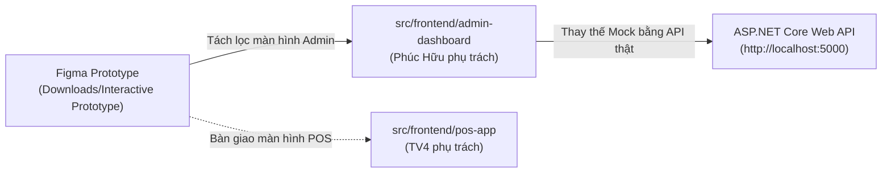

# KẾ HOẠCH TÍCH HỢP GIAO DIỆN FIGMA VÀO NHIỆM VỤ FRONTEND ADMIN
**Dành cho:** Phúc Hữu (Thành viên 3 - Frontend Admin Lead)  
**Nguồn giao diện:** `C:\Users\Jacki Khoa\Downloads\Interactive Prototype for OISM` (Figma Make App)  
**Dự án:** OISMS - Omnichannel Inventory & Sales Management System  
**Cập nhật:** 17/10/2026  

---

## 1. TỔNG QUAN PHẠM VI NHẬN BÀN GIAO TỪ BẢN THIẾT KẾ FIGMA

Bản prototype do Figma tạo ra tại thư mục Downloads đã chứa toàn bộ giao diện HTML/CSS/React và các logic tương tác mẫu. Nhiệm vụ của Phúc Hữu là **chuyển giao toàn bộ các màn hình Quản trị (Admin) vào `src/frontend/admin-dashboard`, gỡ bỏ dữ liệu giả lập (mock data) và nối trực tiếp với 33 API Backend thật**.



### 1.1. Danh mục các Component & Màn hình Phúc Hữu tiếp nhận từ Figma:

| Thành phần Figma | File nguồn trong Prototype | Vai trò & Nhiệm vụ của Phúc Hữu |
| :--- | :--- | :--- |
| **Khung sườn Quản trị** | `src/components/AdminShell.tsx` | Quản lý Sidebar, Topbar, Tên cửa hàng, Avatar, Menu chuyển trang, Nút Đăng xuất. |
| **Trung tâm Thông báo** | `src/components/NotificationCenter.tsx` | Quản lý chuông thông báo toast, danh sách sự kiện đơn hàng/kho (sẵn sàng đón SignalR). |
| **Bộ Design System** | `src/components/ui.tsx` | Tận dụng 100% component dựng sẵn: `Button`, `Input`, `Select`, `Modal`, `Badge`, `PageTitle`. |
| **Màn hình Đăng nhập/Đăng ký** | `src/pages/AuthPage.tsx` | Nối API `POST /api/auth/login` và `POST /api/auth/register-tenant`. |
| **Bảng điều khiển Tổng quan** | `src/pages/DashboardPage.tsx` | Hiển thị KPI doanh thu, biểu đồ, danh sách cảnh báo tồn kho. |
| **Màn hình Sản phẩm & SKU** | `src/pages/ProductsPage.tsx` | Form Danh mục, Thương hiệu, Thêm sản phẩm, Tạo biến thể SKU, Nút sinh mã vạch EAN-13. |
| **Màn hình Kho & Sổ kho** | `src/pages/InventoryPage.tsx` | Form Phiếu nhập kho nhiều dòng, Bảng Tồn kho (`OnHand/Reserved/Available`), Bảng Sổ cái kho. |
| **Màn hình Đơn hàng đa kênh** | `src/pages/OrdersPage.tsx` | Danh sách đơn POS/Sàn, Modal chi tiết đơn và trạng thái. |
| **Màn hình Chi nhánh & Nhân viên** | `src/pages/OrganizationPage.tsx` | Bảng nhân viên (RBAC), Bảng Chi nhánh, Bảng Kho hàng (mới bổ sung từ Backend 2). |
| **Màn hình Báo cáo tài chính** | `src/pages/ReportsPage.tsx` | Báo cáo Doanh thu, Giá vốn WAC, Lợi nhuận gộp, Gợi ý nhập hàng AI. |
| **Xử lý Quyền & Lỗi** | `src/pages/AccessPage.tsx` | Màn hình thông báo lỗi **403 Forbidden** và Hết hạn phiên làm việc. |
| **Bộ mã màu & Style** | `src/index.css` | Sử dụng bộ stylesheet hoàn chỉnh dựa trên Tailwind CSS v4. |

*(Lưu ý: Màn hình `src/pages/PosPage.tsx` dành riêng cho Thành viên 4 - Frontend POS, Phúc Hữu có thể sao chép bàn giao sang `src/frontend/pos-app`).*

---

## 2. KẾ HOẠCH TRIỂN KHAI TỪNG BƯỚC (ACTIONABLE STEPS)

### BƯỚC 1: Thiết lập môi trường và Di chuyển mã nguồn vào `admin-dashboard`
1. **Cập nhật `package.json` của `src/frontend/admin-dashboard`:**
   Đảm bảo có đủ các thư viện Figma yêu cầu:
   ```json
   "dependencies": {
     "react": "^19.0.0",
     "react-dom": "^19.0.0",
     "react-router-dom": "^7.18.4",
     "lucide-react": "^1.57.0",
     "axios": "^1.7.0"
   },
   "devDependencies": {
     "@tailwindcss/vite": "^4.0.0",
     "tailwindcss": "^4.0.0",
     "typescript": "^5.7.0",
     "vite": "^8.0.5"
   }
   ```
2. **Di chuyển mã nguồn:**
   - Sao chép toàn bộ thư mục `src/components/`, `src/pages/` (trừ `PosPage.tsx`), `src/types/`, `src/index.css`, `src/App.tsx` vào `src/frontend/admin-dashboard/src/`.
3. **Kiểm tra biên dịch:**
   - Chạy `npm install` và `npm run build` để xác nhận không có lỗi type/lỗi CSS.

---

### BƯỚC 2: Gỡ bỏ Dữ liệu Cứng & Xây dựng Cơ chế Quản lý Phiên (Auth Guard)

Trong bản Figma gốc, file `DemoSessionContext.tsx` đang chứa mảng dữ liệu cứng `demoAccounts` (Nguyễn Hoàng, Minh Phạm, Lan Trần). **Phúc Hữu cần thực hiện thay thế:**

1. **Xây dựng `src/services/httpClient.ts` (API Client tập trung):**
   ```typescript
   import axios from 'axios';

   export const api = axios.create({
     baseURL: import.meta.env.VITE_API_BASE_URL || 'http://localhost:5000',
     headers: { 'Content-Type': 'application/json' },
   });

   // Tự động đính kèm Access Token vào mọi Request
   api.interceptors.request.use((config) => {
     const token = localStorage.getItem('access_token');
     if (token) {
       config.headers.Authorization = `Bearer ${token}`;
     }
     return config;
   });

   // Bắt lỗi 401 để tự động Refresh Token hoặc chuyển về /login
   api.interceptors.response.use(
     (response) => response,
     async (error) => {
       if (error.response?.status === 401) {
         // Xử lý gọi /api/auth/refresh-token hoặc logout
         localStorage.removeItem('access_token');
         window.location.href = '/login';
       }
       return Promise.reject(error);
     }
   );
   ```

2. **Chuyển đổi `DemoSessionContext` thành `AuthContext` thực tế:**
   - Khi người dùng đăng nhập tại `AuthPage.tsx`: Gọi `POST /api/auth/login`.
   - Nhận về `accessToken` và lưu vào `localStorage`.
   - Gọi ngay `GET /api/auth/me` để lấy thông tin người dùng thật: `email`, `fullName`, `role` (`Owner` hoặc `Staff`), `tenantId`, `tenantName`.
   - Lưu thông tin này vào `AuthContext` để `AdminShell.tsx` tự động hiển thị tên thật, avatar thật và vai trò thật.
3. **Bảo vệ Route (RBAC Route Guard):**
   - Nếu vai trò trả về là `Cashier` (Thu ngân) mà truy cập vào Admin Dashboard -> Chuyển hướng ngay sang `/403` (`AccessPage.tsx`).

---

### BƯỚC 3: Nối các Form & Bảng Nghiệp Vụ với API Backend Thật (Sprint 2 Ready)

Phúc Hữu thay thế các hàm trong `src/services/apiAdapter.ts` bằng các lời gọi API thật tới Backend:

#### 3.1. Phân hệ Tổ chức, Chi nhánh & Kho hàng (`OrganizationPage.tsx`):
- **Tải danh sách chi nhánh:**
  ```typescript
  const res = await api.get('/api/branches');
  setBranches(res.data);
  ```
- **Tạo chi nhánh mới:** Gọi `POST /api/branches` với `{ name, address }`.
- **Tải danh sách kho hàng:** Gọi `GET /api/warehouses?branchId=${selectedBranchId}`.
- **Tạo kho hàng mới:** Gọi `POST /api/warehouses` với `{ branchId, name }`.
- **Bật/Tắt hoạt động kho:** Gọi `PUT /api/warehouses/${warehouseId}/toggle-status`.

#### 3.2. Phân hệ Danh mục, Thương hiệu & Sản phẩm (`ProductsPage.tsx`):
- **Cây danh mục:** Gọi `GET /api/categories` và đổ vào dropdown chọn danh mục cha.
- **Thương hiệu:** Gọi `GET /api/brands` đổ vào dropdown thương hiệu.
- **Danh sách sản phẩm:** Gọi `GET /api/products` hiển thị bảng dữ liệu thật.
- **Form thêm sản phẩm:** Gửi request `POST /api/products` gồm thông tin chung và mảng biến thể `variants: [{ sku, barcode, retailPrice, wholesalePrice }]`.
- **Bắt lỗi nghiệp vụ:** Nếu Backend trả về mã `409 Conflict` (trùng SKU) -> Hiện toast thông báo đỏ: *"Mã SKU này đã tồn tại trong cửa hàng!"*.

#### 3.3. Phân hệ Tồn kho, Phiếu nhập kho & Sổ cái (`InventoryPage.tsx`):
- **Bảng Tồn kho:** Đọc số lượng `OnHand`, `Reserved`, và tính tồn khả dụng `Available = OnHand - Reserved`. Cảnh báo vàng khi `Available <= Threshold`.
- **Form Lập Phiếu nhập kho đa dòng (`ReceiptDialog`):**
  - Cho phép người dùng bấm `+ Thêm dòng sản phẩm`.
  - Chọn SKU, nhập số lượng, nhập đơn giá nhập.
  - Tự động cộng tổng tiền phiếu nhập.
  - Chọn Nhà cung cấp từ danh sách API `GET /api/suppliers`.
- **Bảng Sổ cái kho (`LedgerTable`):**
  - Hiển thị bảng bất biến chỉ đọc (không có nút sửa/xóa).
  - Phân loại rõ ràng bút toán `IN` (Xanh) và `OUT` (Đỏ).

---

## 3. CHECKLIST KIỂM THỬ TỰ THỰC HIỆN (DEV SELF-TEST) CỦA PHÚC HỮU

Trước khi bàn giao cho Trưởng nhóm và Tester kiểm thử nghiệm thu, Phúc Hữu cần kiểm tra đạt các tiêu chí sau:

- [ ] **ST-01:** Khởi động Web Admin bằng `npm run dev` trên cổng `5173` không có lỗi runtime trên Console.
- [ ] **ST-02:** Đăng nhập thành công với tài khoản thật `owner@shopa.local` / `YourStrongDemoPassword123!`.
- [ ] **ST-03:** Đăng xuất xóa sạch token và đưa về màn hình `/login`.
- [ ] **ST-04:** Thử đăng nhập tài khoản thu ngân `cashier@shopa.local` -> Bị chặn với màn hình `403 Forbidden`.
- [ ] **ST-05:** Tạo mới 1 Chi nhánh -> Chi nhánh mới xuất hiện trong danh sách.
- [ ] **ST-06:** Tạo mới 1 Kho hàng thuộc Chi nhánh -> Kho hàng mới hiển thị đúng tên chi nhánh.
- [ ] **ST-07:** Bấm Bật/Tắt kho hàng -> Trạng thái chuyển đổi ngay lập tức.
- [ ] **ST-08:** Thêm sản phẩm mới và tạo 2 biến thể SKU -> Sản phẩm xuất hiện trên bảng `Products`.
- [ ] **ST-09:** Thử tạo trùng mã SKU đã có -> Hiển thị thông báo lỗi 409 rõ ràng, không bị crash trang.
- [ ] **ST-10:** Kiểm tra responsive trên cả màn hình Laptop và Tablet.

---

## 4. KẾT LUẬN & ĐÓNG GÓI BÀN GIAO

Việc tích hợp bản thiết kế Figma vào `admin-dashboard` sẽ giúp Phúc Hữu tiết kiệm **80% thời gian vẽ giao diện**, chỉ cần tập trung vào việc quản lý State, gọi API và xử lý thông báo lỗi.

Sau khi hoàn tất checklist trên, Phúc Hữu cập nhật bằng chứng vào tài liệu [`docs/Phúc hữu report/README.md`](./README.md) để Trưởng nhóm nghiệm thu và merge vào nhánh chính `develop`.
