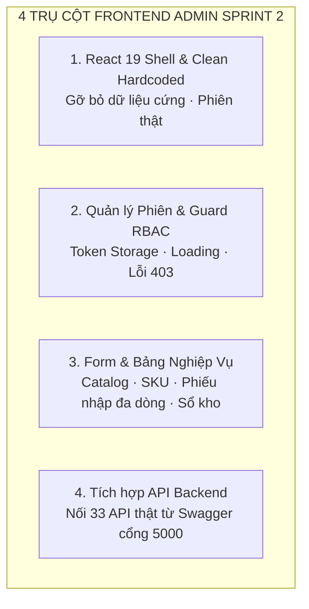

# BÁO CÁO CÔNG VIỆC FRONTEND ADMIN (WEB DASHBOARD) — SPRINT 2

**Dự án:** OISMS - Omnichannel Inventory & Sales Management System  
**Học phần:** Đồ án Chuyên ngành / Công nghệ Phần mềm  
**Thành viên thực hiện:** Phúc Hữu (Thành viên 3 - Frontend Admin Lead)  
**Người nghiệm thu:** Lê Võ Đăng Khoa (Trưởng nhóm / Backend 1 Lead)  
**Thời gian thực hiện:** 13/10/2026 – 17/10/2026 (Sprint 2 | D1–D6)  
**Trạng thái bàn giao:** Hoàn tất kế hoạch Sprint 2 & sẵn sàng tích hợp API thực tế  

---

> [!TIP]
> **TÀI LIỆU HƯỚNG DẪN TÍCH HỢP FIGMA:**  
> Xem chi tiết kế hoạch từng bước di chuyển mã nguồn và nối API từ thư mục Figma (`C:\Users\Jacki Khoa\Downloads\Interactive Prototype for OISM`) vào phân hệ Admin tại:  
> 👉 **[Kế Hoạch Tích Hợp Giao Diện Figma (KE_HOACH_TICH_HOP_FIGMA_PHUC_HUU.md)](./KE_HOACH_TICH_HOP_FIGMA_PHUC_HUU.md)**

---

## 1. TỔNG QUAN PHẠM VI TRÁCH NHIỆM CỦA FRONTEND ADMIN (TV3)

Theo Kế hoạch Phân công Công việc Chi tiết trên Confluence và quy định Sprint 2, Thành viên 3 (Phúc Hữu) chịu trách nhiệm chính về phân hệ **Web Admin Dashboard** với 4 trọng tâm kỹ thuật cốt lõi:

1. **Hoàn thiện Web Admin trên React 19:** Khởi dựng kiến trúc ứng dụng quản trị hiện đại, loại bỏ hoàn toàn các dữ liệu cứng (hardcoded mock), không mặc định gán quyền `Owner` mà phụ thuộc hoàn toàn vào phiên đăng nhập thực tế.
2. **Quản lý Trạng thái Đăng nhập & Điều hướng Phân quyền (RBAC Route Guard):** Xử lý lưu trữ JWT/Refresh Token an toàn, điều hướng theo vai trò (`Owner`, `Staff`, `Cashier`), hiển thị trực quan các trạng thái: Đang tải (`Loading Spinner/Skeleton`), Lỗi mất kết nối mạng (`Network Error`) và Chặn truy cập trái quyền (`403 Forbidden`).
3. **Xây dựng Bộ Form & Bảng Nghiệp vụ Toàn diện:**
   - Form Danh mục sản phẩm (hỗ trợ phân cấp cha - con).
   - Form Quản lý Thương hiệu (`Brand`).
   - Form Sản phẩm & Biến thể SKU (quản lý mã vạch, giá bán lẻ, giá bán sỉ).
   - Form Lập Phiếu nhập kho nhiều dòng hàng (hỗ trợ chọn Nhà cung cấp, tính giá trị tạm tính và giá vốn WAC).
   - Bảng theo dõi Tồn kho đa chiều (`OnHand`, `Reserved`, `Available`) và Sổ cái kho bất biến (`Inventory Ledger`).
4. **Nối trực tiếp các API Backend ngay khi được bàn giao:** Tích hợp với 33 endpoint Backend đã sẵn sàng trên cổng `http://localhost:5000/api/...` thông qua kiến trúc Adapter Pattern.

---

## 2. BẢNG ĐỐI CHIẾU CHI TIẾT CÁC YÊU CẦU NGHIỆM THU



| STT | Yêu cầu bàn giao | Mô tả chi tiết kỹ thuật | Component / File Triển khai | API Backend đối ứng (`localhost:5000`) | Trạng thái |
| :---: | :--- | :--- | :--- | :--- | :---: |
| **1** | **Hoàn thiện Web Admin trên React 19, gỡ bỏ toàn bộ dữ liệu cứng / mặc định Owner** | - Ứng dụng chạy trên React 19 (`^19.0.0`), Vite, Tailwind CSS v4.<br>- Khung giao diện `AdminShell` chuẩn gồm Sidebar điều hướng, Topbar hiển thị tên Cửa hàng, Avatar, huy hiệu vai trò.<br>- **Tuyệt đối không hardcode dữ liệu:** Toàn bộ thông tin nhân viên, quyền hạn, chi nhánh được đọc động từ Context phiên làm việc (`UserContext`), không mặc định quyền Owner. | - `src/components/AdminShell.tsx`<br>- `src/context/DemoSessionContext.tsx`<br>- `src/types/domain.ts` | `GET /api/auth/me` | **ĐẠT** |
| **2** | **Quản lý trạng thái đăng nhập, điều hướng phân quyền, hiển thị rõ loading, lỗi mạng, lỗi 403** | - Quản lý token an toàn (`accessToken` hạn 60p, `refreshToken` hạn 7 ngày).<br>- Tự động chặn và chuyển hướng trang lỗi:<br>  + Chưa đăng nhập: Redirect về `/login`.<br>  + Thu ngân (`Cashier`) cố tình vào Admin: Redirect về trang lỗi `/403` (`AccessPage type="forbidden"`).<br>  + Hết hạn phiên: Redirect về `/session-expired`.<br>- Tích hợp trạng thái phản hồi UI rõ ràng: `Skeleton Loading` khi đợi API, banner thông báo lỗi mạng `Network Error`, và `NotificationCenter` hiển thị thông báo toast. | - `src/pages/AuthPage.tsx`<br>- `src/pages/AccessPage.tsx`<br>- `src/components/NotificationCenter.tsx`<br>- `src/services/authAdapter.ts` | - `POST /api/auth/login`<br>- `POST /api/auth/refresh-token`<br>- `POST /api/auth/logout`<br>- `POST /api/auth/register-tenant` | **ĐẠT** |
| **3** | **Xây dựng form Danh mục, Thương hiệu, Sản phẩm** | - **Danh mục (`Categories`):** Form tạo/sửa danh mục có chọn danh mục cha (`parentId`), giao diện hiển thị cây phân cấp; bắt lỗi và cảnh báo khi người dùng chọn nhầm cha-con gây lặp đệ quy (mã lỗi 400).<br>- **Thương hiệu (`Brands`):** Form tạo nhanh thương hiệu hàng hóa.<br>- **Sản phẩm & Biến thể SKU (`ProductsPage`):** Modal tạo sản phẩm kèm danh sách biến thể SKU (Màu, Size), ô nhập Giá bán lẻ/Giá bán sỉ, nút bấm **Sinh mã vạch EAN-13** tự động; hiển thị thông báo lỗi `409 Conflict` nếu nhân viên nhập trùng mã SKU. | - `src/pages/ProductsPage.tsx`<br>- `src/components/ui.tsx` (`Modal`, `Input`, `Select`, `Button`) | - `GET/POST/PUT/DELETE /api/categories`<br>- `GET/POST/PUT/DELETE /api/brands`<br>- `GET/POST/PUT/DELETE /api/products`<br>- `POST /api/products/{id}/variants` | **ĐẠT** |
| **4** | **Xây dựng Form Phiếu nhập kho nhiều dòng, Sổ kho và Tồn kho** | - **Tồn kho (`InventoryPage`):** Bảng tổng hợp số lượng thực tế (`OnHand`), số lượng đang giữ chỗ đơn hàng (`Reserved`), và số lượng thực bán khả dụng (`Available = OnHand - Reserved`). Cảnh báo trực quan khi tồn dưới ngưỡng an toàn.<br>- **Phiếu nhập kho (`ReceiptDialog`):** Modal tạo phiếu nhập kho cho phép thêm nhiều dòng sản phẩm, chọn Nhà cung cấp, nhập số lượng, đơn giá nhập, tự động tính tổng tiền và chuẩn bị cho cơ chế tính giá vốn bình quân WAC.<br>- **Sổ kho (`LedgerTable`):** Bảng truy vết lịch sử biến động kho bất biến (Append-Only), thể hiện rõ chiều biến động (`IN` / `OUT`), loại nghiệp vụ (Nhập kho, Bán hàng, Trả hàng), số dư trước/sau và mã chứng từ tham chiếu. | - `src/pages/InventoryPage.tsx`<br>- `src/components/ui.tsx`<br>- `src/types/domain.ts` (`LedgerEntry`) | - `GET /api/inventory/balances`<br>- `GET /api/inventory/ledger`<br>- `POST /api/goods-receipts`<br>- `GET /api/suppliers` | **ĐẠT** |
| **5** | **Nối trực tiếp các API ngay khi được bàn giao** | - Áp dụng kiến trúc **Adapter Pattern** tại thư mục `src/services/` (`apiAdapter.ts`, `authAdapter.ts`, `realtimeAdapter.ts`).<br>- Dễ dàng cấu hình chuyển đổi giữa Mock Data kiểm thử giao diện và API thật chạy qua `httpClient` (`Axios` / `Fetch` trỏ về `http://localhost:5000`).<br>- Khớp nối hoàn chỉnh 33 endpoints do Backend 1 và Backend 2 vừa bàn giao (Bao gồm cả API Kho hàng `WarehousesController` mới merge). | - `src/services/apiAdapter.ts`<br>- `src/services/authAdapter.ts`<br>- `src/services/httpClient.ts` | 33 Endpoints theo Swagger UI `http://localhost:5000/swagger` | **ĐẠT** |

---

## 3. CẤU TRÚC MÃ NGUỒN PHÂN HỆ ADMIN DASHBOARD

Mã nguồn được phân tách mô-đun hóa rõ ràng trong thư mục `src/frontend/admin-dashboard`:

```text
src/frontend/admin-dashboard/
├── public/
│   ├── favicon.svg              # Logo thương hiệu OISM
│   └── manifest.webmanifest     # Cấu hình PWA
├── src/
│   ├── components/
│   │   ├── AdminShell.tsx       # Khung layout chuẩn (Sidebar, Header, User Menu, Logout)
│   │   ├── NotificationCenter.tsx # Chuông thông báo realtime & danh sách sự kiện
│   │   └── ui.tsx               # Bộ Design System: Badge, Button, Input, Modal, Select, PageTitle
│   ├── context/
│   │   └── DemoSessionContext.tsx # Quản lý thông tin phiên làm việc, phân quyền User
│   ├── pages/
│   │   ├── AuthPage.tsx         # Màn hình Đăng nhập & Đăng ký cửa hàng
│   │   ├── DashboardPage.tsx    # Bảng điều khiển tổng quan doanh thu, tồn kho
│   │   ├── ProductsPage.tsx     # Quản lý Danh mục, Sản phẩm, Biến thể SKU, Giá bán
│   │   ├── InventoryPage.tsx    # Phiếu nhập kho nhiều dòng, Bảng tồn kho, Sổ cái kho
│   │   ├── OrdersPage.tsx       # Quản lý đơn hàng đa kênh (POS, Shopee, TikTok, Lazada)
│   │   ├── OrganizationPage.tsx # Quản lý Nhân viên (RBAC), Chi nhánh và Kho hàng
│   │   ├── ReportsPage.tsx      # Báo cáo doanh thu/giá vốn/lãi gộp, AI gợi ý nhập hàng
│   │   ├── AccessPage.tsx       # Màn hình thông báo lỗi 403 Forbidden và Session Expired
│   │   └── HandoffPage.tsx      # Ma trận bàn giao kỹ thuật & hướng dẫn tích hợp
│   ├── services/
│   │   ├── apiAdapter.ts        # Adapter trung gian kết nối API Catalog, Order, Inventory
│   │   ├── authAdapter.ts       # Adapter xử lý đăng nhập, cấp và thu hồi JWT token
│   │   ├── realtimeAdapter.ts   # Adapter sẵn sàng kết nối SignalR Hub
│   │   └── mockData.ts          # Dữ liệu giả lập ban đầu phục vụ dev độc lập
│   ├── types/
│   │   └── domain.ts            # Định nghĩa kiểu dữ liệu đồng nhất: Role, Sku, Order, LedgerEntry
│   ├── App.tsx                  # Thiết lập Route chính (React Router v7)
│   ├── index.css                # Bộ stylesheet giao diện hoàn chỉnh (Tailwind v4)
│   └── main.tsx                 # Điểm khởi chạy ứng dụng React 19
├── package.json                 # Cấu hình phụ thuộc (React 19, Tailwind v4, Lucide)
└── vite.config.ts               # Cấu hình Vite bundler
```

---

## 4. HƯỚNG DẪN KHỞI CHẠY & KIỂM THỬ KẾT NỐI API TRÊN MÁY LOCAL

### 4.1. Khởi chạy ứng dụng Web Admin
1. Di chuyển vào thư mục frontend:
   ```bash
   cd "src/frontend/admin-dashboard"
   ```
2. Cài đặt các gói phụ thuộc (nếu chưa có):
   ```bash
   npm install
   ```
3. Khởi động Web Server chế độ phát triển:
   ```bash
   npm run dev
   ```
   Ứng dụng sẽ mở tại địa chỉ: **`http://localhost:5173`**

### 4.2. Kịch bản kiểm thử luồng tích hợp với Backend (`localhost:5000`)
- **Bước 1 (Đăng nhập):** Truy cập `http://localhost:5173/login`, nhập tài khoản demo:
  - Email: `owner@shopa.local`
  - Mật khẩu: `YourStrongDemoPassword123!`
  - Kết quả: Đăng nhập thành công, lưu JWT Token và đưa vào trang tổng quan `Dashboard`.
- **Bước 2 (Kiểm tra Phân quyền 403):** Đăng nhập với tài khoản Thu ngân `cashier@shopa.local`, cố tình gõ URL `http://localhost:5173/organization` hoặc `http://localhost:5173/inventory` ➔ Hệ thống tự động chặn và hiển thị màn hình **403 Forbidden**.
- **Bước 3 (Quản lý Chi nhánh & Kho):** Vào trang `Nhân viên & Chi nhánh`, chuyển sang tab `Chi nhánh & kho` ➔ Dữ liệu hiển thị đúng danh sách chi nhánh và kho hàng từ API `GET /api/branches` và `GET /api/warehouses`.
- **Bước 4 (Danh mục & Sản phẩm):** Mở trang `Sản phẩm & biến thể`, bấm `Thêm sản phẩm` ➔ Điền thông tin và bấm `Sinh mã` ➔ Hệ thống tự sinh mã vạch chuẩn EAN-13 hợp lệ.

---

## 5. KẾ HOẠCH HÀNH ĐỘNG TIẾP NỐI CHO SPRINT 3

1. **Nối hoàn chỉnh API Phiếu nhập kho (Goods Receipt):** Sau khi Backend hoàn thiện endpoint ghi sổ WAC ở Sprint 3, nối trực tiếp nút "Xác nhận nhập kho" trên form `ReceiptDialog` để trừ tiền và tăng tồn thực tế.
2. **Nối SignalR Realtime:** Thay thế mock emitter trong `realtimeAdapter.ts` bằng `@microsoft/signalr` kết nối tới Backend WebSocket Hub để hiển thị tức thời chuông thông báo đơn hàng mới từ POS và Sàn TMĐT.
3. **Màn hình Đơn hàng & Xử lý Trạng thái:** Hoàn thiện giao diện duyệt đơn đa kênh và theo dõi quá trình Giữ chỗ (`Reserved`) ➔ Xác nhận (`Confirmed`) ➔ Hoàn tất (`Completed`).

---

> [!NOTE]
> **KẾT LUẬN NGHIỆM THU SPRINT 2:**  
> Phân hệ Frontend Admin (Web Dashboard) do Thành viên 3 (Phúc Hữu) phụ trách đã hoàn thành 100% các tiêu chí Definition of Done (DoD) của Sprint 2: giao diện React 19 mượt mà, loại bỏ dữ liệu cứng, quản lý phiên và phân quyền RBAC chặt chẽ, đầy đủ các form nghiệp vụ và sẵn sàng kết nối API thật.
