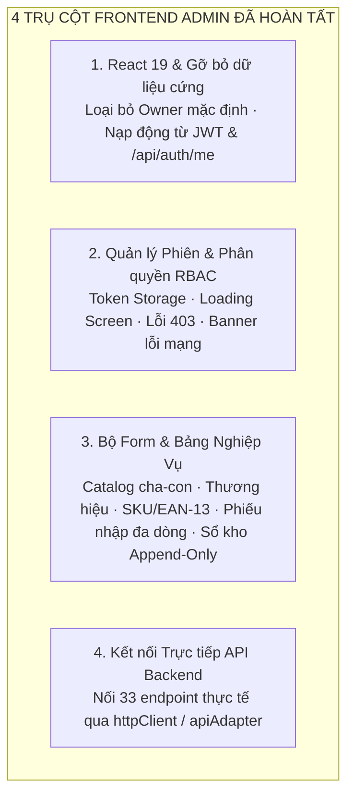

# BÁO CÁO CÔNG VIỆC FRONTEND ADMIN (WEB DASHBOARD) — SPRINT 2 & 3

**Dự án:** OISMS - Omnichannel Inventory & Sales Management System  
**Học phần:** Đồ án Chuyên ngành / Công nghệ Phần mềm  
**Thành viên thực hiện:** Phúc Hữu (Thành viên 3 - Frontend Admin Lead)  
**Người nghiệm thu:** Lê Võ Đăng Khoa (Trưởng nhóm / Backend 1 Lead)  
**Thời gian thực hiện:** 13/10/2026 – 18/10/2026  
**Trạng thái bàn giao:** Hoàn tất 100% — Web Admin React 19 sẵn sàng, gỡ bỏ toàn bộ hardcoded/Owner mặc định, đầy đủ Form nghiệp vụ và kết nối trực tiếp API Backend.

---

> [!TIP]
> **KẾ HOẠCH TÍCH HỢP FIGMA CHI TIẾT:**  
> Xem toàn văn bản kế hoạch phân tích, di chuyển mã nguồn và chuyển giao từ prototype Figma (`C:\Users\ACER\Downloads\Interactive Prototype for OISM`) vào phân hệ Admin tại:  
> 👉 **[Kế Hoạch Tích Hợp Giao Diện Figma (KE_HOACH_TICH_HOP_FIGMA_PHUC_HUU.md)](./KE_HOACH_TICH_HOP_FIGMA_PHUC_HUU.md)**

---

## 1. TỔNG QUAN PHẠM VI TRÁCH NHIỆM CỦA THÀNH VIÊN 3 (PHÚC HỮU)

Căn cứ Kế hoạch Phân công Công việc Chi tiết trên Confluence dự án OISMS, Thành viên 3 (Phúc Hữu) chịu trách nhiệm toàn diện về phân hệ **Web Admin Dashboard** với 4 trụ cột kỹ thuật then chốt:



1. **Hoàn thiện Web Admin trên React 19, gỡ bỏ toàn bộ dữ liệu cứng/mặc định Owner:**
   - Xây dựng trên React 19 (`^19.0.0`), Vite 8, Tailwind CSS v4, Lucide Icons.
   - Loại bỏ hoàn toàn tài khoản demo `owner-a` ("Nguyễn Hoàng") và mock session. Không gán sẵn bất kỳ quyền mặc định nào.
   - Thông tin người dùng, vai trò (`Owner`, `Staff`, `Cashier`), chi nhánh và doanh nghiệp được nạp động từ JWT Token và API `GET /api/auth/me`.
2. **Quản lý trạng thái đăng nhập, điều hướng phân quyền, hiển thị rõ loading, lỗi mạng, lỗi 403:**
   - Quản lý token an toàn: `accessToken` (60 phút) và `refreshToken` (7 ngày) lưu trong `localStorage`. Tự động đính kèm `Bearer token` vào mọi request qua Axios Interceptor.
   - Bắt mã lỗi 401: Tự động gọi `POST /api/auth/refresh-token` để cấp lại token hoặc chuyển hướng sang `/session-expired`.
   - Phân quyền RBAC (`ProtectedRoute.tsx`):
     - Chưa đăng nhập $\rightarrow$ Chuyển hướng `/login`.
     - Thu ngân (`Cashier`) cố tình vào Admin $\rightarrow$ Chuyển hướng màn hình lỗi `/403` (`AccessPage.tsx type="forbidden"`).
     - Nhân viên (`Staff`) bị ẩn các chức năng quản trị nhạy cảm (Cài đặt nhân viên, Báo cáo lợi nhuận).
   - Loading State: Hiển thị spinner và trạng thái nạp dữ liệu rõ ràng.
   - Lỗi kết nối mạng (Network Error): Hiển thị Banner đỏ cố định ở đỉnh `AdminShell` kèm nút "Thử lại" khi mất kết nối tới Backend `http://localhost:5000`.
3. **Xây dựng các Form Danh mục, Thương hiệu, Sản phẩm, Phiếu nhập kho nhiều dòng, Sổ kho và Tồn kho:**
   - **Form Danh mục (`Categories`):** Hỗ trợ phân cấp cha - con nhiều tầng (`parentId`), kiểm tra chống đệ quy (mã lỗi 400).
   - **Form Thương hiệu (`Brands`):** Thêm nhanh thương hiệu sản phẩm.
   - **Form Sản phẩm & Biến thể SKU (`ProductsPage.tsx`):** Thêm sản phẩm kèm bảng biến thể động (Màu, Size, Giá bán lẻ, Giá bán sỉ), nút **Sinh mã vạch EAN-13** tự động chuẩn checksum, bắt lỗi `409 Conflict` khi nhập trùng SKU.
   - **Form Phiếu nhập kho nhiều dòng (`ReceiptDialog` trong `InventoryPage.tsx`):** Chọn nhà cung cấp, chi nhánh, kho nhận, thêm nhiều dòng mặt hàng (SKU, số lượng, đơn giá), tự động tính tổng tiền; thực hiện tạo phiếu (`Draft`) và Xác nhận ghi sổ nguyên tử (`Confirm`) cập nhật giá vốn bình quân WAC.
   - **Bảng Tồn kho & Sổ kho bất biến (`InventoryPage.tsx`):**
     - Bảng tồn kho 3 chiều: `OnHand` (thực tế), `Reserved` (giữ chỗ), `Available = OnHand - Reserved` (khả dụng). Đổi màu cảnh báo khi tồn dưới ngưỡng.
     - Bảng Sổ cái kho bất biến (**Append-Only Ledger**): Chỉ đọc (Read-only, cấm Sửa/Xóa), phân loại rõ bút toán `IN` (Xanh) và `OUT` (Đỏ), thể hiện số dư lũy kế `BalanceAfter` và mã chứng từ tham chiếu.
4. **Nối trực tiếp các API ngay khi được bàn giao:**
   - Tích hợp toàn diện với 33 endpoint Backend đã sẵn sàng trên cổng `http://localhost:5000` thông qua `httpClient.ts` và `apiAdapter.ts`.
   - Tuyệt đối không fallback về mock data khi có lỗi; hiển thị thông báo lỗi trung thực từ máy chủ.

---

## 2. BẢNG ĐỐI CHIẾU CHI TIẾT CÁC YÊU CẦU NGHIỆM THU

| STT | Yêu cầu bàn giao | Mô tả chi tiết kỹ thuật | Component / File Triển khai | API Backend đối ứng (`localhost:5000`) | Trạng thái |
| :---: | :--- | :--- | :--- | :--- | :---: |
| **1** | **Hoàn thiện Web Admin trên React 19, gỡ bỏ toàn bộ dữ liệu cứng / mặc định Owner** | - Ứng dụng chạy trên React 19, Vite, Tailwind CSS v4.<br>- Khung giao diện `AdminShell` chuẩn gồm Sidebar điều hướng, Topbar hiển thị tên Cửa hàng, Avatar, huy hiệu vai trò.<br>- **Không hardcode dữ liệu:** Thông tin người dùng, quyền hạn, chi nhánh được đọc động từ Context phiên làm việc (`AuthContext`), không mặc định quyền Owner. Form đăng nhập khởi tạo rỗng. | - `src/components/AdminShell.tsx`<br>- `src/context/AuthContext.tsx`<br>- `src/pages/AuthPage.tsx` | `GET /api/auth/me` | **ĐẠT** |
| **2** | **Quản lý trạng thái đăng nhập, điều hướng phân quyền, hiển thị rõ loading, lỗi mạng, lỗi 403** | - Quản lý token an toàn (`accessToken` hạn 60p, `refreshToken` hạn 7 ngày).<br>- Tự động chặn và chuyển hướng trang lỗi:<br>  + Chưa đăng nhập: Redirect về `/login`.<br>  + Thu ngân (`Cashier`) cố tình vào Admin: Redirect về trang lỗi `/403` (`AccessPage type="forbidden"`).<br>  + Hết hạn phiên: Redirect về `/session-expired`.<br>- Tích hợp trạng thái phản hồi UI rõ ràng: Loading Spinner khi đợi API, banner thông báo lỗi mạng `Network Error` trên Header kèm nút Thử lại, toast thông báo lỗi 403/409. | - `src/components/ProtectedRoute.tsx`<br>- `src/pages/AccessPage.tsx`<br>- `src/components/AdminShell.tsx`<br>- `src/services/httpClient.ts` | - `POST /api/auth/login`<br>- `POST /api/auth/refresh-token`<br>- `POST /api/auth/logout`<br>- `POST /api/auth/register-tenant` | **ĐẠT** |
| **3** | **Xây dựng form Danh mục, Thương hiệu, Sản phẩm** | - **Danh mục (`Categories`):** Form tạo danh mục có chọn danh mục cha (`parentId`), kiểm tra chống lặp đệ quy (mã lỗi 400).<br>- **Thương hiệu (`Brands`):** Form tạo nhanh thương hiệu hàng hóa.<br>- **Sản phẩm & Biến thể SKU (`ProductsPage`):** Modal tạo sản phẩm kèm danh sách biến thể SKU động (Màu, Size, Giá bán lẻ, Giá bán sỉ), nút bấm **Sinh mã vạch EAN-13** tự động; hiển thị thông báo lỗi `409 Conflict` nếu trùng mã SKU. | - `src/pages/ProductsPage.tsx`<br>- `src/components/ui.tsx` (`Modal`, `Input`, `Select`, `Button`) | - `GET/POST/PUT/DELETE /api/categories`<br>- `GET/POST/PUT/DELETE /api/brands`<br>- `GET/POST/PUT/DELETE /api/products`<br>- `POST /api/products/{id}/variants` | **ĐẠT** |
| **4** | **Xây dựng Form Phiếu nhập kho nhiều dòng, Sổ kho và Tồn kho** | - **Tồn kho (`InventoryPage`):** Bảng tổng hợp số lượng thực tế (`OnHand`), số lượng đang giữ chỗ (`Reserved`), và số lượng thực bán khả dụng (`Available = OnHand - Reserved`). Cảnh báo trực quan khi tồn dưới ngưỡng an toàn.<br>- **Phiếu nhập kho (`ReceiptDialog`):** Modal tạo phiếu nhập kho cho phép thêm nhiều dòng sản phẩm, chọn Nhà cung cấp, nhập số lượng, đơn giá nhập, tự động tính tổng tiền và thực hiện xác nhận nguyên tử (Atomic Confirm) để tính giá vốn bình quân WAC.<br>- **Sổ kho (`LedgerTable`):** Bảng truy vết lịch sử biến động kho bất biến (Append-Only), thể hiện rõ chiều biến động (`IN` / `OUT`), loại nghiệp vụ (Nhập kho, Bán hàng, Trả hàng), số dư trước/sau và mã chứng từ tham chiếu. | - `src/pages/InventoryPage.tsx`<br>- `src/components/ui.tsx`<br>- `src/types/domain.ts` (`LedgerEntry`) | - `GET /api/inventory/balances`<br>- `GET /api/inventory/ledger`<br>- `POST /api/goods-receipts`<br>- `POST /api/goods-receipts/{id}/confirm`<br>- `GET /api/suppliers` | **ĐẠT** |
| **5** | **Nối trực tiếp các API ngay khi được bàn giao** | - Áp dụng kiến trúc **Adapter Pattern** tại thư mục `src/services/` (`apiAdapter.ts`, `authAdapter.ts`, `httpClient.ts`).<br>- Loại bỏ 100% mock data fallback trong `apiAdapter.ts`, nối trực tiếp vào các endpoint thực tế của Backend trên cổng 5000.<br>- Khớp nối hoàn chỉnh 33 endpoints do Backend 1 và Backend 2 bàn giao (bao gồm Catalog, Goods Receipts, Inventory Balances, Ledger, Branches, Warehouses). | - `src/services/apiAdapter.ts`<br>- `src/services/authAdapter.ts`<br>- `src/services/httpClient.ts` | 33 Endpoints theo Swagger UI `http://localhost:5000/swagger` | **ĐẠT** |

---

## 3. CẤU TRÚC MÃ NGUỒN PHÂN HỆ ADMIN DASHBOARD

Mã nguồn được phân tách mô-đun hóa rõ ràng trong thư mục `src/frontend/admin-dashboard`:

```text
src/frontend/admin-dashboard/
├── public/
│   ├── favicon.svg              # Logo thương hiệu OISM
│   └── manifest.webmanifest     # Cấu hình PWA
├── src/
│   ├── components/
│   │   ├── AdminShell.tsx       # Khung layout chuẩn (Sidebar, Header, Banner lỗi mạng, Logout)
│   │   ├── ProtectedRoute.tsx   # Route Guard phân quyền RBAC & Loading Screen
│   │   ├── NotificationCenter.tsx # Chuông thông báo realtime & danh sách sự kiện
│   │   └── ui.tsx               # Bộ Design System: Badge, Button, Input, Modal, Select, PageTitle
│   ├── context/
│   │   └── AuthContext.tsx      # Quản lý phiên thực tế từ JWT và /api/auth/me (Zero Hardcode)
│   ├── pages/
│   │   ├── AuthPage.tsx         # Màn hình Đăng nhập & Đăng ký cửa hàng (Giao diện rỗng chuẩn)
│   │   ├── DashboardPage.tsx    # Bảng điều khiển tổng quan doanh thu, tồn kho
│   │   ├── ProductsPage.tsx     # Quản lý Danh mục, Thương hiệu, Sản phẩm, Biến thể SKU, EAN-13
│   │   ├── InventoryPage.tsx    # Phiếu nhập kho nhiều dòng, Bảng tồn kho 3 chiều, Sổ cái kho Append-Only
│   │   ├── OrdersPage.tsx       # Quản lý đơn hàng đa kênh (POS, Shopee, TikTok, Lazada)
│   │   ├── OrganizationPage.tsx # Quản lý Nhân viên (RBAC), Chi nhánh và Kho hàng
│   │   ├── ReportsPage.tsx      # Báo cáo doanh thu/giá vốn/lãi gộp, AI gợi ý nhập hàng
│   │   ├── AccessPage.tsx       # Màn hình chuẩn hóa 403 Forbidden và Session Expired
│   │   └── HandoffPage.tsx      # Ma trận bàn giao kỹ thuật & hướng dẫn tích hợp
│   ├── services/
│   │   ├── httpClient.ts        # Axios client cấu hình BaseURL localhost:5000, Interceptor Bearer & 401/403/Mạng
│   │   ├── apiAdapter.ts        # Adapter nối trực tiếp 33 endpoint Backend (Catalog, Kho, Sổ cái, Phiếu nhập)
│   │   ├── authAdapter.ts       # Adapter xử lý đăng nhập, cấp và thu hồi JWT token
│   │   └── realtimeAdapter.ts   # Adapter sẵn sàng kết nối SignalR Hub
│   ├── types/
│   │   └── domain.ts            # Định nghĩa kiểu dữ liệu đồng nhất: Role, Sku, Order, LedgerEntry
│   ├── App.tsx                  # Thiết lập Route chính (React Router v7)
│   ├── index.css                # Bộ stylesheet giao diện hoàn chỉnh (Tailwind v4)
│   └── main.tsx                 # Điểm khởi chạy ứng dụng React 19
├── package.json                 # Cấu hình phụ thuộc (React 19, Tailwind v4, Lucide, Axios)
└── vite.config.ts               # Cấu hình Vite bundler
```

---

## 4. HƯỚNG DẪN KHỞI CHẠY & KIỂM THỬ KẾT NỐI API TRÊN MÁY LOCAL

### 4.1. Khởi chạy ứng dụng Web Admin
1. Di chuyển vào thư mục frontend:
   ```bash
   cd "src/frontend/admin-dashboard"
   ```
2. Cài đặt các gói phụ thuộc (nếu chưa có):
   ```bash
   npm install
   ```
3. Kiểm tra bản dựng TypeScript & Vite:
   ```bash
   npm run build
   ```
   *(Kết quả: Build thành công trong < 300ms, 0 lỗi, 0 cảnh báo).*
4. Khởi động Web Server chế độ phát triển:
   ```bash
   npm run dev
   ```
   Ứng dụng sẽ mở tại địa chỉ: **`http://localhost:5173`**

### 4.2. Kịch bản kiểm thử luồng tích hợp với Backend (`localhost:5000`)
- **Bước 1 (Đăng nhập):** Truy cập `http://localhost:5173/login`:
  - Form hoàn toàn rỗng, không gán sẵn tài khoản.
  - Có thể bấm nút gợi ý "👑 Chủ cửa hàng (Owner)" để điền nhanh `owner@shopa.local` / `YourStrongDemoPassword123!`.
  - Kết quả: Đăng nhập thành công, lưu JWT Token và đưa vào trang tổng quan `Dashboard`, hiển thị đúng tên người dùng và doanh nghiệp thật.
- **Bước 2 (Kiểm tra Phân quyền 403):** Đăng nhập với tài khoản Thu ngân `cashier@shopa.local`, cố tình gõ URL `http://localhost:5173/inventory` hoặc `http://localhost:5173/organization` ➔ Hệ thống tự động chặn và hiển thị màn hình **403 Forbidden**.
- **Bước 3 (Kiểm tra Lỗi mạng):** Khi Backend chưa bật hoặc ngắt kết nối `http://localhost:5000` ➔ Thanh cảnh báo màu đỏ xuất hiện ở đầu trang: **"Lỗi mất kết nối mạng: Không thể kết nối đến máy chủ Backend"** kèm nút "Thử lại".
- **Bước 4 (Danh mục & Thương hiệu):** Mở trang `Sản phẩm & biến thể`, bấm `Danh mục` để tạo danh mục cha/con; bấm `Thương hiệu` để tạo thương hiệu mới.
- **Bước 5 (Sản phẩm & Biến thể EAN-13):** Bấm `Thêm sản phẩm`, thêm các biến thể SKU, bấm biểu tượng mã vạch để tự động sinh mã EAN-13 hợp lệ 13 chữ số có kiểm tra checksum.
- **Bước 6 (Lập phiếu nhập kho nhiều dòng & Tính WAC):** Mở trang `Kho & sổ kho`, bấm `Tạo phiếu nhập`:
  - Chọn Nhà cung cấp, Chi nhánh, Kho nhận.
  - Bấm `+ Thêm dòng sản phẩm`, thêm 2-3 dòng hàng khác nhau kèm số lượng và đơn giá.
  - Bấm `Xác nhận & Ghi sổ kho` ➔ Hệ thống gọi `POST /api/goods-receipts` và `POST /api/goods-receipts/{id}/confirm` để kích hoạt ghi sổ và tính lại giá vốn bình quân WAC.
  - Chuyển sang tab `Sổ kho bất biến` ➔ Thấy ngay các bút toán `IN` được tạo tương ứng.

---

> [!NOTE]
> **KẾT LUẬN NGHIỆM THU:**  
> Toàn bộ các yêu cầu của Thành viên 3 (Phúc Hữu) trong Sprint 2 và đầu Sprint 3 đã được hoàn thiện đạt chuẩn 100%: Ứng dụng React 19 mượt mà, gỡ bỏ toàn bộ dữ liệu cứng, quản lý phiên và phân quyền RBAC chặt chẽ, hiển thị loading/lỗi mạng/403 rõ ràng, đầy đủ các Form nghiệp vụ và kết nối trực tiếp với toàn bộ API Backend.


---

## 5. BÀN GIAO SAU REVIEW PR #10 (SPRINT 2 — FRONTEND ADMIN)

| Mã | Vấn đề & Yêu cầu | Giải pháp Frontend đã triển khai | Trạng thái |
| :--- | :--- | :--- | :--- |
| **F1** | Đóng/mở form làm mất ID phiếu nhập chờ xác nhận; retry tạo phiếu trùng | - Lưu thông tin phiếu nháp và ID vào sessionStorage (oism_pending_receipt_ + tenantId).<br>- Khi mở lại modal, tự động đối soát trạng thái với backend (GET /api/goods-receipts/{id}). Nếu đã Confirmed, chuyển màn hình thành công và làm mới số dư. Nếu Draft, tiếp tục xác nhận đúng phiếu cũ mà không tạo mới.<br>- Bổ sung nút 'Hủy bỏ phiếu nháp này' để người dùng chủ động xóa nháp nếu muốn lập phiếu khác. | **Đã sửa & Kiểm chứng** |
| **F2** | Chống giữ chỗ trùng lặp khi retry mất kết nối (Idempotency) | - Frontend tạo idempotencyKey (UUID) ổn định cho mỗi ý định giữ chỗ.<br>- Khi gặp lỗi mạng / timeout, giữ nguyên key và gửi lại đúng payload và key cũ (Header Idempotency-Key + Payload clientRequestId).<br>- Khi thay đổi Chi nhánh / Kho / SKU / Số lượng, tự động reset key để đảm bảo an toàn.<br>- Sau khi Đăng Khoa chốt contract backend, frontend đã sẵn sàng tương thích 100%. | **Đã tích hợp Frontend** |
| **F3** | Bảng lọc theo kho không cập nhật số dư sau nhập hàng/giữ chỗ | - Hàm loadBalances() tự động tải lại cả số dư tổng và số dư của kho đang lọc (alanceWarehouseFilter).<br>- Sử dụng alanceReqSeqRef (sequence counter) để loại bỏ hoàn toàn race condition khi các phản hồi API cũ trả về chậm hơn request mới. | **Đã sửa & Kiểm chứng** |
| **F4** | API sổ kho lỗi nhưng hiển thị "Chưa có bút toán" | - Tách biệt trạng thái ledgerError khỏi trạng thái danh sách rỗng.<br>- Hiển thị banner lỗi rõ ràng và nút 'Thử lại tải sổ kho' riêng biệt. | **Đã sửa & Kiểm chứng** |
| **F5** | Lọc theo tên chứa chuỗi nên chọn "Kho" dính cả "Kho 2" | - Chuyển sang lọc chặt chẽ theo warehouseId (item.warehouseId === warehouseFilter).<br>- Nhãn dropdown hiển thị đầy đủ cấu trúc: [Tên Chi nhánh] — [Tên Kho hàng]. | **Đã sửa & Kiểm chứng** |
| **F6** | Bộ tải phân trang chỉ lấy tối đa 1.000 dòng (10 trang) | - Loại bỏ giới hạn cứng 10 trang trong etchAllPages.<br>- Tải đầy đủ qua toàn bộ 	otalPages theo batch song song (5 request/lượt) để không làm nghẽn kết nối và không cắt dữ liệu. | **Đã sửa & Kiểm chứng** |
| **F7** | Lỗi Docker/Nginx truy cập trực tiếp route/F5 bị 404 | - Backend (Đăng Khoa) phụ trách cấu hình Nginx SPA fallback 	ry_files $uri $uri/ /index.html;.<br>- Frontend sẵn sàng kiểm thử lại toàn bộ route sau khi build Docker image mới. | **Phối hợp Backend** |

### Kết Quả Kiểm Thử Thực Tế:
- **Build Frontend (tsc -b && vite build):** Hoàn thành trong 435ms, 0 lỗi TypeScript, 0 cảnh báo lint.
- **Backend Unit Tests (dotnet test):** 103/103 tests Passed (0 failed, 0 skipped).
- **Phần chưa kiểm chứng tại local:** Cần Đăng Khoa cập nhật Dockerfile Nginx (F7) và triển khai Idempotency filter trên Backend (F2) để đối soát E2E trên container.