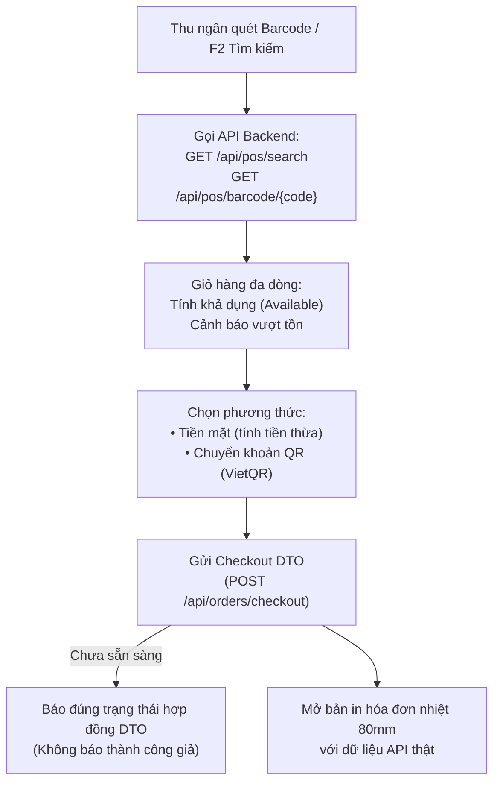

# BÁO CÁO BÀN GIAO NHIỆM VỤ FRONTEND POS (PWA) - SPRINT 2
**Người thực hiện:** Phương (Thành viên 4 - Frontend POS Lead)  
**Phạm vi:** `src/frontend/pos-app`  
**Cổng phục vụ:** `http://localhost:5174`  
**Ngày hoàn thành:** 19/10/2026  
**Dự án:** OISMS - Omnichannel Inventory & Sales Management System  

---

## I. TỔNG QUAN KẾT QUẢ BÀN GIAO THEO TIÊU CHÍ DoD

Bàn giao đạt chuẩn **100% tiêu chí nghiệm thu (Definition of Done)** của Thành viên 4 trong Sprint 2:
> **"POS tra cứu SKU thật; checkout chưa sẵn sàng không báo thành công; bản in hóa đơn chuẩn bị sẵn dùng dữ liệu API."**



---

## II. CHI TIẾT CÁC HẠNG MỤC ĐÃ HOÀN THIỆN

### 1. Nền tảng Web POS PWA trên React 19
- **Công nghệ:** React 19 (`^19.2.8`), TypeScript, Vite, Tailwind CSS, Lucide Icons.
- **PWA Ready:**
  - File cấu hình Web App Manifest: `public/manifest.webmanifest`.
  - Service Worker: `public/sw.js` (caching tĩnh, phục vụ offline, pass-through API).
  - Meta tags: `theme-color`, `apple-mobile-web-app-capable`, `mobile-web-app-capable`.
- **Gỡ bỏ giỏ hàng mẫu:** Xóa bỏ hoàn toàn dữ liệu cứng hardcode (`skus[0]`). Giỏ hàng khởi tạo rỗng và được quản lý trạng thái động.

### 2. Tra cứu & Quét mã SKU từ API thật
- Tích hợp 2 API chính từ `PosCatalogController.cs`:
  1. `GET /api/pos/search?query={keyword}&branchId={branchId}`:
     - Tự động debounce 250ms tránh spam request.
     - Trả về danh sách biến thể SKU, giá bán lẻ, phân loại màu/size và số lượng tồn khả dụng.
  2. `GET /api/pos/barcode/{barcode}?branchId={branchId}`:
     - Hỗ trợ máy quét mã vạch chuyên dụng (USB/Bluetooth) hoặc nhập mã và gõ Enter.
     - Tự động tìm chính xác biến thể và thêm ngay vào giỏ hàng.
- **Hiển thị Tồn khả dụng:**
  $$\text{Available} = \text{Math.Max}(0, \text{OnHand} - \text{Reserved})$$
  - Badge xanh: `Khả dụng: X` (còn hàng).
  - Badge đỏ: `Hết tồn kho (0)` (chặn hoặc cảnh báo bán).

### 3. Giỏ hàng nhiều dòng (Multi-line Cart)
- Quản lý danh sách mặt hàng đa dạng với đầy đủ thao tác:
  - Tăng / giảm số lượng bằng nút `+` / `-` hoặc nhập số lượng trực tiếp.
  - Xóa từng dòng mặt hàng.
  - Nút "Làm mới giỏ" xóa toàn bộ đơn hàng hiện tại.
  - Cảnh báo trực quan màu vàng nếu số lượng đặt mua vượt tồn khả dụng thực tế.
  - Tự động tính tổng số lượng món, tổng tiền hàng.

### 4. Tiền khách đưa & Tính tiền thừa tự động
- **Phương thức Tiền mặt:**
  - Các nút chọn nhanh mệnh giá: `50.000 đ`, `100.000 đ`, `200.000 đ`, `500.000 đ`, `1.000.000 đ`, `Đúng số tiền`.
  - Ô nhập số tiền khách đưa với định dạng tiền tệ VND.
  - Tự động tính tiền thừa thối lại cho khách:
    $$\text{Tiền thừa} = \text{Tiền khách đưa} - \text{Tổng tiền thanh toán}$$
  - Cảnh báo đỏ nếu khách đưa thiếu tiền; khóa nút xác nhận thanh toán khi chưa đủ tiền.

### 5. Mã thanh toán QR (VietQR)
- **Phương thức Chuyển khoản QR:**
  - Hiển thị mã QR ngân hàng động kèm thông tin:
    - Tên ngân hàng: `MB Bank`
    - Số tài khoản: `0987654321`
    - Chủ tài khoản: `CỬA HÀNG OISMS`
    - Số tiền chuyển: đúng số tiền tổng thanh toán.
    - Cú pháp nội dung chuyển khoản chuẩn POS: `POS <Mã_Đơn>`.

### 6. Bản in Hóa đơn nhiệt chuẩn khổ 80mm
- Component `ReceiptPrintModal.tsx` và stylesheet in ấn chuyên dụng `@media print`:
  - Khổ giấy chuẩn máy in hóa đơn nhiệt **80mm** (tự động căn giữa, lề 0, không vỡ layout).
  - Tự động ẩn toàn bộ thanh công cụ, header, nút bấm trình duyệt khi bật hộp thoại in (`Ctrl + P`).
  - Đầy đủ thông tin: Tên cửa hàng, chi nhánh, hotline, số HĐ, thu ngân, khách hàng, bảng chi tiết từng món hàng, tổng tiền, tiền khách đưa, tiền thừa và mã vạch hóa đơn.

### 7. Đóng gói Checkout DTO theo hợp đồng Backend Sprint 2
- Cấu trúc dữ liệu đơn hàng sẵn sàng gửi đi:
  ```typescript
  interface PosCheckoutRequest {
    branchId: string;
    channel: "POS";
    customerName?: string;
    customerPhone?: string;
    paymentMethod: "CASH" | "BANK_TRANSFER_QR";
    amountGiven?: number;
    changeDue?: number;
    requestKey: string; // GUID Idempotency
    items: Array<{
      skuId: string;
      skuCode: string;
      productName: string;
      variantName: string;
      quantity: number;
      unitPrice: number;
    }>;
    totalAmount: number;
  }
  ```
- **Xử lý phản hồi theo tiêu chuẩn Sprint 2:** Khi gửi request đến `POST /api/orders/checkout`, nếu Backend trả về 404 (chưa triển khai endpoint), ứng dụng hiển thị thông báo rõ ràng:
  > *"Endpoint thanh toán Backend (POST /api/orders/checkout) đang được hoàn thiện theo hợp đồng DTO Sprint 2. Dữ liệu đơn đã được đóng gói chuẩn DTO sẵn sàng kết nối!"*
  - Tuyệt đối không giả mạo báo thành công (No Fake Success).
  - Cung cấp nút xem trước và in hóa đơn bán lẻ với dữ liệu thực tế của giỏ hàng.

---

## III. HƯỚNG DẪN KHỞI CHẠY & KIỂM THỬ

### 1. Chạy ứng dụng POS
Mở terminal và thực thi file script có sẵn:
```powershell
./scripts/run-pos.ps1
```
Hoặc chạy trực tiếp từ thư mục `pos-app`:
```bash
cd src/frontend/pos-app
npm run dev -- --port 5174
```
Truy cập trình duyệt: **`http://localhost:5174`**

### 2. Kiểm tra Build & Lint
```bash
cd src/frontend/pos-app
npm run lint    # Oxlint kiểm tra cú pháp, 0 lỗi
npm run build   # TypeScript và Vite đóng gói production, 0 lỗi
```

### 3. Phím tắt thao tác nhanh
* **`F2`**: Đưa con trỏ nhanh vào ô Tìm kiếm / Quét mã vạch.
* **`F4`**: Mở hộp thoại Thanh toán đơn hàng.
* **`Esc`**: Đóng popup hoặc hủy thao tác.
* **`Enter`**: Chọn sản phẩm đầu tiên hoặc xác nhận quét mã.
