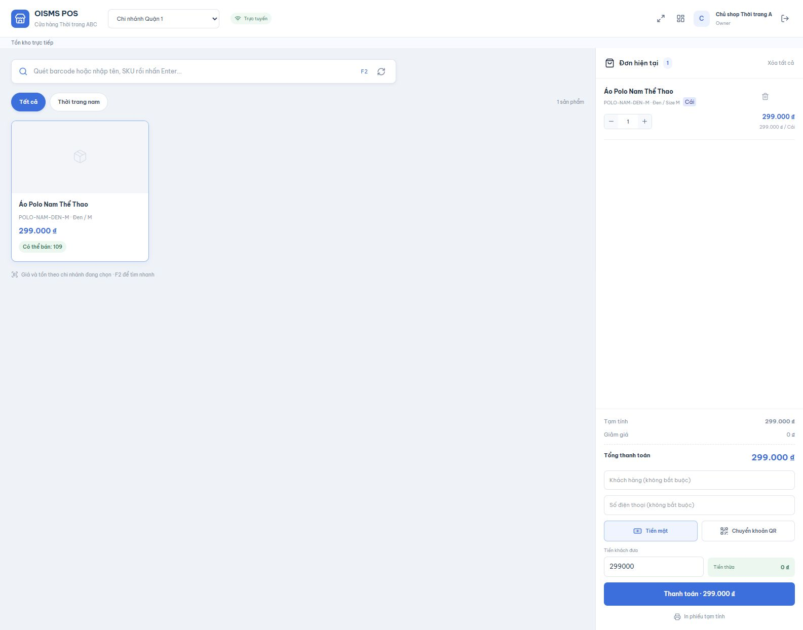

# Nội dung cập nhật để dán vào trang chính OISMS

Ngày 08/11/2026. Thay mục 3.5.1 bằng nội dung dưới đây. Ảnh `3.5.1-pos-current.png` đã được đính kèm trên trang chính Confluence; chèn ảnh này thay ảnh POS cũ. Không tạo thêm trang con.

### 3.5.1. Bán hàng tại Quầy POS

**Sự kiện kích hoạt:** Người dùng mở ứng dụng POS tại `http://localhost:5174/`. Nút POS và đường dẫn `/pos` trong Admin chuyển sang ứng dụng này. Nếu chưa có phiên POS, người dùng đăng nhập bằng tài khoản Owner, Staff hoặc Cashier.

**Tác nhân:** Owner, Staff, Cashier.

**Mục đích:** Tìm hoặc quét hàng, lập giỏ và thanh toán bán lẻ theo chi nhánh; backend kiểm tra giá, quy cách và tồn khả dụng trước khi hoàn tất giao dịch.

**Luồng xử lý:**

1. Đăng nhập POS và chọn chi nhánh bán hàng.
2. Tìm theo tên, SKU hoặc barcode; chọn đơn vị bán và số lượng để thêm vào giỏ.
3. Kiểm tra số lượng, giá, tổng tiền và tồn khả dụng. Tồn kho được cập nhật qua SignalR; sau khi kết nối lại, POS tải lại tồn từ server.
4. Chọn tiền mặt hoặc chuyển khoản QR. Tiền mặt kiểm tra tiền khách đưa và tính tiền thừa; QR yêu cầu thu ngân kiểm tra tiền vào rồi xác nhận thủ công.
5. Gửi checkout. Khi thành công, hiển thị hóa đơn từ dữ liệu server và chọn khổ giấy 58 mm hoặc 80 mm để in.

**Quy tắc nghiệp vụ và giới hạn hiện tại:**

- Chỉ có một giao diện POS hiện hành trong `src/frontend/pos-app`; Admin tại cổng 5173 phục vụ quản trị và mở POS. Giao diện POS tím cũ đã được loại bỏ.
- Phiên đăng nhập Admin và POS độc lập. Trang đăng nhập Admin có nút "Bạn là thu ngân? Đăng nhập tại quầy POS" để thu ngân đăng nhập thẳng tại POS. Cashier vẫn đăng nhập qua Admin thì phiên Admin được thu hồi, rồi được chuyển sang màn đăng nhập POS kèm dòng nhắc dùng nút này ở lần sau.
- Thêm hàng vào giỏ chưa xuất kho. Checkout thành công tạo một đơn Completed, payment, invoice và bút toán OUT trong cùng giao dịch; backend chụp giá, giá vốn và hệ số quy đổi của đơn vị bán.
- Khi tồn giảm dưới lượng đang có trong giỏ, POS cảnh báo và giữ giỏ để thu ngân điều chỉnh. Backend kiểm tra tồn lần cuối khi checkout.
- Khi mất phản hồi checkout, gửi lại phải giữ nguyên RequestKey và snapshot của lần gửi đó để tránh tạo trùng đơn, thanh toán, hóa đơn hoặc bút toán kho.
- Đổi chi nhánh hoặc phiên đăng nhập sẽ ngừng nhận sự kiện thuộc phạm vi trước đó.
- PWA lưu tài nguyên giao diện để mở lại khi mất mạng; checkout vẫn cần kết nối backend.
- Ảnh bên dưới dùng giỏ minh họa và chưa gửi checkout. Chưa kiểm thử in trên máy in vật lý hoặc xác nhận chuyển khoản bằng webhook ngân hàng.

*Hình 3.5.1. POS hiện tại tại cổng 5174; giỏ minh họa chưa gửi checkout.*

---

Các chỗ liên quan cần sửa trên trang chính:

- Mục **3.2, đăng nhập/phân quyền**: bổ sung “Admin và POS dùng phiên riêng. Owner/Staff quản trị tại cổng 5173; Owner/Staff/Cashier bán hàng tại cổng 5174. Cashier không giữ phiên quản trị khi được chuyển từ Admin sang POS; trang đăng nhập Admin có nút dành cho thu ngân mở thẳng màn đăng nhập POS.”
- Mục **3.5.6, thanh toán VietQR**: đổi “hai POS” thành “ứng dụng POS hiện tại”; đổi chú thích ảnh “POS Admin” thành “POS hiện tại tại cổng 5174”. Luồng xác nhận tiền vào vẫn do thu ngân thực hiện thủ công.
- Xóa hình và chú thích **3.5.1c Modal thanh toán tiền mặt của POS PWA tím cũ** nếu còn trong trang.

Nguồn kiểm chứng: [báo cáo tách POS](./tach-pos-khoi-admin-2026-11-08.md).
